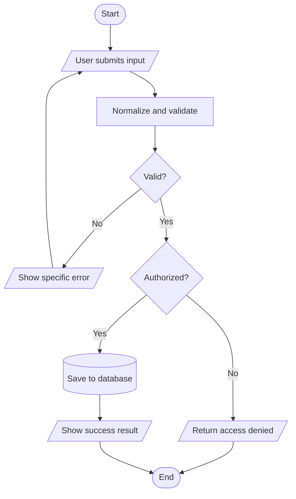

# Flowchart Standard

Flowcharts must be understandable without reading the source code and must use actual flowchart semantics.

## Required shapes

| Meaning | Shape | Mermaid form |
|---|---|---|
| Start or end | Terminator / rounded | `([Start])` |
| Input or output | Parallelogram | `[/Enter credentials/]` |
| Processing step | Rectangle | `[Validate request]` |
| Decision | Diamond | `{Valid?}` |
| Database or persistent store | Cylinder | `[(Database)]` |
| Subprocess | Double-edged process when supported; otherwise labeled rectangle | `[Subprocess: Send email]` |

Use labeled decision branches such as `Yes`, `No`, `Authorized`, and `Rejected`. Loops must visibly return to an earlier step. Show validation failures and alternate/error exits instead of drawing only the happy path.

## Diagram selection by mode

- **Standard:** Create 3-5 diagrams: overall flow, the main business transaction, and the riskiest authentication/authorization/validation flow. Add another only when it explains a materially different process.
- **Deep:** Cover overall flow, authentication/session, main business transaction, riskiest validation/error flow, and approval/role flow when applicable.
- **Focused:** Create only diagrams needed for the requested area.

Omit diagrams that are genuinely not applicable and explain why.

## Source and rendered output

- Save editable Mermaid source as `.mmd`.
- Also produce a rendered `.svg` with visible standard shapes; embedding only a code block is not enough.
- Reuse an available renderer such as Mermaid CLI or Graphviz. Do not add a dependency to the submitted system just to render diagrams.
- If no renderer is available, create a valid standalone SVG directly, preserving the same shape meanings.
- Embed each SVG in the consolidated PDF and add a short plain-language explanation below it. A separate link is supporting evidence, not the user-facing deliverable.
- Keep node text concise. Put exact source references in the explanation or a mapping table rather than overcrowding the diagram.

## Baseline example

## Accuracy check

Before delivery, trace every arrow against the implementation or label it as an assumed intended flow. Never combine intended and actual behavior in one diagram without visually distinguishing them.
