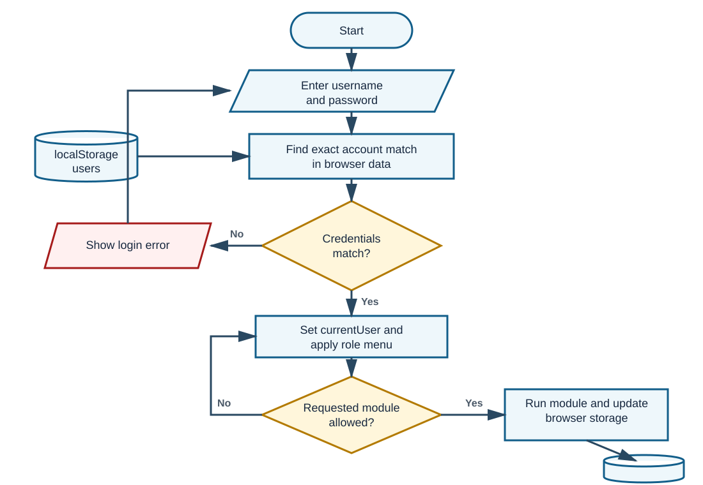
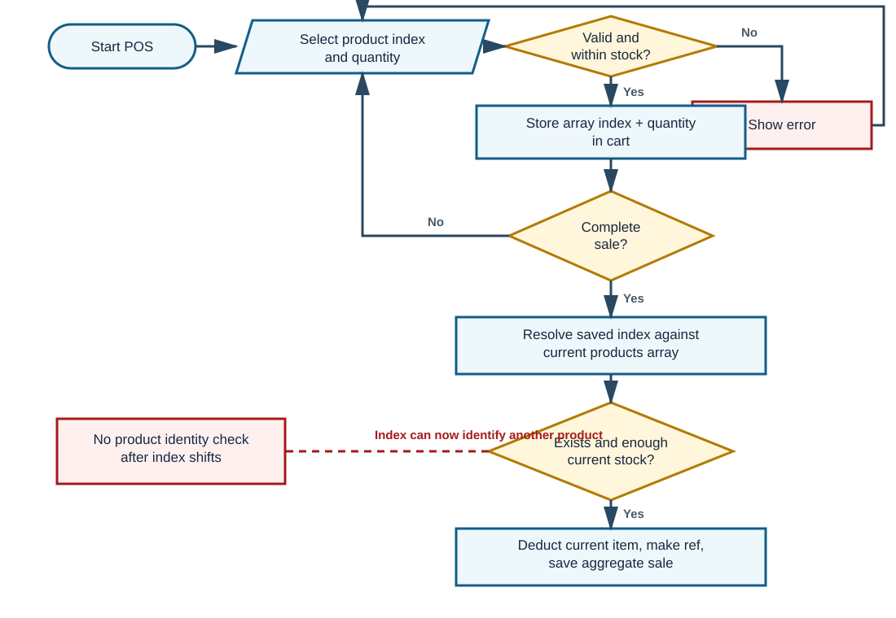
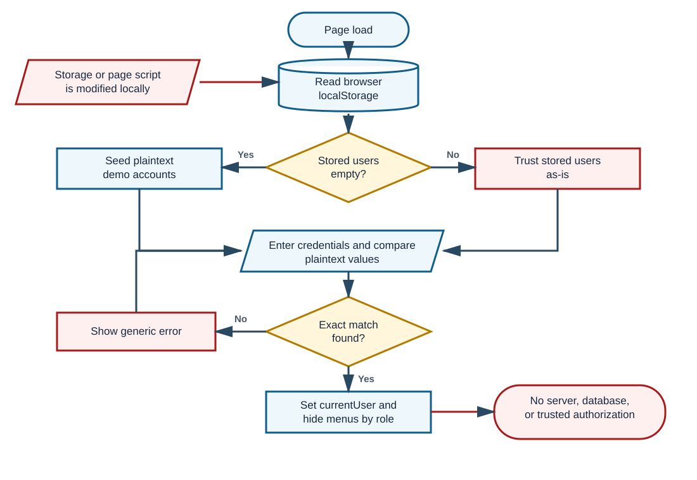

# Ariale Threads Warehouse and POS - Mock Defense Analysis

# 1. One-Page Panel Brief

**Review date:** September 29, 2026  
**Mode:** Standard, system-only | **Submitted system:** `F:\Arialethreads.html`  
**Evidence boundary:** No capstone paper or formal requirements document was supplied. Intended behavior below is reconstructed from UI labels and source code and is explicitly treated as an assumption.

## System at readiness verdict

Ang Ariale Threads ay single-file warehouse inventory/POS prototype na may Admin, Manager, Inventory Staff, Cashier, at Staff roles. **Prototype-ready, pero hindi operationally ready.** Gumagana ang login, role menu, inventory, cart, stock deduction, at totals, ngunit nasa editable browser `localStorage` ang passwords at lahat ng records. Confirmed din na puwedeng ibang product ang ma-charge kapag binura ang cart product bago checkout.

## Top strengths

- Malinaw ang role matrix at may `canAccess()` checks sa main inventory/POS actions.
- Nirerecheck ng `completeSale()` ang current stock bago mag-deduct.
- May duplicate-username at last-Admin safeguards; self-contained at offline ang demo.

## Top five risks

| Priority | Risk | Status | Practical effect |
|---|---|---|---|
| High | Client-only accounts, passwords, roles, and data | Confirmed - isolated harness | Local storage edit can create an Admin and change business records. |
| High | Cart uses mutable product array indexes | Confirmed - isolated harness | After deletion, a cart line can charge and deduct a different product. |
| High | Stored HTML injection through `innerHTML` | Code-evidenced; UI execution blocked | A product/user value can become active page markup or script. |
| Medium | Sale saves totals but not product lines or cashier | Confirmed - isolated harness | Top Products remains zero and transactions cannot be audited item-by-item. |
| Medium | Product validation accepts blanks and duplicate SKUs | Confirmed - isolated harness | Zero-value/zero-stock records and ambiguous product identities are accepted. |

## QA snapshot

13 targeted checks: **4 controls behaved as declared, 8 defect/risk paths reproduced, 1 full-browser check blocked**. Browser UI execution was not bypassed because the available browser disallows local `file:` pages. The exact inspected inline script was executed in a Node standard-library VM with a minimal DOM/localStorage harness.

# 2. System Explained Simply and Essential Flows

## Actors, modules, and data movement

| Actor | Intended access reconstructed from code | Main actions |
|---|---|---|
| Admin | Dashboard, Inventory, POS, Reports, Accounts | Full local prototype control and account maintenance |
| Manager | Dashboard, Inventory, POS, Reports | Maintain products, sell, inspect summaries |
| Inventory Staff | Dashboard, Inventory | Add, edit, search, and remove stock records |
| Cashier | Dashboard, POS | Build and complete an order |
| Staff | Dashboard | View local summary only |

The browser loads three arrays from `localStorage`: `products`, `sales`, and `users` (`Arialethreads.html:1135-1137`). If users or products are empty, demo records are seeded (`1161-1200`). Login searches for an exact username/password pair (`1203-1208`). Inventory and sales functions mutate the arrays and save the full JSON back to the same browser (`1152-1159`). There is no API, server validation, relational database, or central multi-device record.

## Flowchart 1 - Overall actual flow



**Meaning:** Login, permissions, modules, and persistence all run in one browser. The role check is useful for interface flow, but it is not a trusted security boundary because the same client owns the accounts and data.

## Flowchart 2 - POS transaction and index-drift loophole



**Meaning:** The cart stores only a product array index (`1364-1376`). At completion, that index is resolved again against the current array (`1408-1421`). If product deletion shifts the array, the same index can point to a different item; no SKU or immutable ID is checked.

## Flowchart 3 - Authentication and authorization boundary



**Meaning:** Both the credentials and the authorization decision come from editable browser state. This is acceptable only as a classroom/demo prototype, not as protection for real transactions.

## Critical use-case correctness

| Use case | Precondition | Main outcome | Alternative/exception | Verdict |
|---|---|---|---|---|
| Login | Stored user exists | `currentUser` set; role menu applied | Generic error on no exact match | Partial: works, but passwords and authority are client-controlled |
| Maintain inventory | Role allows Inventory | Product array saved to browser | Negative numbers rejected | Partial: blank numerics and duplicate SKU accepted |
| Complete sale | Role allows POS; nonempty cart | Current stock deducted; aggregate sale saved | Stock-change alert if index missing or quantity too high | Incorrect edge path: array index can identify another product |
| View reports | Local sales/products exist | Totals and history rendered | Empty states shown | Partial: no filtering/detail; Top Products lacks input data |
| Manage accounts | Admin role | Add/edit/delete local account | Duplicate username and last-admin safeguards | Partial: plaintext/weak passwords; local role tampering remains possible |

# 3. Top Findings and Recommended Improvements

## F-01 - Browser data is treated as the security authority

**Severity:** High | **Confidence:** High | **Evidence:** Confirmed in isolated harness  
**Problema:** Plaintext users, passwords, roles, inventory, and sales are all stored and trusted locally.  
**Saan:** `1135-1159`, `1161-1179`, `1203-1238`.  
**Paano mabubutas:** Put an Admin object into `arialeThreadsUsers`, reload the script, then log in with that record. The harness authenticated the injected Admin.  
**Expected vs actual:** Expected trusted authentication and authorization; actual authority comes from editable browser JSON.  
**Effect:** Anyone with local page/storage access can change identity and business data.  
**Ayusin:** Move authentication, authorization, and canonical records to a server-backed database; store only a short session token client-side. Verify with a non-Admin attempt to call every protected endpoint.  
**Panel question:** Ano ang trusted source of truth kapag binago ng user ang `localStorage`?

## F-02 - User values are written as HTML

**Severity:** High | **Confidence:** High | **Evidence:** Code-evidenced; raw insertion reproduced, browser execution not tested  
**Problema:** Product and account values are concatenated into `innerHTML`.  
**Saan:** `1294-1295`, `1344-1346`, `1386-1387`, `1465-1466`, `1539-1543`, `1561-1562`.  
**Paano mabubutas:** Save a product name containing HTML such as an image element with an error handler; the exact markup appears in the generated table row.  
**Expected vs actual:** Expected text-only display; actual values are parsed as page markup in a real browser.  
**Effect:** Stored cross-site scripting can alter the interface and local records.  
**Ayusin:** Render untrusted values with `textContent`/DOM nodes and validate input at the trusted server boundary. Verify that HTML payloads display literally and never execute.  
**Panel question:** Bakit unsafe ang `innerHTML` kahit local-only ang prototype?

## F-03 - Product deletion can silently change a cart item

**Severity:** High | **Confidence:** High | **Evidence:** Confirmed in isolated harness  
**Problema:** Cart rows save array indexes, not stable product IDs.  
**Saan:** `1364-1376`, `1408-1421`; deletion uses `products.splice(i,1)` at `1318-1326`.  
**Paano mabubutas:** Add product A at index 0, delete A from Inventory, then complete the existing cart. Product B shifts to index 0 and is sold instead.  
**Expected vs actual:** Expected sale of A or a clear invalid-cart error; actual sale charged B at PHP 100 and reduced B stock in the harness.  
**Effect:** Wrong charge, wrong stock, and unreliable transaction history.  
**Ayusin:** Give each product an immutable ID/SKU reference in the cart, block deletion when referenced, and revalidate identity plus stock in one atomic sale operation.  
**Panel question:** What invariant connects a cart line to the same product at checkout?

## F-04 - Required numeric fields and product identity are incomplete

**Severity:** Medium | **Confidence:** High | **Evidence:** Confirmed in isolated harness  
**Problema:** `Number('')` becomes `0`, and the validation checks only negative values. SKU uniqueness and color are not required.  
**Saan:** `1270-1281`; UI hints at required product information in `1105-1106`.  
**Paano mabubutas:** Enter SKU and name only; leave price, stock, minimum, and color blank. Then add another record with the same SKU.  
**Expected vs actual:** Expected rejection; actual first record saved with zero numeric values, and two `DUP-1` records were accepted.  
**Effect:** Ambiguous inventory and misleading valuation/status.  
**Ayusin:** Validate presence before conversion, require finite values, enforce SKU uniqueness in the database, and define whether color is required.  
**Panel question:** Aling rules ang UI-only, at alin ang database-enforced?

## F-05 - Sales are not auditable and Top Products cannot work

**Severity:** Medium | **Confidence:** High | **Evidence:** Confirmed in isolated harness  
**Problema:** A sale stores only date, reference, item count, and total, while the dashboard expects `productLines`.  
**Saan:** Sale write `1435-1437`; Top Products read `1516-1537`.  
**Paano mabubutas:** Complete a two-unit sale and refresh Dashboard.  
**Expected vs actual:** Expected sold quantity for the sold product; actual sale object had no product lines and the dashboard row stayed at 0.  
**Effect:** No item-level audit, cashier trace, price snapshot, refund basis, or reliable best-seller report.  
**Ayusin:** Save immutable transaction headers and line items with product ID, description snapshot, unit price, quantity, cashier, timestamp, payment/tender, and status.  
**Panel question:** Paano mapapatunayan kung anong exact items ang bumuo sa isang reference number?

## F-06 - Deleting all stock causes demo inventory to return

**Severity:** Medium | **Confidence:** High | **Evidence:** Confirmed in isolated harness  
**Problema:** Empty inventory is interpreted as first-time setup.  
**Saan:** `1182-1201`.  
**Paano mabubutas:** Remove all products, then reload so `seedProducts()` runs.  
**Expected vs actual:** Expected valid empty inventory; actual five demo products reappeared.  
**Effect:** Phantom stock and corrupted operational state.  
**Ayusin:** Use an explicit first-run/setup flag and separate demo-data loading from normal startup.  
**Panel question:** How does the system distinguish never initialized from intentionally empty?

## F-07 - No atomic multi-user transaction or recovery process

**Severity:** Medium | **Confidence:** High | **Evidence:** Code-evidenced; concurrent browser test not available  
**Problema:** Product and sales writes are separate `localStorage.setItem()` calls, with no lock, rollback, or central conflict check (`1439-1440`).  
**Paano mabubutas:** Two independent browser contexts can read the same stock, then each complete a sale against its own local copy.  
**Expected vs actual:** Expected one canonical stock balance and all-or-nothing transaction; actual design is isolated per browser/device.  
**Effect:** Divergent stock and reports, plus no safe recovery after a partial failure.  
**Ayusin:** Commit stock deduction and sale lines in one database transaction with concurrency control, backups, reconciliation, void/refund workflow, and audit log.  
**Panel question:** What happens if two cashiers sell the last unit at the same time?

## F-08 - Sales chart is decorative, not data-driven

**Severity:** Medium | **Confidence:** High | **Evidence:** Code-evidenced  
**Problema:** The line/area chart has hardcoded SVG points (`1093`), while `updateDashboard()` updates only the total legend and never recalculates the chart (`1471-1546`).  
**Effect:** A zero-sales store and a high-sales store show the same trend shape.  
**Ayusin:** Aggregate sales by a declared time period and render points from those values; show an honest empty state when no data exists.  
**Panel question:** Which function converts dated sales into the chart points?

## F-09 - Edit success messages are computed after edit state is cleared

**Severity:** Low | **Confidence:** High | **Evidence:** Confirmed in isolated harness  
**Problema:** `clearForm()` resets `editIndex` before the success message is selected (`1280-1287`). The same order occurs for accounts (`1584-1589`, `1620-1626`).  
**Expected vs actual:** Expected "Product updated"; actual harness displayed "Product added."  
**Effect:** Misleading operator feedback and weak confidence during defense.  
**Ayusin:** Capture whether the action is add/edit before clearing state, then show the correct message.  
**Panel question:** Why does the current ternary always see add mode after a successful save?

## Recommended system improvements

| Priority | Current condition | Add or change | Intended process and benefit | Success indicator |
|---|---|---|---|---|
| Critical | Browser is the authority | Server authentication, authorization, and canonical database | Every protected action is checked by role on the server; prevents local bypass | Storage edits cannot grant access or alter canonical records |
| High | Cart points to array position | Immutable product IDs and atomic checkout | Cart resolves the same product identity; stock and sale commit together | Deletion/edit race cannot change the sold item |
| High | Aggregate-only sales | Transaction header + line items + cashier + tender + status | Supports receipts, reconciliation, void/refund, and real product analytics | Reference reconstructs every item and stock movement |
| High | Unsafe display pipeline | Safe text rendering plus boundary validation | Inputs display as text; server validates values and uniqueness | HTML payload is inert and duplicate SKU is rejected |
| Medium | Demo data mixed with operations | First-run setup and explicit demo mode | Empty inventory stays empty unless Admin deliberately imports demo data | Reload never creates phantom stock |
| Medium | No operational controls | Audit log, backups, reconciliation, and role review | Manager can trace who changed stock/sales and recover correctly | Sample restore and daily reconciliation pass |
| Medium | Static reports | Date filters, data-derived trends, export, and variance indicators | Reports answer a declared period and match transactions | Chart values reconcile to transaction totals |
| Later | Basic inputs and feedback | Accessible labels, clear required rules, actionable errors | Faster, less error-prone use for staff | Keyboard flow, labels, and error-state review pass |

# 4. Validation, Process Correctness, and Important JavaScript

## Boundary validation matrix

| Boundary | Present control | Missing/weak control | Verdict |
|---|---|---|---|
| Client input | Number inputs have `min`; code rejects negative values | Presence checked after conversion; no finite check; duplicate SKU allowed; weak password accepted | Partial |
| Authentication | Exact username/password match; generic failure message | Plaintext credentials, hardcoded defaults, no lockout/session timeout, local authority | Incorrect for production |
| Authorization | Menu hiding plus `canAccess()` on main actions | No trusted server enforcement; data/functions remain local and mutable | Prototype-only |
| Server/API | None | No request validation, rate limiting, central identity, or business-rule enforcement | Not implemented |
| Database/business rules | Duplicate username and last-admin checks in JS | No constraints, transactions, immutable IDs, audit history, or concurrency control | Not implemented |
| Output rendering | None for saved text | Repeated `innerHTML` interpolation | Unsafe |
| Recovery | None | No backup, restore, void/refund, rollback, or reconciliation | Not implemented |

## Process correctness summary

- **Correct within prototype:** seeded account can log in; wrong password is rejected; Staff is denied Inventory by `canAccess`; normal sale deducts stock and adds one aggregate sales record; duplicate usernames and last-Admin deletion are blocked.
- **Partial:** inventory maintenance, account management, reporting, and roles work only inside one browser and rely on editable state.
- **Incorrect:** cart identity after product deletion, Top Products calculation, empty-inventory persistence, and edit-success messages.
- **Not testable here:** full visual browser behavior, actual HTML-handler execution, accessibility interaction, multi-tab concurrency, printing/receipts, and external backup/restore because no such backend/process exists.

## Important JavaScript functions

| Function/responsibility | Input and side effect | How the system applies it | User-visible effect |
|---|---|---|---|
| `seedUsers()` / `seedProducts()` (`1161-1201`) | Checks array length and writes defaults | Initializes the demo on load | Immediate sample accounts/products; also causes phantom reseeding |
| `login()` (`1203-1220`) | Reads login fields; searches local users | Sets `currentUser`, opens system, applies role UI | Login success or generic error |
| `applyPermissions()` / `canAccess()` / `showPage()` (`1230-1264`) | Uses role-to-page map | Hides nav and blocks page routing | Different modules per role |
| `saveProduct()` (`1270-1288`) | Reads form, converts numerics, pushes/replaces product | Persists inventory and refreshes dependent views | Product appears/updates, but validation gaps remain |
| `addToCart()` (`1356-1381`) | Stores product index and quantity | Combines repeated selections and checks current stock | Cart line and totals update |
| `completeSale()` (`1400-1447`) | Rechecks indexed items, deducts stock, saves aggregate sale | Core POS transaction | Stock drops and reference appears |
| `updateReports()` / `updateDashboard()` (`1448-1557`) | Aggregates local arrays and writes HTML/SVG labels | Supplies totals, tables, status, and product ranking | Summary views; ranking and trend are unreliable |
| `saveUser()` / `deleteUser()` (`1566-1618`) | Adds/replaces/removes local users | Admin account management | Duplicate username and last-admin safeguards, but plaintext passwords |

# 5. Vibe-Coding Risk Indicators

These are implementation-risk signals only. They are **not proof of AI authorship**.

## V-01 - Writer and reader disagree on the sale shape

**Location:** `Arialethreads.html:1435-1437`, `1516-1520`  
**Responsibility:** `completeSale()` writes sales; `updateDashboard()` calculates Top Products.  

```js
sales.push({
    date:new Date().toISOString(),reference:ref,items:items,total:total
})
// Later:
if(s.productLines)s.productLines.forEach(function(x) {
    soldMap[x.name]=(soldMap[x.name]||0)+x.qty
})
```

**What it does:** The writer never creates `productLines`, but the reader requires it.  
**Why it is a signal:** Two connected features were implemented against incompatible data contracts without an end-to-end check.  
**System effect:** Every current sale contributes zero to Top Products.  
**Confidence:** High.

## V-02 - Cart identity is only a mutable array position

**Location:** `1364-1376`, `1408-1421`  
**Responsibility:** `addToCart()` and `completeSale()`.  

```js
else cart.push({ index:index,quantity:qty });
// Later:
var p=products[cart[i].index];
...
products[item.index].stock-=item.quantity
```

**What it does:** Saves an index, then resolves it after the products array may have changed.  
**Why it is a signal:** The happy path was checked, but identity stability across inventory mutation was not.  
**System effect:** A different product can be charged and deducted.  
**Confidence:** High.

## V-03 - Validation converts blank before testing blank

**Location:** `1272-1278`  
**Responsibility:** Product form parsing and validation.  

```js
price:Number(document.getElementById('price').value),
stock:Number(document.getElementById('stock').value),
minimum:Number(document.getElementById('minimum').value)
...
if(!data.sku||!data.name||data.price<0||data.stock<0||data.minimum<0)
```

**What it does:** Blank strings become zero before the only numeric validation.  
**Why it is a signal:** The error says to complete product information, but the implementation tests negativity rather than completeness.  
**System effect:** Incomplete products are saved as zero-value/zero-stock records.  
**Confidence:** High.

## V-04 - Edit state is cleared before feedback is chosen

**Location:** `1280-1287`  
**Responsibility:** Save completion and toast feedback.  

```js
if(editIndex===-1)products.push(data);
else products[editIndex]=data;
saveProducts();
clearForm();
...
toast(editIndex===-1?'Product added.':'Product updated.')
```

**What it does:** `clearForm()` sets `editIndex=-1`, so the toast always chooses "added."  
**Why it is a signal:** State-reset order was not verified for the edit branch; the same pattern appears in account save.  
**System effect:** Operators receive incorrect success feedback.  
**Confidence:** High.

## V-05 - User data is repeatedly concatenated into HTML

**Location:** Representative example `1294-1295`; same pattern at `1346`, `1387`, `1466`, `1543`, `1562`  
**Responsibility:** Table/card rendering.  

```js
var row=tbody.insertRow();
row.innerHTML='<td>'+p.sku+'</td><td><b>'+p.name+'</b></td>...'
```

**What it does:** Parses saved values as markup.  
**Why it is a signal:** A quick rendering shortcut was copied across modules without a trust-boundary review.  
**System effect:** Stored markup can change or script the page.  
**Confidence:** High.

# 6. QA Summary and Five Strongest Panel Questions

## High-value QA cases

| ID | Test | Expected | Actual/status | Evidence |
|---|---|---|---|---|
| QA-01 | Login `admin` / seeded password | Admin session | Passed | RT-01 |
| QA-02 | Wrong admin password | Reject with generic error | Passed | RT-02 |
| QA-03 | Staff asks for Inventory | Denied | Passed | RT-03 |
| QA-04 | Product with blank price/stock/minimum | Reject | Failed: saved all as 0 | RT-04 |
| QA-05 | Add two products with same SKU | Reject duplicate | Failed: both saved | RT-05 |
| QA-06 | Normal two-unit POS sale | Deduct 2 and record sale | Passed | RT-06 |
| QA-07 | Add A, delete A, then complete cart | Reject stale cart | Failed: B sold instead | RT-07 |
| QA-08 | View Top Products after a sale | Sold item shows quantity 2 | Failed: shows 0 | RT-08 |
| QA-09 | Empty inventory then reload/init | Remain empty | Failed: five demo products return | RT-09 |
| QA-10 | Inject Admin in local storage | Reject untrusted identity | Failed: login succeeds | RT-10 |
| QA-11 | Edit a product | Show "updated" | Failed: shows "added" | RT-11 |
| QA-12 | Create account with password `x` | Reject weak password | Failed: account created | RT-12 |
| QA-13 | Product name contains active HTML | Display literal text, no execution | Blocked full browser; raw markup insertion reproduced | RT-13 + code |

## Q1 - How do you guarantee the cart still refers to the same product?

**Why ask:** It targets the confirmed wrong-item sale defect.  
**Strong answer:** Use immutable product IDs in cart lines; re-read and validate the same ID at checkout; block or version conflicting product deletion; commit stock and sale atomically.  
**Follow-up:** Show the exact check that would fail after product A is deleted.  
**Red flags:** "The index should stay the same" or reliance only on the dropdown.

## Q2 - Where is authentication and authorization enforced?

**Why ask:** The prototype trusts local browser state.  
**Strong answer:** Admit the present prototype limitation, then describe server-side identity, hashed passwords, sessions, and endpoint-level role checks.  
**Follow-up:** If `localStorage` says the user is Admin, what trusted component rejects that claim?  
**Red flags:** Treating hidden buttons as security or saying users cannot open developer tools.

## Q3 - What is the complete schema of a sale?

**Why ask:** The current transaction cannot reconstruct sold products or support Top Products.  
**Strong answer:** Header plus line items: immutable reference, timestamp, cashier, status, tender, product ID, description/price snapshot, quantity, totals, and stock movement links.  
**Follow-up:** Which current field supplies `productLines` to `updateDashboard()`?  
**Red flags:** Using only total and item count, or claiming the current dashboard already derives product sales.

## Q4 - Which business rules are enforced at each boundary?

**Why ask:** The UI has some checks, but no server/database constraints.  
**Strong answer:** Define client usability checks, server validation, database uniqueness/check constraints, authorization, output encoding, and transaction rules.  
**Follow-up:** Why does a blank numeric field pass, and where should duplicate SKU be rejected?  
**Red flags:** "HTML `min` is enough" or only repeating the current JavaScript condition.

## Q5 - How will two cashiers and recovery be handled?

**Why ask:** `localStorage` creates separate, non-atomic copies per browser/device.  
**Strong answer:** Central database, transaction/isolation strategy, stock version/locking, idempotent checkout, audit log, reconciliation, backups, restore test, and controlled void/refund.  
**Follow-up:** What happens when both cashiers read stock 1 before either sale commits?  
**Red flags:** "Last save wins," manual edits, or no rollback/reconciliation plan.

# 7. Coverage, Assumptions, Limitations, and Evidence

## Source inventory

| Item | Classification | Evidence |
|---|---|---|
| `F:\Arialethreads.html` | Submitted system source | 50,530 bytes, 1,669 lines, SHA-256 `EC39E58B6AF4351C717A547E36AF1F77929BFA397EBFF1543D7FBD70C7B1D69B` |
| `F:\image1.jpg` | Referenced UI asset | Present; not part of business logic review |
| Inline CSS + HTML + JavaScript | Complete application stack supplied | One script tag; no external resource or network references |
| Capstone paper / requirements | Not supplied | Paper-to-system traceability not applicable |
| Server / API / database | Not supplied and not referenced | Cannot validate server, database, deployment, or central security behavior |

## Evidence status

- **Confirmed in isolated harness:** Exact inspected inline application script executed through Node's standard-library VM with in-memory DOM/localStorage stubs. This confirmed login outcomes, role map, product validation behavior, normal sale, index-drift sale, missing line items, reseeding, local Admin injection, edit toast, weak password, and raw HTML insertion.
- **Code-evidenced:** Findings tied directly to the listed file/line locations but not reproduced in a full browser.
- **Assumption:** Intended workflow is reconstructed from the interface wording and code because no paper or formal requirements were provided.
- **Not testable:** The available controlled browser rejects local `file:` URLs, so no bypass was attempted. Full visual interaction, active event-handler execution, accessibility, multi-tab concurrency, deployment, backup/restore, printing, and server/database behavior remain unverified or absent.

## Final defense position

The safest honest claim is: **Ariale Threads demonstrates the intended inventory/POS workflow as an offline prototype, but it does not yet provide trustworthy production authentication, transaction identity, auditability, concurrency, or persistent centralized control.** The defense should acknowledge that boundary, demonstrate the working happy path, reproduce the cart-index defect and Top Products mismatch, and present the improvement roadmap as the next implementation phase.
