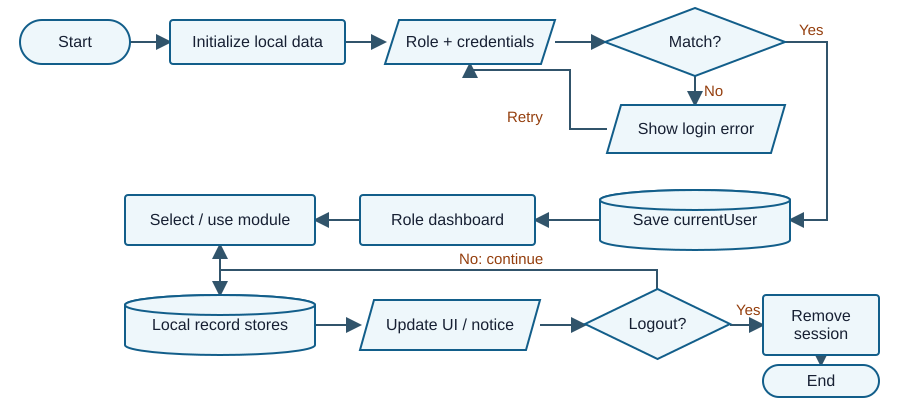
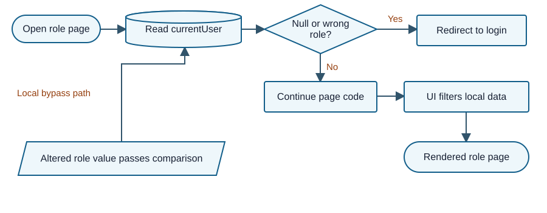
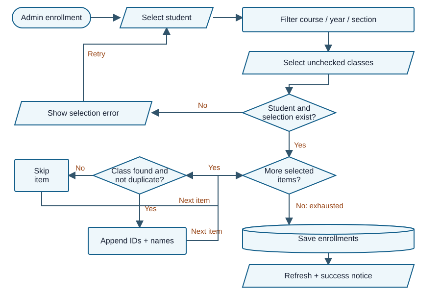

# EDUCORE SIMS - Mock Defense Review

**Review date:** 02 October 2026 (Asia/Manila)

## Panel brief: ano ang system at gaano ito kahanda?

**Verdict: demonstrable classroom prototype, pero partial pa ang correctness ng records at access controls.** May working role interfaces at JavaScript CRUD. Hindi pa sapat ang ebidensya para sabihing reliable ang buong enrollment, academic history, order reversal, at recovery flow.

EDUCORE SIMS ang pangalan sa document; **SIMSIMI** ang source folder. Isang HTML/CSS/JavaScript app ito: browser ang nagbabasa, nagva-validate, at nagsusulat ng JSON sa Local Storage. Walang submitted backend o database schema. May **129 files, 38 JavaScript files, at 30 HTML pages**; walang TypeScript, package manifest, o supplied automated test suite sa inventory.

**Strengths:** malinaw ang tatlong role menus; may course/year/section enrollment filter at duplicate check; teacher grades use active enrollments; store checkout checks latest stock and saves product snapshots; teacher password change checks current password and confirmation. Sa Classes at Subjects, may original-array index mapping para sa filtered actions - existing pattern na puwedeng gamitin sa Students/Teachers.

**Unahin sa defense:** (1) browser role value is not a secure identity; (2) search can edit/delete the wrong record; (3) grades and attendance can mix repeated subjects across classes; (4) order cancellation does not restore deducted stock; (5) restore can replace records without validating a backup schema.

### Roles at pangunahing data movement

| Actor | Intended access | Actual implementation / limit |
|---|---|---|
| Admin | Student/teacher/subject/class CRUD, enrollment, announcements, store/orders, reports, settings | Client-side page checks; all local data accessible to the same browser origin. |
| Teacher | Assigned subjects/classes/students; record attendance and grades; view announcements; settings | Assignment filters exist. Grade class lookup also accepts matching teacher name, which is weaker than a stable ID. |
| Student | Own profile, subjects, grades, attendance, announcements; store and orders | Own-record filters exist, but subject-based joins can confuse class histories. No separate Student/classes.html was supplied. |

**Intended journey:** admin creates teacher → assigns subject → creates class → creates student → enrolls student → teacher records attendance/grades → student views own records. Store is a separate journey: publish product → student checks out → admin changes status → cancellation should reconcile reserved stock.

### Evidence at QA snapshot

**16 selected cases: 2 Passed, 14 Failed, 0 Blocked, 0 Not Run.** These are case outcomes against stated or explicitly proposed acceptance rules, not a whole-system pass rate. Fifteen cases ran in a Node VM with DOM stubs and in-memory synthetic records. Q04 was additionally confirmed in a fresh headless Edge context; Q15 used harmless stored HTML in Edge. All 38 JS files passed syntax checks. No page errors occurred in the sampled Students browser flow.

**Confirmed** means observed in the specified test environment; **Code-evidenced** means inspected code, not reproduced behavior. Full browser end-to-end coverage, concurrency, real accounts, institutional grading policy, and production security were not verified. Source and document were read-only; all generated artifacts are outside the app.

<div class="page-break"></div>

## Paper-to-system traceability

Paper: **EDUCORE_SYSTEM_DOCU.docx**, visible title “EDUCORE TECHNOLOGIES / STUDENT INFORMATION MANAGEMENT SYSTEM / SYSTEM DOCUMENTATION,” academic year 2026-2027. Walang explicit revision date. Section names ang citations; paragraph IDs below are extraction locators, **not page numbers**.

| ID / paper claim | Document section | Implementation evidence | Verdict / defense significance |
|---|---|---|---|
| P01: Local Storage prototype, browser/device limited | Project Overview P34; Project Limitations P172-182 | storage.js:400-486; no backend in inventory | **Implemented.** Fair limitation; do not grade it as a cloud SIS. “Centralized” only means one local dataset. |
| P02: Secure login and restricted role functions | Objectives P52; Limitations P179-181 | auth.js:45-73,168-186; Q02-Q03 | **Contradicted as a security claim.** Role routing exists; trusted identity and account-status enforcement do not. |
| P03: Admin adds/edits/searches/deletes students and teachers | Included Features P140-143 | students.js:66-158,453-545; teachers.js:118-148 | **Partial.** Search-to-action identity mapping fails for Students; same index pattern exists in Teachers. |
| P04: Teacher assigned by subject, classes constructed from subject | Included Features P144-148 | classes.js:184-400,956-1065; subjects.js:157-260 | **Implemented in code for basic setup.** Stable identifier consistency remains weak across modules. |
| P05: Enrollment connects students to appropriate classes | Included Features P149-150 | enrollment.js:426-595,700-922 | **Partial.** Course/year/section and duplicate rules exist; status and current-term eligibility are absent. |
| P06: Teachers enter grades; students view academic information | Included Features P153-154; Target Users P217-220 | teacher-grades.js:1356-1753; student-grades.js:377-492 | **Partial.** Writer persists class/enrollment identifiers, but student reader selects first matching subject grade. |
| P07: Teachers manage attendance for assigned classes | Included Features P151-152 | teacher-attendance.js:226-316,544-822,1305-1480 | **Partial.** Class/date save exists; student reader duplicates repeated-subject histories. |
| P08: Audience-specific announcements | System Features P242-251 | teacher-announcements.js:128-185; student-announcements.js:99-155,366-475 | **Contradicted for student viewing.** Teacher filters audience/status; student list renders every stored notice, including teacher-only drafts. |
| P09: Store/order management | Scope P71; Included Features P158-159; Use Case P331 | student-store.js:1825-2408; student-orders.js:1310-1502 | **Partial.** Checkout deducts stock; cancellation only changes order status. Product storage key is undeclared. |
| P10: Reports, settings, password changes | Features P266-273 | reports.js:51-221; teacher-settings.js:423-603; settings.js:203-342 | **Partial overall.** Counts and password checks exist; recovery validates JSON syntax only. |
| P11: Objectives achieved and testing performed | Objectives P67; Conclusion P422-426 | No test results, dataset, acceptance matrix or supplied test suite found | **Not verifiable as a testing claim.** Analyzer tests below do not validate an earlier evaluation. |

### Paper consistency at diagram critique

**System Flowchart:** overall login/role/logout sequence matches basic implementation. Its repeated label “Data securely stored” overstates Local Storage protection. The “No logout” arrow returns to the administrator lane even after teacher/student use; it should return to the current role. It omits failed writes and academic-history joins.

**Use Case Diagram:** teacher “Post Announcements” conflicts with the text and supplied view-only teacher module. Student “My Classes” is named in the diagram/text, but the supplied student navigation exposes My Subjects and no dedicated classes page. Clarify whether class detail within subjects satisfies this requirement. The inclusion of “Save to Local Storage” under viewing grades also blurs read versus write behavior. Correct the diagram and scope before claiming every objective achieved.

<div class="page-break"></div>

## Domain capability baseline and gap critique

**Scope:** single-browser academic information prototype, with an optional school-store module that the paper explicitly includes. Research question: anong minimum controls ang kailangan para hindi maghalo ang identity, enrollment, grades, attendance, at order stock sa scope na ito?

Research supports the comparison, not a certification requirement. OneRoster describes class rosters for a defined period and gradebook data; ginamit lang itong reference for relationships and context, not a mandate to implement its API [R1]. OWASP supports identity/resource authorization and treating browser storage as untrusted [R2-R3]. MDN explains origin-scoped persistence and file-URL uncertainty [R4]. Term consistency, reversals, and safe recovery below are **reviewer-derived core dependencies** of the claimed flows.

| Capability / importance | Basis | Expected → actual evidence | Verdict / priority |
|---|---|---|---|
| Stable record identity / Core | Core-process dependency; R1 | Actions target the selected record → filtered row position used by Students/Teachers | **Incorrect / High**, F02 |
| Role and account eligibility / Core | Explicit objective; R2-R3 | Valid active account controls access → mutable role and inactive login accepted | **Incorrect / High**, F01 |
| Teacher ownership / Core | Explicit assigned-class scope; R2 | Assignment uses stable ID → IDs plus teacher-name fallback; no trusted server enforcement | **Partial / High**, F01 |
| Subject-to-class setup / Core | Explicit requirement | Subject resolves assigned teacher → class creation checks assignment | **Complete in inspected code**, full setup E2E unverified |
| Class enrollment / Core | Explicit; core dependency | Valid active class/current period; no duplicate → cohort filter + duplicate check only | **Partial / High**, F08 |
| Class-specific grades / Core | Explicit; R1 as relationship reference | Student sees correct enrollment result → first subject grade wins across classes | **Incorrect / High**, F04 |
| Class/date attendance / Core | Explicit; core dependency | Distinct meeting history → writer separates class/date; reader joins by subject | **Incorrect / High**, F04 |
| Grading completion policy / Core | Necessary grade interpretation | Separate progress from completed result → any nonblank periods average to “final” | **Partial / Medium**, F09; institution policy unverified |
| Announcements by audience / Core | Explicit | Published notices for intended role → teacher filtering exists; student list exposes all notices | **Incorrect / High**, F13 |
| Store + order reconciliation / Core within claimed store scope | Explicit; core transaction dependency | Stock, orders and reversals agree → no cancellation stock reversal; split checkout writes | **Incorrect / High**, F06-F07 |
| Backup and recovery / Important | Recommended operational practice; browser-only dependency | Validate complete backup before replace → arbitrary parsed JSON clears stores | **Incorrect / High**, F11 |
| Reports / Important | Explicit broad summary claim | Summarize existing records → counts/course/order summaries present; period reconciliation absent | **Partial / Medium**, dependent on source correctness |
| Audit attribution / Important | Recommended practice; R2 | Actor/event history → addLog reads username absent from login session; logging mainly order update | **Partial / Medium**, code-evidenced |
| Cloud sync/mobile app/email/SMS / Optional | Explicit limitations | Future enhancements, not current deliverables | **Out of scope.** No deduction for absence. |

**Functional gaps** are wrong record selection and incomplete record/order lifecycles. **Control gaps** include weak access, unsafe HTML rendering and recovery. **Enhancements** include multi-campus sync and mobile support. Walang legal-compliance verdict o prescribed institutional grade weighting sa review na ito.

**Research sources, accessed 02 October 2026:**

- [R1: 1EdTech OneRoster 1.2](https://standards.1edtech.org/oneroster/specifications/standards/v1p2), final release listed 19 September 2022. Relationship reference, not university policy.
- [R2: OWASP Authorization Cheat Sheet](https://cheatsheetseries.owasp.org/cheatsheets/Authorization_Cheat_Sheet.html), living technical guidance.
- [R3: OWASP HTML5 Security Cheat Sheet](https://cheatsheetseries.owasp.org/cheatsheets/HTML5_Security_Cheat_Sheet.html), living technical guidance.
- [R4: MDN Window.localStorage](https://developer.mozilla.org/en-US/docs/Web/API/Window/localStorage), living browser documentation.

<div class="page-break"></div>

## Overall system function and access flow

### Diagram 1 - normal implemented flow



Login reads the role-specific account array, saves `{id, role}`, then redirects. Module scripts read/write the same origin's local stores and refresh the UI. Logout removes only currentUser. The diagram simplifies module-specific validation; several modules display success even when storage failed. **Code map:** auth.js:14-107; storage.js:52-378,400-486. No API/controller/database boundary exists in this submission.

### Diagram 2 - actual page-role guard and bypass boundary



The guard checks only null and role equality. A matching role with a nonexistent account ID passes in Q03. The redirect is a UI action; the caller does not receive an allow/deny result that stops all subsequent mutation code. “Altered role” is a **local synthetic bypass**, not a remotely demonstrated exploit. **Code map:** auth.js:168-186 and top-level Auth.checkAccess calls in module scripts.

**Practical limit:** browser-local role menus help organize a classroom demo, pero hindi nila ma-eenforce ang secure access against a user controlling that browser. Real school use needs a trusted identity and record authorization boundary; prototype documentation should say this plainly [R2-R3].

<div class="page-break"></div>

## Main transaction: enrollment to academic records

### Diagram 3 - implemented enrollment decisions



**Code map:** enrollment.js:305-418 selects student; 426-595 filters course/year/section and disables already-enrolled boxes; 700-899 validates selection, finds each class, avoids duplicates, and saves. The handler does not recheck active status/current school year/semester, and it does not inspect the save result before its success message.

### Critical use cases at postconditions

| Use case / precondition | Main flow | Alternatives / actual postcondition |
|---|---|---|
| Enroll student: admin, student/class setup exists | Select student and cohort classes → duplicate checks → append enrollments | Missing selection is rejected; missing class skipped. Saved enrollment stores classId and names, but no subjectCode/teacherId/term fields. |
| Record grade: teacher, assigned class and active enrollment | Select class → enter period scores → save grade with enrollmentId/classId | No selected class/teacher/student rejected. Blank periods allowed; first period can produce Passed. Student reader later ignores enrollmentId/classId. |
| Record attendance: teacher, class/date/students exist | Load roster → choose statuses → replace class/date batch | Missing class/date/roster rejected. Default is Present; failed writes still get success. Student reader duplicates matching subject history. |
| Place/cancel order: student, available stock and own order | Latest stock check → order write → stock write; owner cancels pending order | Checkout can partially commit if stock write fails. Cancellation preserves order record but leaves stock deduction. |

**Process lesson:** may tamang local steps, pero kailangang pareho ang keys at business meaning sa writer at reader. “Na-save” is not enough if a later screen shows another class's grade or wrong stock.

<div class="page-break"></div>

## Prioritized loopholes and findings - 1 of 3

### F01 - role value can stand in for identity

**High | Confirmed in VM; supporting code | High confidence.** Problema: role-check ang access gate, hindi verified account/session. Q02 logged in an Inactive synthetic student; Q03 passed admin access with a nonexistent account ID. Credentials are stored/compared as plain text.

**Safe demo:** sa disposable synthetic store, compare inactive login and a same-role session with missing account. Expected: reject both. Actual: redirect/login and guard acceptance. **Effect:** local users can access or alter records outside intended restrictions. **Ayusin:** document demo-only security, enforce account status and stable ownership; for actual deployment use trusted authentication/authorization. **Verify:** revoked/missing accounts and other-role/other-record access are denied. **Panel:** “Saan galing ang trusted identity kung editable ang currentUser?”

**Evidence:** auth.js:45-73,168-186; storage.js:60-183; teacher-grades.js:498-510 also accepts teacher-name matching, untested with duplicate names. This is a local trust-boundary failure, not proof of a remote attack.

### F02 - search edits or deletes the wrong person

**High | Confirmed in Edge + VM | High confidence.** Problema: displayed filtered index is passed to a handler that reads the original array. **Safe demo:** create Alpha then Beta, search Beta, click Edit. Expected: Beta form. Actual: Alpha form. Delete uses the same position mapping; no real record was deleted during testing.

**Effect:** wrong student update/delete; Teachers has the same code pattern. **Ayusin:** resolve by record ID or reuse original-index mapping already present in Classes/Subjects. **Verify:** first/middle/last search result updates only its own record. **Panel:** “Bakit hindi guaranteed na original index ang i?”

**Evidence:** students.js:112-144,453-491,505-545; teachers.js:118-148,479-487. Positive comparison: classes.js:611-612,667-680; subjects.js:370-372,438-447. Teacher wrong-row behavior is code-evidenced, not separately browser-tested.

### F03 - stored text is rendered as HTML

**High | Harmless markup confirmed in Edge; executable XSS code-evidenced | High confidence.** Problema: names and other record fields enter innerHTML without escaping. **Safe demo:** synthetic firstName contains a harmless bold ReviewMarker. Expected: literal text. Actual: a real bold element appears in the table.

**Effect:** markup changes UI; executable content could affect same-origin data and credentials, but script execution/exfiltration were not tested. **Ayusin:** render user text with textContent or the existing escaping pattern in store modules. **Verify:** harmless HTML characters remain literal through table/modal views. **Panel:** “Paano ninyo sinisigurong data lang ang names/content?”

**Evidence:** students.js:116-144,514-519; announcements.js:91-190. Existing safer helper: admin-store.js:93-101; student-store.js:203-218. See R3 for browser storage and HTML trust implications.

### F04 - repeated subject histories mix across classes

**High | Confirmed in VM | High confidence.** Problema: student readers match subject, not exact enrollment/class. **Safe demo:** same student, same subject, two class enrollments; saved grades 80 and 95; one attendance entry per class. Expected: each enrollment has its own grade/meeting. Actual: both show 80; two attendance entries become four rows.

**Effect:** inaccurate student history and attendance summaries. **Ayusin:** join grade by enrollmentId/classId and attendance by classId/studentId/date; expose term context. **Verify:** repeated subjects never reuse another class's result. **Panel:** “Bakit may classId sa writer pero subject ang join sa reader?”

**Evidence:** student-grades.js:377-492; student-attendance.js:377-486; teacher-grades.js:1621-1649; teacher-attendance.js:1400-1455. Q07-Q08 cover synthetic repeated-subject cases.

<div class="page-break"></div>

## Prioritized loopholes and findings - 2 of 3

### F05 - renamed subjects hide existing academic records

**High | Confirmed in VM | High confidence.** Problema: enrollment snapshots contain subjectName but no stable subject reference. **Safe demo:** enroll Programming, then rename subject to Renamed Programming. Expected: existing enrollment and results remain visible. Actual: student grades skip both old name-only enrollments.

**Effect:** records look missing although still saved; teacher resolution is also incomplete because enrollment lacks teacherId/employeeNumber expected by readers. **Ayusin:** store stable references, use classId to resolve current subject/teacher, retain historical display snapshots intentionally. **Verify:** rename/reassignment does not hide records. **Panel:** “Alin ang identity key at alin ang display snapshot?”

**Evidence:** enrollment.js:790-879; student-grades.js:227-306,335-366; student-attendance.js:227-306. Q09 verified subject rename only; teacher-label behavior is code-evidenced.

### F06 - product store uses an undefined key

**Medium | Confirmed in VM | High confidence.** Problema: STORAGE_KEYS.PRODUCTS is used but never declared. Admin and student happen to share the resulting literal key **"undefined"**, kaya puwedeng magmukhang working ang store.

**Safe demo:** save one synthetic product and inspect key names. Expected: named product store. Actual: product array lives under "undefined". **Effect:** accidental key collision, fragile backup/migration/debugging. This is not proof the entire store cannot run. **Ayusin:** define and consistently use one named key; safely preserve existing product data. **Verify:** new and restored product records use the intended key. **Panel:** “Ano ang actual string na naipapasa sa setItem?”

**Evidence:** storage.js:7-35; admin-store.js:29-50; student-store.js:124-143,2319-2323; Q10.

### F07 - order lifecycle does not reconcile stock

**High | Cancellation confirmed in VM; partial checkout code-evidenced | High confidence.** Problema: checkout deducts quantity, but cancelling a pending order changes status only. Admin status changes also have no allowed-transition matrix or stock reversal.

**Safe demo:** synthetic order for two items, stock already 8 from 10; cancel own Pending order. Expected under the implemented reservation model: stock 10, one reversal. Actual: cancelled, stock 8. **Effect:** stock disappears from available supply. Separately, successful order write followed by failed stock write leaves partial state and a retained cart; retry may create another order.

**Ayusin:** define reservation/release and terminal statuses; make order+stock commit/reversal recoverable and repeat-safe. **Verify:** cancel twice restores once; failed checkout leaves reconcilable state. **Panel:** “Kailan reserved, sold, at returned ang stock?”

**Evidence:** student-store.js:2245-2340; student-orders.js:1310-1502; admin-orders.js:2045-2243. Q11 verified cancellation; retry/concurrency were not executed.

### F08 - enrollment ignores active status and current term

**High | Confirmed in VM | High confidence.** Problema: available-class filter checks cohort only. **Safe demo:** create Inactive class in an old school year with same course/year/section. Expected: unavailable for current enrollment. Actual: selectable.

**Effect:** stale/inactive class enrollment, possible duplicate subject histories. Current-term eligibility is a proposed acceptance rule inferred from schoolYear/semester fields; the paper does not define detailed enrollment policy. **Ayusin:** define allowed statuses/term and recheck at save, including student eligibility. **Verify:** inactive and out-of-term selections rejected; same pair remains unique. **Panel:** “Paano ninyo pinipili ang eligible academic period?”

**Evidence:** enrollment.js:477-497,700-786; classes.js:1205-1222 stores schoolYear/semester/status. Q06 confirmed old/inactive visibility, not a full browser enrollment submission.

### F13 - student announcement view exposes teacher-only drafts

**High | Confirmed in VM | High confidence.** Problema: student list loads and renders every announcement without audience/status filtering. **Safe demo:** synthetic Teachers + Draft notice. Expected: hidden from student. Actual: its title/content appear in student list. Dashboard filters Published but still ignores audience.

**Effect:** intended audience and publication state do not control student visibility. **Ayusin:** apply the same allowed-audience/published rule to list, dashboard, detail and counts. **Verify:** draft and teacher-only notices stay hidden; published All/Students appear. **Panel:** “Pareho ba ang eligibility rule sa lahat ng announcement screens?”

**Evidence:** student-announcements.js:99-155,366-475; student-dashboard.js:537-556. Q16 confirmed student list; dashboard is code-evidenced. This is distinct from local-storage bypass: the normal viewer itself exposes the notice.

<div class="page-break"></div>

## Prioritized loopholes and findings - 3 of 3

### F09 - incomplete periods can be labeled final and Passed

**Medium | Confirmed in VM | High confidence on behavior; policy unverified.** Problema: average uses only nonblank periods, then immediately assigns Passed/Failed. **Safe demo:** prelim 90, three blanks. Expected under proposed completion rule: provisional 90, Pending completion. Actual: finalGrade 90.00, Passed.

**Effect:** a progress estimate looks like a finalized result. Equal period weights and a 75 passing mark are hardcoded; no supplied institution policy validates them. **Ayusin:** document authorized formula/completion rules and distinguish provisional versus released final results. **Verify:** incomplete grades cannot be misread as finalized. **Panel:** “Sino ang nag-approved ng weights, threshold, at release rule?”

**Evidence:** teacher-grades.js:1209-1347. Q12 failure is against an explicitly proposed completion acceptance rule, not proof of violating a specific school's policy.

### F10 - success can appear after a failed write

**High | Confirmed in VM | High confidence.** Problema: Storage.save returns false on failure, but grade save ignores it. **Safe demo:** inject an in-memory write error for grades; save four 90s. Expected: clear failure and unchanged persisted/UI result. Actual: no persisted grade, but 90.00 display and success toast.

**Effect:** user thinks a record is saved until refresh. Similar unchecked calls occur in enrollment, attendance, student CRUD and teacher password change. **Ayusin:** show success only after confirmed persistence; preserve input and recover from failure. **Verify:** quota failure never shows saved success. **Panel:** “Paano ninyo alam na persisted ang update?”

**Evidence:** storage.js:456-486; teacher-grades.js:1706-1753; enrollment.js:893-919; teacher-attendance.js:1468-1480; teacher-settings.js:567-601. Q13 confirmed grades only.

### F11 - restore replaces stores without schema checks

**High | Confirmed in VM | High confidence.** Problema: parsed JSON is accepted as a backup before clearing storage. **Safe demo:** disposable VM receives a file whose JSON is the scalar string "abc". Expected: reject it and preserve records. Actual: stores cleared and numeric character keys written.

**Effect:** malformed-but-valid JSON can erase the local dataset; a mid-restore write failure can leave partial data. Backup also exports every origin key, including credentials and currentUser; an unrelated non-JSON key can break export. **Ayusin:** validate version, allowed keys, types and relations; stage replacement and retain a recovery copy. **Verify:** invalid schema never changes live records. **Panel:** “JSON-valid ba ay katumbas ng valid system backup?”

**Evidence:** settings.js:203-267,284-342. Q14 uses fake FileReader and memory only; no real browser dataset was cleared. Backup download and mid-restore quota failure were not executed.

### F12 - hard delete leaves references and permits identity reuse

**High | Code-evidenced | High confidence.** Problema: student/class/enrollment deletion removes only its own array entry; related grades/attendance/enrollments are not protected. Storage.generateId scans live records from 001, so a deleted ID can be reused even when old references remain.

**Safe verification plan:** disposable fixture has student STU001 with enrollment; inspect delete logic, then compare next generated ID against historical references. Expected: history is retained/archived and identity never binds to a new person. Code permits an orphan and reused identity; **this end-to-end scenario was not executed**.

**Effect:** hidden history, wrong reattachment, misleading reports. **Ayusin:** archive referenced entities or block destructive deletion; keep stable never-reused identifiers. **Verify:** deleted/archived records do not leak history to new accounts. **Panel:** “Ano ang mangyayari sa grade kapag dinelete at nirecreate ang student?”

**Evidence:** students.js:531-545; classes.js:1491-1526; enrollment.js:1005-1027; storage.js:524-550. Display identifiers also use array length: students.js:226-238; teachers.js:231-250.

<div class="page-break"></div>

## Validation review and process correctness

**Trust boundary** means the point where data needs rechecking before it becomes an authoritative record. Dito, all validation runs in the client. There is no server/database enforcement layer; this is an architectural limitation already acknowledged by the paper, but it limits “secure role-based” claims.

| Boundary / process | Existing control | Missing or weak control | Process verdict / evidence |
|---|---|---|---|
| Login input → session | Nonblank fields; username/password equality; role-specific collection | Status, expiry, trusted identity; plain-text credentials | **Partial / Q01-Q03.** Correct basic login/invalid-password path; inactive/forged identity accepted. |
| Form → student/teacher array | Required fields, exact username duplicate checks | Canonical username rules; identifier uniqueness after deletion; consistent contact/date rules | **Partial.** students.js:280-316. HTML constraints are client-only. |
| Search result → mutation | Search works; confirm-delete dialog exists | Selected record identity not preserved after filtering | **Incorrect / Q04.** Confirmation cannot fix the wrong target. |
| Subject → class setup | Assigned teacher must resolve; required course/year/section/subject/year | Uniform teacher key; uniqueness/schedule conflicts not established | **Correct basic setup in code; broader policy not verified.** classes.js:956-999. |
| Student/class → enrollment | Matching cohort; duplicate student/class check | Active student/class; current period; authoritative revalidation | **Partial / Q05-Q06.** Priority is eligibility, not adding advanced waitlists. |
| Enrollment → grade writer | Active enrollments; selected teacher/student; 0-100 range comparisons | Completion/release policy; finite-number guard; unchecked save return | **Partial / Q12-Q13.** Numeric input behavior outside the sampled fixtures not verified. |
| Enrollment → student academic views | Student ID/number and subject matching | Exact enrollment/class/term join; stable subject identity | **Incorrect / Q07-Q09.** Source persistence and visible correctness differ. |
| Class/date → attendance | Missing class/date/empty roster rejected; replaces class/date batch | Active-enrollment status in attendance roster; meeting policy; reviewed-default status; save failure | **Partial.** teacher-attendance.js:544-660,1305-1480; defaults Present. |
| Product/cart → order | Latest product/stock checks; quantity ceiling; order save checked | Strict positive integer check at checkout; atomic/recoverable order+stock; per-user cart key | **Partial.** student-store.js:1850-1959,2245-2340; shared cart key at61-62. |
| Order → cancel/admin update | Student owner and Pending checks; save failure checks | Stock reversal; allowed admin transitions; persisted-state race recheck | **Incorrect / Q11.** Admin transitions and stale-state races untested. |
| Stored fields → rendered DOM | Store modules have escapeHtml helpers | General names/content inserted into innerHTML | **Incorrect / Q15.** Harmless markup confirmed; executable injection untested. |
| Announcement → student viewer | Teacher list checks audience/Published | Student list has no eligibility filter; dashboard ignores audience | **Incorrect / Q16.** Teachers + Draft shown to student, F13. |
| Backup → replacement storage | JSON.parse catches malformed syntax only by throwing | Schema/version/relations, preview, rollback, allowed key namespace | **Incorrect / Q14.** Export includes unrelated same-origin keys. |

**Reusable validator coverage:** validator.js defines required/email/usernameExists; email accepts any text containing “@”. Targeted search found no Validator.* caller in submitted JS. Main modules instead repeat checks. An unused helper is not an effective control; judge actual handlers and native fields.

**Not verified:** every input permutation, malicious script execution, all DOM constraints, grading weights, institutional attendance rules, restoration of a complete valid backup, simultaneous tabs, and external deployment behavior. These are not counted as passed cases.

<div class="page-break"></div>

## Important JavaScript: functions and user-visible effect

All business logic is JavaScript; no TypeScript was supplied. Page script tags load storage/auth and role modules directly. Input → handler → array transformation → JSON storage → UI is the main application pattern.

| Function / call site | Inputs → output / side effect | Paano ginagamit ng system |
|---|---|---|
| Storage.initialize; loaded by storage.js:611 | Missing keys → demo accounts, empty arrays, settings | Bootstraps a fresh browser. It does not repair malformed existing records. storage.js:52-378. |
| Storage.get / save | Key / JSON object → parsed value or boolean write result | Shared persistence boundary. get returns null for missing/invalid JSON; save returns false on exception. storage.js:400-486. |
| Auth.login; loginForm submit | Role/username/password → currentUser + redirect or error | Reads role collection and compares credentials; stores id and role only. auth.js:14-74,226-236. |
| Auth.checkAccess; top of role module | Required role → redirect on null/mismatch | Organizes pages; no trusted verification or mutation permission result. auth.js:168-186. |
| loadStudents / editStudent | Keyword / index → rendered rows / populated form | Search transforms array; action handler reopens original array position. students.js:66-158,453-497. |
| getSubjectTeacher; class form submit | Subject code → assigned teacher record or null | Auto-populates teacher from subject, avoiding separate manual selection. classes.js:184-400,956-1065. |
| loadAvailableClasses; selectStudent | Selected student's cohort + enrollments → checkbox table | Normalizes numeric year to year label; marks duplicates checked/disabled. enrollment.js:426-595. |
| Enrollment click handler | Selected student + checked classes → enrollment array | Adds stable student/class IDs and display-name snapshots, then refreshes panels. enrollment.js:700-922. |
| calculateFinalGrade / getGradeStatus; saveGrade | Nonblank period values → average string and Passed/Failed/Pending | Uses equal weights over supplied periods; “Pending” only when all blank. teacher-grades.js:1209-1347,1517-1529. |
| saveGrade | Student/enrollment IDs + DOM values → upsert grade | Stores class/enrollment context; student reader should preserve those joins. teacher-grades.js:1356-1753. |
| saveAttendance; save button | Selected class/date + roster statuses → replaced class/date batch | Rewrites a meeting batch and shows toast. teacher-attendance.js:1305-1480. |
| loadStudentGrades / loadStudentAttendance | Current student + enrollments + subjects + records → student lists | Joins by subject and skips unresolved subject; causes history mixing/rename loss. student-grades.js:69-514; student-attendance.js:70-533. |
| checkout; checkout button | Cart/latest products/current student → order, stock deduction | Saves item snapshots, checks write results, clears cart only after both writes. student-store.js:1825-2408. |
| cancelCurrentOrder / updateOrderStatus | Own pending order or selected admin order → changed status | Cancellation keeps history; neither path reconciles stock. student-orders.js:1310-1502; admin-orders.js:2045-2243. |
| loadReport | Local records → count/course/order summaries | Useful overview, but wrong source joins/deletions cannot be corrected by summary cards. reports.js:51-221. |
| Restore FileReader.onload | Imported JSON → clear + write all keys + reload | No schema validation or transactional replacement. settings.js:284-342. |

**Positive implementation comparison:** Classes uses classes.indexOf(item), Subjects uses originalIndex, and store uses record IDs. Existing correct patterns make F02 a small integration fix. Storage.save and student order paths already demonstrate error feedback; reuse that discipline in academic saves.

**Audit note:** Auth.login stores no username, while Storage.addLog reads currentUser.username (storage.js:566-583). Normal login can therefore leave actor attribution undefined. Logging is mainly observed in admin order updates, not a complete immutable audit history.

<div class="page-break"></div>

## Vibe-coding indicators: exact evidence, not authorship proof

Ang mga ito ay **implementation-risk signals**: inconsistent integration, happy-path handling, at unverified assumptions. Hindi sila proof na AI ang nagsulat, at hindi rin stylistic judgment sa proponents. Excerpts below preserve exact nonblank source lines; blank spacing is compressed.

### V01 - missing key hidden by shared accidental behavior

```javascript
    localStorage.setItem(
        STORAGE_KEYS.PRODUCTS,
        JSON.stringify(products)
    );
```

**Location/function:** admin-store.js:47-50, saveProducts; STORAGE_KEYS map is storage.js:7-35 and has no PRODUCTS. **Does:** writes product collection. **Signal:** both product modules rely on a missing shared constant. **Effect:** literal “undefined” key, fragile integration; VM confirmed Q10. **Confidence: High.**

### V02 - filtered action wiring conflicts with existing correct modules

```html
                <button
                class="edit-btn"
                 onclick="editStudent(${i})">
```

**Location/function:** students.js:134-136, loadStudents. **Does:** wires filtered-row position to edit handler. **Signal:** handler uses original array index, while Classes already maps to original index. **Effect:** Beta row edits Alpha; Edge and VM confirmed Q04. **Confidence: High.** This supports incomplete cross-module verification, not a claim about copying or authorship.

### V03 - success path discards persistence result

```javascript
    Storage.save(
        STORAGE_KEYS.GRADES,
        grades
    );
```

**Location/function:** teacher-grades.js:1706-1709, saveGrade; success toast at1750-1753. **Does:** attempts persistence without examining boolean return. **Signal:** shared Storage.save explicitly returns false on failure, but UI assumes success. **Effect:** displayed saved result with no stored grade in Q13. **Confidence: High.**

### V04 - comment promises recovery that code does not complete

```javascript
        The order already exists, so do not
        create another order. Restore the
        original product quantities instead.
```

```javascript
        loadProducts();
```

**Location/function:** student-store.js:2329-2334, checkout failure branch. **Does:** reloads products after stock-save failure. **Signal:** the order stays committed, cart stays populated, and no linked rollback/idempotency state is created despite the recovery wording. **Effect:** unresolved order/stock mismatch; retry duplication is code-evidenced, not executed. **Confidence: High for incomplete recovery; Medium for retry impact.**

**Verification habit to improve:** test lifecycle changes, not only first-create screens: search before edit, repeat a subject next term, rename a subject, cancel an order, and simulate a failed write. The signal is a missing integration check; the remedy is observable behavior, not speculation about how code was produced.

<div class="page-break"></div>

## QA: selected high-value cases and actual outcomes

**16 cases, 2 Passed and 14 Failed.** “Failed” means the observed app behavior misses the specified acceptance condition; successful execution of the analyzer harness does not mean the application passed. Q12 uses a proposed completion rule because no institutional policy was supplied. Q06 uses current-term eligibility inferred from class metadata. These are explicit assumptions.

All fixture names, grades and products are synthetic. VM tests run unmodified JS functions with DOM stubs and in-memory Local Storage; they do not prove full UI behavior. Edge used a fresh context and read-only loopback server; it was closed after verification.

| ID / category | Safe steps / test data | Expected | Actual / status |
|---|---|---|---|
| Q01 Login / positive-negative | Synthetic active student; correct then wrong password | Correct routes; wrong rejected | Both observed. **Passed - VM** |
| Q02 Auth / status | Inactive student; correct credentials | Inactive account rejected | Redirected to student. **Failed - VM** |
| Q03 Auth / authorization | Same-role currentUser with nonexistent admin ID | Reject nonexistent identity | Guard passed. **Failed - VM** |
| Q04 CRUD / integration | Alpha then Beta; search Beta; Edit | Form shows Beta | Form shows Alpha. **Failed - Edge + VM** |
| Q05 Enrollment / positive + boundary | Existing enrollment; matching and wrong section | Disable duplicate; exclude wrong cohort | Both observed. **Passed - VM**; submit duplicate check also code-evidenced |
| Q06 Enrollment / business | Same cohort; old school year; Inactive class | Exclude ineligible class | Class selectable. **Failed - VM** |
| Q07 Grades / history | Two classes, same subject, same student; 80 and 95 | Each enrollment shows its grade | Both use 80. **Failed - VM** |
| Q08 Attendance / integration | Two class enrollments; one entry per class | Two distinct entries | Four reader rows. **Failed - VM** |
| Q09 Academic / mutation | Rename subject after name-only enrollment | Existing results still discoverable | Zero grade-view rows. **Failed - VM** |
| Q10 Storage / schema | Save synthetic product in admin module | Defined product key | Literal undefined key. **Failed - VM** |
| Q11 Store / reversal | Own Pending order, qty2; post-deduction stock8 | Cancel releases stock to10 once | Cancelled, stock8. **Failed - VM** |
| Q12 Grades / completion | Prelim90; other periods blank | Provisional result; pending final completion | 90.00, Passed. **Failed - VM**, proposed acceptance |
| Q13 Storage / error handling | Four90s; synthetic grade-write error | Error; no saved success display | Stored grades empty; 90.00 + success toast. **Failed - VM** |
| Q14 Recovery / negative | Valid JSON scalar string abc, fake file | Reject before any replacement | Stores cleared; character keys written. **Failed - VM** |
| Q15 Rendering / trust boundary | Harmless bold ReviewMarker in stored name | Display literal markup | Real bold element. **Failed - Edge**; executable script not tested |
| Q16 Announcements / authorization | Synthetic Teachers audience + Draft status | Hidden from student list | Title/content rendered. **Failed - VM** |

**Evidence mapping:** Q01-Q03→F01; Q04→F02; Q15→F03; Q07-Q08→F04; Q09→F05; Q10→F06; Q11→F07; Q06→F08; Q12→F09; Q13→F10; Q14→F11; Q16→F13. F12 remains code-evidenced with a proposed test, outside these executed-case totals. One additional finding/case is included because normal student announcement disclosure is a distinct authorization failure.

**Additional verification:** node --check accepted all 38 JavaScript files. This proves parseability, not business correctness. No dependencies were installed, no submitted files changed, no real account/service contacted, and no real dataset was restored/reset.

**Not covered:** full add/edit/delete journeys in every module; all user inputs; teacher-name collisions; concurrent tabs; checkout partial-write retry; full valid backup recovery; institutional grading/attendance policy; performance/accessibility; production hosting. Browser screenshots inside the paper are prior documentation evidence, not current runtime results.

<div class="page-break"></div>

## Recommended system improvements

This is a product/process roadmap, not replacement code. Unahin ang correctness ng current scope bago cloud sync or mobile expansion.

| Priority / current condition | Add or change / intended process | Benefit and observable success |
|---|---|---|
| **High - record identity drifts**, F02/F04/F05/F12 | One stable record reference for actions and joins; preserve class/enrollment/term context; archive referenced entities | Search edits exact person; repeated subject histories remain distinct; rename/delete cannot reattach history to a new account. |
| **High - role/audience restrictions inconsistent**, F01/F13 | Separate demo restrictions from real authorization; require active accounts, stable ownership and uniform notice eligibility; trusted enforcement before real use | Missing/inactive accounts denied; drafts/teacher-only notices hidden from students; demo security explained. |
| **High - records can claim success without persistence**, F10 | Complete each save with explicit result; preserve unsaved inputs; provide recovery action and durable confirmation | Quota/write error never produces success; reload agrees with displayed state. |
| **High - store state can diverge**, F06/F07 | Explicit product store; documented reservation/status lifecycle; linked stock release and recoverable checkout | Place qty2 then cancel returns stock exactly once; retry cannot create duplicate commitment. |
| **High - unsafe data rendering/recovery**, F03/F11 | Literal rendering for user text; versioned allowlisted backup schema; validate before replace and retain recovery copy | Harmless markup stays text; invalid or partially failed import leaves prior dataset recoverable. |
| **Medium - academic rules unclear**, F08/F09 | Define eligible term/status, approved grading formula, completion/release states and attendance meeting rules | Out-of-term class excluded; partial periods shown as provisional; school owner can explain formula and release conditions. |
| **Medium - reports/audit can mislead** | Add actor ID, event history for consequential changes, period filters and reconciliation views | Report matches underlying enrollment/grade/order records; each change identifies actor and reason. |
| **Later - scale enhancements** | Cloud sync, mobile access, email/SMS after data controls stabilize | Multi-device use preserves the same authoritative records; these remain beyond submitted prototype scope. |

### Documentation improvements before defense

1. Revise “secure” and “centralized” wording to describe actual local-browser guarantees. Keep acknowledged limitations visible.
2. Align teacher announcement permissions and Student My Classes with supplied pages. Fix the role-loop arrow and read/write semantics in diagrams.
3. Add concrete test evidence: fixture, expected/actual result, environment, and test date. Screenshots alone do not establish all objectives achieved.
4. Document lifecycle rules for current-term enrollment, grade release, class/student archival, and pending-order stock reservation/cancellation.

**Suggested acceptance sequence:** correct identity mapping → academic joins → order lifecycle → persistence/recovery → retest the 16 cases with expanded browser journeys. A successful walkthrough should show record counts and identities before and after each action, including reload.

**Fair assessment:** may solid learning value at interactive functionality ang project. Ang main improvement is integration discipline: keep the same identity and business meaning across creation, editing, viewing, reversal, and recovery. More modules are less valuable than making these flows consistent.

<div class="page-break"></div>

## Five strongest panel questions

### 1. “Kung editable ang currentUser, saan ninyo vine-verify ang identity at authority?”

**Why ask:** security claim versus local role comparison, F01. **Strong answer:** explain authentication versus authorization, browser trust limits, active-account checks and stable record ownership; acknowledge that real deployment needs a trusted boundary. **Follow-up:** demonstrate a nonexistent same-role identity and an inactive user. **Red flag:** “Hidden naman ang menu” or treating role selection/local JSON as secure permission.

### 2. “Kapag nag-search ng Beta, paano ninyo sinisigurong Beta rin ang ie-edit o ide-delete?”

**Why ask:** directly reproduced wrong-target mutation, F02. **Strong answer:** describe filtered versus original array positions, use stable ID or original mapping, and cite the existing Classes/Subjects implementation. **Follow-up:** repeat the action when the searched record is last in the original list. **Red flag:** “Pareho lang ang index” without tracing arrays or testing search first.

### 3. “Paano ninyo dini-distinguish ang same subject sa dalawang class o school year?”

**Why ask:** grades and attendance are saved with context but read by subject, F04/F05. **Strong answer:** trace student → enrollment → class → subject; grades use enrollment/class reference, attendance uses student/class/date, and term is shown. Explain which fields are stable identity versus display snapshots. **Follow-up:** save 80/95 in two classes, then rename the subject. **Red flag:** matching by subject name alone or saying records are correct only because they exist in storage.

### 4. “Ano ang mangyayari sa stock kapag Pending order ay kinansela, o stock-save ang nag-fail?”

**Why ask:** lifecycle/recovery consistency, F07. **Strong answer:** define reservation, fulfillment, cancellation and release; explain a repeat-safe reversal and recoverable order+stock commitment. Admit the current cancellation changes status only. **Follow-up:** place quantity2, cancel, inspect stock, cancel/retry again. **Red flag:** deletion/status alone is claimed to restore quantity, or assuming two storage writes are one transaction.

### 5. “Paano ninyo pinatutunayang saved ang record at valid ang imported backup?”

**Why ask:** false save success and unsafe replacement, F10/F11. **Strong answer:** handle failed persistence before success; validate backup version, key/type/relationship schema before replacement; retain rollback/recovery data. **Follow-up:** show synthetic quota failure and schema-invalid but JSON-valid file. **Red flag:** JSON.parse alone is validation, or toast alone is evidence of a durable save.

### Final review boundaries

**Reviewed:** source inventory and page wiring; critical authentication, student CRUD, subject/class setup, enrollment, academic readers/writers, store/order lifecycle, announcements, reports/settings; paper text/tables and embedded flow/use-case figures. Technical references in this report are relative to the submitted SIMSIMI source root:

`C:/Users/justi/Downloads/Web-20261002T152358Z-1-001/Web/SIMSIMI/`

The supplied paper path is the sibling `EDUCORE_SYSTEM_DOCU.docx`. Line references use the original submitted files. No generated analysis files were included in source findings. Paper claims remain separate from implementation evidence; institutional policies and earlier evaluation results were not supplied. Suspected concurrency and executable injection impacts were not promoted to confirmed runtime results.

**Defense-ready takeaway:** explain the working prototype honestly, demonstrate the current limitations with synthetic records, and show measurable acceptance rules for the next revision. Do not claim production-grade access, complete testing, or final academic correctness from role menus and success messages alone.

