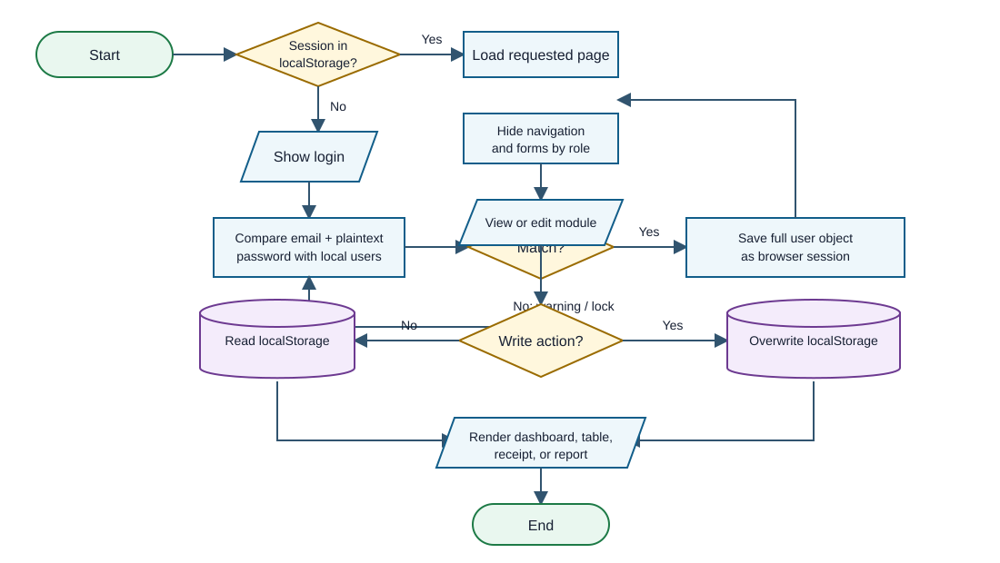
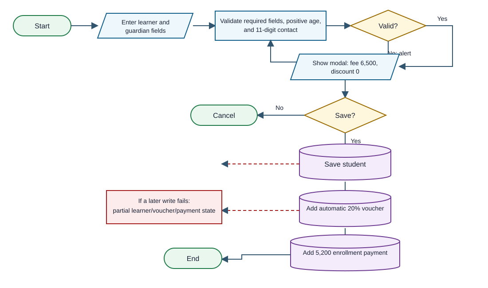
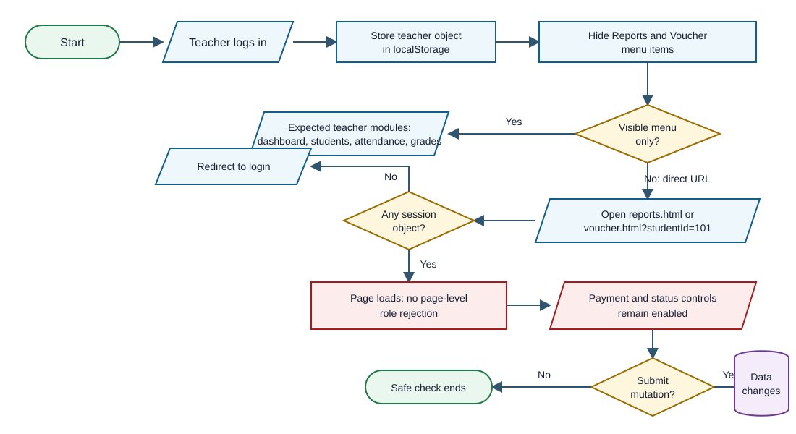

# SLA-SIMS Mock Defense Analysis

# 1. One-Page Panel Brief

## Ano ang system?

Ang SLA-SIMS ay browser-only Student Information Management System prototype para sa Spectrum Learning Academy. May modules para sa learner profiles, attendance, qualitative grades, tuition payments at automatic 20% vouchers, dashboard metrics, reports, at staff users. Plain HTML, CSS, at JavaScript ito; lahat ng operational data at login state ay nasa browser `localStorage`.

## Readiness verdict

**Prototype-ready for a guided classroom demo, pero hindi pa safe para sa real school records o real money.** Gumagana ang main screens at basic CRUD, at pumasa sa syntax check ang lahat ng 12 JavaScript files. Ang pinakamalaking blocker ay wala itong tunay na server-side identity, authorization, protected database, transaction control, audit trail, o reliable backup. Sa confirmed runtime check, nakapasok ang Teacher account sa admin-only Reports at tuition Voucher pages gamit lamang ang direct URL.

## Strengths

- Malinaw ang module separation at madaling sundan ang basic user flow.
- May basic validation para sa required learner fields at 11-digit guardian contact.
- Escaped ang learner values sa pangunahing student table at voucher search results.
- Consistent ang tuition constants at may prevention ng lampas sa configured payment count sa normal UI flow.
- All supplied JavaScript files parse successfully with `node --check`.

## Top five risks

| Priority | Risk | Evidence | Practical effect |
|---|---|---|---|
| 1 | Role bypass through direct URLs | **Confirmed** | Teacher can open Reports and Voucher and sees mutation controls. |
| 2 | Plaintext/default credentials and forgeable session | **Code-evidenced** | Anyone with browser access can read or replace identities and passwords. |
| 3 | Sensitive learner, disability, guardian, grade, and payment data in localStorage | **Code-evidenced** | Data is device-local, tamperable, unencrypted at app level, and not centrally recoverable. |
| 4 | Voucher automatically granted to every learner | **Confirmed + code-evidenced** | No eligibility, approval, reference, or configurable amount is captured. |
| 5 | Deletes and status/payment changes have no audit or reversal trail | **Code-evidenced** | Records can disappear without accountable history; reports can become inconsistent. |

## QA snapshot

12 high-value checks: **2 Passed**, **3 Failed**, **1 Blocked**, **6 Not Run**. Passed means directly observed, not inferred. No automated test suite or build manifest was supplied.

# 2. System Explained Simply

## Actors and observed permissions

| Actor | Intended access inferred from UI | Actual enforcement |
|---|---|---|
| Admin | All modules and user management | Menu shows all. Identity and role are trusted from localStorage. |
| Registrar | Dashboard, students, attendance, grades, voucher | Some forms/actions are hidden, but no protected server boundary exists. |
| Teacher | Dashboard, student view, attendance, grades | Menu hides Reports, Voucher, Users; direct URLs still load protected pages. |
| Learner/guardian | No login supplied | Their data is handled by staff only; no consent/notice or access workflow exists. |

## Modules and data movement

| Module | Main responsibility | Data read/written |
|---|---|---|
| `login.js`, `auth.js` | Login, lockout, menu visibility, logout | `users`, `spectrumlearningacademy`, attempts, lock time |
| `student.js` | Learner CRUD, enrollment modal, initial payment | `students`, `vouchers`, `payments`, plus cascading deletes |
| `attendance.js` | Add, edit, delete daily status | `attendance` |
| `grades.js` | Add, edit, delete subject result | `grades` |
| `voucher.js` | Search learner, sequence fixed payments, delete payment, PDF receipt | `students`, `vouchers`, `payments` |
| `reports.js` | Build tables/PDFs and directly edit statuses | All major arrays plus expected `activityLogs` |
| `dashboard.js` | Compute counts and financial totals | All major arrays |

## Reconstructed intended process

Assumption ito dahil walang capstone paper o requirements document: staff logs in, registrar/admin enrolls a learner, the system automatically creates a voucher and first payment, teachers record attendance and qualitative grades, registrar/admin handles remaining tuition, and admin reviews reports/users. The code does not model class sections, school year/term, enrollment documents, voucher eligibility, approvals, or formal record release.

# 3. Domain Capability Baseline and Gap Matrix

Narrow research question: **Ano ang minimum capabilities ng small Philippine basic-education learner information and tuition prototype para mapanatili ang record accuracy, access control, daily attendance, assessment history, at voucher/payment integrity?** The exact school accreditation, grade levels, and whether "voucher" means the official SHS Voucher Program were not supplied, so compliance conclusions are conditional.

| Capability | Importance and basis | Expected behavior | Actual evidence | Verdict / effect |
|---|---|---|---|---|
| Secure role-based access | Core; privacy/security requirement | Identity verified at trusted backend; every page/action checks role | `auth.js:1-40` only checks a client object and hides UI | **Incorrect - Critical.** Direct-route bypass confirmed. |
| Protected learner records | Core; DPA/NPC | Confidentiality, integrity, availability, limited access, retention and recovery | All learner/disability/contact/grade/payment data uses localStorage (`db.js:12-23`) | **Incorrect - High.** Tamperable and device-bound. |
| Enrollment identity and status lifecycle | Core; DepEd enrollment process | Guardian-signed enrollment basis for minors, school year/grade/status, record transfer state | Six basic fields only; no grade level, LRN, school year, documents, or temporary enrollment | **Partial - High.** Cannot support complete enrollment/transfer decisions. |
| Daily attendance integrity | Core; DepEd SF2 practice | One daily status per learner/class/date, monthly summary, absence intervention | Add simply pushes records; Present/Absent only (`attendance.js:56-60`) | **Partial - Medium.** Duplicates and incomplete reporting possible. |
| Assessment history | Core for claimed grades | Subject, period, school year, assessor, result, correction history | One learner-subject-grade tuple (`grades.js:43-55`) | **Partial - High.** Cannot distinguish quarters or explain changes. |
| Class and teacher assignment | Important; needed for class reports | Explicit section, subject, teacher, term relationships | Report infers teacher from hardcoded usernames/subjects (`reports.js:148-168`, `229-249`) | **Incorrect - Medium.** Report can misstate responsibility. |
| Voucher eligibility and amount | Core if official/program claim | Eligibility basis, application/approval, program year, amount, status, evidence | Every learner gets 20% automatically (`db.js:89-109`) | **Incorrect - High.** If internal discount, naming and approval basis are still missing. |
| Payment ledger and reversal | Core because money is claimed | Authorized entry, immutable receipt/ref, reversal/refund, reconciliation | Payment may be deleted outright (`voucher.js:293-303`) | **Partial - High.** No accountable correction trail. |
| Reports and reconciliation | Important | Same totals trace to source records; filters have modeled data | `schoolYear` filter exists but enrollment never stores it; activity log is never written | **Partial - Medium.** Some report claims cannot be substantiated. |
| Audit trail | Core for sensitive/status/financial changes | Who, what, when, before/after, reason | No operational logger; `activityLogs` is read only (`reports.js:15,90-95`) | **Missing - High.** Accountability is absent. |
| Backup, restore, and multi-device continuity | Important | Tested recovery, controlled central store, concurrent update safety | Browser-local arrays only | **Missing - High.** Clearing profile or changing device loses access. |
| Safe record disposal | Important; privacy and integrity | Retention policy, authorized archival/deactivation, linked record handling | Hard deletes; voucher orphan remains after learner deletion | **Incorrect - Medium.** Totals and history can diverge. |

Research anchors: NPC Data Privacy Act and IRR; DepEd DO 017, s. 2025 enrollment policy; DepEd SF2 daily attendance guidance; DepEd DO 8, s. 2015 classroom assessment; DepEd DO 011, s. 2026 voucher guidelines. These sources define expectations, not proof of implementation.

# 4. Essential Flowcharts

## Overall actual system flow



The user session, authorization hints, operational data, and reports all meet inside one browser trust boundary. There is no separate server decision point. Source mapping: `login.js:116-138`, `auth.js:1-40`, `db.js:12-23`.

## Enrollment and first-payment flow



The UI shows a PHP 6,500 fee and zero discount before save (`student.js:233-247`), but saving first creates a 20% voucher and then records PHP 5,200 (`student.js:264-314`). The three arrays are written separately, so a storage failure can leave partial state.

## Confirmed authorization bypass



Confirmed locally: Teacher sees only expected menu entries, but direct navigation to Reports and Voucher loads both pages and keeps status/payment controls enabled. No mutation was submitted.

# 5. Prioritized Findings

## F-01 - Hidden menus are not authorization

**Critical | High confidence | Confirmed**

**Problema:** Role restrictions are visual only. **Saan:** `auth.js:1-40`, `reports.js:391-406`, `voucher.js:259-303`. **Paano mabubutas:** Login as Teacher, then type `reports.html` or `voucher.html?studentId=101`. **Effect:** A teacher can reach student-status, user-status, payment entry, payment deletion, and full reports. **Ayusin:** Enforce authentication and authorization at a trusted backend on every route and mutation; UI hiding is only presentation. **Panel question:** "Saan talaga dine-decide na bawal ang Teacher - sa menu lang o sa protected operation?"

Runtime result: both pages opened. Reports exposed editable status selects; Voucher exposed an enabled Record Payment button. Expected: access denied or read-only. Actual: privileged controls available.

## F-02 - Passwords and session are plaintext browser data

**High | High confidence | Code-evidenced**

**Problema:** Default passwords are embedded and displayed; custom passwords and the whole logged-in user are stored as JSON. **Saan:** `db.js:34-55`, `log-in.html:29-31`, `login.js:116-138`, `usermanagement.js:45-51`. **Paano mabubutas:** Any person with browser/profile access can inspect storage or source, read credentials, and replace the session role. **Effect:** Account secrecy and identity assurance collapse. **Ayusin:** Backend accounts, salted password hashing, secure session cookie, forced credential setup, and server-side role checks. **Panel question:** "If someone changes `localStorage.spectrumlearningacademy`, what trusted component rejects the forged role?"

Inactive status is also not checked during login (`login.js:116-119`), so status changes in Reports do not disable access.

## F-03 - Sensitive learner records live only in localStorage

**High | High confidence | Code-evidenced**

**Problema:** Names, age, disability classification, guardian contact, attendance, grades, and payments are browser-local arrays. **Saan:** `db.js:12-23,57-109`. **Paano mabubutas:** Browser tools, another local script on the same origin, profile clearing, or device loss can expose, alter, or erase data. **Effect:** No dependable confidentiality, integrity, availability, recovery, or multi-user consistency. **Ayusin:** Protected centralized persistence, least-privilege API, encryption in transit/at rest as appropriate, backup/restore testing, retention policy. **Panel question:** "Paano ninyo mababawi at mapapatunayang tama ang records kapag na-clear ang browser data?"

## F-04 - Voucher is automatic, universal, and unsupported by eligibility data

**High | High confidence | Confirmed + code-evidenced**

**Problema:** Every current and new learner gets a fixed 20% voucher without application, approval, program year, source, or eligibility. **Saan:** `db.js:89-109`, `student.js:284-296`, `voucher.js:346-348`. **Paano mabubutas:** Add any valid learner; the voucher and discounted payment are created automatically. **Effect:** Financial totals can be materially wrong. If intended as DepEd SHS VP, the model does not represent the program workflow or variable subsidy basis; if internal scholarship, the UI label is misleading. **Ayusin:** Clarify policy, then capture voucher type, eligibility evidence, approval, amount/formula, validity period, and revocation. **Panel question:** "Anong rule at dokumento ang nagpapatunay na lahat ng learners ay automatic 20%?"

## F-05 - Enrollment and payment are separate, non-atomic writes

**High | Medium confidence | Code-evidenced**

**Problema:** Learner, voucher, and payment are saved one after another with no rollback. **Saan:** `student.js:264-309`. **Paano mabubutas:** A storage quota/error after the learner write but before payment produces partial data. **Effect:** Learner can exist without correct voucher/payment or vice versa. **Ayusin:** Perform one server transaction with validation and rollback; expose a single success only after commit. **Panel question:** "Kapag nag-fail ang third save, paano ibinabalik ang first two writes?"

## F-06 - Destructive deletes erase history and leave orphan vouchers

**High | High confidence | Code-evidenced**

**Problema:** Payments are deleted, not reversed; student deletion removes several arrays but not vouchers. **Saan:** `voucher.js:293-303`, `student.js:160-170`, `dashboard.js:62-76`. **Paano mabubutas:** Delete a student with a voucher, then review voucher count/discount; or delete a payment and inspect history. **Effect:** Financial and dashboard totals can no longer be reconciled; no actor/reason/time remains. **Ayusin:** Authorized reversal/deactivation with reason and immutable audit record; enforce referential integrity. **Panel question:** "How do you prove a payment existed after it is deleted?"

## F-07 - Attendance allows conflicting daily records

**Medium | High confidence | Code-evidenced**

**Problema:** Add always pushes a new row; there is no uniqueness rule for learner plus date/class. **Saan:** `attendance.js:56-68`. **Paano mabubutas:** Record Present and Absent for the same learner/date. **Effect:** Attendance rate and interventions become unreliable. Reports even count `Late`, but the UI offers only Present/Absent (`attendance.html:84-87`, `reports.js:135-137`). **Ayusin:** One scoped attendance record per learner/date/class, explicit allowed statuses, correction history, and monthly summary. **Panel question:** "What prevents two contradictory statuses on the same day?"

## F-08 - Grade records lack period, school year, assessor, and duplicate rules

**High | High confidence | Code-evidenced**

**Problema:** A grade is only learner, subject, and qualitative code. **Saan:** `grades.js:43-55`. **Paano mabubutas:** Add the same subject repeatedly; the report chooses a modal code, not a time-based assessment (`reports.js:179-210`). **Effect:** The panel cannot tell which quarter, curriculum target, or teacher a result belongs to, and "average" can be misleading. **Ayusin:** Model school year, term/quarter, subject/class, teacher, assessment basis, timestamps, and authorized correction. **Panel question:** "What exactly does one row mean across four grading periods?"

## F-09 - User lifecycle contradicts user-management validation

**High | High confidence | Code-evidenced**

**Problema:** User management accepts any valid email, but every page load removes accounts that are not `@gmail.com`; it also recreates three default users. **Saan:** `usermanagement.js:60-90`, `db.js:34-55`. **Paano mabubutas:** Add `staff@school.edu`, reload, or delete a required default user and reload. **Effect:** Legitimate accounts disappear, deleted defaults return, and admins cannot trust lifecycle actions. **Ayusin:** Remove startup rewriting; use explicit migration/seed only in development and validate one documented email policy. **Panel question:** "Why does a successfully saved account disappear after reload?"

## F-10 - Reports render stored values as HTML and claim unmodeled data

**High | High confidence | Code-evidenced**

**Problema:** Report/user/attendance/grade tables interpolate stored values into `innerHTML` without escaping. **Saan:** `reports.js:351-388`, `attendance.js:21-29`, `grades.js:11-20`, `usermanagement.js:17-28`. **Paano mabubutas:** A stored name containing an event-handler payload can execute when a privileged user opens a report. **Effect:** Stored cross-site scripting can act under another user's browser session. Separately, School Year and Activity reports lack modeled/written source data. **Ayusin:** Render user data with `textContent` or a single escaping helper, apply a restrictive CSP, and remove/report only modeled fields. **Panel question:** "Which stored fields are treated as text, and where is that guaranteed?"

## 6. Recommended System Improvements

| Priority | Current condition | Add or change / intended process | Benefit and success indicator |
|---|---|---|---|
| Critical | Browser decides identity and permissions | Backend authentication plus per-action role policy; deny direct route/action before data access | Teacher receives 403/redirect and cannot submit payment/status changes even with crafted requests. |
| High | Sensitive data is browser-local | Central protected datastore, least-privilege API, backups, restore drill, retention rules | Cleared browser does not erase records; restore test reproduces expected counts/checksums. |
| High | Default/plaintext passwords | Hashed passwords, first-use setup, inactive-account enforcement, session expiry | No password is readable in source/storage; inactive user cannot login. |
| High | Enrollment is six fields plus automatic money actions | Explicit school year, grade/section, learner identifier, guardian relationship/authorization, enrollment status and documents | One learner has a traceable enrollment record with required approvals. |
| High | Voucher is blanket 20% | Separate internal discount vs official program; record eligibility, approver, amount, period, evidence | Every discount traces to a valid policy and approval; totals reconcile. |
| High | Deletes erase finance/status history | Reversal/deactivation workflow with reason, actor, time, before/after, approval where needed | Original record remains; net totals and audit log agree. |
| Medium | Attendance/grades allow ambiguous duplicates | Unique keys and period-aware records with authorized correction | Conflicting same-day attendance and duplicate period grades are rejected. |
| Medium | Reports infer class/teacher and read empty activity logs | Explicit class/subject/teacher relationships and real audit events | Report rows trace to modeled relationships and audit entries. |

## 7. Validation and Process Correctness

| Boundary | Existing control | Material gap | Status |
|---|---|---|---|
| Login input | Required email/password; lowercase email; three-attempt local lock | Lock is per browser and clearable; default credentials are displayed; inactive ignored | Partial |
| Authentication | User lookup in local array | No trusted identity service, hashing, secure session, expiry | Incorrect |
| Authorization | Hides menu/forms; teacher view-only guard in `student.js` | Direct URLs and page functions lack enforceable role checks | Incorrect, confirmed |
| Student fields | Required fields, positive numeric age, 11 digits | No integer/max age in JS, duplicates, LRN, school year/grade, guardian relationship/docs | Partial |
| Attendance | Student/date required | No unique learner-date scope; no class/term; conflicting records allowed | Partial |
| Grades | Student/subject/grade required | No period/year/teacher or duplicate rule | Partial |
| Voucher | Fixed constants and payment count | No eligibility/approval; universal discount | Incorrect |
| Payment | Fixed amount, sequence, balance ceiling | Direct-route access, deletions, no official reconciliation/audit/reversal | Partial |
| User management | Required fields, email syntax, duplicate username/email | Plaintext password, self/last-admin deletion possible, startup filter/reseed conflict | Incorrect |
| Rendering | Student table and voucher search escape text | Other major tables render unescaped stored values | Incorrect |
| Persistence | JSON parse fallback | Parse failure silently returns defaults; no schema/version/transaction/backup | Incorrect |

Process correctness summary: the demo happy path is coherent enough to show enrollment, attendance, grades, payment, and reporting on one browser. It is not a correct multi-user school workflow because trust, school-year context, approvals, auditability, and recovery are absent.

## 8. Important JavaScript Functions

| Function / location | Input and output | Side effect and user-visible purpose | Main concern |
|---|---|---|---|
| `initDB` - `db.js:34-110` | Existing arrays -> normalized/seeded arrays | Seeds users/students and auto-vouchers | Deletes non-Gmail users, restores defaults, universal voucher |
| `login` - `login.js:116-139` | Email/password -> Boolean/navigation | Stores whole user object and opens dashboard | Plaintext comparison; inactive/role trust |
| auth IIFE - `auth.js:1-55` | Session JSON -> page/menu state | Redirects if missing, hides links/forms | Presence check only; no route authorization |
| `validateStudent` - `student.js:216-224` | Form object -> error/null | Blocks basic invalid enrollment | No duplicate, integer/max age, enrollment context |
| `commitStudentAndEnrollmentPayment` - `student.js:264-315` | Pending learner -> 3 records | Enrolls and records first discounted payment | Non-atomic, automatic voucher |
| `renderAttendance` / add handler - `attendance.js:25-73` | Attendance array/form -> table/new row | Shows and mutates daily statuses | Unescaped HTML; duplicate conflict |
| `renderGrades` / add handler - `grades.js:15-60` | Grade array/form -> table/new row | Shows and mutates assessment rows | Unescaped HTML; no period/uniqueness |
| `addPayment` - `voucher.js:259-291` | Selected learner/type/date -> payment | Records fixed staged payment | No role check/audit/approval |
| `getStudentBalance` - `db.js:153-163` | Learner ID -> nonnegative number | Dashboard/payment balance | Masks overpayment by clamping to zero |
| `renderReport` - `reports.js:347-389` | Built dataset -> HTML table | Displays reports/status editors | Stored HTML injection; edit controls for any logged-in role |
| `updateStatusByIndex` - `reports.js:391-406` | Array index/status -> persisted mutation | Changes learner/user status | No authorization, reason, history |

## 9. Vibe-Coding Risk Indicators

These are implementation-risk signals only. They are **not proof** that AI wrote the system.

### V-01 - UI authorization mistaken for security

**Location:** `auth.js:26-40` | **Responsibility:** role navigation/form display | **Confidence:** High

```js
const roleNavAccess = {
  admin: ['dashboard','students','attendance','grades','voucher','reports','users'],
  registrar: ['dashboard','students','attendance','grades','voucher'],
  teacher: ['dashboard','students','attendance','grades']
};
el.style.display = allowed.includes(page) ? 'flex' : 'none';
```

What it does: hides links. Signal: no matching page/action rejection. Effect: direct URL bypass confirmed.

### V-02 - User management and startup logic contradict each other

**Location:** `db.js:34-55` vs `usermanagement.js:60-90` | **Responsibility:** account persistence | **Confidence:** High

```js
users = users.filter(u => u && (u.email || '').endsWith('@gmail.com') && u.role !== 'student');
requiredUsers.forEach(req => {
  const exists = users.find(u => u.username === req.username);
  if (exists) { exists.email = req.email; exists.role = req.role; }
  else { users.push(req); }
});
```

What it does: silently rewrites saved users on load. Signal: the create/edit screen promises persistence for emails that initialization later removes. Effect: disappearing accounts and resurrected defaults.

### V-03 - Enrollment preview disagrees with saved charge

**Location:** `student.js:233-247,284-305` | **Responsibility:** first payment | **Confidence:** High

```js
const amount = TUITION.ENROLLMENT_FEE;
voucherDiscountDisplay.textContent = 'PHP 0.00';
voucherTotalDisplay.textContent = peso(amount);
// later: add voucher, then
amount: getEnrollmentPaymentAmount(studentRecord.id),
```

What it does: previews PHP 6,500 and zero discount, then saves PHP 5,200 after auto-voucher creation. Signal: two flows were connected without reconciling the confirmation UI. Effect: the user confirms a different number from the recorded payment.

### V-04 - Report expects data that no module writes

**Location:** `reports.js:15,70-73,90-95` | **Responsibility:** school-year/activity reports | **Confidence:** High

```js
const getActivityLogs = () => DB.get('activityLogs', []);
const years = [...new Set(getStudents().map(s => s.schoolYear).filter(Boolean))].sort();
```

What it does: reads activity logs and school year. Signal: no writer for `activityLogs`, and enrollment does not set `schoolYear`. Effect: filters/reports appear complete but return empty or unverifiable claims.

### V-05 - Hardcoded teacher mapping replaces a relationship model

**Location:** `reports.js:151-168,232-249` | **Responsibility:** class/teacher report | **Confidence:** High

```js
const subjectToTeacher = {
  'pre-academics': 'teacher',
  'functional life skills': 'yani',
  'language & communication': 'riri'
};
```

What it does: guesses teacher from a username string. Signal: two separate hardcoded maps stand in for class assignment. Effect: renaming a user or changing an assignment silently breaks the report.

### V-06 - Fallbacks imply an API that does not exist

**Location:** `attendance.js:7-14` | **Responsibility:** data access | **Confidence:** Medium

```js
if (typeof DB !== 'undefined' && DB.getStudents) return DB.getStudents();
try { return JSON.parse(localStorage.getItem('students') || '[]'); } catch (e) { return []; }
```

What it does: checks `DB.getStudents`, but `DB` only exposes `get` and `set`. Signal: compatibility branch cannot be used and adds false complexity. Effect: maintenance confusion; actual path silently falls back to direct localStorage.

## 10. QA Summary

| ID | Risk tested | Expected | Actual / status |
|---|---|---|---|
| QA-01 | Teacher login | Correct dashboard | **Passed - confirmed** |
| QA-02 | Teacher direct Reports URL | Denied | **Failed - full report and status controls opened** |
| QA-03 | Teacher direct Voucher URL | Denied/read-only | **Failed - Record Payment enabled** |
| QA-04 | Forged local session | Rejected by server | **Not Run; no server check exists** |
| QA-05 | Duplicate attendance | Rejected/updated | **Not Run; code pushes duplicate** |
| QA-06 | Duplicate grade | Period conflict handled | **Not Run; no period/duplicate check** |
| QA-07 | Age boundary | Integer, realistic max | **Not Run; JS accepts any positive number** |
| QA-08 | Interrupted enrollment writes | All-or-nothing | **Blocked; three independent writes** |
| QA-09 | Voucher eligibility | Evidence-based | **Failed - all learners auto-20%** |
| QA-10 | Student deletion | Linked data reconciled | **Not Run; voucher left behind** |
| QA-11 | Non-Gmail user persistence | Remains after reload | **Not Run; startup filter removes it** |
| QA-12 | JS syntax | All parse | **Passed - 12/12** |

Tests that would alter submitted records were intentionally not executed. A clean disposable copy plus explicit authorization is needed for mutation and fault-injection tests.

## 11. Five Strongest Panel Questions

### 1. "Show us where a Teacher is technically prevented from recording or deleting a payment."

**Why ask:** Direct-route bypass was confirmed. **Strong answer:** acknowledges UI hiding is insufficient and describes server-side route/action checks plus a denied test. **Follow-up:** "Why did `voucher.html?studentId=101` open with Record Payment enabled during review?" **Red flag:** "Hindi naman nakikita sa menu."

### 2. "How do you protect and recover disability, guardian, grade, and payment records if browser storage is cleared or edited?"

**Why ask:** These are sensitive school records and the only store is localStorage. **Strong answer:** central protected storage, backup/restore, access logging, retention, and tested recovery. **Follow-up:** "Show the last successful restore evidence." **Red flag:** "May localStorage naman" or "hindi naman mabubura."

### 3. "What policy makes every learner eligible for an automatic 20% voucher, and where is the approval evidence stored?"

**Why ask:** The discount materially changes finance. **Strong answer:** distinguishes internal scholarship from official SHS VP and cites eligibility, amount, approval, validity, and reconciliation. **Follow-up:** "What happens when a learner is not eligible or the amount changes?" **Red flag:** "Fixed lang po para simple."

### 4. "What does one grade row mean - which school year, quarter, class, teacher, and assessment basis?"

**Why ask:** Current record has only learner, subject, grade. **Strong answer:** identifies the full academic context and correction history. **Follow-up:** "How do you prevent two conflicting grades for the same period?" **Red flag:** claims the report average is valid without time/context fields.

### 5. "If enrollment saves the learner but the voucher or payment write fails, how does the system roll back?"

**Why ask:** The three saves are independent. **Strong answer:** one transactional operation, validation before commit, idempotency/duplicate protection, rollback, and verification. **Follow-up:** "Can you demonstrate a failed-write test?" **Red flag:** "Sunod-sunod naman ang code kaya okay."

# 12. Coverage, Assumptions, Limitations, and Sources

### Evidence summary

- **Confirmed runtime:** Teacher login; Teacher direct access to Reports and Voucher; enabled privileged controls; seeded metrics; automatic voucher visible; 12/12 JavaScript syntax checks passed.
- **Code-evidenced:** client-only trust, plaintext passwords, non-atomic writes, duplicate attendance/grades, hard deletes, orphan vouchers, startup account rewrite, stored HTML injection, missing audit writer.
- **Not run:** any action that adds, edits, or deletes submitted records; storage fault injection; receipt/PDF download; cross-browser/device testing.
- **Not testable from submission:** production deployment, TLS, backend/database controls, real user consent/notices, backup process, school policy, official voucher participation, external integrations, performance, accessibility with assistive technology.

### Assumptions

- This is a student prototype for a small Philippine basic-education or special-education school, inferred from UI labels, learner classifications, tuition, and DepEd-like voucher wording.
- No paper means claimed objectives, exact roles, grade levels, school type, voucher definition, and exclusions could not be verified.
- Demo data appears synthetic, but it was still treated as sensitive-format data and not copied beyond minimal evidence.

### Sources used for the baseline

1. National Privacy Commission, Data Privacy Act of 2012: https://privacy.gov.ph/data-privacy-act/
2. National Privacy Commission, Implementing Rules and Regulations: https://privacy.gov.ph/implementing-rules-regulations-data-privacy-act-2012/
3. DepEd DO 017, s. 2025, Revised Basic Education Enrollment Policy: https://www.deped.gov.ph/2025/06/13/june-13-2025-do-017-s-2025-revised-basic-education-enrollment-policy/
4. DepEd School Form 2 Daily Attendance Guidance: https://www.deped.gov.ph/wp-content/uploads/2021/03/DM_s2021_014.pdf
5. DepEd DO 8, s. 2015, Classroom Assessment: https://www.deped.gov.ph/2015/04/01/do-8-s-2015-policy-guidelines-on-classroom-assessment-for-the-k-to-12-basic-education-program/
6. DepEd DO 011, s. 2026, voucher program guidelines: https://www.deped.gov.ph/wp-content/uploads/DO_s2026_011r.pdf

This assessment is for mock-defense preparation, not a legal compliance certification or proof of authorship. Vibe-coding indicators describe observable integration risks only.
