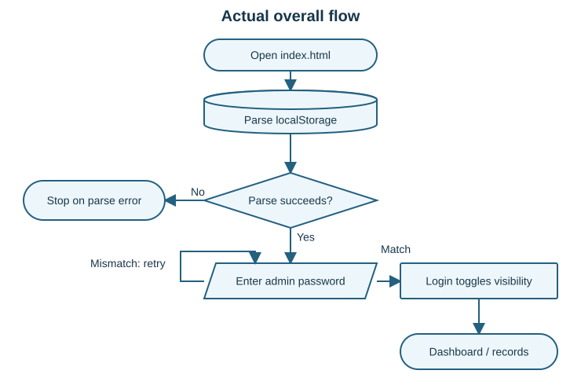
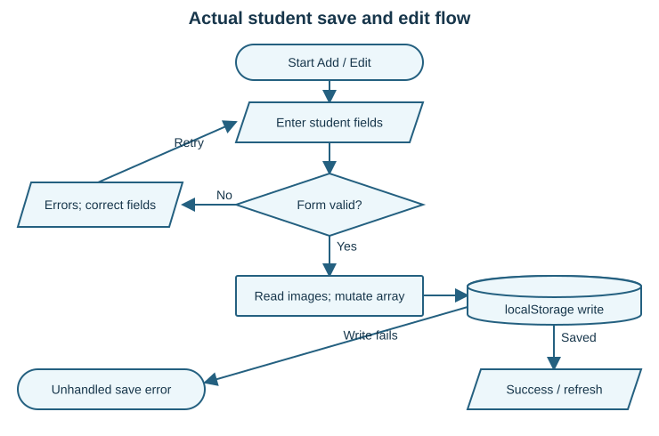
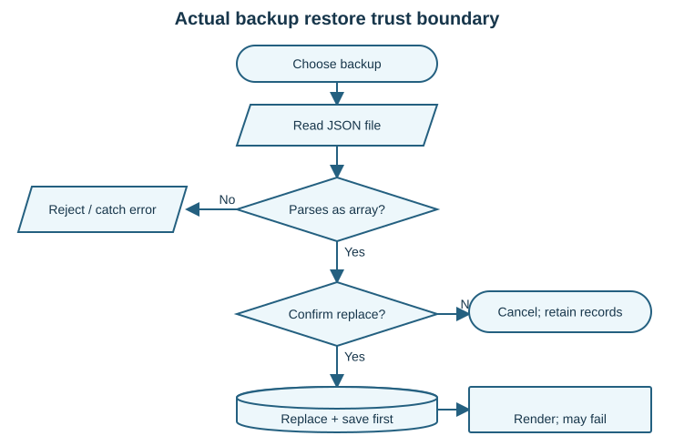

# SYNCONE - Mock Defense Analysis

# Panel brief

**Review date:** October 1, 2026 | Standard review | Taglish

## Ano ang system at gaano ito kahanda?

Ang SYNCONE ay isang **local student-record management prototype**. May admin login screen, student add/edit/view, search at filters, dashboard, document-image attachments, print, at JSON backup/restore. Ang buong data at password ay nasa browser storage ng device. Walang submitted backend, database server, paper, README, o test suite.

**Readiness verdict:** Maipapakita ang pangunahing records workflow gamit ang synthetic data, pero kailangan pang ayusin ang access protection, data integrity, at recovery bago gamitin para sa tunay na student records. Hindi ito full enrollment, grading, o multi-user SIS batay sa supplied implementation. Hindi awtomatikong defect ang kawalan ng mga module na iyon.

## Mga magandang foundation

- May coherent add/edit/view workflow at combined search/course/year/section/status filtering.
- May required-field checks at calendar validation na nakakakita ng impossible date.
- May ID collision loop sa current in-memory list, document previews, at manual backup.
- Gumagamit ng `textContent` ang student-details modal para sa text values; may popup-block checks sa document/print functions.

## Limang pinakamahalagang risks

| Priority | Risk | Bakit mahalaga sa panel |
|---|---|---|
| 1 | Login ay visibility gate lamang | Walang independent authorization bago basahin o baguhin ang records. |
| 2 | Restore accepts malformed array | Puwedeng mapalitan ang valid dataset bago mapansin ang error. |
| 3 | Unescaped imported values | Raw markup pumapasok sa table at print HTML; possible script risk remains browser-unverified. |
| 4 | Images + unhandled storage failures | Maaaring magkaiba ang in-memory at persisted records kapag pumalya ang save. |
| 5 | Stale tab autosave | Puwedeng ma-overwrite ang mas bagong records gamit ang lumang copy. |

## Evidence snapshot

**14 isolated logic checks: 3 pass, 11 fail** against stated expected controls. Lahat ay Node VM checks na may synthetic DOM, storage, FileReader, at popup objects; hindi browser end-to-end tests. The checking script completed its assertions successfully; the 11 failures describe application behavior, not crashed test infrastructure.

**Confirmed (isolated logic)** = directly reproduced using submitted JavaScript. **Code-evidenced** = exact source supports the observation. **Not testable in this review** = browser/UI/device or deployment behavior was not exercised. No submitted files were edited; no real records or accounts were used.

# System explained simply

## Scope, actors, at data movement

**Inferred intended process:** Isang administrator ang nag-eencode at nag-a-update ng student profile, naglalagay ng document images, naghahanap ng records, nagpi-print, at gumagawa ng backup. Inference ito mula sa UI at code; walang paper na nagpapatunay sa formal school process, permissions, retention, o enrollment approvals.

Technology: `index.html` (UI), `style.css` (presentation), `script.js` (all application logic), at 3 JPG/PNG assets. No TypeScript, API, package manifest, external service, or database schema supplied. Inventory is exactly 6 files; generated analysis stays outside the submission.

Data flow: form values -> `students` array -> serialized JSON in `localStorage.students`. Document files become base64 data URLs inside each record. Browser reload reads the saved array; manual backup downloads that array as JSON. Different browser profiles/devices do not share a central dataset through this code.

| Actor / permission | Actual implementation | Meaning |
|---|---|---|
| Administrator UI | Add, edit, view, print, backup/restore, password settings | One shared password; no per-user identity or permission matrix. |
| Logged-out page visitor | Login UI is shown; records already parsed in memory | Record functions have no login-state check. |
| Browser-profile/device operator | Can access application storage | Browser/device access is part of the real trust boundary. |
| Student / faculty / registrar accounts | No separate accounts supplied | Not inferred as required roles without scope documentation. |

## Critical use cases

| Use case | Preconditions and normal flow | Alternative / exception | Postcondition |
|---|---|---|---|
| Create record | Operator opens Add, enters valid profile, submits; images read, ID assigned, save attempted | Validation errors stop submit; image read failure resolves null; storage error uncaught | Success should mean persisted record; failure can leave memory modified. |
| Update record | Existing ID selected; edit fields; submit | Clear resets form; removing an existing document already mutates the live object | Changes persist on successful save; cancel is not a reliable rollback for document removal. |
| Retrieve / print | Record exists; operator filters or views profile | Unknown ID returns; popup blocked triggers alert | Profile displayed; table print may include records outside selected section. |
| Restore | Operator chooses JSON; parser accepts array; confirms replacement | Non-array rejected; malformed array contents pass; render may throw after persistence | Current dataset replaced, with no staged schema validation or undo. |

No paper-to-system traceability matrix is possible: no capstone paper was supplied. UI labels establish feature intent, not proof of institutional requirements.

# Domain capability baseline and gaps

Baseline is scoped to a single-operator student profile/document register. Core = needed for reliable primary workflow; Important = operational reliability; Optional = broader SIS expansion. A school deployment in the Philippines is **assumed, not confirmed**. RA 10173 is therefore contextual guidance, not a legal compliance verdict.

| Capability / importance | Basis and expected behavior | Actual evidence / verdict | Effect / priority |
|---|---|---|---|
| Student profile lifecycle / Core | UI intent: add, update, retrieve accurate fields | Submit + update + modal exist, JS 183-235, 398-592; **Partial** | Happy path available; failed writes and cancellation weaken integrity. High |
| Stable unique ID / Core | Necessary dependency: distinguish each record | JS 140-152 skips loaded collisions; no commit-time/concurrent constraint; **Partial** | Double-submit/tab/import collisions not prevented globally. High |
| Access control / Core | Necessary confidentiality; OWASP [R1] | JS 78-109, 314-385: visibility toggle only; **Incorrect** | No trusted authorization boundary. High |
| Protected student documents / Core | Sensitive data context [R1,R2] | Data URLs in localStorage, JS 154-180, 223-226; **Partial** | Browser storage/backup holds full documents. High |
| Field/business validation / Core | Necessary accuracy of profile | JS 1372-1528: date format/calendar, required values; no future-date rule; **Partial** | Invalid future DOB accepted. Medium |
| Search + consistent print / Core | Explicit filters and Print Table UI | JS 294-312 vs 1171-1223; **Incorrect** | Section scope lost at print. Medium |
| Accurate aggregate reporting / Core | Explicit Total/Active/Inactive labels | JS 616-633; **Incorrect** | Total displays active count only. Medium |
| Durable save / Core | Necessary persistence; quota handling [R3] | JS 237-264: full JSON write, no catch; **Partial** | Cannot guarantee success under storage failure. High |
| Safe backup/restore / Important | UI promise: protect current data | JS 767-839: array check and confirm; no item schema; **Partial** | Invalid import can replace valid records. High |
| Edit history / Important | Recommended accountability for records | No actor/time/change log model or history flow; **Missing** | Cannot explain who changed a document or field. Medium |
| Tab conflict control / Important | Same-browser storage semantics [R4] | Whole-array autosave; no storage listener/version; **Missing** | Lost updates possible. High |
| Retention/recovery rules / Important | Recommended operations; privacy context [R2] | Manual backup only; no retention policy or rollback; **Not verifiable** as institutional policy | Need owner-approved process. Medium |
| Grades, fees, enrollment approvals, multi-campus sync / Optional | No explicit submitted requirement | **Out of scope** for this review | Ask for paper/scope before calling them missing. Later |

**Baseline critique:** Product should reliably preserve, retrieve, restrict, and recover the records it already promises. Enterprise modules are not needed to resolve these gaps. “Complete” status is withheld for end-to-end capabilities because no browser journey was executed. R1-R4 are linked with access date and context on the last page.

# Overall flow and student transaction



**Overall actual behavior:** Data is loaded before login. Invalid stored JSON terminates script initialization. Correct password reveals the application; incorrect password remains at login. Navigation and record functions do not consult an authenticated state. Source: JS 1-3, 78-139.



**Main transaction:** Form validation happens before file reads. Create pushes a new object; edit mutates an existing object. Storage success is needed before the success UI. An uncaught write error ends that path without rollback. Editing reads each selected image twice through the submit/update call chain. Source: JS 183-241, 489-592.

# Restore boundary, validation, and process correctness



**Critical boundary:** JSON syntax and outer array are checked, but item structure is not. Confirmation is a useful safeguard against accidental replacement; it does not validate data. Persistence happens before rendering, so an error message can appear after invalid data has already been saved. Source: JS 794-839.

| Layer / process | Correct, partial, incorrect, or blocked | Verification boundary |
|---|---|---|
| HTML constraints | **Partial:** required, maxlength, selects, file accept | Browser native submission behavior not exercised. Email lacks HTML `required` though custom validation requires Gmail. |
| JavaScript validation | **Partial:** rejects blanks, impossible calendar dates, malformed contact/email | T01/T02 pass; T03 future DOB fails. Names only checked nonempty in custom validator. |
| Business rules | **Partial:** in-memory ID loop; no global ID uniqueness, DOB <= today, duplicate-profile policy | Cross-record policy and age thresholds need owner requirements. |
| Server authorization/validation | **Missing** in submitted architecture | Not applicable to offline UI mechanics; required trusted protection if actual school records are deployed. |
| Database constraints/transaction | **Missing:** browser JSON only | No durable transaction or independent constraint exists in supplied files. |
| Imported backup | **Incorrect:** only outer array check; no field, ID, enum, URL, or size validation | T07: `[null]` persisted before error. |
| Image upload | **Partial:** PNG/JPEG MIME allowlist; read error returns null | No byte-size limit or file signature/decode verification; actual image loading not exercised. |
| Read/filter/detail | **Partial:** combined filters and modal text handling | T06: screen section filter works; print loses section. |
| Edit/cancel | **Incorrect** for existing-document removal | T10: Clear does not undo live record mutation; autosave persists it. |
| Save and recovery | **Partial:** backup exists; unhandled quota/startup faults | T08/T09: injected corrupt JSON/write failure exposed absent recovery. |

**What should happen:** Validate candidate data, check authorization and identity, commit one consistent update, then show success. For restore, preview and validate the full candidate dataset before replacing anything; retain an undo copy. This is recommended intended flow, separate from the actual diagrams.

# Prioritized findings - access and data boundaries

## F01 - Walang independent access protection

**High | High confidence | Confirmed in isolated logic + code-evidenced.** Role/data: all student records and documents; JS 1-3, 78-109, 314-385; CSS 27-29.

Problema: Login hides or shows screens; record functions do not check permission. Safe demo: in a disposable synthetic harness, call `viewStudent` before login. **Expected:** denied. **Actual T13:** profile fields populated. Password and recovery answer also use readable localStorage. Impact: someone with the same browser profile or injected same-origin code can reach private data. No remote compromise was tested.

Ayusin: define actual operator identity and protect the persistence boundary for real deployment; use a trusted service or protected local application storage appropriate to scope. A hidden div or client-side hash does not create authorization. Verify logged-out read/write operations are denied at the trusted boundary. Panel: “Saan talaga ine-enforce ang permission bukod sa login screen?”

## F02 - Bagong password hindi agad ginagamit sa login

**Medium | High confidence | Confirmed in isolated logic.** Role: administrator; JS 3, 78-81, 63, 750-765.

Problema: Password settings/reset writes to storage but leaves the `adminPassword` variable unchanged. Safe demo: change default password, logout, then login on the same page. **Expected:** new accepted, old rejected. **Actual T04:** reverse until reload. Reset has the same stale-variable pattern by code inspection. Impact: confusing recovery and stale credential acceptance. Ayusin: update the current authentication state consistently; verify both same-page and post-reload credential transitions. Panel: “Bakit iba ang stored password at login comparison value?”

## F03 - Restore at startup hindi kayang mag-recover safely

**High | High confidence | Confirmed in isolated logic.** Role/data: administrator and full dataset; JS 2, 794-837.

Problema: Valid JSON array is treated as valid student data. Safe demo: import synthetic `[null]` after one valid test record; confirm restore. **Expected:** reject and retain old dataset. **Actual T07:** invalid data saved; rendering throws; generic error follows. T08 separately confirms malformed stored JSON throws at startup. Impact: unusable record list and manual recovery need. Ayusin: validate every item and duplicate ID before commit; retain previous dataset and handle startup corruption. Verify invalid import leaves stored data unchanged. Panel: “Paano ninyo mapapatunayang safe ang restore bago mapalitan ang current records?”

## F04 - Raw values pumapasok sa generated HTML

**High potential impact | High confidence for sink; execution unverified.** Role/data: table, recent list, document/print outputs; JS 278-289, 663-680, 459-477, 924-959, 980-1163, 1247-1267.

Problema: Imported strings interpolate directly into HTML and inline handlers. Safe demo: harmless `<b>TEST-MARKER</b>` in a synthetic record. **Expected:** literal text. **Actual T12:** raw tag reaches table and popup HTML. Impact: output integrity failure; possible cross-site scripting if active payload reaches the browser, not executed here. Ayusin: text nodes/escaping for each output context, validated IDs and document data, same validation on import. Verify harmless markup stays literal everywhere. Panel: “Bakit safe ang modal `textContent`, pero iba ang table at print?”

## F05 - Save failure walang consistent recovery

**High | High confidence | Confirmed injected failure + static image risk.** Data: records/images; JS 154-180, 223-240, 503-578.

Problema: Base64 images share a limited storage bucket, with no size cap or save-error handling. Safe demo: inject a storage write exception in the synthetic harness. **Expected:** controlled error with intact saved state. **Actual T09:** exception propagates; mutation already happened in create/edit. Actual browser quota limit was not filled. Ayusin: bounded image sizes, controlled storage errors, and commit/rollback behavior. Verify forced failure gives a clear error and preserves the prior committed record. Panel: “Kapag puno ang storage, alin ang tunay na source of truth?”

# Prioritized findings - workflow and reporting

## F06 - Remove document nakaka-save kahit kinansela ang edit

**Medium | High confidence | Confirmed in isolated logic.** Role/data: document attachments; JS 887-914, 594-614, 261-264.

Problema: Remove modifies the actual student object immediately. Safe demo: edit synthetic record, remove existing birth certificate, click Clear, invoke scheduled autosave. **Expected:** original remains. **Actual T10:** null document persisted. Impact: unintentional document loss; there is no attachment history. Ayusin: draft edits, then commit only on Update; Clear discards draft. Verify removal + Clear + autosave keeps original. Panel: “Anong difference ng preview state at saved record state?”

## F07 - Lumang tab puwedeng mag-overwrite ng bagong records

**High | High confidence for simulated sequence; browser scenario not run.** Data: full student array; JS 2, 237-264; no storage-event/version logic found in entire script.

Problema: Each page holds its own full array. Safe demo: two VM contexts share synthetic storage; A adds one record; stale B runs autosave. **Expected:** new record retained or conflict shown. **Actual T11:** storage becomes `[]`. Impact: silent lost updates even on one browser profile. Ayusin: stop unconditional stale writes and detect version conflicts; single-writer restriction is a valid prototype control if enforced and documented. Verify two open sessions cannot silently replace newer changes. Panel: “Paano ninyo hinahandle ang two-tab writes?”

## F08 - Total Students kapareho lang ng Active

**Medium | High confidence | Confirmed in isolated logic.** Module: dashboard; JS 616-633; HTML 100-125.

Safe demo: 1 active + 1 inactive synthetic record. **Expected:** Total 2, Active 1, Inactive 1. **Actual T05:** 1/1/1. Impact: wrong overview. Ayusin: total counts all scoped records; verify total equals active + inactive when only those statuses are allowed. Panel: “Ano ang definition ng Total Students?”

## F09 - Section filter nawawala sa Print Table

**Medium | High confidence | Confirmed generated-output logic.** Module: list/print; JS 294-312 vs 1171-1223.

Safe demo: A and B records; select A and print. **Expected:** A only. **Actual T06:** screen excludes B but popup HTML includes B. Impact: misleading printed list and unnecessary disclosure of out-of-section profiles. Ayusin: same result-set selection for UI and print. Verify visible IDs equal printed IDs for each filter combination. Browser print dialog/layout not tested. Panel: “Bakit dalawang magkaibang filtering rules ang ginagamit?”

## F10 - Field checks hindi sapat sa tunay na student information

**Medium | High confidence | Confirmed future date; other rules code-evidenced.** Module: validation; JS 1397-1528; HTML 208-226, 290-310.

Problema: Valid calendar date can be in the future; email must be lowercase `@gmail.com`; contact only starts with 0; course/year/section custom checks only nonempty. Safe demo: otherwise-valid profile with DOB 01/01/2099. **Expected:** reject future DOB. **Actual T03:** accepted. Impact: inaccurate student data; Gmail-only rule may exclude valid school emails unless intentional. Ayusin: owner-approved date/contact/email/enum rules applied to form and imports. Verify today/future boundaries and supported institutional email domains. Panel: “Alin ang school requirement, at alin ang arbitrary validation choice?”

**Secondary code note:** `changePassword` references `passwordMessage` before its `const` declaration in >20-character branches (JS 689-703). Native maxlength limits normal typing; modified/programmatic values can raise ReferenceError. This is a code-evidenced boundary defect, not counted as an executed QA case or separate headline finding.

# Recommended system improvements

Product/process recommendations ito, hindi replacement-code plan. Unahin ang controls na kailangan sa current records workflow bago magdagdag ng modules.

| Priority / current condition | Add or change / intended process | Benefit / success indicator |
|---|---|---|
| **High:** visibility-only shared login | Define actual operator accounts and protected read/write boundary; logged-in operator gets only allowed record operations | Confidentiality and accountability; logged-out calls cannot retrieve or alter stored records. |
| **High:** restore can persist bad records | Stage import; validate schema, required fields, enums, IDs and attachment data; show preview; retain rollback copy before approved replace | Reliable recovery; invalid/cancelled import leaves current data unchanged. |
| **High:** save mutates before durable write | Save one validated candidate; report failure specifically; retain prior committed state; bound attachment sizes | No ambiguous “saved” state; forced write failure leaves record intact and user informed. |
| **High:** same-origin tabs write stale arrays | Enforce one writer or detect revision conflicts before save; require refresh/merge decision when current data changed | Prevent silent loss; two sessions preserve updates or display conflict. |
| **High:** records/documents in readable storage and exports | Define controlled workstation, document access and backup handling; store only needed information; decide protected persistence suitable to actual deployment | Reduced exposure; authorized retrieval/export only, documented retention and recovery drills. |
| **Medium:** destructive edit action precedes Update | Separate draft from saved record; confirm intended attachment removal on commit; Clear discards draft | Predictable cancellation; original image survives cancelled edits. |
| **Medium:** counts and print use wrong result scope | Agree count definitions; use same selected dataset for screen and export/print | Accurate operations; totals reconcile and printed IDs match visible IDs. |
| **Medium:** no change history | Record actor, time, changed fields and document action with minimal necessary data; establish correction/retention process | Traceable corrections; operator can explain a sampled change and restore authorized prior data. |
| **Medium:** rule choices undocumented | Confirm valid emails, contact formats, DOB constraints, document requirements and duplicate policy with school owner | Inclusive, accurate capture; approved boundary cases behave consistently across create/update/import. |
| **Later:** broader academic modules unclaimed | Add enrollment, grades, fees or online sync only if approved scope/paper requires them | Avoid feature inflation; each new module has a verified end-to-end requirement. |

**Suggested readiness gate:** Demonstrate create -> reload -> view -> edit/cancel -> print -> backup -> restore using synthetic records, then exercise invalid import, storage failure, and two-tab conflict. A polished dashboard alone cannot establish operational correctness.

# Important JavaScript and its application

All references are to submitted `script.js`; no TypeScript exists. Inputs, output, side effects, and call sites below explain behavior beyond filename listing.

| Function / location | Input -> output and side effects | Where used / user-visible effect |
|---|---|---|
| `login`, `logout`, `showPage` / 78-139 | Password field compared with startup variable; returns no value; changes DOM visibility/navigation | Login button/Enter, Logout, nav buttons; local page gate only. |
| `generateStudentId` / 140-152 | Current year + loaded array -> unused candidate in field; local while loop | Startup, Add navigation and Clear; no reserved/committed unique ID. |
| `readDocumentImage` / 154-181 | File input -> Promise(data URL or null); MIME allowlist; alert/reset on invalid MIME | Submit and update; read error becomes absent image rather than explicit transaction failure. |
| Submit listener / 183-235 | Event + form -> validated candidate object; awaits 3 reads, mutates array, persists, refreshes UI | Student form submit; edit branch calls `updateStudent` after already reading files. |
| `saveStudents`, `updateLastSaved` / 237-264 | Whole array -> storage JSON + timestamp; no return contract or catch | Create/update/restore/autosave; timestamp means write time, not audit history. |
| `displayStudents`, `filterStudents` / 265-312 | Array/filter fields -> table markup and combined matching subset | List loading/search/filter controls; raw interpolation needs output-context protection. |
| `viewStudent` / 314-385 | ID -> found record in modal; null-safe document-button state | View button; `textContent` for details avoids interpreting those text fields as HTML. |
| `editStudent`, `updateStudent` / 398-592 | ID -> prefilled form; edited fields -> same object; reads docs, saves, clears editing state | Edit and Update; no draft transaction or independent auth/validation inside direct update call. |
| `clearForm`, `removeExistingDocument` / 594-614, 887-914 | Clear resets controls; Remove sets current object's document to null | Clear/Remove buttons; different mutation timing produces cancellation bug. |
| `updateDashboard`, `displayRecentStudents` / 616-685 | Array -> status counts + last five insertion-order records | Dashboard; total bug, no created-at ordering or modification history. |
| `changePassword`, `resetForgottenPassword` / 686-765, 22-70 | Form credentials -> storage password/security settings; reset compares case-insensitive answer | Settings/recovery; live login variable not refreshed. |
| `backupData`, restore listener / 767-841 | Array -> JSON download; selected JSON -> replacement array | Backup/Restore UI; backup includes documents but excludes passwords/security settings. |
| `openDocumentImage`, print functions / 915-1370 | Data URL/ID/filters -> new window HTML; browser printing requested | Document view, Print detail/table; actual rendering/popups/print not exercised here. |
| `validateStudentForm` + input listeners / 1372-1694 | Trimmed fields -> boolean + inline errors; listeners normalize date/contact typing | Submit/blur/input; calendar roundtrip useful, imported data bypasses these rules. |

**Safe architectural explanation:** JS owns UI, business rules, storage, and security decisions in one file. Simplicity is reasonable for a prototype, but these responsibilities need consistent trust-boundary checks; file length or style alone is not an authorship signal.

# Vibe-coding indicators - evidence, not authorship

These are observable integration/verification risks. **Hindi ito proof na AI ang sumulat.** Same defects can arise from rushed manual work. Confidence refers to the inconsistency, not authorship.

## V1 - Copied metric assignment | High confidence

JS 616-626, `updateDashboard`:

```js
let active =
    students.filter(function(student) {
        return student.status === "Active";
    }).length;
document
    .getElementById("totalStudents")
    .textContent = active;
```

What it does: active-only count feeds Total. Signal: total/active labels imply different measures but share the same expression; mixed-status verification seems absent. Effect: T05 reports misleading total.

## V2 - Storage update disconnected from live auth | High confidence

JS 3, 81 and 750, startup/login/settings responsibilities:

```js
let adminPassword = localStorage.getItem("adminPassword") || "admin123";
```

```js
if (password === adminPassword) {
```

```js
localStorage.setItem("adminPassword", newPassword);
```

What it does: password loaded once, then different state updated. Signal: the settings success path is not reconciled with its consumer. Effect: T04 shows stale-password acceptance until reload.

## V3 - Happy-path backup acceptance | High confidence

JS 805-809 and 824-828, restore listener:

```js
let restoredStudents =
    JSON.parse(e.target.result);
if (
    !Array.isArray(restoredStudents)
)
```

```js
students =
    restoredStudents;
saveStudents();
updateDashboard();
displayStudents();
```

What it does: outer array check precedes replacing/saving records. Signal: assumed item schema is verified only indirectly when rendering later. Effect: T07 persists `[null]` then shows a misleading read-error message.

## V4 - Untested exceptional password branch | High confidence, static only

JS 689-703, `changePassword`:

```js
if (newPassword.length > 20) {
    passwordMessage.textContent =
        "Password must not exceed 20 characters";
```

```js
const passwordMessage = document.getElementById("passwordMessage");
```

What it does: tries to use a later block-scoped variable. Signal: exceptional branch disagrees with declaration order; HTML maxlength can hide the defect during normal typing. Effect: >20 programmatic input can cause ReferenceError instead of validation feedback. Browser reproduction not run.

# Evidence-aware QA inventory

**Executed: 14. Passed expected controls: 3. Failed expected controls: 11. Harness errors: 0.** All results are Confirmed in isolated Node VM logic, not full browser journeys. Each uses fresh synthetic context; T11 alone shares an in-memory storage object across two contexts. Actual student data was never accessed.

| ID / category | Safe synthetic steps and expected result | Actual result / status |
|---|---|---|
| T01 Positive form | Fill all fields with valid sample values; validator accepts | **Pass:** true. |
| T02 Date boundary | Use 02/30/2000; validator rejects nonexistent date | **Pass:** false. |
| T03 Business rule | Use 01/01/2099; reject future DOB | **Fail:** true. |
| T04 Credential lifecycle | Change to new password; same-page logout/login; new works, old fails | **Fail:** new fails, old works. |
| T05 Aggregate | Load 1 active + 1 inactive; expect total 2 | **Fail:** total 1. |
| T06 Integration | Load sections A/B; filter A, generate print HTML; expect same IDs | **Fail:** B excluded on screen, included in print. |
| T07 Import boundary | Restore `[null]`; expect rejection without dataset replacement | **Fail:** bad array persisted before render error. |
| T08 Corrupt storage | Start with `not-json`; expect controlled recovery | **Fail:** SyntaxError during initialization. |
| T09 Failure injection | Storage throws quota-like error; expect controlled save failure | **Fail:** exception propagates; actual quota not filled. |
| T10 Cancel/edit | Remove existing image, Clear, autosave; expect original retained | **Fail:** null persisted. |
| T11 Concurrency simulation | A saves new record; stale B autosaves; expect retain/conflict | **Fail:** newer record overwritten. |
| T12 Output handling | Import harmless bold marker; expect literal text in table/print | **Fail:** raw HTML reaches generated outputs; active script not tested. |
| T13 Authorization | Call view while no login occurs; expect denied access | **Fail:** modal fields populated. |
| T14 ID collision | Loaded candidate already exists; expect next unused ID | **Pass:** collision skipped within loaded array. |

## Checks still needed in a disposable browser profile

Native required/maxlength behavior; create/update/reload end-to-end; invalid/large/real image decode and FileReader errors; actual quota/persistence limits; visual responsive/accessibility checks; keyboard modal focus; printing layout and popup blocks; real two-tab event timing; password-reset UI/reload flow. These are **Not Run**, separate from the 14 executed checks.

Security execution was deliberately limited to harmless markup. T12 confirms unescaped data flow, not exploit execution. Direct calls in T13 demonstrate missing function guards; browser CSS bypass and deployment exposure were not executed. T09 uses fault injection, not a measurement of device capacity.

# Five strongest panel questions

## 1. “Saan ninyo ine-enforce ang access permission kapag tinawag ang record function habang logged out?”

**Strong answer guide:** Explain UI visibility versus trusted data access; identify that localStorage and client functions are inside the user's browser. Show an authorized boundary suitable for actual deployment, or honestly state prototype limits. **Follow-up:** What happens to documents on shared workstations after Logout? **Red flag:** “Secure na dahil hidden ang system div” or “password hashing in the same browser is enough.” Anchor: F01/T13.

## 2. “Paano ninyo sinisiguro na hindi masisira ang current records kapag nag-restore ng backup?”

**Strong answer guide:** Describe full schema/enum/ID/size checks, pre-commit preview, rollback copy, and errors that accurately indicate whether data changed. Acknowledge current outer-array check is insufficient. **Follow-up:** What should happen for `[null]`, duplicate IDs, or invalid attachment URLs? **Red flag:** “JSON.parse succeeded, so valid students na.” Anchor: F03/T07-T08.

## 3. “Kapag sabay ang two tabs o pumalya ang storage, paano ninyo napo-protect ang latest student record?”

**Strong answer guide:** Explain whole-array snapshots and last-write-wins risk; choose explicit single-writer enforcement or version/conflict handling, with controlled failed commits. Discuss bounded attachment sizes. **Follow-up:** Does autosave know whether its copy is newer? **Red flag:** “Autosave every five minutes guarantees walang mawawala.” Anchor: F05/F07/T09/T11.

## 4. “Bakit iba ang nasa filtered screen, printed list, at dashboard total?”

**Strong answer guide:** Point to total receiving active count and print filtering omitting section. Define total population and reuse consistent selection logic; show a two-status, two-section example. **Follow-up:** What other filter combinations must match? **Red flag:** Defending the label after seeing total=active, or treating print as unrelated to chosen scope. Anchor: F08/F09/T05/T06.

## 5. “Ano ang exact moment na committed ang password change at document removal?”

**Strong answer guide:** Distinguish memory, DOM preview, and persisted storage. Password variable remains stale after settings save; document removal mutates live record before Update. Explain synchronized credentials and cancellable draft edits. **Follow-up:** Demonstrate change -> logout -> login and remove -> Clear -> autosave. **Red flag:** “Success alert means all states are consistent.” Anchor: F02/F06/T04/T10.

**Fair scoring:** Reward explanation of actual functions, reproducible examples, and honest limitations. Do not require new enterprise modules or assume AI authorship. Ask proponents to justify Gmail-only validation and operational scope with their requirements, rather than guessing those requirements for them.

# Coverage, limitations, research, and evidence

## Review coverage

Source root: `E:/SYNCONE SYSTEM - MOCK DEF/`. All 1,694 JavaScript lines were covered through responsibility-based targeted reads/searches: login/recovery, navigation, ID generation, add/update, storage, rendering/filtering/modal, document previews/removal, password settings, backup/restore, print generation, validators/input listeners. HTML screens and constraints were inspected. CSS was reviewed for visibility/presentation context; no exhaustive styling/accessibility audit is claimed.

Inventory: `index.html`, `script.js`, `style.css`, `schoolBackground.jpg`, `syncOneLogoLogin.png`, `syncOneLogoSidebar.jpg`. Hash manifest retained outside submission. No paper, test command, package manifest, API route, migration, database, or production URL was supplied. No dependency was installed in the app, no data was seeded, and no source file was changed.

## Assumptions and exclusions

- Student-record register and administrator operator are inferred from UI/code. Enrollment approval, deletion/retention policy, legal processing basis, multiple school users, and Philippine deployment are not confirmed requirements.
- No backend service can be evaluated because none was submitted. This is an architecture limitation, not proof that a separately deployed service cannot exist.
- Browser-native rendering, popup behavior, storage origin behavior for `file://`, printing, reload journeys, real file decoding, and device limits were not executed. Synthetic mocks do not replace browser end-to-end QA.
- T04 confirms password settings behavior. Recovery reset's stale comparison is code-evidenced only. F04 active-script execution is unverified. F07 observed sequence is a shared-storage simulation.
- No numeric readiness score, legal compliance certification, AI-authorship conclusion, exhaustive security assurance, or full validation coverage claim is made.

## Research sources - accessed October 1, 2026

**R1 - OWASP HTML5 Security Cheat Sheet.** Technical guidance on browser-storage trust and sensitive information; supports access/storage baseline and import skepticism. [Official OWASP source](https://cheatsheetseries.owasp.org/cheatsheets/HTML5_Security_Cheat_Sheet.html).

**R2 - National Privacy Commission: Republic Act No. 10173 (2012).** Philippine legal context: education data is sensitive personal information; the Act includes proportionality and safeguards. Actual applicability, processing basis, institutional obligations and policies need deployment facts. This report does not adjudicate compliance. [Official NPC text](https://privacy.gov.ph/data-privacy-act/).

**R3 - MDN Storage quotas and eviction criteria.** Web Storage has finite capacity; writes can throw QuotaExceededError. Source supports handling write failures; review did not measure this machine's quota. [Official platform documentation](https://developer.mozilla.org/en-US/docs/Web/API/Storage_API/Storage_quotas_and_eviction_criteria).

**R4 - MDN Window: storage event.** Same-origin other contexts can receive storage-change notifications; a local array snapshot does not automatically reconcile itself. Supports investigating tab conflicts; exact real-browser sequence remains untested. [Official platform documentation](https://developer.mozilla.org/en-US/docs/Web/API/Window/storage_event).

## Evidence reference convention

“JS 78-109” means exact 1-based lines in submitted `script.js`; HTML/CSS references likewise identify their supplied files. Source SHA-256 for `script.js`: `6bcf115ac894e566359e30b94684e46a2023bd9c7c917bdcf1f3eadec738b78c`.

Canonical report, editable diagrams, full inventory and synthetic check outputs are retained under the workspace-level analysis folder for traceability. The PDF is self-contained; no supporting artifact is required to understand its findings.

