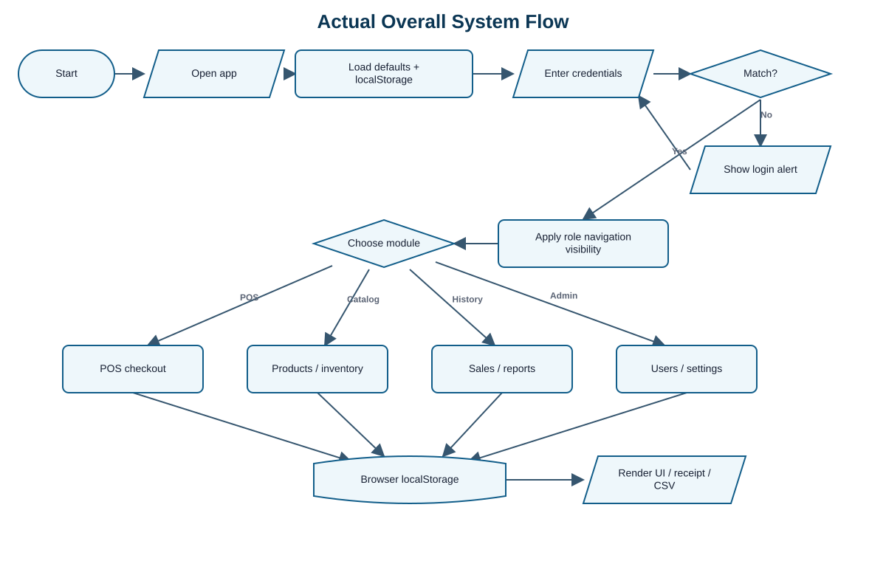
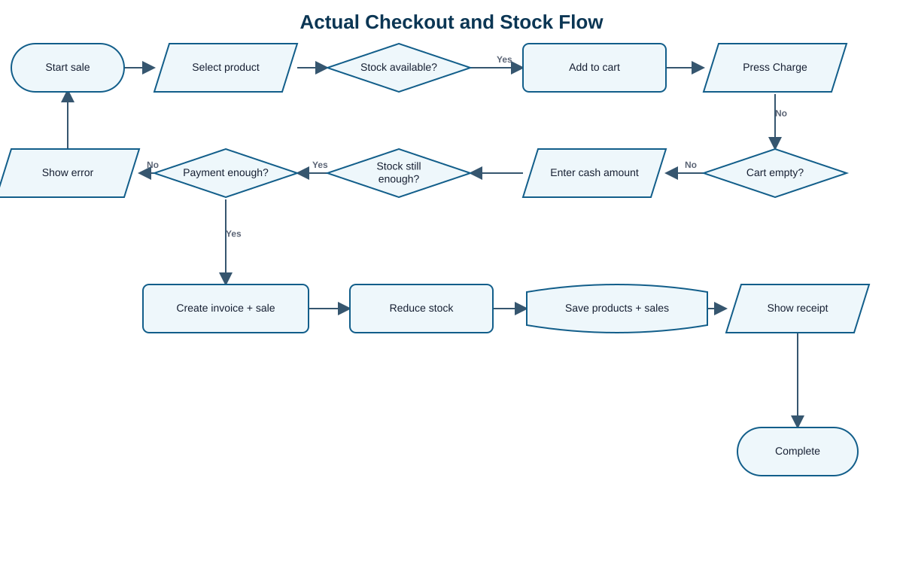
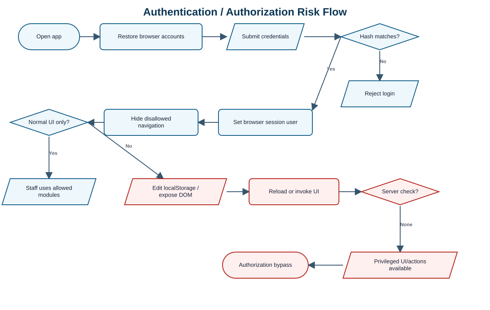

# KHELMOORA OS Mock-Defense Analysis

<style>body{font-size:9.4pt}table{font-size:7.9pt}pre{font-size:8pt;padding:3mm}h2{margin-top:6mm}h3{margin-top:4mm}</style>

# 1. One-page Panel Brief

**Review date:** September 29, 2026  
**Mode:** Standard, system-only  
**Submitted source:** `C:/Users/justi/Downloads/System-20260928T235957Z-1-001/System/`  
**Primary evidence:** `index.html`, `script.js`, `style.css`, bundled `chart.js`, and 25 product images

## Ano ang system?

KHELMOORA OS is a single-page inventory and point-of-sale system for a jewelry store. May Administrator at Staff roles, product and stock maintenance, cash checkout, receipt printing, sales history, dashboard, reports, user management, categories, at store settings. Lahat ng operational data ay nasa browser `localStorage`; walang backend API at walang database.

## Readiness verdict

> **Ready for a controlled, single-device prototype demo; hindi pa ready for real store deployment.** Gumagana ang normal login at checkout, pero ang authorization, data integrity, recovery, at historical reporting ay nakasalalay sa editable browser data.

## Strong points na dapat maipaliwanag sa defense

- **Confirmed:** Admin at Staff logins worked; walang uncaught page error sa isolated Edge run.
- **Confirmed:** Checkout rechecked stock, rejected insufficient cash in code, created `INV-0001`, reduced `EARR-001` from 100 to 99, and persisted one sale.
- **Code-evidenced:** Duplicate SKU is rejected on add (`script.js:1071-1075`).
- **Code-evidenced:** Inventory stock update rejects a value below zero (`script.js:1239-1246`).
- **Code-evidenced:** The current user and last Administrator cannot be deleted (`script.js:2518-2529`).

## Top five risks

| Priority | Risk | What this means |
|---|---|---|
| High | Browser-only authorization | Staff privileges can be changed through `localStorage`; hidden pages can be exposed. |
| High | Stored script injection | Product text is inserted using `innerHTML`; a safe isolated test executed an injected event handler. |
| High | Sale deletion breaks inventory history | Deleting a transaction removes revenue but does not return stock or create a void trail. |
| High | Invalid numeric values | The product form accepted price `-1` and stock `-5`. |
| High | Historical reports are mutable | Profit and category reports use the current product record, not a sale-time snapshot. |

## QA count

The report contains **13 high-value cases**: 3 Passed, 4 Failed, 4 Not Run, and 2 Blocked. The isolated runtime subset had 4 passed and 5 failed checks. `Not Run` and `Blocked` are not treated as success.

# 2. System Explained Simply

## Actors and practical permissions

| Actor | Normal UI access | Important limitation |
|---|---|---|
| Administrator | Dashboard, POS, Products, Inventory, Sales, Reports, Settings | Authority is enforced only in browser JavaScript. |
| Staff | Dashboard, POS, Sales | Navigation is hidden, but privileged HTML and functions still exist in the loaded page. |
| Walk-in customer | Named on receipt only; no account | Customer identity is always hard-coded as `Walk-in Customer`. |

## Modules and data movement

| Module | Purpose | Reads/writes |
|---|---|---|
| Login and users | Hashes passwords, loads accounts, hides navigation by role | `khelmoora_accounts`, `sessionUsername` |
| POS | Cart, discount, VAT, cash amount, invoice and receipt | Products and sales arrays, then `localStorage` |
| Products and inventory | Catalog CRUD, SKU, cost, price, stock, low-stock threshold | `khelmoora_products`, categories, threshold |
| Sales and reports | History, deletion, date filters, revenue, product and category summaries | Sales plus the current products array |
| Settings | Accounts, categories, receipt, store and preferences | Several `khelmoora_*` keys |

## Reconstructed intended process

No paper or formal requirements were supplied, so this is an **assumption based on UI labels and code**: an Administrator configures products, users, and store settings; Staff or Administrator records cash sales; checkout reduces stock and saves an invoice; management reviews history and reports. A real operational flow should also support controlled void/reversal, audit trail, backups, and centralized authorization. Those controls are not implemented in this build.

## Technology and architecture

- Static HTML/CSS/JavaScript, with Chart.js bundled locally.
- No `fetch`, `XMLHttpRequest`, WebSocket, API route, server code, or database reference was found.
- 31 submitted files: 1 HTML, 2 JavaScript, 1 CSS, 2 JPG, and 25 PNG.
- `node --check` passed for `script.js` and `chart.js`; no duplicate HTML IDs and no missing referenced default product image were found.

# 3. Essential Flowcharts

## A. Actual overall system flow



The browser loads defaults plus saved data, authenticates against an in-memory account object, hides pages according to `allowedPages`, then reads and writes all modules through local storage. Evidence: `script.js:1-25`, `668-771`, `841-855`, and `2599-2645`.

## B. Actual checkout and stock flow



The positive flow is coherent for one browser: stock is checked during selection and again at payment; cash is validated; the sale is appended; stock is reduced; both arrays are saved. Evidence: `script.js:205-253` and `496-612`.

## C. Riskiest authentication and authorization flow



The role check controls visibility only. There is no trusted server to reject a changed browser role or privileged function call. Confirmed in runtime checks RT-08 and RT-09; code evidence at `script.js:668-726` and `2599-2645`.

# 4. Prioritized Findings and Loopholes

## F-01 - Browser data can promote Staff to Administrator

**Severity:** High | **Confidence:** High | **Status:** Confirmed runtime  
**Problema:** Ang account, role, page list, at session user ay editable sa browser storage. `applyRoleAccess()` hides menu items but does not create a trusted authorization boundary.  
**Saan:** Login, session restore, all privileged pages and actions.  
**Paano mabubutas:** Sa isolated test, the stored Staff role was changed to `Administrator`, all pages were added to `allowedPages`, then the page was reloaded. Every administrator navigation item became visible. The hidden Settings DOM could also be exposed directly.  
**Expected vs actual:** A trusted server should reject unauthorized actions; actual behavior trusted modified client state.  
**Effect:** A local user can reach product deletion, inventory changes, transaction deletion, user management, and store settings.  
**Ayusin:** Move accounts, sessions, permissions, and privileged mutations to a server; authorize every operation server-side. Keep UI hiding only as usability.  
**Evidence:** `script.js:16-25`, `668-726`, `754`, and `2599-2645`; runtime RT-08 and RT-09.  
**Verification:** Repeat storage tampering; server must still return an access-denied response.

## F-02 - Product content can execute stored browser code

**Severity:** High | **Confidence:** High | **Status:** Confirmed runtime  
**Problema:** Product fields are user-controlled but are concatenated into `innerHTML`.  
**Saan:** POS cards, product table, inventory table, dashboard, receipt, and report rows.  
**Paano mabubutas:** A harmless isolated product name containing an image error handler was saved. When the list rendered, it set a test-only browser flag, proving execution.  
**Expected vs actual:** Product text should display literally; actual HTML was parsed and executed.  
**Effect:** A malicious or accidental value can modify the page, read business data, or perform actions as the current user.  
**Ayusin:** Render user data with `textContent` or explicit DOM nodes; validate image paths separately; add a restrictive Content Security Policy as defense in depth.  
**Evidence:** `script.js:205-218`, `402-411`, `907-920`, and `1161-1177`; runtime RT-05.  
**Verification:** Save HTML-like text and confirm it is shown as text with no event execution.

## F-03 - Deleting a sale does not reverse stock and can reuse invoice numbers

**Severity:** High | **Confidence:** High | **Status:** Confirmed runtime plus code evidence  
**Problema:** Transaction deletion splices the sale record only. It does not return item quantities, store a void reason, or preserve an audit record. The invoice counter is recalculated from remaining sales.  
**Saan:** Sales History and invoice generation.  
**Paano mabubutas:** Checkout one EARR-001, then delete `INV-0001`. The sale count became zero but stock stayed at 99 instead of returning to 100.  
**Expected vs actual:** A void/reversal should atomically preserve history and reverse inventory; actual behavior silently removed only the sale.  
**Effect:** Inventory, revenue, and audit history disagree. Deleting the latest record can make the next checkout reuse its number.  
**Ayusin:** Replace delete with a permissioned void/reversal transaction, reason, actor, timestamp, inventory reversal, and immutable invoice identifier.  
**Evidence:** `script.js:347-359`, `525-551`, and `1342-1355`; runtime RT-03.  
**Verification:** Void a sale and confirm stock restoration, preserved original sale, linked reversal, and no invoice reuse.

## F-04 - Product form accepts negative financial and stock values

**Severity:** High | **Confidence:** High | **Status:** Confirmed runtime  
**Problema:** The product form checks only blank/NaN values; it does not require cost, price, and stock to be zero or higher. The HTML numeric inputs also have no `min` constraint.  
**Saan:** Product Add/Update.  
**Paano mabubutas:** Save price `-1` and stock `-5`; the product was persisted.  
**Expected vs actual:** Invalid values should be rejected; actual product became both negative-priced and out of stock.  
**Effect:** Dashboard, inventory value, receipts, and financial reports can become nonsensical.  
**Ayusin:** Enforce finite non-negative cost/price and integer non-negative stock at the trusted server and mirror it in HTML/JavaScript.  
**Evidence:** `index.html:591-603`, `script.js:1042-1062`; runtime RT-04.  
**Verification:** Test `-1`, decimal stock, empty, `Infinity`, very large values, and valid zero boundaries.

## F-05 - Historical profit and category reports change with the live catalog

**Severity:** High | **Confidence:** High | **Status:** Code-evidenced  
**Problema:** A sale stores SKU, name, quantity, and selling price, but not cost, category, tax rate, or the complete discount allocation. Profit and category reports later look up the current product record.  
**Saan:** Sale record and report builders.  
**Paano mabubutas:** Change a product cost/category after a sale, or delete the product, then regenerate reports. Profit uses the new cost or zero; category becomes `Uncategorized` and is not included in the fixed table.  
**Expected vs actual:** Historical figures should use values frozen at checkout; actual figures depend on later catalog edits.  
**Effect:** Previously reported gross profit and category totals are not reproducible.  
**Ayusin:** Store sale-time unit cost, category, tax rate/amount, discount allocation, and gross/net values per line; report only from immutable sale snapshots.  
**Evidence:** `script.js:532-541`, `1774-1808`, and `1810-1851`.  
**Verification:** Record a sale, change/delete the product, and confirm the historical report remains identical.

## F-06 - Report totals do not share one financial definition

**Severity:** Medium | **Confidence:** High | **Status:** Code-evidenced  
**Problema:** Sales totals use `sale.total` after discount and VAT, while product/category revenue and profit revenue use `item.price * qty` before discount and VAT. The Sales Report also renders all periods even when one period is selected.  
**Saan:** Sales, Product Performance, Profit and Revenue, Category Sales, CSV export.  
**Effect:** Two reports for the same period can legitimately show different "Total Sales" without explaining gross, discount, tax, and net meanings.  
**Ayusin:** Define gross sales, discounts, net sales, tax, COGS, and gross profit once, store needed snapshots, and label each output consistently.  
**Evidence:** `script.js:1666-1733`, `1736-1808`, `1810-1851`, and `1885-1953`.  
**Verification:** One discounted VAT sale must reconcile across receipt, history, every report, and CSV.

## F-07 - Category settings are not integrated end to end

**Severity:** Medium | **Confidence:** High | **Status:** Code-evidenced  
**Problema:** Settings can add/delete arbitrary categories, but POS filters and Category Sales use fixed hard-coded mappings. Deleting a category does not check existing products.  
**Saan:** Product form, POS filters, category settings, category reports.  
**Effect:** A custom category has no dedicated POS filter and may disappear from reports; deleting a used category leaves inconsistent products.  
**Ayusin:** Use one category source for settings, forms, filters, and reports; block deletion while referenced or require a reassignment workflow.  
**Evidence:** `script.js:152-159`, `1394-1401`, and `2223-2288`.  
**Verification:** Add, assign, sell, report, rename, and delete a custom category without losing visibility or historical classification.

## F-08 - Default credentials and browser-side password storage are unsafe

**Severity:** High | **Confidence:** High | **Status:** Confirmed defaults plus code evidence  
**Problema:** Source contains `admin/admin123` and `staff/staff123`. Passwords are unsalted SHA-256 hashes when available, with a weak custom fallback, stored beside roles in `localStorage`; login has no attempt limit.  
**Saan:** Authentication and account management.  
**Effect:** A copied deployment starts with public credentials; an attacker with browser access can copy hashes or repeatedly guess passwords. Hashing in the same untrusted client does not secure authorization.  
**Ayusin:** First-run account setup, server-side password hashing using Argon2/bcrypt/scrypt, rate limiting, secure session cookies, forced default-password change, and account recovery policy.  
**Evidence:** `script.js:637-707` and `728-771`; runtime RT-01 and RT-06.  
**Verification:** Fresh deployment must not accept known defaults and must lock/rate-limit repeated failures.

## F-09 - Browser-only storage has no shared transaction or recovery control

**Severity:** High | **Confidence:** High | **Status:** Architecture-evidenced; multi-device test blocked  
**Problema:** Products, sales, users, and settings are independent per browser profile. There is no central database, transaction, backup, restore, or synchronization layer.  
**Saan:** Entire system.  
**Effect:** Clearing browser data can erase operations; another terminal sees different stock; concurrent checkouts cannot prevent overselling; user changes do not propagate.  
**Ayusin:** Central transactional persistence with backups, restore drills, atomic sale-and-stock updates, and an offline policy if required.  
**Evidence:** `script.js:1-25` and all `localStorage` save/restore routines; static search found no network or database layer.  
**Verification:** Two clients must see the same stock, overlapping sales must serialize safely, and a tested backup must restore all business data.

# 5. Recommended System Improvements

| Priority | Current condition | Add or change | Intended process | Benefit | Success indicator |
|---|---|---|---|---|---|
| Critical | Browser decides identity and authority | Central authentication, server sessions, operation-level authorization | Server verifies actor and permission for every read/write | Prevents client-side privilege escalation | Modified browser role still receives access denied |
| High | Sale is permanently deleted without inventory reversal | Controlled void/refund workflow with reason and audit trail | Authorized user creates a linked reversal; original remains | Reconciles cash, stock, and accountability | Void restores quantities and is visible in audit history |
| High | All data is in one browser | Central database, automated backup, tested restore | Every terminal commits to one source of truth | Multi-device consistency and recovery | Recovery-point and recovery-time objectives are demonstrated |
| High | Sale lines omit cost/category/tax snapshot | Immutable sale-time financial snapshot | Checkout stores gross, discount, tax, net, cost, category | Stable historical reports | Report totals remain unchanged after catalog edits |
| High | Untrusted text reaches `innerHTML` | Safe text rendering and input/output validation | Text remains text throughout the UI and exports | Prevents stored script injection | Security payload suite executes nothing |
| Medium | Categories and reports use separate fixed lists | Single managed category lifecycle | Add/rename/archive/reassign through one workflow | Prevents missing filters and totals | Custom category appears consistently everywhere |

# 6. Validation and Process Correctness

## Trust-boundary validation matrix

| Boundary | Current control | Verdict | Missing control |
|---|---|---|---|
| Login input | Required fields and hash comparison | Partial | Server verification, secure password storage, throttling |
| Role/permission | Hide navigation using `allowedPages` | Incorrect for security | Server authorization on each privileged operation |
| Product SKU | Required and duplicate check on add | Partial | Normalization, length/character policy, server uniqueness constraint |
| Price/cost/stock | NaN check; stock-update form rejects negative | Partial | Non-negative finite ranges on product add/update and server/database constraints |
| Checkout stock | Checked on add and immediately before payment | Correct for one tab | Atomic database transaction and concurrency control |
| Cash amount | Must cover computed total | Mostly correct | Finite upper/lower bounds and currency-safe decimal arithmetic |
| Tax/discount | Discount capped at subtotal; tax read from settings | Partial | Valid tax range, authorization, stored sale-time breakdown |
| Date range | Date inputs converted to start/end | Partial | Required dates and From <= To validation |
| User content rendering | Many lists use template `innerHTML` | Incorrect | Context-safe DOM rendering and CSP |
| Persistence | JSON parse with some fallback logging | Partial | Schema validation, database constraints, backup/recovery |

## Critical use-case correctness

| Use case | Preconditions | Main result | Alternate/exception | Postcondition | Verdict |
|---|---|---|---|---|---|
| Admin login | Default or saved account exists | Dashboard shown | Blank/invalid input alerts | Browser session username saved | Partial - authentication works, trust boundary does not |
| Staff login | Staff exists | Allowed menus visible | Disallowed menus hidden | Client role applied | Incorrect as authorization; correct as UI behavior |
| Cash sale | Product in stock, cart not empty | Sale and stock saved | Stock/cash errors keep flow open | Receipt shown, cart cleared | Correct in isolated single-browser happy path |
| Product add | Admin UI open | Product saved and rerendered | Duplicate SKU rejected | Catalog persists | Partial - negative values and unsafe text accepted |
| Stock update | Existing SKU | New non-negative stock saved | Negative/NaN rejected | Dashboard/table refresh | Correct for direct stock form; no reason/audit record |
| Sale deletion | Administrator | Sale removed | Confirmation dialog | Reports refresh | Incorrect - no reversal or immutable history |

# 7. Important JavaScript Functions

| Function / responsibility | Inputs and output | Side effects and user-visible effect | Location |
|---|---|---|---|
| `hashPassword(plainText)` | Password string to 64-character hash | Uses SHA-256 in secure contexts; custom fallback otherwise | `script.js:637-652` |
| Login submit handler | Username/password to account match | Sets current user, browser session, role label, and visible pages | `script.js:728-771` |
| `applyRoleAccess(allowedPages)` | Array of page names | Hides menu items and redirects to Dashboard when needed | `script.js:711-726` |
| `renderPosProductList()` | Global products/cart | Builds clickable cards and enforces cart quantity against current stock | `script.js:205-253` |
| Payment handler | Cart, cash, discount, VAT | Rechecks stock, creates invoice, saves sale, reduces stock, shows receipt | `script.js:496-612` |
| Product form submit | Form fields to product object | Duplicate-SKU check, save, rerender all catalog views | `script.js:1038-1087` |
| Stock save handler | SKU and new quantity | Rejects negative stock, updates product and views | `script.js:1239-1260` |
| Sales deletion handler | Invoice number | Removes one sale, recalculates counter, refreshes reports | `script.js:1342-1355` |
| `getReportDateRange(period)` | Daily/weekly/monthly/quarterly/yearly/custom | Produces start/end dates for report filtering | `script.js:1628-1660` |
| `buildProfitRevenueReport(range)` | Date range and global sales/products | Calculates revenue and COGS from sale prices plus current catalog costs | `script.js:1774-1808` |
| `downloadReportCSV(type, range)` | Selected report and range | Creates browser Blob and downloads CSV | `script.js:1885-1968` |
| `restoreSessionOnRefresh()` | Navigation type plus saved username/page | Auto-opens the dashboard on reload and reapplies client role | `script.js:2599-2645` |

## Key implementation takeaway

The code is easy to demonstrate because all state is local and all modules share global arrays. The same simplicity is the main ceiling: there is no trusted boundary between user, role, data, and business operation. For a prototype this is understandable; for deployment it must change before adding more screens.

# 8. Vibe-Coding Risk Indicators

These are observable implementation-risk signals, **not proof of AI authorship**.

## V-01 - Production-looking defaults mixed with hard-coded credentials

**Location:** `script.js:654-665` | **Responsibility:** Account bootstrap | **Confidence:** High

```js
const accounts = {
    admin: {
        password: "admin123",
        role: "Administrator",
        allowedPages: ["dashboard", "pos", "products", "inventory", "sales", "reports", "settings"]
    },
    staff: { password: "staff123", role: "Staff", allowedPages: ["dashboard", "pos", "sales"] }
};
```

**What it does:** Creates first-run accounts. **Why signal:** Demo credentials are embedded in the same file that implements real user management. **System effect:** Every fresh copy starts with known passwords unless manually changed.

## V-02 - Authorization is implemented as menu visibility

**Location:** `script.js:711-725` | **Responsibility:** Role access | **Confidence:** High

```js
function applyRoleAccess(allowedPages) {
    navItems.forEach(function (item) {
        const page = item.getAttribute("data-page");
        const isAllowed = allowedPages.includes(page);
        item.style.display = isAllowed ? "" : "none";
    });
    if (!activePage || !allowedPages.includes(activePage)) {
        if (dashboardNav) dashboardNav.click();
    }
}
```

**What it does:** Hides navigation and selects Dashboard. **Why signal:** UI state is treated as authorization without a server decision. **System effect:** Hidden pages/actions remain in the loaded client and were exposed in runtime testing.

## V-03 - User-controlled product fields are interpolated into HTML

**Location:** `script.js:907-919` | **Responsibility:** Product table rendering | **Confidence:** High

```js
productTableBody.innerHTML = filtered.map(function (p) {
    return `
        <tr data-sku="${p.sku}">
            <td>${buildProductImageTag(p.image, p.name, "product-thumb")}</td>
            <td>${p.name}</td>
            <td>${p.sku}</td>
            <td>${p.description}</td>
```

**What it does:** Builds product rows. **Why signal:** Rendering was completed for the happy path without a consistent encoding boundary. **System effect:** Stored product text executed an injected handler in the isolated test.

## V-04 - Required-field validation stops before business boundaries

**Location:** `script.js:1042-1062` | **Responsibility:** Product save validation | **Confidence:** High

```js
const price = parseFloat(pfPrice.value);
const stock = parseInt(pfStock.value, 10);
if (name === "" || sku === "" || isNaN(price) || isNaN(stock)) {
    alert("Please complete the required fields (Name, SKU, Price, Stock).");
    return;
}
const productData = {
    cost: parseFloat(pfCost.value) || 0,
    price: price,
    stock: stock
};
```

**What it does:** Rejects missing or non-numeric required values. **Why signal:** It validates type presence but not business-valid ranges. **System effect:** Negative price and stock were saved.

## V-05 - Historical COGS is reconstructed from current catalog state

**Location:** `script.js:1780-1787` | **Responsibility:** Profit report | **Confidence:** High

```js
filteredSales.forEach(function (s) {
    s.items.forEach(function (item) {
        const product = products.find(function (p) { return p.sku === item.sku; });
        const cost = product ? product.cost : 0;
        totalRevenue += item.price * item.qty;
        totalCost += cost * item.qty;
    });
});
```

**What it does:** Calculates revenue and cost. **Why signal:** The report assumes the catalog never changes after a sale. **System effect:** Editing/deleting a product changes old profit results.

# 9. QA Summary

| ID | Test | Status | Actual / evidence | Severity |
|---|---|---|---|---|
| QA-01 | Default Administrator login | Passed | Dashboard opened | High |
| QA-02 | Staff normal navigation | Passed | Only Dashboard, POS, Sales visible | Medium |
| QA-03 | Tamper Staff role in localStorage | Failed | All admin pages became visible | High |
| QA-04 | One-item cash checkout | Passed | Sale stored; stock 100 to 99 | High |
| QA-05 | Delete sale and reverse stock | Failed | Sale gone; stock stayed 99 | High |
| QA-06 | Reject negative price/stock | Failed | Price -1 and stock -5 saved | High |
| QA-07 | Render product name safely | Failed | Injected handler executed | High |
| QA-08 | Reject reversed custom dates | Not Run | No explicit code validation | Medium |
| QA-09 | Preserve profit after cost change | Not Run | Current cost lookup found | High |
| QA-10 | Custom category end to end | Not Run | Fixed mappings found | Medium |
| QA-11 | Never reuse invoice after deletion | Not Run | Counter derives from remaining sales | High |
| QA-12 | Prevent concurrent overselling | Blocked | No shared backend/database | High |
| QA-13 | Restore cleared browser data | Blocked | No backup/restore workflow | High |

## Testing notes

- Runtime used headless Microsoft Edge in a fresh temporary context. Source files were not modified.
- Safe local payloads affected only the temporary context; no real accounts, production service, seed, migration, or destructive external test was used.
- `script.js` and `chart.js` passed syntax checks. No runtime page errors appeared during the nine-check run.
- Full QA details remain in the supporting CSV for traceability, but the PDF is the canonical reviewer document.

# 10. Five Strongest Panel Questions and Limitations

## Q1. Saan talaga ine-enforce ang authorization: menu visibility ba o trusted server?

**Why ask:** Ito ang pinakamalaking security boundary.  
**Strong answer:** The student should acknowledge that the current build is client-only, explain why hiding menus is not authorization, and propose server-side sessions plus permission checks for every mutation.  
**Follow-up:** If Staff calls the same delete function directly, what component rejects it?  
**Red flags:** "Hidden naman ang button," "hashed ang password kaya safe," or no distinction between authentication and authorization.

## Q2. Ano ang tamang business process kapag mali ang sale: delete, void, o refund?

**Why ask:** Current deletion removes revenue but leaves stock reduced.  
**Strong answer:** Preserve the original sale; create a linked reversal with actor, reason, timestamp, payment effect, and atomic stock return; never reuse invoice IDs.  
**Follow-up:** What if only one line item is returned?  
**Red flags:** Hard delete, manual stock edit, or no audit trail.

## Q3. Bakit kailangang i-snapshot ang cost, category, discount, at tax sa oras ng checkout?

**Why ask:** Current historical profit depends on the live product record.  
**Strong answer:** Catalog values change; immutable sale-line facts make old reports reproducible and allow gross, net, VAT, COGS, and profit to reconcile.  
**Follow-up:** Which exact fields belong to the sale header versus each sale line?  
**Red flags:** Recompute old sales from current price/cost or assume products are never edited/deleted.

## Q4. Paano ninyo pipigilan ang stored script injection sa product name and description?

**Why ask:** Runtime confirmed execution through `innerHTML`.  
**Strong answer:** Use `textContent`/DOM nodes, contextual encoding, strict validation for image paths, and CSP as defense in depth; test output sinks, not only inputs.  
**Follow-up:** Which current render functions are unsafe sinks?  
**Red flags:** Regex-only sanitization, "admin lang naman," or HTML escaping applied to only one table.

## Q5. Paano magiging consistent ang stock kapag may dalawang cashier at paano mare-recover kapag nasira ang device?

**Why ask:** All state is currently per browser.  
**Strong answer:** Central database transaction, row/version check or atomic stock decrement, durable audit log, automated backups, restore testing, and a defined offline policy.  
**Follow-up:** What happens when both carts see the last item at the same time?  
**Red flags:** Relying on page refresh, copying browser storage manually, or no restore test.

## Coverage, assumptions, and limitations

- **Confirmed runtime:** Nine isolated browser checks covering default logins, normal Staff visibility, checkout persistence, transaction deletion, negative product values, unsafe rendering, direct page exposure, and role tampering.
- **Code-evidenced:** Report definitions, category integration, invoice counter behavior, password design, storage model, and validation coverage.
- **Assumption:** The intended process was reconstructed from UI and code because no capstone paper, requirements, database schema, or deployment design was supplied.
- **Not testable/blocked:** Real multi-device concurrency, production deployment, database constraints, backup/restore, external integrations, and real printer behavior because these components were absent.
- **Not comprehensively tested:** Every responsive layout, assistive-technology path, every report download in spreadsheet software, performance at large data volume, and browser compatibility.
- **Scope safety:** Submitted system remained read-only. No dependency was added to it, and no production data or third-party service was touched.

## Evidence summary

Source inventory, exact line review, `node --check`, static network/backend search, ID/image consistency checks, and an isolated headless-browser run support this report. Findings labeled Code-evidenced were not silently upgraded to runtime-confirmed results.
