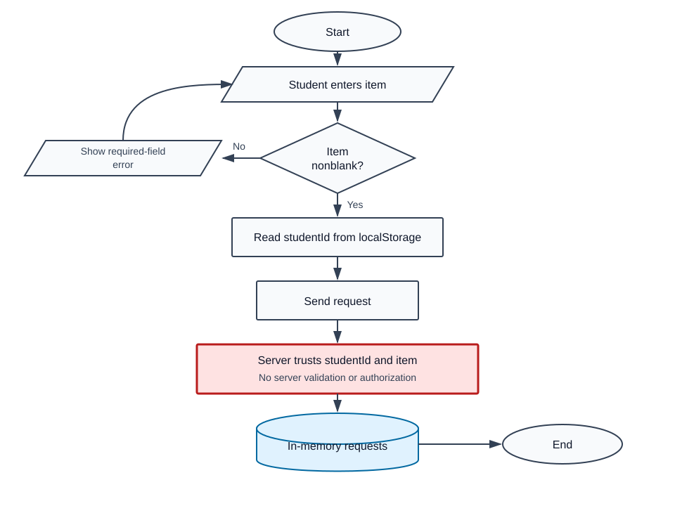

# QuickBorrow Mock Defense Smoke-Test Report

## Executive summary

QuickBorrow lets students request equipment and administrators approve requests. The smoke test found that the browser performs one required-field check, but the server trusts client-provided identity and does not enforce validation or administrator authorization. The core process can therefore be bypassed through direct function/API calls.

Evidence status: the four main bypasses below are **Confirmed** by a local, non-destructive function-level run. This fixture has no real HTTP routing, database, or authentication provider, so those layers are outside the test.

## System explained simply

- `public/app.js` collects an item, checks that it is not blank, reads `studentId` from `localStorage`, and sends a request.
- `server.js:createRequest` stores whatever `studentId` and `item` the caller supplies.
- `server.js:approveRequest` approves a matching request without checking the caller's role.
- `server.js:listRequests` filters using the caller-provided student ID rather than an authenticated identity.

The diagram shows the actual control point: the client-side decision can be skipped, after which the server stores the supplied values without its own validation or authorization.

## Use cases and permissions

| Use case | Intended actor | Precondition | Intended result | Actual enforcement |
|---|---|---|---|---|
| Submit request | Student | Authenticated as the same student | Pending request with a valid item | Not enforced server-side |
| Approve request | Administrator | Authenticated admin; request is pending | Approved request | No role or state check |
| View requests | Student | Authenticated | Own requests only | Trusts supplied `studentId` |

## JavaScript analysis

- `FIXTURE/public/app.js:3-22` handles the submit event. Lines 7-10 reject blank items in the browser, but lines 15-18 send identity from editable local storage. Lines 12-21 do not check `response.ok`, so an HTTP failure would still reach the success alert.
- `FIXTURE/server.js:3-12` creates an in-memory request. It has no required-field, ownership, type, or length validation.
- `FIXTURE/server.js:14-18` changes status to approved. It has no authentication, administrator authorization, pending-state guard, or not-found handling.
- `FIXTURE/server.js:20-22` exposes records selected by a caller-controlled ID.

## Validation and QA findings

### F-01 — Client-only item validation

- Severity: Medium; confidence: High; evidence: Confirmed.
- Location: `public/app.js:7-10`, `server.js:3-10`.
- Safe reproduction: call `createRequest({ studentId: 'other-user', item: '' })` directly.
- Expected: reject the request. Actual: an empty-item request is stored.
- Improvement: validate and normalize the item in the server-side creation path; keep the browser check only for usability.

### F-02 — Caller controls record ownership

- Severity: High; confidence: High; evidence: Confirmed.
- Location: `public/app.js:16`, `server.js:6`, `server.js:20-22`.
- Safe reproduction: submit or query with another `studentId`.
- Expected: derive the student ID from the authenticated session. Actual: the supplied ID is trusted.
- Improvement: ignore client ownership fields and use the authenticated principal for create/list operations.

### F-03 — Approval has no authorization or state guard

- Severity: High; confidence: High; evidence: Confirmed.
- Location: `server.js:14-17`.
- Expected: administrator-only approval of pending requests. Actual: any direct caller can approve a found request.
- Improvement: require an authenticated admin and enforce the allowed `pending -> approved` transition atomically.

### F-04 — Missing request/error handling

- Severity: Medium; confidence: High; evidence: Code-evidenced.
- Location: `server.js:15-16`, `public/app.js:12-21`.
- Effect: an unknown ID can cause a runtime exception, while the UI can display success for a failed response.
- Improvement: return a controlled not-found result and show success only after checking the response status.

## Vibe-coding indicators — not proof of AI authorship

- High confidence: validation exists only in the visible UI path and is absent from the trusted server path. Effect: direct calls bypass the rule.
- High confidence: the documented role restrictions have no matching authorization logic. Effect: the interface appears complete while the business rule is unenforced.
- Medium confidence: all functions implement only the happy path. Effect: missing IDs and failed responses produce crashes or misleading feedback.

## Highest-value panel questions

1. Where is the authenticated user identity established, and why is `studentId` accepted from local storage?
2. What server-side rule prevents a non-admin from approving a request?
3. How does the server reject an empty or malformed item when the frontend is bypassed?
4. What state transitions are allowed, and where are they enforced atomically?
5. How does the UI distinguish a successful response from a 4xx/5xx response?

Strong answers should point to server-side code and tests. A red flag is relying on hidden buttons, local storage, or HTML validation as proof of authorization.

## Prioritized improvements

- Now: authenticate callers; derive identity server-side; enforce admin approval and server validation.
- Next: handle missing records and failed HTTP responses; add negative and authorization tests.
- Later: replace the in-memory array with persistence that enforces identifiers and state integrity if this becomes more than a demo.

## Coverage and limitations

This was a controlled skill smoke test against a deliberately small fixture. It verified evidence labeling, code tracing, runtime reproduction, tailored questions, QA CSV output, and the no-renderer SVG fallback. It did not assess a real framework, database, deployment, accessibility, performance, or third-party integration.
