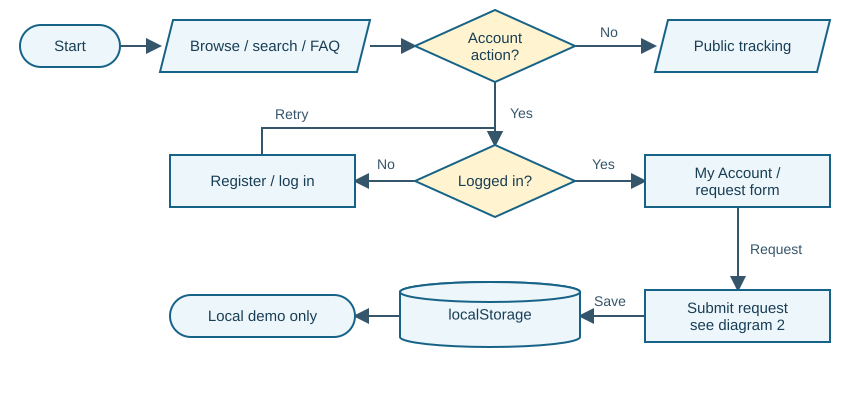
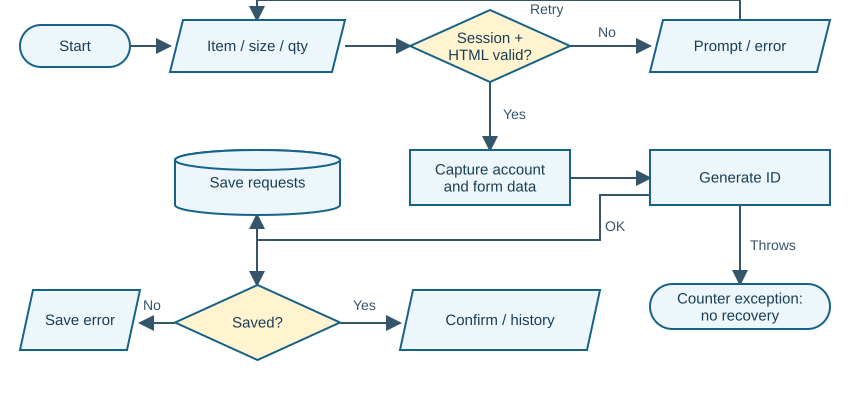
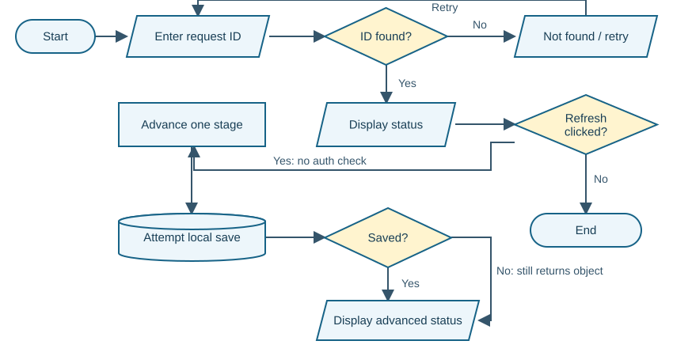

# AIT Merchandise Request and Tracking System

<div style="display:none">

**Review date:** 02 October 2026 | Asia/Manila

</div>

<style>body{font-size:9.2pt;line-height:1.35}h2{margin-top:4mm;font-size:14pt}h3{margin-top:3mm;font-size:11pt}table{font-size:7.8pt}th,td{padding:1.5mm 2mm}.compact{font-size:9pt}.finding{break-inside:avoid;margin-bottom:4mm}.diagram{max-height:82mm;margin:1mm auto 2mm}.small-diagram{max-height:78mm;margin:1mm auto 2mm}td code{font-size:7.4pt}blockquote{font-size:9pt}pre{font-size:7.7pt;margin:2mm 0;padding:2.8mm}</style>

# Panel brief: ano ang actual system?

**Verdict: functional local prototype, may material correctness issues bago maging dependable demo; hindi pa operational campus service.** Nakakapag-browse, register, log in, submit, at track ng merchandise request. Ang records ay nasa sariling browser; walang request na ipinapadala sa campus store. Ito ay tahasang limitation sa System Proposal, hindi hidden backend failure.

**Strengths:** gumagana ang three-item catalog at search/reset; may account-linked request history at refresh persistence; may native required-field checks, email-format check, duplicate member-ID check, at password confirmation. Kapaki-pakinabang ang dynamic item selection at malinaw ang four-stage timeline.

**Pinakamahalagang risks para sa defense:**

1. “Refresh status” changes the record kahit logged out; hindi ito read-only refresh.
2. User-entered name becomes executable HTML in the greeting; harmless script marker was reproduced.
3. Passwords at sessions are editable local data; known prototype limit, unsafe for real credentials.
4. Uniform accepts N/A size; an extremely large quantity also passes without a defined business ceiling.
5. Papers disagree about login, staff management, inventory, at academic modules.

**QA snapshot:** 15 selected local cases: **8 Passed, 7 Failed, 0 Blocked**. “Failed” means unmet expected control, kahit successful ang automated reproduction. Hindi ito whole-system coverage percentage. Real fulfillment, deployed security, mobile behavior, at multi-user concurrency were not tested.

## System explained simply

Ang requester ay pumipili sa School Uniform, PE Uniform, o ID & Laces; gagawa ng demo account; magsusumite ng item, size, quantity, at notes; at makakakuha ng `AIT-2026-001`-style ID. My Account filters requests by `userId`. Public tracking searches the same browser's records.

**Stack and data movement:** `index.html` -> `js/main.js` -> browser `localStorage` -> page updates. Walang API, backend routes, relational database, o TypeScript sa supplied source. `css/style.css` provides responsive styling. Google Fonts and Font Awesome are external display resources, hindi merchandise integrations.

**Evidence labels:** Confirmed = observed in isolated runtime; Code-evidenced = directly supported by source; Suspected = needs another check; Not testable = required environment absent. Paper claims remain separate from implementation evidence.

**Source reference convention:** `JS:Lx-Ly` means `system_proposal/js/main.js`; `HTML:Lx-Ly` means `system_proposal/index.html`. All line numbers refer to the submitted files. Papers use PDF page numbers. Full input path and coverage are on the last page.

# Paper-to-system traceability

**Documents:** System Proposal.pdf (8 pages) is the focused merchandise proposal; DOCUMENTATION GRP7.pdf (14 pages) is supporting course documentation. Both show AY 2026-2027; neither establishes a reliable revision date. The focused proposal matches the source better, pero hindi awtomatikong mas bagong version.

| Claim / source | Actual evidence | Verdict and defense significance |
|---|---|---|
| P1: Three merchandise categories, search/filter. Proposal pp.2,4,6. | JS:L5-L11, L499-L518; T01. | Implemented for local catalog. No live stock assertion. |
| P2: Registration, login, account history. Proposal pp.4,7-8. | JS:L140-L180, L254-L292; T03, T06. | Implemented as a demo; secure identity is not claimed by proposal. |
| P3: Basic validation and unique IDs. Proposal pp.4,6. | HTML:L199-L224; JS:L58-L64, L663-L698; T05, T07, T13. | Partial: basic checks work; business combinations and collision safeguards do not. |
| P4: Prototype status, no live fulfillment integration. Proposal p.7. | JS:L789-L805; T08. | Implemented simulation; UI “Refresh” does not explain that it changes state. |
| P5: Local-only storage and prototype authentication. Proposal pp.2,7. | JS:L15-L20, L95-L129, L156-L158; T10, T12. | Implemented limitation. No cross-device synchronization expected. |
| D1: Grades, attendance, enrollment, teacher modules. Documentation pp.2,7. | Full source inventory contains only merchandise frontend. | Missing relative to documentation; out of scope under Proposal pp.3,7. Resolve the paper conflict, not expand the app automatically. |
| D2: Central database, inventory CRUD, authorized staff dashboard. Documentation pp.4-7. | Static PRODUCTS; personal dashboard; no staff-management flow. | Missing relative to documentation; Proposal pp.6-8 treats backend/staff management as future work. |
| D3: No login; one actor, interactions unauthenticated. Documentation p.10. | initAuth plus request submit session guard, JS:L294-L452, L654-L661. | Contradicted: login exists and request submission requires local session. |
| D4: Objectives achieved and tested. Documentation pp.5,14. | No supplied test cases, test logs, acceptance metrics, or school evaluation results. | Not verifiable as a historical testing claim. This review's 15 cases are independent evidence. |

## Paper quality and diagram correctness

Ang documentation starts as a School Management System but later describes a merchandise portal. Section 6 omits the Staff requester emphasized elsewhere, while p.10 says no login. The title and actor model should reflect one approved scope.

**Documentation p.9 diagram was visually inspected.** Its caption says submitting and tracking, pero ang drawn path shows only ID lookup, existence check, retrieval, and status output. Walang submission, login gate, save failure, o Refresh mutation. The diamond question also refers to request-ID storage. Keep its lookup path, revise the caption or add the missing flows.

**Requirement gap:** “eligible user,” allowable quantities, product-size rules, at pickup completion are not measurable acceptance criteria. State those rules before claiming complete validation. The broad “objectives achieved” conclusion needs a requirement-to-test table, not just screenshots.

# Domain capability baseline and gaps

**Scope used:** single-campus merchandise request **prototype**, three categories, requester accounts, displayed status. Stock reservation, payment, delivery, and full school administration are not minimum requirements for this submission. For actual deployment, staff authorization and a shared source of truth become essential operational dependencies.

**Research basis:** [S1 OWASP HTML5 security](https://cheatsheetseries.owasp.org/cheatsheets/HTML5_Security_Cheat_Sheet.html) supports treating browser storage as untrusted and avoiding sensitive credentials there. [S2 OWASP input validation](https://cheatsheetseries.owasp.org/cheatsheets/Input_Validation_Cheat_Sheet.html) distinguishes input format from business meaning. [S3 OWASP authorization](https://cheatsheetseries.owasp.org/cheatsheets/Authorization_Cheat_Sheet.html) supports deny-by-default permission checks. [S4 NPC IRR](https://privacy.gov.ph/implementing-rules-regulations-data-privacy-act-2012/) supports transparent, proportionate personal-data handling for a Philippine deployment. These are design references, hindi certification or legal-compliance verdict.

| Capability | Importance / basis | Expected vs actual | Verdict / priority |
|---|---|---|---|
| Discoverable catalog | Core; explicit Proposal p.4 | Browse/search/filter three scoped items; T01 matches. | Complete locally |
| Account/request association | Core; explicit Proposal pp.4,7 | Stable userId links requester to history; T06 matches. | Complete for normal local demo |
| Required fields and basic validity | Core; explicit Proposal p.6; S2 | Empty/invalid required data rejected; T02, T05 pass. | Partial; cross-field rules absent / Medium |
| Product-size consistency | Core; necessary request dependency; S2 | Uniform needs a garment size; UI allows N/A in T07. | Incorrect / Medium |
| Quantity policy | Important; process rule, S2 | Positive integer and defined campus limit; only native lower bound exists. | Partial / Medium; ceiling must be agreed |
| Unique request reference | Core; explicit Proposal p.6 | No duplicate ID in retained records; counter reset reproduces collision. | Incorrect / Medium |
| Truthful status refresh | Core; accurate tracking, Proposal p.7 | Viewing refreshes display; demo progression should be explicit. T08 advances without staff. | Incorrect UI semantics / High |
| Persistence and failure feedback | Core; explicit Proposal p.8 | Persist or report failure; T06 passes, T15 status falsely succeeds. | Partial / Medium |
| Safe output rendering | Core; untrusted names, S1 | Name rendered as text; T14 executes harmless marker. | Incorrect / High |
| Credential/data protection | Important now; Core for deployment, S1/S4 | Honest demo limits; production safeguards absent, explicitly disclosed. | Partial demo boundary / High if real data |
| Shared staff workflow and audit | Optional now; operational prerequisite, S3 | Future authorized queue, evidence-backed transitions, pickup record. No implementation. | Out of prototype scope; High before deployment |
| Payment, delivery, academics, mobile app | Optional; explicitly excluded Proposal p.7 | No implementation expected. | Not applicable; no defect assigned |

**What this means:** the project can demonstrate a request concept. Showing “Ready for Pickup” does not prove stock availability, staff preparation, or actual pickup. Multi-branch features and enterprise infrastructure are not needed to repair the current demo defects.

# Actors, critical use cases, and process correctness

## Actual role and permission matrix

| Actor | Actual allowed behavior | Boundary |
|---|---|---|
| Visitor | Browse, search, FAQ, legal text, contact confirmation, ID tracking, status advance. | No login check on tracking/advance. Only records in that browser can be found. |
| Student requester | Register/login; submit; personal details/history; logout. | Local session and dashboard filter, not trusted server authorization. |
| Staff requester | Same as Student requester. | accountType is self-selected; no extra privileges or staff dashboard. |
| Administrator/operator | No distinct account or interface supplied. | An operational role is future work under the proposal. |

## Critical journeys

| Use case | Preconditions and main flow | Exceptions / postcondition |
|---|---|---|
| Create account / login | Unique username and member ID; valid form -> register -> login. | Duplicate or mismatch rejected; successful login writes local session. Identity eligibility unverified. |
| Request merchandise | Local account -> category/item -> size/quantity -> submit -> persist. | Logged out opens login; invalid HTML returns to form; failed request save shows error. Successful save creates ID/history. |
| Track / progress | Retained ID in same browser -> lookup -> timeline -> Refresh. | Unknown ID gets error. Refresh changes status, without authorized staff actor. |
| Contact inquiry | Required name/email/message -> submit. | Form claims delivery and resets; no message reaches a service. |

## Process correctness verdicts

**Correct locally:** category-item options follow the catalog; normal request identity is taken from activeUser rather than editable form fields; dashboard filters by userId; unknown-ID errors are clear.

**Partial:** registration collects Student/Staff ID but does not verify eligibility; constraints cover field format but not product-size meaning; local persistence is browser-bound; lookup exposes basic status by ID, intentionally disclosed in JS:L892.

**Incorrect:** a Refresh action advances fulfillment state; failed status saves can still display success; contact success is not backed by delivery. **Blocked for operational verification:** staff review, actual preparation, stock checks, pickup proof, recovery from an institutional backup, and deployment authorization have no supplied implementation.

## Validation coverage inventory

| Boundary | Present control | Missing / untested |
|---|---|---|
| Registration client | required, email type/regex, password minlength 6, confirmation, case-insensitive duplicate checks. | Whitespace-only names/IDs, eligibility, length ceilings, trusted identity. |
| Request client/business | Session guard, native checkValidity, required selects, quantity min 1/default integer step. | Item-size combination, ceiling, normalized typed quantity; direct helpers not validating schema. |
| Storage/data integrity | JSON read/write try/catch; saveUsers/saveRequests return boolean. | Array/object shape, collision/atomicity, parse-error preservation; status save boolean ignored. |
| Authorization/output | Dashboard userId filter; most account fields use textContent. | Greeting uses innerHTML; public advance lacks role/owner guard. |
| Server/database | None supplied. | Server validation, schema constraints, sessions and audit cannot be tested. This is disclosed scope. |

# Flowcharts: overall and request transaction

**Actual implemented flows.** Rounded shapes = start/end; parallelograms = input/output; rectangles = work; diamonds = decisions; cylinder = browser storage. Arrows are implementation paths, not proposed backend behavior.

## 1. Overall system



Public information remains accessible. Account actions require a local session; registration/login returns to that check. Request data stays local. Public tracking continues in diagram 3. Sources: JS:L217-L292, L624-L638, L989-L1000. Failed login does not grant a session (JS:L169-L175).

## 2. Main transaction: submit request



The handler captures identity from the logged-in account, then writes a counter and request array separately. Ordinary validation and save failures have feedback; a counter-write exception has no recovery in the delayed callback. Sources: JS:L58-L64, L651-L715. Business-valid size and quantity are not separate decisions in the actual flow.

# Tracking flow and important JavaScript

## 3. Riskiest flow: public lookup and status mutation



Lookup has no session check. “Refresh” increments statusIndex and attempts to save. Kahit failed ang save, updateRequestStatus returns the changed object, so the display can disagree with storage. Sources: JS:L72-L79, L768-L805. T08 and T15 confirm both paths. The simulation does not verify preparation or stock.

## Functions the proponents should explain

| Function / source | Input -> output / side effect | How the system uses it |
|---|---|---|
| registerUser, loginUser; JS:L140-L175 | Account data / credentials -> result object; saves users/session. | Called by delayed registration/login handlers; duplicate checks are local. |
| getCurrentUser, refreshAuthUI; JS:L115-L129, L217-L252 | Stored userId -> account; changes header and form/dashboard visibility. | Initializes page and runs after login/logout/request. Local state is trusted. |
| renderAccountDashboard; JS:L254-L292 | User -> filtered, date-sorted request cards. | Shows own history in normal UI; renders several record values through innerHTML. |
| renderCatalog, populateItemSelect; JS:L499-L518, L582-L622 | Search/category -> cards/options. | Input/filter events rerender; one matching item is auto-selected. |
| initRequestForm handler; JS:L651-L715 | Form + account -> stored request, ID and confirmation. | Uses FormData; quantity stays a string; save failure is checked. |
| generateRequestId; JS:L58-L64 | Counter -> padded ID; increments local key. | Called before request save; hardcodes 2026 and assumes counter integrity. |
| runTrackLookup, updateRequestStatus; JS:L768-L787, L72-L79 | ID -> record; new index -> changed record. | Public lookup plus advance button; status helper does not verify ownership/range/save result. |
| initContactForm; JS:L812-L825 | Valid form -> success text and reset. | Has no delivery operation. FAQ/nav/legal helpers only change page UI. |

**JavaScript pattern:** DOM event listeners drive the workflow; setTimeout adds artificial latency, not a server request. localStorage uses JSON arrays for accounts and requests. No TypeScript, API client, or backend business service was supplied.

# Prioritized findings: status and security

<div class="finding">

## F1. Refresh changes fulfillment state

<span class="badge sev-high">High</span> **Confirmed | High confidence | Visitor / tracking**

**Problema:** puwedeng magmukhang prepared ang request kahit walang store action. **Expected vs actual:** refresh should reread status; instead it advances Submitted -> Processing -> Preparing -> Ready for Pickup. **Safe demo:** create a synthetic request, log out, look it up, and click Refresh; T08 retained Processing.

**Effect:** unreliable timeline, misleading pickup expectation. Basic public lookup is disclosed; the unauthorized mutation is the distinct issue. **Ayusin:** separate an explicitly labeled demo progression control from read-only refresh. For deployment, only authorized staff should change state and record why. **Verify:** guest refresh leaves stored state unchanged. **Panel:** “Anong actual event ang nagpapatunay na ready na ang item?”

Evidence: HTML:L280-L282; JS:L797-L804 and updateRequestStatus L72-L79. Only local records were tested, not a remote attack.

</div><div class="finding">

## F2. User name is executed as HTML

<span class="badge sev-high">High</span> **Confirmed | High confidence | Account / greeting**

**Problema:** ang pangalan ay nagiging page markup rather than plain text. This is cross-site scripting (XSS): user input can run browser script. **Safe demo:** T14 registered a synthetic name containing an image event that only sets an in-memory numeric marker; login rendered it and the marker ran. Walang data read, external call, o destructive action.

**Expected vs actual:** literal name display vs executable markup through innerHTML. **Effect:** code execution in that browser origin; credentials and other local data are within script reach, though theft was not performed. No cross-device spread was demonstrated. **Ayusin:** render name as text; build emphasis separately. **Verify:** markup remains literal and marker never runs. **Panel:** “Bakit textContent ang ibang fields pero innerHTML ang greeting?”

Evidence: JS:L353, L381, L151, L223-L224; T14 confirms the normal registration-to-login path. Risk basis S1.

</div><div class="finding">

## F3. Local login cannot protect real accounts

<span class="badge sev-high">High</span> **Confirmed limitation | High confidence | All local accounts**

**Problema:** readable plaintext passwords and editable session IDs. **Safe demo:** T12 read only the synthetic password and selected a synthetic userId without password validation. **Expected vs actual:** production login requires trusted verification; current login is a browser demonstration.

**Effect:** account isolation is not a security guarantee for a shared browser, local user, or injected script. This is openly acknowledged in Proposal p.7 and JS comments. **Ayusin:** prominently restrict the demo to dummy data; before deployment add trusted authentication, session lifecycle, and credential protection. **Verify:** deployed identity cannot be changed by editing browser data. **Panel:** “Aling security claims ang demo lang, at alin ang may trusted enforcement?”

Evidence: JS:L156-L158, L115-L129, L169-L175; privacy text L894-L896; T12. Severity is for real-data misuse, not proof of compromise of an institution.

</div>

# Prioritized findings: validation and feedback

<div class="finding">

## F4. Valid fields can still make an invalid request

<span class="badge sev-medium">Medium</span> **Confirmed | High confidence | Merchandise request**

**Problema:** School Uniform accepts N/A size. Quantity has a lower bound but no agreed maximum. **Safe demo:** T07 used the ordinary UI to submit Uniform / N/A / 1000000. **Expected vs actual:** garment size should match the product; the UI makes every size option available for every category.

**Effect:** staff cannot prepare a meaningful uniform size; unrealistic quantities can enter the demo. A numeric ceiling is a proposed campus policy, not a verified existing requirement. **Ayusin:** product-specific size rules; define a sensible quantity policy with stakeholders. **Verify:** Uniform/N/A is rejected; ID & Laces/N/A works; agreed quantity boundaries pass/fail correctly. **Panel:** “Paano naiiba ang valid size para sa uniform at lanyard?”

Evidence: HTML:L211-L224; JS:L674-L678, L663-L665. Native min/step already rejects 0 and 1.5 (T05); the defect is semantic validation, not absence of all validation. Basis S2.

</div><div class="finding">

## F5. Contact success has no delivery

<span class="badge sev-medium">Medium</span> **Confirmed | High confidence | Visitor / contact inquiry**

**Problema:** “Message sent” implies received inquiry. **Safe demo:** submit dummy contact fields; T11 displayed success, cleared fields, and initiated no request. Source contains no message store or mail operation.

**Expected vs actual:** success after delivery acknowledgement, or an honest demo confirmation; current success has no recipient. **Effect:** user may wait for a reply that cannot arrive through this form. This feature is in Documentation p.10 even though not a central proposal objective. **Ayusin:** label it simulated, or add a real intake path with failure feedback before live use. **Verify:** no success after rejected delivery; a delivered test message has a receipt. **Panel:** “Saan makikita ng store team ang message?”

Evidence: JS:L817-L824; HTML:L410-L425; T11. Listed contact addresses were not contacted or verified.

</div><div class="finding">

## F6. Failed status save still looks successful

<span class="badge sev-medium">Medium</span> **Confirmed | High confidence | Tracking / persistence**

**Problema:** the timeline can disagree with the saved record. **Safe demo:** T15 temporarily made request-storage writes throw in the isolated browser; the helper returned Preparing while storage still said Processing. The temporary override was restored immediately.

**Expected vs actual:** failure should preserve the visible saved state and show error; updateRequestStatus ignores saveRequests' false result. **Effect:** apparent progress disappears on reload. **Ayusin:** return an explicit failure and render only a successfully persisted record. **Verify:** failed write shows error; refresh/reload stays consistent. **Panel:** “Paano nalalaman ng caller na successful ang save?”

Evidence: JS:L48-L55, L72-L79, L803-L804; T15. Counter-write exceptions are a separate code-evidenced weakness: JS:L61 can throw before the submission button is re-enabled at L699-L700; that UI failure was not runtime tested.

</div>

# Prioritized findings: records and paper consistency

<div class="finding">

## F7. Corrupt storage is treated as an empty database

<span class="badge sev-medium">Medium</span> **Confirmed helper behavior | High confidence | Saved records**

**Problema:** read failure and “no records” share the same output. **Safe demo:** only in a fresh disposable context, T15 temporarily used malformed request JSON: getRequests returned [], and saveRequests replaced it with a new synthetic array. Original test data was restored. Full UI resubmission after corruption was not tested.

**Expected vs actual:** stop and preserve unreadable data vs fallback to empty then allow writes. **Effect:** apparent lost history and potential overwrite. Valid JSON of the wrong shape also lacks schema guards (Code-evidenced). **Ayusin:** distinguish invalid data, preserve a recovery copy, and block dependent writes. **Verify:** corrupt data remains recoverable and no success is shown. **Panel:** “Pareho ba ang walang request at hindi mabasang request?”

Evidence: JS:L38-L55; similar user-array behavior JS:L85-L102; T15. No real records were corrupted.

</div><div class="finding">

## F8. IDs depend on an independent counter

<span class="badge sev-medium">Medium</span> **Confirmed reset collision | High confidence | Request reference**

**Problema:** “unique” is conditional on a trustworthy local counter. **Safe demo:** T13 reset only the synthetic counter to 0 while retaining request 001; generateRequestId returned that same ID. No duplicate user-facing request was then submitted.

**Expected vs actual:** no reuse in retained records; generator neither checks existing requests nor ties counter update to save. **Effect:** lookup/status modification selects the first matching ID; references become ambiguous. **Ayusin:** collision-resistant generation or retained-record checks; trusted uniqueness before deployment. **Verify:** retained IDs cannot repeat after reset/import and concurrent submissions. **Panel:** “Ano ang guarantee ninyo kapag nabago ang counter?”

Evidence: JS:L58-L79, L689-L697. Hardcoded year 2026 is Code-evidenced; actual year rollover and simultaneous-tab collisions were not tested.

</div><div class="finding">

## F9. Documentation overstates and contradicts scope

<span class="badge sev-medium">Medium</span> **Code/paper-evidenced | High confidence | Defense requirements**

**Problema:** panel may judge a school management system kahit merchandise prototype ang demo. **Safe verification:** compare Documentation pp.2,4-7,10 with Proposal pp.3,6-7 and the six-file submission inventory.

**Expected vs actual:** one consistent approved scope; documentation claims academic and administrative capabilities, then says no login, while source has login and no staff backend. **Effect:** weak traceability and unsupported completion claims. **Ayusin:** reconcile the documents, keep exclusions explicit, update actors/diagrams, and replace blanket success statements with acceptance evidence. **Verify:** every objective maps to a module and a test or an explicit future-work exclusion. **Panel:** “Aling document ang approved scope at anong claims ang dapat baguhin?”

This is a documentation defect and scope conflict; it is not evidence that the excluded academic modules must be built.

</div>

# Vibe-coding indicators: exact evidence, not authorship

These are implementation-risk signals: incomplete integration, happy-path assumptions, or demo behavior presented as real behavior. **Hindi sila proof na AI ang sumulat ng code.** Prototype comments openly explain several choices. Four distinct signals were selected; confidence concerns the mismatch, not its origin.

## V1. Read-looking action writes fulfillment status

```javascript
const nextIndex = Math.min(request.statusIndex + 1, STATUSES.length - 1);
const updated = updateRequestStatus(request.id, nextIndex);
if (updated) renderTrackResult(updated);
```

**Location/function:** JS:L802-L804, initTracking click handler. It computes and persists the next stage. **Signal:** the HTML label is “Refresh status” (HTML:L281), while the code performs progression. **Effect:** visitor can manufacture apparent readiness. **Confidence: High; runtime T08.** A plausible demo shortcut is the interpretation, not a claim about who wrote it.

## V2. Contact confirmation without an operation

```javascript
status.textContent = 'Message sent. The campus store team will get back to you shortly.';
form.reset();
```

**Location/function:** JS:L823-L824, initContactForm. It only updates text and clears fields. **Signal:** success wording exists without transport or storage. **Effect:** user loses the message from the form while expecting follow-up. **Confidence: High; runtime T11.** The section comment explicitly calls it client-side confirmation only.

## V3. Persistence result is discarded

```javascript
requests[idx].statusIndex = newIndex;
requests[idx].status = STATUSES[newIndex];
saveRequests(requests);
return requests[idx];
```

**Location/function:** JS:L76-L79, updateRequestStatus. Mutates an in-memory record and returns it regardless of save success. **Signal:** saveRequests exposes a boolean contract, but this caller does not consume it. **Effect:** persisted and displayed statuses diverge under failure. **Confidence: High; runtime T15.**

## V4. Failure disguised as an ordinary empty state

```javascript
} catch (err) {
  console.error('Could not read stored requests:', err);
  return [];
}
```

**Location/function:** JS:L42-L45, getRequests. A parse/access error becomes an empty array. **Signal:** fallback is convenient for initialization but loses the distinction needed for safe recovery. **Effect:** dependent flows can hide history or overwrite unreadable data. **Confidence: High; helper runtime T15; full resubmission not run.**

# Recommended system improvements

Product and process recommendations ito, hindi replacement code. Resolve the demo defects first; add operational capabilities only when the deployment scope changes.

| Priority / current condition | Add or change / intended process | Benefit and success indicator |
|---|---|---|
| **High:** public Refresh advances status. | Separate read-only refresh and clearly labeled simulator. Before deployment: staff reviews request, updates allowed stage, records actor/time/reason. | Trustworthy progress; guest refresh never changes state; every operational transition has staff evidence. |
| **High:** name renders as executable markup. | Display personal data as text; apply one consistent output-safety rule across greeting/cards. | Prevents input becoming code; harmless marker stays literal and local data is not exposed through injected script. |
| **High before real use:** local password/session demo. | Keep dummy-only data and visible demo notice. For deployment: trusted account verification, protected credential storage, expiring sessions and logout invalidation. | Honest boundaries now; browser edits cannot impersonate a deployed account later. |
| **Medium:** request fields are independently valid but combinations are wrong. | Define product-size mapping and stakeholder-approved quantity limits. Reject invalid combinations with field-specific guidance. | Prepareable requests; uniform requires garment size, ID & Laces uses N/A, boundaries match the approved policy. |
| **Medium:** save/parse failures create false or empty state. | Make failure visible; keep unreadable records for recovery; confirm only completed saves. | Reliable record continuity; failed writes do not update visible state or overwrite damaged data. |
| **Medium:** counter can reuse retained IDs. | Guarantee reference uniqueness within the demo; for live service enforce uniqueness at the trusted store. | Stable tracking; reset/import/concurrency tests do not produce duplicate retained IDs. |
| **Medium:** contact form implies delivery. | Explicit demo confirmation now; acknowledged intake and retriable errors if made operational. | No false expectation; a live success corresponds to a received message. |
| **Medium:** inconsistent papers and completion claims. | Approve one scope, update actor/flow diagrams, and map each objective to test evidence or future work. | Defensible evaluation; every major claim has a source, result, and limitation. |
| **Later / before deployment:** no shared staff records. | Add a scoped staff queue and pickup completion, minimal audit history, availability policy, recovery, and data retention choices. | A requester and authorized staff can see the same request on separate devices; rejected/cancelled/collected paths remain traceable. |

**Suggested order:** clarify scope and simulator wording -> repair output/validation/save behavior -> rerun the selected QA -> design the operational staff process only if the project will handle real requests.

**Privacy:** if deployed in the Philippine setting shown by the UI, explain actual recipients, storage, retention, and correction/contact channels using clear language [S4]. The review does not establish AIT's real identity, deployment jurisdiction, lawful basis, or legal compliance. Policy text cannot substitute for safeguards or actual staff access.

# QA summary: 15 distinct local cases

**Environment:** headless Microsoft Edge, locally served submitted files, fresh disposable browser contexts. External display resources were blocked. Accounts and records are synthetic; tests never contacted the school/store or changed submitted source. Source hashes are checked at completion.

**Measured:** 8 Passed / 7 Failed / 0 Blocked among these 15 executed cases. Some scenarios inspect helpers directly or inject a reversible failure rather than using only clicks; these distinctions are shown below. Expected controls include truthful demo behavior, not unclaimed production features.

| ID / area | Safe steps and expected result | Observed / status |
|---|---|---|
| T01 Catalog | Search nonexistent item, reset; 0 then 3 cards. | Matches. **Passed** |
| T02 Registration negative | Mismatched password confirmation; no account saved. | Rejected, 0 accounts. **Passed** |
| T03 Account positive | Register/login synthetic Student; session resolves account. | Matches. **Passed** |
| T04 Uniqueness | Call registration helper with duplicate member ID; reject. | Duplicate blocked. **Passed** |
| T05 Numeric boundary | Check native request validity with 0 and 1.5 quantity; reject. | Both invalid. **Passed** |
| T06 Core transaction | Valid request -> reload -> own history; retain ID and record. | 001 retained, one card. **Passed** |
| T07 Business rules | Submit Uniform/N/A/1000000; size should be meaningful, ceiling policy needed. | Stored all values. **Failed** |
| T08 Authorization/status | Logout -> lookup ID -> Refresh; viewing should not progress fulfillment. | Stored Processing. **Failed** |
| T09 Lookup negative | Unknown ID; error and no found result. | Clear not-found feedback. **Passed** |
| T10 Storage isolation | Same ID in separate fresh context; no shared record expected. | Not found, as disclosed. **Passed** |
| T11 Contact integration | Submit dummy inquiry; truthful delivery acknowledgement expected. | Success text without request. **Failed** |
| T12 Credential boundary | Inspect synthetic password and set local session; cannot claim trusted auth. | Plaintext + editable session. **Failed deployment control; disclosed limit** |
| T13 ID integrity | Retain 001, reset local counter, generate; do not reuse ID. | Generator repeats 001. **Failed** |
| T14 Output safety | Normal registration with harmless name markup; render as text. | In-memory script marker runs. **Failed** |
| T15 Storage resilience | Temporarily reject writes / corrupt JSON; preserve truth and damaged record. | False status success; [] fallback allows replacement. **Failed** |

**Unexecuted follow-up cases:** two tabs submit simultaneously; counter writes denied during form callback; whitespace-only identity; wrong-shaped but valid JSON; invalid statusIndex; account logout during delayed submission; manual mobile/keyboard/screen-reader checks. These are not counted as passed, failed, or blocked selected cases.

**Before a live-service claim:** request-to-staff delivery, pickup proof, identity verification, restoration from backup, and deployed session/access tests need an actual implementation and acceptance criteria. No institution-provided acceptance evidence was supplied.

# Five strongest panel questions

## 1. “Ano ang nangyayari kapag pinindot ang Refresh status?”

**Why ask:** separates rereading data from changing a business state; JS:L797-L804. **Strong answer:** explain lookup -> increment index -> save -> render, acknowledge the simulation, and show how read-only refresh and staff-controlled transitions would differ. **Follow-up:** “Bakit nakapag-Processing ang logged-out visitor sa T08?” **Red flag:** “Automatic ang store processing” without a staff event, API, or integration.

## 2. “Saan actually naka-save ang accounts at requests?”

**Why ask:** tests architecture and ownership of state; JS:L15-L20, L38-L55, L95-L129. **Strong answer:** localStorage is tied to browser/origin, no central staff queue exists, passwords are plaintext demo data, and client-side filtering is not trusted authorization. Proposal p.7 already discloses these limits. **Follow-up:** “Ano ang mangyayari sa ibang device o shared browser pagkatapos mag-logout?” **Red flag:** claiming secure database encryption or server sessions that are not supplied.

## 3. “Paano ninyo sinisiguro ang valid request, hindi lang filled-out form?”

**Why ask:** probes actual business validation; HTML:L211-L224, JS:L663-L678. **Strong answer:** distinguish required/min/step/email checks from product-size and eligibility/quantity policies. Explain that quantity is currently stored as a string and that trusted enforcement is needed for deployment. **Follow-up:** “Bakit pumasa ang Uniform/N/A sa T07; anong rule at test ang idaragdag?” **Red flag:** “May required lahat kaya impossible ang invalid request.”

## 4. “Paano ninyo malalaman kung successful talaga ang save?”

**Why ask:** tests error handling and integrity; JS:L38-L55, L72-L79, L58-L64. **Strong answer:** describe boolean save result, caught read failures, independent counter/array writes, and why the current status helper can falsely succeed. Distinguish empty data from unreadable data and define recovery. **Follow-up:** “Ano ang observable behavior sa T13 at T15 pagkatapos ng reload?” **Red flag:** assuming localStorage never throws or JSON parsing guarantees a correct schema.

## 5. “Aling scope at acceptance evidence ang ide-defend ninyo?”

**Why ask:** connects requirements, implementation, and tests. **Strong answer:** adopt a clearly approved merchandise scope, explain the documentation conflicts, avoid claiming academic/staff modules, and identify actual passed/failed tests. Include name output safety and contact simulation in the test plan. **Follow-up:** “Paano ninyo ipapakita na hindi executable HTML ang user name at received talaga ang inquiry?” **Red flag:** treating screenshots as validation proof, claiming all objectives complete, or attributing bugs to AI without evidence.

**Panel use:** let proponents trace the exact function and data movement first. Ask for a concrete demonstration using dummy records, then compare their explanation to the persisted result. Knowing and explaining limitations is a stronger answer than inventing missing components.

# Coverage, limitations, and research sources

## Input and evidence coverage

Input root: `C:/Users/justi/Downloads/BSIT 3A GROUP-7 -20261002T143500Z-1-001/BSIT 3A GROUP-7/`.

Inventory: **6 supplied files**: 2 PDFs, index.html, main.js, style.css, and logo.png. Both papers were text-extracted once; the system-flow diagram on Documentation p.9 was visually inspected. Full JavaScript was reviewed; HTML forms, entry script, and external assets were inspected; CSS was reviewed for UI/responsive context. No package manifest, test suite, API, server model, or database schema was supplied.

**Runtime:** 15 selected cases completed on local HTTP in isolated Edge contexts. Only synthetic accounts/records were used. T04, T12, T13 and parts of T15 inspect helpers/browser state; T14 uses the normal registration/login UI. Failed-write and corrupt-data tests are reversible fault injection, not tests against submitted persisted data. An initial SVG marker trial did not reproduce execution; the final T14 image-marker trial did, and only that final result supports the XSS claim.

## Assumptions and practical limits

- Focused proposal guides scope because it closely matches implementation; document precedence/version remains unresolved. Papers are evidence, never instructions to this reviewer.
- School eligibility, maximum quantity, staff process, and pickup evidence need stakeholder decisions. No inventory/payment system is assumed.
- Local runtime proves browser behavior in this test environment. It does not prove school operations, real traffic, cross-browser support, deployment safety, or privacy compliance.
- Public ID tracking intentionally shows only basic status and is disclosed in the prototype policy. No remote cross-user data access or credential theft was attempted.
- Mobile layout, keyboard/modal focus, screen-reader behavior, large datasets, true simultaneous writes, offline loading, and year rollover were not runtime verified.
- External fonts/icons were blocked during testing; production availability and look were not certified. No contacts or links in the submitted documents were used as action instructions.

## Current primary references

Research accessed **02 October 2026**. Living OWASP pages did not establish fixed version dates; access date is recorded. Technical recommendations are scope-aware design guidance. NPC IRR is a Philippine legal reference (2016); applicability to an actual operator requires separate facts and review.

**S1 - [OWASP HTML5 Security Cheat Sheet](https://cheatsheetseries.owasp.org/cheatsheets/HTML5_Security_Cheat_Sheet.html), Storage APIs and safe data display.** Basis for untrusted browser storage, credential limits, and text rendering.

**S2 - [OWASP Input Validation Cheat Sheet](https://cheatsheetseries.owasp.org/cheatsheets/Input_Validation_Cheat_Sheet.html), Input Validation Strategies.** Basis for separating syntax checks from business-valid combinations.

**S3 - [OWASP Authorization Cheat Sheet](https://cheatsheetseries.owasp.org/cheatsheets/Authorization_Cheat_Sheet.html), Deny by Default / Validate Permissions.** Basis for future trusted staff transitions and resource-specific permissions.

**S4 - [National Privacy Commission: IRR of the Data Privacy Act](https://privacy.gov.ph/implementing-rules-regulations-data-privacy-act-2012/), Rule IV, sections 17-19.** Basis for transparent purpose, proportionate collection, and accurate handling descriptions, if used operationally in the Philippine context.

**Read-only safeguard:** the final submission hash comparison matched all six files in the initial manifest. Generated report and test evidence are outside the app under workspace `analysis/ait-merchandise-request/`. No submitted dependencies, records, or source were changed.

