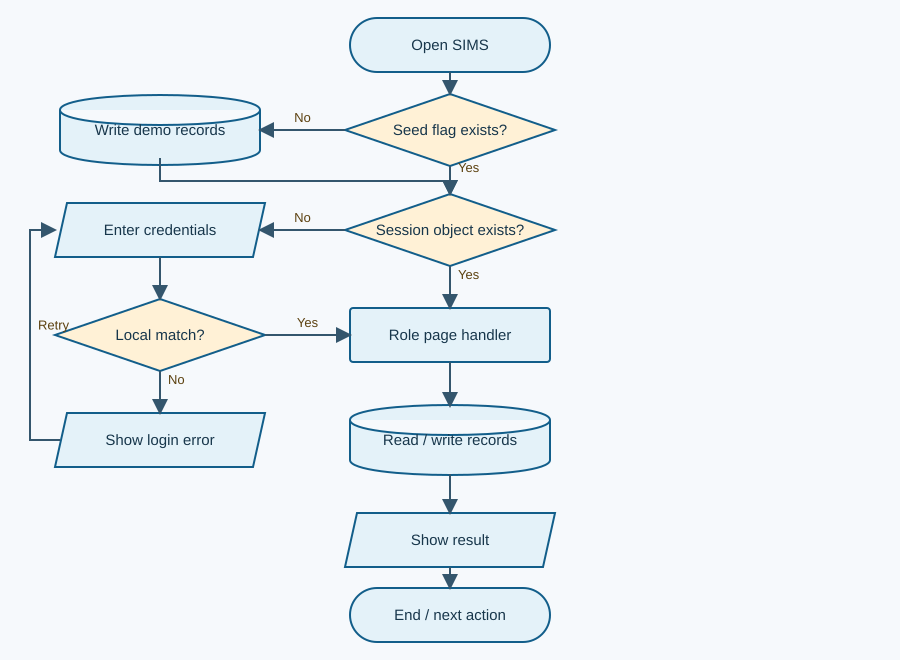
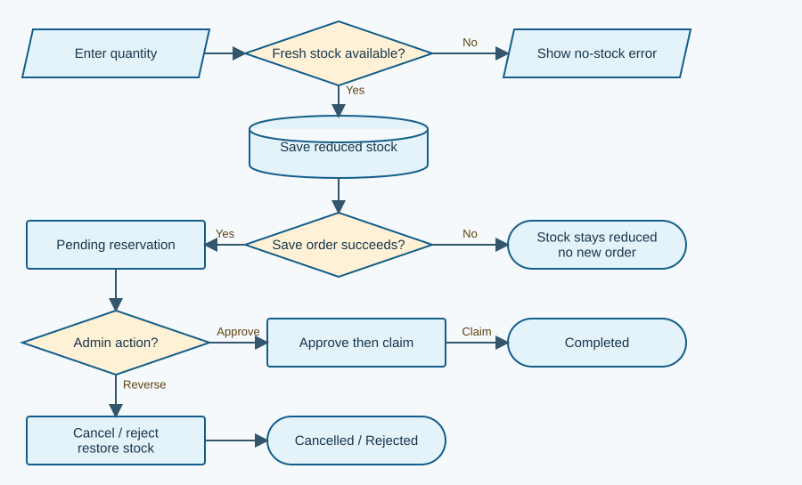
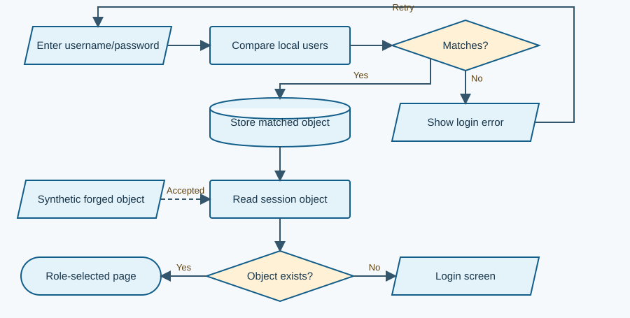

# Atellion Integrated School SIMS

**Review date:** 1 October 2026 (Asia/Manila)

## Panel brief: demonstrable prototype, hindi pa dependable school system

**Standard, system-only review.** Kayang ipakita ang student registration, attendance, grades, announcements, reports at school-store orders. Pero ang submitted implementation ay HTML/CSS/JavaScript lamang: lahat ng account at record ay nasa browser storage. Walang submitted API, server, database service, package manifest, automated test suite o capstone paper.

**Readiness verdict:** suitable para sa controlled demonstration gamit ang synthetic data; kailangan munang maayos ang access control, academic record lifecycle at transaction integrity bago gamitin sa tunay na school records. Hindi ito grading score o legal compliance certification.

### Limang pinakamahalagang risk

1. Nababago ang role/session at records sa client; plaintext ang passwords.
2. Teacher CSV export includes same-subject students outside the assigned section.
3. Draft grades appear to students; walang academic-year key o protected release lifecycle.
4. Magkahiwalay ang section-to-teacher at teacher-to-section assignments.
5. Stale order forms at partial writes can produce incorrect stock.

**QA:** 14 selected cases: **4 Passed, 9 Failed, 1 Not Run**. Thirteen execute original JavaScript inside an isolated Node VM with a minimal DOM stub and synthetic memory stores. Confirmed means observed in that harness, **hindi full-browser or production acceptance**. No submitted browser storage was opened or seeded.

### System explained simply

Ang Admin ang nagreregister at nagmamanage ng records, sections, products at orders. Ang Teacher ang nagtatala ng attendance at grades ng assigned section. Ang Student ang tumitingin ng sariling records at nag-oorder para sa pickup sa Registrar's Office. Inferred intended process ito mula sa UI at code; walang supplied approved requirements.

| Actor | Intended visible responsibility | Actual boundary |
|---|---|---|
| Admin | Registration, staff/sections, grades, products, orders, announcements, reports | Role selects AdminPages; no independent write authority |
| Teacher | Assigned students, attendance, grades, schedule, announcements | Page filters section; export filters subject only |
| Student | Own profile, grades, attendance, schedule, store/history | Page filters refId; stored data remains client-accessible |

**Data movement:** input -> page handler -> dbLoad/dbSave -> localStorage -> HTML rendering. Login matches the local users array and saves the whole matched object in sessionStorage. No network persistence or cross-device synchronization implementation was supplied. The external font request is visual, not a data backend.

**Strengths:** reusable storage helpers and role page modules; escapeHtml on many display fields; explicit 0-100 grade guard; fresh-stock reread before ordering; cancellation checks Pending; student attendance distinguishes school years. Sources: js/app.js:63-84, 292-319; js/teacher.js:241-263; js/student.js:106-117, 250-257, 323-327.

<div class="page-break"></div>

## Domain capability baseline and gap matrix

**Scope assumption:** single-school Grade 11/12 record-management prototype with a local store reservation/pickup feature. Core means necessary for that workflow; Important means dependable operation; Optional means an enhancement unless expressly claimed. No enrollment-policy, grading-policy or deployment declaration was supplied.

Research basis: [R1] OWASP client storage, [R2] authorization, [R3] DepEd assessment guidance, [R4] education-sector privacy advisory, [R5] logging guidance. These support a narrow baseline, hindi enterprise feature wishlist. [R3] is a policy reference to validate with the school; private-school applicability and approved modifications are unverified. [R4] explicitly presents recommendations for online-learning context, not a universal SIMS compliance checklist.

| Capability / importance / basis | Expected -> actual evidence | Verdict / effect |
|---|---|---|
| Trusted identity + permissions / Core / R1,R2 | Protected identity and every read/write checked -> local object trusted; generic writes unguarded | Incorrect; High, F01 |
| Student registration / Core / UI claim | Valid learner and matching class/account -> separate saves, broad section list | Partial; Medium, F05/F07 |
| Teacher-class assignment / Core / dependency | One consistent relationship -> two independent name fields | Incorrect; High, F04 |
| Attendance / Core / UI claim | Valid learner/date, editable with accountability -> upsert per student/date; defaults Present | Partial; policy/calendar checks unverified |
| Grade computation + academic periods / Core / UI,R3 | School-approved result per subject/period -> four-quarter mean, no year/term key | Partial; High, F03; formula policy not verifiable |
| Grade release / Core / dependency | Draft then controlled release -> student page includes Draft | Incorrect if Draft is private; F03 |
| Student record privacy / Core / R1,R2,R4 | Own/authorized data only -> frontend filters and broad teacher export | Incorrect; High, F01/F02 |
| Store order lifecycle / Core / UI claim | Reserve, approve, claim or reverse once -> lifecycle exists, stale handlers unchecked | Partial; High, F06/F07 |
| Historical records + reconciliation / Important / R5, dependency | Retain orders and actor/change history -> hard deletes; log capped at 15 | Partial; High, F08 |
| Reports/export / Important / UI claim | Correct period and scope -> useful CSV; admin attendance merges years | Partial; Medium, F02/F09 |
| Schedule management / Important / displayed feature | Maintain current teacher/section schedule -> read pages and seeded schedules only | Partial; no maintenance handler supplied |
| Recovery + shared record source / Important / operating assumption | Verified restore and one authoritative record source -> browser-only, no backup/restore path | Missing for real operation; F10 |

**Optional / out of scope:** payment gateway, SMS, multi-campus operation, LMS content, biometrics and advanced analytics are not defects merely because absent. Payment collection/receipt handling becomes Core only if the team claims actual paid-sales reconciliation; the current code marks pickup Completed and labels totals as revenue without a payment ledger.

**How to verify completeness:** ask for school-approved grade/attendance rules and a synthetic student journey across registration, assigned teaching, release and store pickup. For privacy, verify an authorized read/export and a rejected outside-scope attempt. For recovery, prove restored records match the original counts and totals.

<div class="page-break"></div>

## Flowchart 1: actual overall system flow



Browser ang parehong interface at record store. The storage cylinder denotes persistent **localStorage**, not a server database. Source: index.html script order; js/app.js:342-385; js/auth.js:21-28; js/storage.js:23-51. Startup runs seedDatabase when its flag is absent; this review did not execute that initializer.

The decision is whether a session object exists, not whether a trusted service has verified the identity. A forged session follows the same route-selection path. Error exits from storage parsing/saving are not centrally handled; they can interrupt the shown normal path.

**Panel prompt:** Paano nagiging authoritative ang browser record kung dalawang computer ang gamit ng Admin at Teacher? Strong answer: distinguish this local demo from a shared, authenticated record service; do not claim automatic synchronization.

<div class="page-break"></div>

## Flowcharts 2 and 3: order integrity and identity boundary



**Actual order flow.** Quantity is parsed/clamped, stock saved first, then Pending order saved. Normal cancellation/rejection restores stock; approval reserves it until completion. The failure branch leaves reduced stock if order persistence fails. Source: js/student.js:248-271, 320-330; js/admin.js:1181-1188, 1224-1231, 1240-1260. The transition should recheck live status before changing stock; current rejection uses the captured order.



**Actual identity flow.** Valid and invalid password cases work locally. A supplied session object is read directly; no trusted validation blocks a forged role. Source: js/auth.js:8-28; js/app.js:302-315, 343-353. Dashed path depicts synthetic session forgery confirmed by Q03, not an external attack on a deployed service.

<div class="page-break"></div>

## Prioritized loopholes and findings: F01-F05

### F01 - Browser controls identity and sensitive records

**High / High confidence / Confirmed in harness + code-evidenced.** Problema: role selection is presentation control; passwords and all learner records are browser-readable. Saan: all roles, authentication and persistence. Safe reproduction: in synthetic memory, place an Admin-shaped session object; getCurrentUser accepts it. As Student, call dbUpdate on a teacher record; the write succeeds. Expected: reject unverified identity and unauthorized writes. Actual: trusted client object and unrestricted helper. Effect: record confidentiality/integrity cannot be enforced against a user controlling this browser. Ayusin: trusted authentication, hashed password storage and authorization at the authoritative record boundary; client filters remain convenience. Verify forged role and outside-role writes are rejected. Panel: ano ang security boundary bukod sa sidebar? Source: js/auth.js:8-28; js/storage.js:23-51, 98-109; js/app.js:300-315. No remote compromise claim.

### F02 - Teacher export exceeds assigned section

**High / High confidence / Confirmed in harness.** Problema: limited ang visible class list pero malawak ang CSV. Saan: Teacher grades export. Safe reproduction: create two synthetic students in sections A/B with Math grades, assign teacher to A, trigger export callback. Expected: one permitted learner; Actual: two rows. Effect: outside-class grade disclosure through a normal feature. Ayusin: apply the same authorized class/subject scope to reads and exports. Verify Q06 produces one row and no outside-scope data. Panel: bakit subject lang ang export filter? Source: js/teacher.js:194-201, 289-298.

### F03 - Grade lifecycle lacks period identity and protected release

**High / High confidence / Confirmed draft exposure; period overwrite code-evidenced.** Problema: Draft visible; same student/subject updates the same record regardless of school year. Saan: Teacher save and Student dashboard/grades. Safe reproduction: synthetic Draft row appears in student HTML (Q05). Then inspect or simulate saving that subject in a new academic year; lookup has no year key. Expected: separate historical periods and a defined release state. Actual: four quarters in one row, Draft/Submitted editable by the same handler. Effect: premature results and historical overwrite. Ayusin: academic year/term/subject identity, explicit correction and release rules. Verify prior-period grades survive and unreleased grades are hidden if policy requires it. Panel: ano ang Submitted at sino ang puwedeng mag-correct? Source: js/teacher.js:201-203, 241-277; js/student.js:16, 81-88. Whether four-quarter mean matches school policy is **Not verifiable**, not a proven policy violation.

### F04 - Assignment and name-based references drift

**High / High confidence / Confirmed one-sided assignment; rename effects code-evidenced.** Problema: section's assignedTeacher and teacher's assignedSection are updated independently. Safe reproduction: assign section A to Different; old teacher retains A (Q09). Rename A; student.section and teacher.assignedSection remain old strings. Expected: consistent relationship; Actual: mismatched ownership. Effect: wrong/empty teaching lists and disconnected schedules. Ayusin: stable IDs and one authoritative assignment relationship with validated updates. Verify rename and reassignment preserve correct learner access. Panel: alin ang source of truth? Source: js/admin.js:448-450, 584-590, 614-616; js/app.js:289-293; js/teacher.js:16, 308.

### F05 - Registration/edit validation misses business consistency

**Medium / High confidence / Code-evidenced.** Problema: required fields do not establish real enrollment validity. Saan: registration and teacher edits. Safe demonstration on disposable synthetic state: choose Grade 12/HUMSS with a Grade 11/STEM section; section options are unfiltered. Enter future birthdate, whitespace name/contact, or rename teacher username to an existing account. Expected: actionable rejection; Actual: handler lacks these business checks. Effect: inconsistent learner classification or ambiguous usernames. Ayusin: normalize, validate dates/contact and class compatibility; enforce account uniqueness on create and edit. Verify invalid combinations and duplicate edits fail without partial writes. Panel: saan ninyo ine-enforce ang consistency? Source: js/admin.js:65-105, 123-155, 407-422. Native browser required checks do exist; end-to-end behavior here was Not Run.

<div class="page-break"></div>

## Prioritized loopholes and findings: F06-F10

### F06 - Stale reject form can restore stock twice

**High / High confidence / Confirmed in harness.** Problema: rejection uses a captured order without checking its current Pending status. Safe reproduction: open synthetic Pending reject modal at stock 9; simulate cancellation restoring stock to 10; submit the existing rejection form. Expected: no second reversal; Actual: stock 11, status Rejected (Q10). Effect: inventory overstatement; approve/complete similarly lack current-state guards. Ayusin: conditional allowed transitions, one reversal per order, live state check inside the authoritative transaction. Verify stale submit cannot alter already-cancelled orders. Panel: ano ang mangyayari kapag dalawang tab ang nag-handle? Source: js/admin.js:1199-1200, 1224-1231; approval 1181-1188; completion 1258-1260. Harness simulates a stale event; real multi-tab interleaving was not tested.

### F07 - Separate writes leave partial business transactions

**High / High confidence / Confirmed order failure; registration code-evidenced.** Problema: stock is reduced before order creation; student is added before account creation. Safe reproduction: synthetic stock 5, order quantity 1, inject storage failure only for orders. Expected: stock stays 5 if order fails; Actual: 4 and no new order (Q11). Effect: lost reservation stock or learner without login. Ayusin: commit related changes together, or use validated rollback/recovery for the declared local prototype. Verify failed commit leaves all related records unchanged. Panel: paano babawi sa second-write failure? Source: js/student.js:256-271; js/admin.js:154-155; js/storage.js:28-35. Cross-tab lost updates are an additional code-evidenced risk, not reproduced here.

### F08 - Deletion and tiny activity feed weaken history

**High / High confidence / Code-evidenced; 15-item cap Confirmed.** Problema: Admin may delete Completed orders; older activity entries disappear after 15 items. Student deletion removes learner/account but leaves grades, attendance and orders. Safe demonstration: inspect a synthetic Completed order's Delete path; 16 log calls retain 15 (Q13). Expected: accountable retention/reversal and safe deactivation; Actual: hard deletion and limited text feed. Effect: displayed revenue changes when completed history is removed, orphan records become Unknown, and investigation loses context. Ayusin: retain transactions, archive learners, record actor/time/change/reason with a defined retention policy. Verify prior-period reconciliation survives deactivation and correction. Panel: paano mapapatunayan ang sales total after Delete? Source: js/admin.js:20, 214-219, 1138, 1240-1250; js/storage.js:62-65. Fifteen items is a reasonable dashboard feed limit, but not an authoritative audit history.

### F09 - Admin quarter totals mix academic years

**Medium / High confidence / Code-evidenced.** Problema: Admin quarter grouping uses month-to-quarter only. Safe reproduction to run later: synthetic attendance on 2025-06-10 and 2026-06-10 both Present; compare Admin Q1 total with Student selected school-year view. Expected: clearly selected/labeled year; Actual: Admin aggregates both. Effect: misleading comparisons or official-looking summaries. Ayusin: explicit report year/date range and totals aligned with that range. Verify Q1 2026 includes only that year's entries. Panel: lifetime summary ba o current year ang report? Source: js/admin.js:831-841; compare js/student.js:107-117. An all-time report is acceptable when explicitly labeled; the current quarter headings do not disambiguate years.

### F10 - Browser data has no verified recovery or shared authority

**Medium / High confidence / Confirmed malformed-JSON failure; recovery absence code-evidenced.** Problema: JSON.parse/setItem failures are not centrally handled; no submitted restore mechanism. Safe reproduction: corrupt only a synthetic storage key; dbLoad throws (Q12). Expected: clear error and controlled recovery; Actual: interrupted read. Effect: blank/broken flows and records lost if the user clears site data or changes browser/device. Ayusin: storage error handling, export/restore verification and a declared deployment model. Verify corrupt input preserves existing recoverable data; restore counts match. Panel: saan ang backup at paano ibabalik? Source: js/storage.js:23-30; product save has a limited catch at js/admin.js:1033-1044. No real data was corrupted or cleared.

<div class="page-break"></div>

## Recommended system improvements

Ito ay product/process roadmap, hindi replacement code. Priority follows actual user/data effect; establish the demo-versus-deployment scope first.

| Priority / current condition | Add/change and intended process | Benefit / success indicator |
|---|---|---|
| High / client is final authority | For real deployment, use a trusted shared record store; verify identity and role/record scope on every operation. Use synthetic-only setup for the local demo. | Student cannot change other records; forged roles rejected; Admin/Teacher see the same committed record. |
| High / ambiguous academic lifecycle | School approves grade formula, year/term model and release/correction rules; teacher drafts, authorized release, reasoned correction, retained prior periods. | Students see only policy-approved results; last year's grade survives next year's save. |
| High / duplicated assignment fields | Maintain one teacher-class-subject relationship using stable identifiers; reassignment validates affected learners/schedules. | Rename/reassign does not break class lists or expose another class. |
| High / unsafe store transitions | Define Pending -> Approved -> Completed and allowed cancellation/rejection; commit stock/order together; each reversal once. | Stale forms rejected; failed save changes neither stock nor order; reservation totals reconcile. |
| High / history can disappear | Archive students/products as appropriate; retain completed orders and correction records; separate dashboard feed from audit history. | Historical totals remain reproducible after record deactivation; actor/reason visible. |
| Medium / weak business input checks | Validate enrollment compatibility, birthdates and usernames at the write boundary; show specific errors. | Invalid combination rejected before either account or learner is persisted. |
| Medium / unreliable reporting scope | School-year/date/section controls in reports and exports; clarify all-time views and reservation totals versus collected revenue. | Filtered report equals underlying selected records; export has the same permission scope. |
| Medium / no tested recovery | Document browser limitations, add controlled backup/restore and test corruption/storage-full recovery. | Restore reproduces student/order counts and stock; errors do not silently discard records. |
| Later / fixed schedule/demo setup | Add schedule maintenance and approved calendar configuration only within agreed scope; replace static sample setup when deploying. | Teacher schedule matches assignments; term dates match an approved school calendar. |

**Before defense:** agree on the actual scope and explain the four strongest correctness failures honestly. **Before real use:** resolve identity, privacy and academic/transaction integrity, then run browser and school-user acceptance. More cosmetic screens will not address these boundaries.

<div class="page-break"></div>

## Validation coverage and process correctness

Validation means checking acceptable input and business state before saving; authorization means deciding who may perform that operation. Native required/min/max rules help users, pero hindi independent security controls.

| Boundary / journey | Existing control | Missing or uncertain control / verdict |
|---|---|---|
| Login -> session | Required inputs; username trim; exact password match; logout clears session | Identity object is self-asserted; no expiry/revalidation. Incorrect for protected deployment; Q01/Q02 pass, Q03 fails. |
| Registration -> learner/account | Create-time username duplicate guard; required fields | No matched grade/strand/section guard, atomic account creation or date/contact policy. Partial. |
| Teacher -> assigned learners | Section filter on classroom pages | Export lacks section filter; assignment itself can drift. Incorrect; Q06/Q09 fail. |
| Grade inputs -> record | Numeric parsing, NaN and 0-100 checks; average rounded to two decimals | No year/term key, release protection, revision history; formula acceptance unknown. Partial; Q07/Q08 pass, Q05 fails. |
| Attendance -> daily record | Nonempty date; upsert by student/date; rendered status options | No approved school-day bounds, change reason, server authorization; untouched rows default Present. Partial; policy acceptance Not Run. |
| Quantity -> reservation | Native integer input; fresh stock read; parsed/clamped quantity | No atomic commit or cross-tab serialization; uses captured price/name with fresh stock. Partial; Q11 fails. |
| Cancel/reject/approve/claim | Cancel rereads Pending; confirm prompts; rejection reason | Other handlers lack live transition checks; no enforced pickup date/ID proof/payment state. Partial; Q10 fails. |
| Student read -> own records | Filters studentId; year-aware attendance | Draft filtering absent; client can read entire store. Partial/incorrect privacy boundary. |
| Persistent record layer | JSON arrays and ID helpers | No schema, foreign keys, uniqueness constraints, transactional writes or centralized error recovery. No submitted database service. |
| Export/render -> display | escapeHtml on many text fields; CSV quote escaping | CSV formula protection unverified; numeric and image interpolation not uniformly typed/escaped. Additional risk, not reproduced as injection. |

### Critical use cases and acceptance outcomes

**Register student (Admin).** Preconditions: section exists, account unique, school approves learner fields. Main: fill -> validate -> save learner/account -> confirm. Alternative: duplicate/invalid data rejected. Exception: failed second save should leave no partial learner. Postcondition: one consistent learner/account pair. Current: partial (F05/F07).

**Save/release grades (Teacher, Student reader).** Preconditions: correct class/subject/year assignment. Main: enter valid grades -> compute -> Draft -> policy-defined release. Alternative: invalid/unfinished grades rejected. Correction: preserve old version and reason. Postcondition: correct period, authorized visibility. Current: numeric core correct; academic lifecycle partial (F02/F03).

**Reserve/claim store item (Student, Admin).** Preconditions: active item, sufficient stock, valid student. Main: reserve -> Pending -> approve pickup -> claim. Alternatives: Pending cancellation/rejection returns stock once. Exception: stale event/write failure changes nothing. Postcondition: order status and stock reconcile. Current: happy path exists, exceptional transitions incorrect (F06/F07).

<div class="page-break"></div>

## Important JavaScript: function responsibilities and effects

No TypeScript was supplied. Six JavaScript files are loaded as classic scripts; global helpers connect page modules. No API route/controller layer or external business-service integration is present in the supplied inventory.

| Function / location | Input -> output and side effect | Application / user-visible meaning |
|---|---|---|
| dbLoad/dbSave, storage.js:23-30 | key -> parsed array; key/data -> browser write | Every module reads/writes the same local store. JSON/storage failure propagates. |
| dbAdd/dbUpdate/dbDelete, storage.js:32-51 | record/id/updates -> changed array; update may return null | CRUD helpers centralize persistence but do not validate permission or relationships. |
| attemptLogin, auth.js:21-28 | username/password -> matching object or null; writes session | Login handler calls it; local exact comparison establishes visible role. |
| getCurrentUser, auth.js:8-10 | session JSON -> object/null | showApp, routing and role lookups trust this identity. |
| navigateTo, app.js:300-319 | pageKey -> calls selected role renderer; replaces page HTML | Sidebar navigation changes modules; absent pages show Page not found. |
| escapeHtml, app.js:77-84 | text -> escaped HTML characters | Registration/list/announcement rendering uses it to reduce text markup injection. Not an authorization control. |
| AdminPages.registration handler, admin.js:123-160 | form values -> learner + user records + activity | Creates login-enabled learner; duplicate username rejected; saves are separate. |
| getStudentsInSection, app.js:292-293 | section name -> matching students | Teacher dashboard/class/attendance/grades use mutable name-based grouping. |
| TeacherPages.attendance save, teacher.js:170-190 | rendered student/date/status -> update/insert records | Saves one day of attendance; rerecording changes existing entries. |
| computeOverall/saveGrade, teacher.js:228-277 | Q1-Q4 -> rounded mean; Draft/Submitted persistence | Input preview and save/submit share a calculation. Guard rejects NaN/out-of-range. |
| StudentPages.attendance render, student.js:107-169 | school year/quarter -> filtered tables and counts | Keeps student years separate, unlike Admin quarter summary. |
| StudentPages.shop handler, student.js:248-275 | quantity/item -> reduced stock + Pending order | Rechecks stock and snapshots product price/name for history; write pair is non-atomic. |
| AdminPages.orders handlers, admin.js:1158-1264 | action/reason/pickup -> status/stock/activity | Approve/reject/delete/claim implement store lifecycle; live-state protection is incomplete. |
| downloadCSV, app.js:272-285 | filename, headers, rows -> downloadable Blob | Exports records with quoted CSV fields; receiving spreadsheet formula behavior not tested. |
| logActivity, storage.js:62-65 | message -> timestamped entry; keeps 15 | Supports dashboard recency, insufficient as historical audit ledger. |

**Panel explanation of grade code:** parseFloat reads inputs; some rejects invalid/out-of-range values; Math.round(mean * 100) / 100 rounds to two decimal places; findIndex identifies the existing student/subject row; dbSave persists the replacement. The missing period identity matters more than how short the formula is.

<div class="page-break"></div>

## Vibe-coding indicators: observable integration risks

These are **not proof of AI authorship**. Confidence describes the functional mismatch, not who wrote the code. Exact excerpts below were checked against the submission. Source paths are relative to E:/Atellion/atellion sims6/.

### V1 - UI sanitization contradicts search helper

**js/admin.js:322 and 340-342; search input handler / studentMatchesSearch; High confidence.**

```js
const cleaned = searchBox.value.replace(/[^\p{L} ]/gu, "");
// also match numbers typed with spaces/dashes, e.g. "0917-123-4561"
const digits = term.replace(/[\s\-()+]/g, "");
return /^\d+$/.test(digits) && String(s.contact || "").replace(/[\s\-()+]/g, "").includes(digits);
```

Excerpt joins two cited sites; they are not contiguous. Handler removes digits while helper explicitly supports phone digits. Signal: requirements and helper integration conflict. Effect: normal search input cannot reach its intended numeric matching branch; usernames with digits also lose the digits. Code-evidenced; browser typing Not Run.

### V2 - Two writers for one relationship

**js/admin.js:450 and 616; assignment submit handlers; High confidence.**

```js
dbUpdate(DB_KEYS.TEACHERS, t.id, { assignedSection: $("#as-section").value });
dbUpdate(DB_KEYS.SECTIONS, s.id, { assignedTeacher: $("#asec-teacher").value });
```

Two separate sites shown. Each edits only its own field. Signal: inverse relationship not integrated. Effect: section table and teacher access disagree; Q09 confirms one-sided update. This is an implementation risk independent of coding style.

### V3 - Page scope and export scope disagree

**js/teacher.js:196 and 290; grades page / export callback; High confidence.**

```js
const students = teacher.assignedSection ? getStudentsInSection(teacher.assignedSection) : [];
const grades = dbLoad(DB_KEYS.GRADES).filter((g) => g.subject === teacher.subject);
```

Separate page and export sites. Page uses section; export uses subject. Signal: feature-specific happy path bypasses a shared permission rule. Effect: additional learners appear in CSV; Q06 confirms two rather than one authorized row.

### V4 - Stock and order written as unrelated saves

**js/student.js:257-260; buy-form submit handler; High confidence.**

```js
dbUpdate(DB_KEYS.PRODUCTS, fresh.id, { stock: fresh.stock - qty });
dbAdd(DB_KEYS.ORDERS, {
  id: newId("ord"),
  studentId: student.id,
```

Excerpt stops at the beginning of the order object. It reduces stock before order persistence. Signal: normal workflow integrated without failure rollback. Effect: Q11 confirms stock 5 -> 4 while order write fails. Do not interpret this as proof that the code was generated.

<div class="page-break"></div>

## QA summary: distinct high-value cases

**4 Passed / 9 Failed / 1 Not Run, 14 total.** Failed means the stated acceptance expectation was not met; it is not the harness crashing unexpectedly. Synthetic fixtures, original functions and captured listeners were used. Native HTML constraints, visual UI, actual downloads and multi-tab timing were not exercised. Q13 tests whether the feed could serve as a history ledger; its cap is intentional for a dashboard.

| ID / category | Safe steps / expected | Observed result / status |
|---|---|---|
| Q01 / positive authentication | Synthetic demo/pw -> Student session | Student returned / Passed |
| Q02 / negative authentication | Wrong password -> null | null / Passed |
| Q03 / authorization boundary | Store forged Admin object -> reject | Accepted object / Failed |
| Q04 / authorization write | Student calls teacher update -> deny/no change | Subject changed / Failed |
| Q05 / release integration | Synthetic Draft grade -> not in student HTML | Draft subject rendered / Failed |
| Q06 / privacy/export | Same subject, sections A/B; teacher A -> one row | Two CSV rows captured / Failed |
| Q07 / numeric boundary | Set four grades to 101 -> reject save | No grade persisted / Passed |
| Q08 / computation | 70,80,90,100 -> 85 | Overall 85 / Passed |
| Q09 / relationship integrity | Reassign section -> old teacher access updated | Old assignment unchanged / Failed |
| Q10 / stale business state | Open reject; cancel+restore; submit reject -> stock 10 | Stock 11 / Failed |
| Q11 / persistence failure | Stock 5; qty 1; fail order write -> stock 5 | Stock 4, no new order / Failed |
| Q12 / malformed persistence | Synthetic invalid JSON -> controlled error/recovery | Parse exception / Failed |
| Q13 / audit continuity | Log 16 distinct events -> retained history 16 | 15 retained in feed / Failed for audit use |
| Q14 / acceptance | Approved school policy + real-browser journey | No policy supplied; browser journey not executed / Not Run |

### Verification boundaries

Confirmed positives are narrow: correct credential matching, wrong-password rejection, out-of-range grade rejection and arithmetic mean. Hindi nito pinapatunayan ang privacy, completeness ng grading rules o production readiness.

Follow-up browser acceptance should cover 0/100/blank/non-numeric grade boundaries, normal store approval/cancellation/claim, mismatched enrollment, whitespace/future dates, report school years, browser quota failures and shared-state concurrency. These are recommendations, not additional passed tests. No dependency installation or production endpoint probing was performed.

<div class="page-break"></div>

## Five strongest panel questions

### 1. Ano ang nagpapatunay na tunay na Admin ang session object?

**Why ask:** direct identity boundary in F01. **Strong answer:** explain that the submitted prototype stores role/password locally and does not enforce a trusted security boundary; describe how protected identity and per-operation authorization would change this. **Follow-up:** which operation rejects a forged role today? **Red flag:** claiming hidden buttons or sessionStorage encryption alone enforce permission.

### 2. Bakit may other-section grades sa Teacher CSV?

**Why ask:** Q06 tests a normal feature, not just deliberate storage editing. **Strong answer:** trace TeacherPages.grades -> export listener -> subject-only filter -> downloadCSV; apply the same verified section/subject scope to page and export. **Follow-up:** paano kapag same subject ang dalawang teachers? **Red flag:** saying CSV is safe because My Students is filtered.

### 3. Paano hiwalay ang grades bawat school year, at ano ang Submitted?

**Why ask:** record identity and release are central academic processes. **Strong answer:** current key is studentId+subject and the four-quarter mean needs school approval; propose year/term identity and an explicit draft/release/correction lifecycle. **Follow-up:** explain saveGrade, its 0-100 guard and why a later year currently updates the same row. **Red flag:** four-quarter average is automatically the school's approved SHS formula; Submitted means immutable despite Edit/Save remaining available.

### 4. Alin ang source of truth sa teacher-section assignment?

**Why ask:** UI relationships disagree in Q09. **Strong answer:** identify both assignedTeacher and assignedSection writers, demonstrate the mismatch, then define stable ID-based assignments and consistent update behavior. **Follow-up:** ano ang mangyayari kapag ni-rename ang section o teacher? **Red flag:** assume names stay unique and never change; claim both fields automatically synchronize.

### 5. Paano ninyo pinapanatiling tama ang stock kapag stale ang form o failed ang save?

**Why ask:** Q10 and Q11 show two distinct integrity failures. **Strong answer:** explain reserve first/order second, captured reject state, and the need for conditional transitions and an all-or-nothing commit; distinguish pickup status from payment/revenue evidence. **Follow-up:** show expected stock after cancel then stale reject, and after failed order write. **Red flag:** confirmation prompts prevent concurrency; a fresh stock read alone makes two saves atomic.

**Limited-time defense order:** ask 1, 5, 3, 2, 4. Invite the team to show a synthetic case and trace the exact function before proposing an improvement. Evaluate ownership and reasoning, hindi memorized framework terminology.

<div class="page-break"></div>

## Coverage, assumptions, limitations and research sources

**Reviewed input:** E:/Atellion/atellion sims6/ contains index.html, css/style.css, six JavaScript files and three PNG assets. Source was read-only. Inventory hashes provide integrity checks; generated reports and tests live under D:/MOCK DEFENSE ANALYSIS/analysis/atellion-sims6/, outside the submission.

**Coverage:** all six JS modules inspected; critical registration, identity, teacher assignment, grades/attendance, student reading, reports and order callbacks traced. Focus is correctness, privacy and integrity. No broad dependency vulnerability scan, destructive tests, migrations or live accounts. No submitted source fixes were made.

**Evidence levels:** Confirmed = isolated original-function execution described in QA; Code-evidenced = directly supported by cited source; Suspected = requires another check; Not testable/Not Run = unavailable policy or unexecuted environment. Full UI behavior, native form validity, device synchronization and real-browser concurrency remain unverified. Style/CSS and visual accessibility were not comprehensively audited.

**Assumptions to resolve:** Grade 11/12 school context inferred from UI; actual institutional jurisdiction, private/public status, calendar, release authority, grading formula, retention periods and payment process were not supplied. Draft privacy is a reasonable lifecycle expectation requiring school confirmation. No paper-to-system traceability is possible without a paper. No instructions inside source comments were treated as user authorization.

### Targeted research, accessed 1 October 2026

**R1.** [OWASP HTML5 Security Cheat Sheet](https://cheatsheetseries.owasp.org/cheatsheets/HTML5_Security_Cheat_Sheet.html): client storage cannot establish trusted protection for sensitive data. Technical recommendation; living page, no fixed publication date used. Supports F01 and the privacy baseline.

**R2.** [OWASP Authorization Cheat Sheet](https://cheatsheetseries.owasp.org/cheatsheets/Authorization_Cheat_Sheet.html): validate permission for protected operations; client-only role selection is insufficient. Technical recommendation; living page. Supports consistent read/export/write scope.

**R3.** [DepEd Order No. 8, s. 2015](https://www.deped.gov.ph/2015/04/01/do-8-s-2015-policy-guidelines-on-classroom-assessment-for-the-k-to-12-basic-education-program/), 1 April 2015: classroom assessment policy reference; the official listing allows non-DepEd modifications with appropriate approval. Official search metadata verified; full page fetch returned 403. Used only to justify school-policy validation, not a specific computed formula or claim of current universal applicability.

**R4.** [Data Privacy Council Education Sector Advisory No. 2020-1](https://privacy.gov.ph/wp-content/uploads/2020/10/DP-Council-Education-Sector-Advisory-No.-2020-1.pdf), 2020, pp. 1, 3-4: education data safeguards, intended recipients and proportionate downloading. NPC-hosted recommendations for online learning; used as relevant guidance, not a legal verdict for this project.

**R5.** [OWASP Logging Cheat Sheet](https://cheatsheetseries.owasp.org/cheatsheets/Logging_Cheat_Sheet.html): auditability and meaningful security/event logging. Living technical guidance. Supports separate audit records rather than treating a short activity feed as complete history.

**Research limit:** OWASP canonical pages were successfully opened and verified; an initial request to noncanonical paths failed. DepEd's full-page fetch returned 403, so only the official listing's scope statement was used. No claim is made that this five-source review exhausts school regulations or proves legal compliance.

**Evidence recap:** ten prioritized findings, four exact-excerpt integration indicators, three actual-flow diagrams, fourteen selected QA cases and five tailored questions. Main conclusion is about this supplied browser prototype, not an unseen backend or a production deployment.
