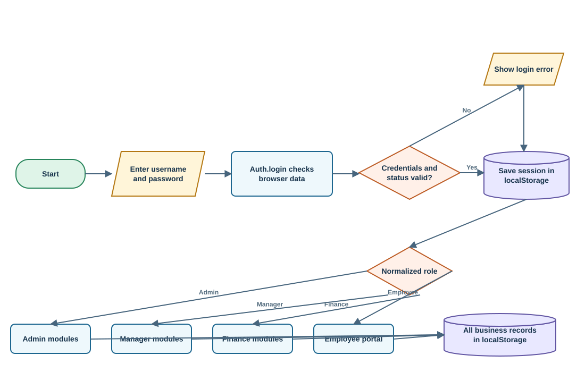
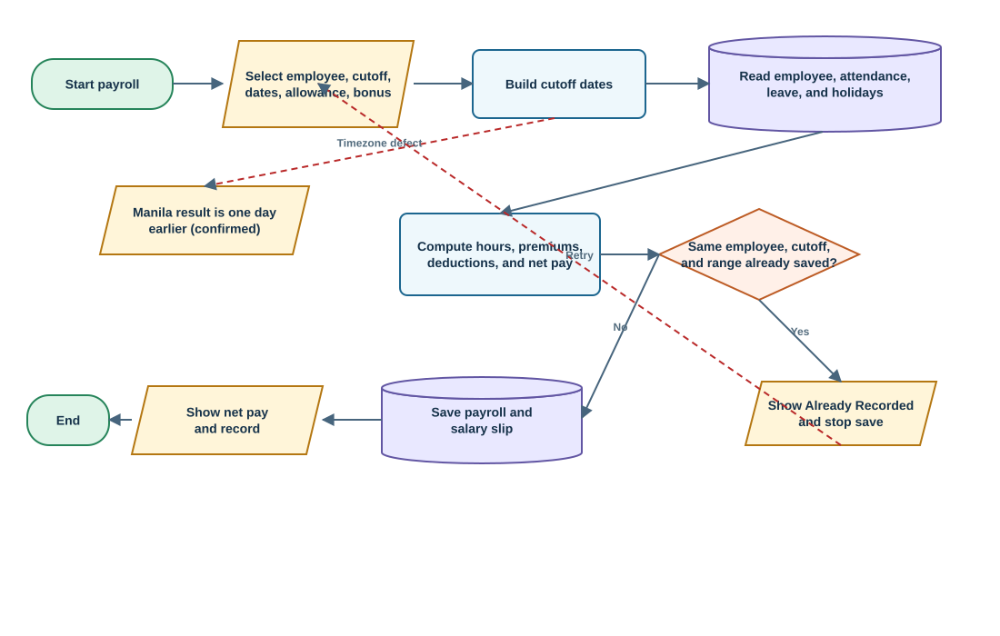
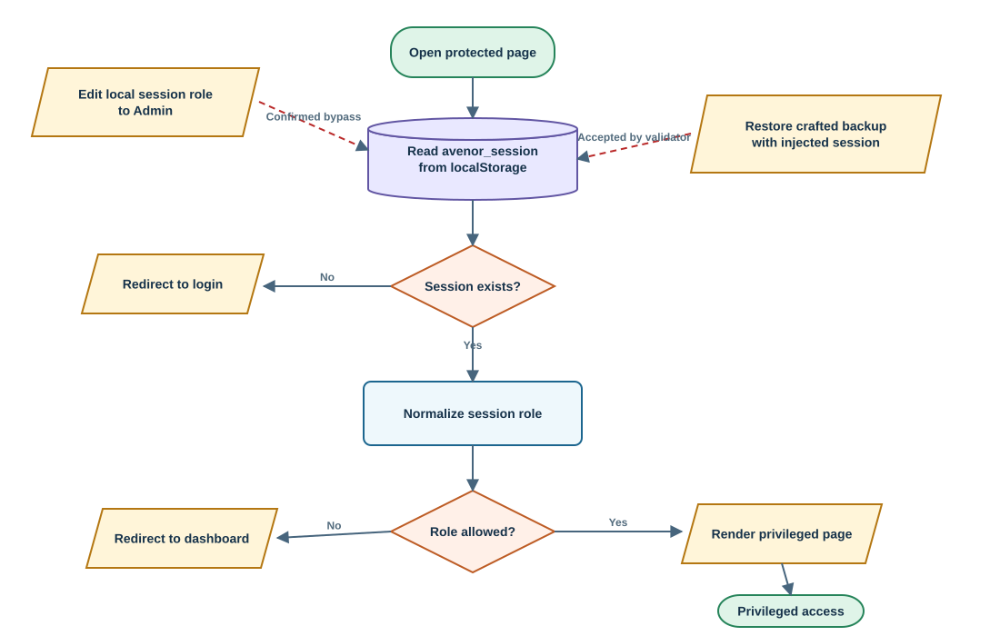

# AVENORLINE Employee Management and Payroll System

**Review date:** September 28, 2026  
**Mode:** Standard system-only review  
**Submitted source:** `E:\group 2 - bsit 3a\avenorline`  
**Readiness verdict:** **Prototype/demo ready; hindi pa production-ready for real HR or payroll data.**

## One-page Panel Brief

### Ano ang system?

Ang AVENORLINE ay browser-based employee management at payroll prototype. May modules para sa users, employees, departments, positions, attendance/timeclock, leave, payroll, payslips, 13th-month pay, reports, announcements, incidents, files, logs, at backup/restore. Lahat ng data at access decisions ay nasa browser `localStorage`; walang supplied server, database, API, o paper/requirements document.

### Mabilis na verdict

Maganda ang breadth ng demo at malinaw ang role-oriented menus, pero ang browser mismo ang security boundary, database, at payroll engine. Ibig sabihin, kayang baguhin ng taong may access sa browser ang session, roles, records, payroll inputs, logs, at backups. May limang defect na na-reproduce sa isolated runtime harness: fabricated Admin session, destructive seed reset, one-day payroll cutoff shift, permissive backup validation, at wrong-year 13th-month classification.

### Top strengths

- May central page/role map at page guard (`script.js:454-477`, `581-599`).
- May useful employee validation, duplicate payroll check, and safer incident escaping (`script.js:1343-1349`, `2031-2033`, `3773-3783`).
- May audit-style logs, backup/export, leave workflow, salary slips, at clear dashboard modules.
- JavaScript syntax check passed; source loaded successfully in an isolated Node runtime.

### Top five risks for the panel

| Priority | Risk | Evidence status | Bakit mahalaga |
|---|---|---|---|
| Critical | Fabricated Admin session is trusted | Confirmed | Full role bypass; local data and payroll can be altered |
| High | Seed-version change overwrites real records | Confirmed | Employee, attendance, payroll, slip, file, and 13th-month data loss |
| High | Payroll cutoff shifts one day earlier in Manila | Confirmed | Wrong attendance dates and payroll period |
| High | Restore accepts injected session and unknown keys | Confirmed | Crafted backup can insert privileged state or arbitrary browser keys |
| High | 13th-month year logic uses save date, not payroll period | Confirmed | Wrong annual basic-pay basis and benefit amount |

### QA count

**14 high-value cases:** 2 Passed, 5 Failed, 2 Blocked, 5 Not Run. “Blocked” at “Not Run” are not counted as success. Detailed cases are in the QA section and supporting CSV.

> **Panel takeaway:** I-defend ito bilang functional front-end prototype, not as a secure or legally validated payroll deployment. Ang strongest next step ay server-side authority plus payroll-rule validation, bago magdagdag ng bagong features.

## System Explained Simply

### Actors and practical access

| Actor | Intended access from code | Main actions | Main concern |
|---|---|---|---|
| Admin | All administrative modules | Manage workforce, users, payroll, settings, backups | Browser-local role can be fabricated |
| Manager | Employees, departments, positions, attendance, leave, reports, announcements, incidents | Review a department/workforce scope | Scope is UI/client logic only |
| Finance | Dashboard, attendance, payroll, payslips, reports, 13th month, incidents | Compute and release pay artifacts | Calculation rules are hard-coded and not independently approved |
| Employee | Personal portal modules | View own data, clock, apply leave, view pay, submit incidents | Linked identity and records are browser data |
| Kiosk user | Any signed-in user who opens `timeclock.html` | Time in/out by numeric employee ID | ID knowledge alone can impersonate attendance |

### Modules and data movement

1. `script.js` seeds demo users and records, then reads/writes named keys in `localStorage` (`script.js:9-40`, `340-430`).
2. Login hashes the submitted password with a small custom function, finds a local user, and saves a local session (`script.js:174-207`).
3. Each page calls `initPage`, which reads that session and checks the role against `PAGES` (`script.js:454-477`, `581-599`).
4. Business functions directly calculate and save attendance, leave, payroll, files, and logs in the same browser store.
5. Backup export serializes most local keys; restore reads a JSON file and writes every supplied key (`script.js:3045-3095`).

There is **no supplied backend** to independently authenticate the user, authorize a transaction, lock concurrent changes, validate payroll rules, protect files, or preserve tamper-evident audit history. Google Fonts is the only observed remote reference; no `fetch`, XHR, WebSocket, IndexedDB, or database integration was found.

### Assumed intended process

No capstone paper was supplied. The following is reconstructed from UI labels and code, so it is an **assumption**, not a documented requirement: Admin maintains master data and accounts; employees clock and request leave; managers approve HR requests; Finance calculates two payroll cutoffs and generates payslips/13th-month records; Admin backs up the browser data.

## Three Essential Flowcharts

### 1. Overall actual system flow



The login, role selection, modules, and business records all converge on the same browser store. The arrows are based on `Auth`, `PAGES`, `initPage`, and storage helpers (`script.js:9-58`, `174-218`, `454-477`, `581-599`).

### 2. Main payroll transaction



Normal flow: choose employee/cutoff, read attendance-leave-holiday records, compute, prevent an exact duplicate, then save payroll and slip. The dashed path is the confirmed Manila-time defect in `getCutoffRange` (`script.js:1913-1925`, `1940-2028`, `2116-2127`).

### 3. Riskiest access-control flow



The page guard works only with the session object it reads locally. The runtime check showed that a fabricated `{role: "Admin"}` session passes `requireRole`; backup validation also accepts a supplied session key (`script.js:163-168`, `193-207`, `3065-3095`).

## Top Findings

### F-01 - Browser-local session is treated as authority

**Severity:** Critical | **Confidence:** High | **Evidence:** Confirmed  
**Affected:** All roles, all protected modules, HR/payroll data | `script.js:163-168`, `174-207`, `581-599`

**Problema:** Ang role at identity ay ordinary JSON sa `localStorage`. Walang server signature or server-side authorization.  
**Saan:** Login, page access, and every role-based action.  
**Paano mabubutas:** Sa isolated harness, a fabricated session with `role: "Admin"` made `requireRole(['Admin'])` return true.  
**Expected vs Actual:** Expected: only a verified Admin reaches Admin actions. Actual: locally supplied session data is accepted.  
**Effect:** Puwedeng ma-view o mabago ang employee, payroll, file, user, at backup data from the same browser profile.  
**Ayusin:** Move identity, session issuance, authorization, and business writes to a server; re-check authorization on every operation.  
**Verification:** A modified browser session must receive 401/403 from the server and no record should change.  
**Panel question:** “Saan eksaktong pinapatunayan ng system na tunay ang Admin role?”

### F-02 - Published default passwords and non-cryptographic hashing

**Severity:** High | **Confidence:** High | **Evidence:** Code-evidenced and seeded login confirmed  
**Affected:** Admin and all seeded accounts | `script.js:174-179`, `373-406`, `1260-1280`, `2996-3005`, `3733-3754`

**Problema:** May known passwords (`admin123`, `avenor123`, `password123`), custom fast hash, at visible login hint. A `mustChangePassword` flag is written but never enforced.  
**Paano mabubutas:** Anyone with the source or login screen knows the Admin credential; hashes can be recomputed quickly.  
**Expected vs Actual:** Expected: unique secret, slow salted hash, forced first-login change. Actual: shared predictable secrets and a reversible workflow assumption.  
**Effect:** Account takeover and shared-account accountability failure.  
**Ayusin:** Server-side password hashing (Argon2/bcrypt/scrypt), one-time setup, forced reset, lockout/rate limits, and no credential hints.  
**Verification:** A new user cannot continue until changing a one-time secret; repeated failures are throttled.  
**Panel question:** “Bakit may `mustChangePassword` pero saan ito binabasa?”

### F-03 - Seed-version mismatch can erase operational data

**Severity:** High | **Confidence:** High | **Evidence:** Confirmed  
**Affected:** Employees, users, attendance, payroll, slips, 13th-month, files | `script.js:338-416`

**Problema:** Kapag iba o missing ang seed version, nire-replace ang master records at sini-set sa empty arrays ang transactions.  
**Paano mabubutas:** Change/remove `avenor_seed_version`, then load any page. The harness confirmed the custom employee disappeared and attendance became empty.  
**Expected vs Actual:** Expected: seed runs only on truly empty first install or migrates safely. Actual: version mismatch is destructive initialization.  
**Effect:** Silent HR/payroll data loss after update, restore issue, or manual storage edit.  
**Ayusin:** Separate first-run seed from migrations; never overwrite non-empty business keys; require backup and an idempotent migration log.  
**Verification:** Upgrade a populated fixture and compare every pre-existing record and total afterward.  
**Panel question:** “Ano ang mangyayari sa live payroll kapag nagbago ang `REAL_ROSTER_VERSION`?”

### F-04 - Payroll cutoff dates shift one day earlier in Manila

**Severity:** High | **Confidence:** High | **Evidence:** Confirmed  
**Affected:** Attendance selection, absence count, payroll range, duplicate key | `script.js:1913-1925`, `1940-1947`

**Problema:** Local midnight is converted with `toISOString()`, which is UTC. In UTC+8, September 1 becomes August 31.  
**Paano mabubutas:** Compute first cutoff for September 2026 in Asia/Manila. Actual result: `2026-08-31` to `2026-09-14`.  
**Expected vs Actual:** Expected: September 1-15. Actual: August 31-September 14.  
**Effect:** Wrong attendance included/excluded, wrong absences, and a misleading payroll label.  
**Ayusin:** Build date-only strings from local year/month/day without UTC conversion, then regression-test both cutoffs and month ends.  
**Verification:** Test February/leap year, 30/31-day months, UTC+8, and exact boundary attendance.  
**Panel question:** “Bakit gumagamit ng UTC conversion para sa Philippine date-only cutoff?”

### F-05 - Backup validation allows session injection and unknown keys

**Severity:** High | **Confidence:** High | **Evidence:** Confirmed validator behavior  
**Affected:** Settings/restore, identity, all local browser data | `script.js:3045-3095`

**Problema:** Three arrays are the only validity requirement; restore writes every `dump.data` entry. Walang key allowlist, record schema, size limit, or atomic rollback.  
**Paano mabubutas:** A crafted file containing the required arrays plus `avenor_session` and `unrelated_key` returned valid in the harness.  
**Expected vs Actual:** Expected: reject unrecognized/security-sensitive keys. Actual: validator accepts them and import is prepared to save them.  
**Effect:** Privileged session insertion, arbitrary local key pollution, partial restore, or corrupted structures.  
**Ayusin:** Strict versioned schema, exact key allowlist excluding session, per-record checks, preview counts, backup-before-restore, and atomic server transaction.  
**Verification:** Unknown key, injected session, wrong field type, oversized file, and mid-restore failure must all leave current data unchanged.  
**Panel question:** “Which exact keys and schemas are allowed during restore?”

### F-06 - Timeclock can impersonate another employee using ID digits

**Severity:** High | **Confidence:** High | **Evidence:** Code-evidenced; not executed to avoid altering records  
**Affected:** Attendance and downstream payroll | `timeclock.html:93-105`, `107-183`, `228-239`

**Problema:** Any signed-in user can open the kiosk page; it checks only whether a session exists. Entering numeric employee-ID digits records time in/out for that employee.  
**Paano mabubutas:** Enter a coworker’s visible/predictable ID such as `007`; first entry clocks in, next entry clocks out.  
**Expected vs Actual:** Expected: dedicated kiosk authorization plus employee proof. Actual: ID knowledge alone changes attendance.  
**Effect:** Falsified hours, late status, overtime, and payroll.  
**Ayusin:** Dedicated kiosk role/device, PIN/badge/QR with anti-replay, confirmation screen, supervisor correction workflow, and immutable edit history.  
**Verification:** Wrong PIN, guessed ID, rapid replay, and ordinary employee session must not create records.  
**Panel question:** “What prevents me from clocking in EMP-007?”

### F-07 - Stored HTML is rendered without consistent escaping

**Severity:** High | **Confidence:** High | **Evidence:** Code-evidenced; browser execution blocked  
**Affected:** Employees, users, leave, payroll, files, topbar | `script.js:1020-1053`, `1067-1110`, `1384-1404`, `1829-1859`, `2909-2933`

**Problema:** Many stored fields are inserted into template strings assigned to `innerHTML` without `escapeHtml`. The incident module correctly escapes, proving a safer pattern already exists (`script.js:3773-3783`).  
**Paano mabubutas:** Import or save crafted markup into a displayed name/address/file field, then open the corresponding list or modal.  
**Expected vs Actual:** Expected: markup appears as text. Actual: browser interprets it as HTML.  
**Effect:** Script execution can read/alter all same-origin local HR/payroll data.  
**Ayusin:** Use `textContent`/DOM construction by default and a single trusted escaping layer for unavoidable HTML templates; validate imported strings.  
**Verification:** Standard stored-XSS payloads must render inertly across every field inventory.  
**Panel question:** “Why is `escapeHtml` limited to incidents while employee and user tables use raw fields?”

### F-08 - 13th-month pay uses record creation year, not covered payroll year

**Severity:** High | **Confidence:** High | **Evidence:** Confirmed  
**Affected:** 13th-month computation and employee benefit | `script.js:2256-2271`

**Problema:** Records are grouped by `createdAt.startsWith(year)` instead of payroll `from/to`. If no record is found, even a past selected year uses the current month count.  
**Paano mabubutas:** Payroll for Dec 16-31, 2025 saved Jan 2, 2026 was ignored for 2025 and counted for 2026. The 2025 fallback produced nine months using September 2026 as the current month.  
**Expected vs Actual:** Expected: earnings belong to the work/payroll period. Actual: save timestamp controls the year.  
**Effect:** Underpayment or overpayment and incorrect annual basis.  
**Ayusin:** Allocate eligible basic salary by covered date, define inclusion rules, and freeze an auditable annual ledger.  
**Verification:** Test late-posted December payroll, backdated corrections, new hires, inactive employees, and selected past/future years.  
**Panel question:** “Why does `createdAt` decide which year earned the pay?”

### F-09 - Employee email collision can silently downgrade a privileged account

**Severity:** High | **Confidence:** High | **Evidence:** Code-evidenced  
**Affected:** Employee onboarding and user roles | `script.js:1260-1269`, `1328-1369`

**Problema:** Employee form validates email shape but not uniqueness. Account linking reuses a user by matching email and changes any non-Employee role to `Employee`.  
**Paano mabubutas:** Add an employee using an existing Admin/Manager/Finance email.  
**Expected vs Actual:** Expected: reject duplicate identity or require explicit reconciliation. Actual: existing account is linked and role is overwritten.  
**Effect:** Admin lockout, privilege loss, mistaken identity, and audit confusion.  
**Ayusin:** Enforce unique normalized emails, separate employee-person linkage from role assignment, and require reviewed conflict resolution.  
**Verification:** Attempt collisions by case, whitespace, username, linked employee, and all privileged roles.  
**Panel question:** “Why can employee creation mutate an existing user’s role?”

### F-10 - File save can fail while UI reports success

**Severity:** Medium | **Confidence:** High | **Evidence:** Code-evidenced  
**Affected:** Employee files and browser storage | `script.js:30-33`, `1380-1449`

**Problema:** Files are converted to base64 inside limited `localStorage`. `saveData` returns false on quota/error, but upload ignores the return and immediately logs/shows success.  
**Paano mabubutas:** Fill storage near quota, then upload an allowed file.  
**Expected vs Actual:** Expected: clear failure and no audit success. Actual: code always proceeds to “uploaded successfully.”  
**Effect:** User believes a required HR document exists when it was not persisted.  
**Ayusin:** Store documents in a protected server/object store; check the write result and verify read-back before logging success.  
**Verification:** Simulate quota, interrupted upload, wrong MIME/content, duplicate name, and unauthorized download.  
**Panel question:** “How does the UI know the file was actually saved?”

## Recommended System Improvements

| Priority | Current condition | Add or change | Intended process | Benefit | Success indicator |
|---|---|---|---|---|---|
| Critical | Browser decides identity and permissions | Server authentication, signed/secure session, per-action authorization | UI requests an operation; server verifies actor, role, scope, and record | Prevents local role fabrication | Tampered client receives 401/403; no write occurs |
| Critical | Browser is the HR/payroll database | Transactional database with constraints and backups | Server validates and commits; users receive a record/version ID | Integrity, concurrency, recovery | Restore drill meets RPO/RTO and reconciliation totals match |
| High | Payroll rules are hard-coded | Approved versioned payroll policy/rate tables and specialist sign-off | Each run stores rule version, inputs, calculation, approval, release | Explainable and auditable payroll | Golden payroll cases match approved computations |
| High | Seed can overwrite live data | First-run setup plus idempotent migrations | Seed only a new empty tenant; upgrades migrate without replacing records | Prevents data loss | Populated upgrade fixture is byte/value preserving except planned fields |
| High | Kiosk accepts ID only | Dedicated kiosk role/device and employee verification | Identify, verify, confirm action, record device/time, allow reviewed correction | Reduces attendance fraud | Guessed ID/replay cannot create a record |
| High | Restore trusts loose JSON | Versioned schema, allowlist, dry-run preview, backup, atomic restore | Validate all records before commit; rollback on any failure | Safe recovery | Malformed/unknown-key imports make zero changes |
| High | Payroll can be generated directly | Draft-review-approve-release lifecycle with separation of duties | Finance prepares, authorized approver reviews differences, then releases | Prevents accidental/unauthorized pay | Every released run has preparer, approver, timestamp, totals |
| Medium | Logs are ordinary editable local data | Append-only audit service and correction events | Never overwrite history; corrections reference original record | Accountability | Every critical change has actor, before/after, reason, and immutable ID |
| Medium | Uploads live in localStorage | Protected document storage, allowlisted content, malware scan, retention | Upload, verify, scan, authorize access, preserve checksum | Reliable HR documents | Failed/unsafe uploads never show success; access tests pass |
| Medium | Errors can be misleading | Unified error handling with read-back verification | Success only after confirmed persistence; actionable error otherwise | Trust and supportability | Forced storage/network failures show correct result and no false audit entry |

## Validation and Process Correctness

### Validation matrix

| Boundary | Present controls | Missing or weak controls | Verdict |
|---|---|---|---|
| Client/UI | Required fields, email/contact/name/number checks, date order on employee leave | Not uniform; Admin leave lacks date order; many mutation functions assume trusted caller | Partial |
| Authentication | Username/email lookup, password comparison, Approved status | Known defaults, fast custom hash, no forced change/rate limit/server proof | Incorrect for production |
| Authorization | Central `PAGES` roles, `initPage`, limited Manager display scope | Client-only; functions/data store remain writable; timeclock only checks session | Incorrect for production |
| Business rules | Duplicate payroll key, attendance calculations, leave statuses | Cutoff timezone bug; unapproved payroll policies; weak identity linkage | Partial/incorrect |
| Persistence | JSON parse fallback, backup/export, some confirmations | No database constraints, transactions, concurrency control, atomic restore, tamper evidence | Incorrect for production |
| Output | Incident escaping and some `textContent` use | Raw `innerHTML` for many stored fields | Partial |
| Files | 2 MB size limit | No content allowlist, server authorization, scan, durable storage, write verification | Partial |

### Process correctness by critical use case

| Use case | Preconditions and main flow | Alternatives/exceptions | Postcondition | Verdict |
|---|---|---|---|---|
| Login | Local user exists, hash matches, status Approved | Invalid/inactive returns error | Local session JSON saved | Functionally works; security incorrect |
| Employee onboarding | Admin/Manager enters validated employee fields; account auto-created | Username collision gets numeric suffix | Employee and account stored | Partial; email collision can change privileged role |
| Attendance | Employee clock or kiosk ID creates today’s record; next action clocks out | Duplicate/completed record stops | Attendance feeds payroll | Partial; kiosk identity is weak |
| Leave | Employee submits Pending; Manager/Admin approves/rejects | Employee may cancel Pending | Status stored | Partial; no balance/overlap policy and inconsistent date validation |
| Payroll | Finance/Admin selects range; engine reads records; duplicate blocked | Missing/incomplete attendance deducted | Payroll plus slip stored | Incorrect cutoff; domain rates unverified; no approval/release state |
| 13th month | Active employee; use payroll basic pay or fallback | Existing annual record prevents duplicate | Annual record stored | Incorrect year attribution/fallback |
| Incident | Signed-in actor submits; Admin approves/rejects | Role-scoped list; output escaped | Decision recorded | Mostly coherent; still client-tamperable |
| Backup/restore | Admin exports keys; restore prompts before overwrite | Invalid JSON/three missing arrays rejected | Supplied keys written, reload | Partial; schema and atomicity inadequate |

## Important JavaScript and How the System Applies It

| Function | Inputs / outputs / side effects | System use and visible effect |
|---|---|---|
| `saveData` / `getData` (`script.js:30-40`) | JSON to/from `localStorage`; save returns boolean | Storage layer for every module; failures can be swallowed |
| `Auth.login` (`174-200`) | Login/password -> result; writes session and log | Opens dashboard for an Approved local account |
| `initPage` (`581-599`) | Page ID and session role -> render or redirect | Builds role menu/topbar; not a server authorization boundary |
| `getManagerScope` (`3796`) | Current Manager identity -> employee subset | Filters Manager views by department or `managerId` |
| `kioskRecord` (`timeclock.html:107-184`) | Numeric ID -> time in/out write | Kiosk attendance; predictable ID is its only employee proof |
| `computeCutoffPayroll` (`1940-2028`) | Employee, cutoff, options -> detailed payroll object | Calculates hours, absences, premiums, government deductions, net pay |
| `findExistingPayroll` (`2031-2033`) | Employee/cutoff/range -> existing record/null | Blocks exact duplicate payroll save |
| `compute13thMonth` (`2256-2271`) | Employee/year -> annual basic and 1/12 | Generates 13th-month values; uses wrong time attribute |
| `isValidBackupFile` / `importData` (`3065-3100`) | Parsed JSON -> validity; writes supplied keys | Restore workflow; permits extra/session keys |
| `escapeHtml` (`3773`) | Any value -> escaped text string | Correctly protects incident templates but is not applied consistently |

## Vibe-Coding Evidence

These are implementation-risk indicators only. **Hindi ito proof na AI ang author.**

### V-01 - Security flag is written but never enforced

**Location/function:** `script.js:1274-1280`, `createLinkedEmployeeAccount`  
**Evidence code:**

```js
const tempPassword = 'avenor123';
const account = {
  id: generateId('USR'), fullName: emp.name, username, email: emp.email,
  passwordHash: Auth._hash(tempPassword), role:'Employee', status:'Approved',
  linkedEmployeeId: emp.id, createdAt:new Date().toISOString(),
  mustChangePassword:true
};
```

**What it does:** Creates an approved account with a common temporary password.  
**Why signal:** Search found no read/check of `mustChangePassword`; the control stops at data decoration.  
**System effect:** User can keep using the shared default.  
**Confidence:** High.

### V-02 - Declared government-rate object is bypassed by duplicated literals

**Location/function:** `script.js:1904`, `2021-2025`, payroll engine  
**Evidence code:**

```js
const GOV_RATES = { pagibig: 0.02, sss: 0.05, philhealth: 0.025 };
// ...
const pagibig=applyGov ? monthlySalary*0.02/2 : 0;
const sss=applyGov ? monthlySalary*0.05/2 : 0;
const philhealth=applyGov ? monthlySalary*0.025/2 : 0;
```

**What it does:** Computes flat deductions on the second cutoff.  
**Why signal:** A named rule source exists but is ignored, so updates can diverge; no brackets/caps/effective dates are modeled.  
**System effect:** Payroll policy is hard to verify and safely update.  
**Confidence:** High.

### V-03 - Safer escaping exists only in a late-added module

**Location/function:** `script.js:3773-3783`, incident rendering; compare `1020-1053`  
**Evidence code:**

```js
function escapeHtml(v){
  return String(v??'').replace(/[&<>'"]/g,
    c=>({'&':'&amp;','<':'&lt;','>':'&gt;',"'":'&#39;','"':'&quot;'}[c]));
}
// incident fields call escapeHtml(...)
```

**What it does:** Makes incident content safe before insertion into HTML.  
**Why signal:** Earlier employee/user/payroll renderers interpolate stored values raw, showing inconsistent integration rather than a system-wide output rule.  
**System effect:** Some modules resist stored HTML while others can interpret it.  
**Confidence:** High.

<div class="page-break"></div>

### V-04 - Duplicate/dead profile and attendance flows remain

**Location/function:** `script.js:3214-3315`; `profile.html:1`  
**Evidence code:**

```js
function renderEmpProfile() { /* editable profile renderer */ }
function openEditProfileModal() { /* expects modal fields */ }
function initEditProfileForm() { /* saves profile edits */ }
function ensureAttendanceOnLogin() { /* auto time-in */ }
```

**What it does:** Defines an editable profile and automatic login attendance path.  
**Why signal:** `profile.html` calls the different `renderEmpProfilePage`; searches found no callers for these functions.  
**System effect:** Claimed behavior can exist in code without being reachable or tested, increasing defense confusion.  
**Confidence:** High.

### V-05 - Shared save failure is converted into false success

**Location/function:** `script.js:30-33`, `1423-1449`, file upload  
**Evidence code:**

```js
function saveData(key, data) {
  try { localStorage.setItem(key, JSON.stringify(data)); return true; }
  catch (e) { console.error(e); return false; }
}
// ...
saveData(KEYS.EMPLOYEE_FILES, files);
showToast('success', 'Uploaded', `${file.name} uploaded successfully.`);
```

**What it does:** Storage helper signals failure, but caller always shows success.  
**Why signal:** Error handling exists at one layer but is not integrated into the business result.  
**System effect:** Missing document with a successful UI message/log.  
**Confidence:** High.

## QA Summary

| ID | Test | Expected | Actual | Status |
|---|---|---|---|---|
| QA-01 | Parse `script.js` | No syntax error | Exit 0 | Passed |
| QA-02 | Seeded Admin login | Valid seeded account signs in | `ok: true` | Passed |
| QA-03 | Fabricated Admin session | Reject | Accepted | Failed |
| QA-04 | Seed mismatch with existing data | Preserve records | Employee removed; attendance cleared | Failed |
| QA-05 | September 2026 first cutoff in Manila | Sep 1-15 | Aug 31-Sep 14 | Failed |
| QA-06 | Backup with session/unknown key | Reject | Validator returned true | Failed |
| QA-07 | Dec 2025 payroll saved Jan 2026 | Count in 2025 | Counted in 2026 | Failed |
| QA-08 | Coworker kiosk ID | Require proof | Code accepts ID alone | Not Run |
| QA-09 | Stored HTML in employee output | Render as text | Browser execution unavailable | Blocked |
| QA-10 | Employee email matches Admin | Reject collision | Code downgrades matching user | Not Run |
| QA-11 | File upload at quota | Report failure | Code path reports success | Not Run |
| QA-12 | Admin leave end before start | Reject | No guard in Admin handler | Not Run |
| QA-13 | Government deduction legality | Approved tables/policy | Specialist validation absent | Blocked |
| QA-14 | Exact duplicate payroll | Block duplicate | Guard exists in code | Not Run |

### Suggested next execution order

1. Fix and unit-test cutoff/13th-month date rules with immutable fixtures.
2. Move auth/write authority to a server, then run role/record-scope tests.
3. Add a browser integration suite for stored output, kiosk, restore, and storage failure.
4. Have HR/payroll/accounting approve golden computations before release.

## Five Strongest Panel Questions

### 1. “If I change `avenor_session.role` to `Admin`, what independent control rejects me?”

**Why ask:** Tests whether the team understands trust boundaries.  
**Strong answer:** Client guards are only UX; production needs server-issued sessions and server authorization on every read/write. A tampered role must get 401/403.  
**Follow-up:** “Show the code that rejects the modified client.”  
**Red flags:** “Hidden ang menu,” “hashed ang password,” or “users will not open DevTools.”

### 2. “Why does a September 1 cutoff become August 31 in Philippine time?”

**Why ask:** Directly targets a confirmed payroll bug.  
**Strong answer:** `toISOString` converts local midnight to UTC; date-only payroll boundaries should be constructed without UTC conversion and covered by timezone/month-end tests.  
**Follow-up:** “What happens in February and the second cutoff?”  
**Red flags:** No boundary fixtures, reliance on the developer’s machine timezone.

### 3. “What data survives when `REAL_ROSTER_VERSION` changes?”

**Why ask:** Tests migration and recovery discipline.  
**Strong answer:** Current code can replace records; production should separate one-time demo seed from idempotent migrations, back up first, and verify record counts/totals after upgrade.  
**Follow-up:** “Show the rollback and upgrade test.”  
**Red flags:** “Refresh lang,” “may backup naman,” or no populated migration fixture.

### 4. “How do you prove a 13th-month amount belongs to the correct earned year?”

**Why ask:** Links code fields to payroll meaning.  
**Strong answer:** Use covered payroll dates and eligible basic pay, not record creation timestamp; handle late posting, corrections, hires, and prior-year reruns with an auditable annual ledger.  
**Follow-up:** “Where does a Dec 31 payroll saved Jan 2 go?”  
**Red flags:** “Based on `createdAt`,” current-month fallback for past years, or no reconciliation.

<div class="page-break"></div>

### 5. “What stops one employee from clocking another employee in using `007`?”

**Why ask:** Tests the real attendance threat model.  
**Strong answer:** Dedicated kiosk authorization, employee proof (PIN/badge/approved biometric policy), replay controls, confirmation, device/time audit, and supervisor correction—not predictable ID alone.  
**Follow-up:** “Can an ordinary signed-in employee open `timeclock.html`?”  
**Red flags:** “Masked naman ang displayed ID” or reliance on employee honesty.

## Coverage, Assumptions, and Limitations

### Reviewed

- All 20 submitted files were inventoried and SHA-256 baselined: 18 HTML pages, `script.js` (3,823 lines), and `styles.css`.
- Entry points, shared storage/auth, roles/pages, employee/user linking, attendance/timeclock, leave, payroll, payslips, 13th month, incidents, files, logs, and backup/restore were traced.
- JavaScript syntax check and an isolated read-only-source runtime harness were executed. No source file was edited.

### Evidence summary

- **Confirmed runtime:** seeded login works; fabricated Admin session accepted; seed mismatch erased test records; cutoff shifted; crafted backup accepted; 13th-month year misclassification reproduced.
- **Code-evidenced:** default password design, kiosk impersonation path, raw HTML sinks, account-role collision, false upload success, uneven validation.
- **Assumptions:** Intended business flow and role responsibilities were inferred from UI and code because no paper, formal requirements, payroll policy, test data specification, or database design was supplied.
- **Not testable here:** Full browser UI flow. The controlled browser blocked local `file:` URLs by policy, and no workaround was used. Stored-XSS execution, storage quota behavior, accessibility, responsiveness, multi-tab concurrency, and actual file download/upload were not runtime-verified.
- **Domain limitation:** Philippine payroll, government contribution, tax, holiday, leave, and 13th-month legal correctness requires current official policy plus HR/payroll/accounting review. This report does not certify legal compliance.

### Scope boundaries

No production service, real account, network target, dependency installation, database seed/migration, destructive test, or submitted-source modification was performed. Vibe-coding indicators describe observable integration risks only and are not authorship claims.

### Readiness decision

**Accept for classroom demonstration with disclosed limitations. Do not use for real employee, document, attendance, or payroll operations until Critical/High findings are resolved and payroll golden cases are independently approved.**
