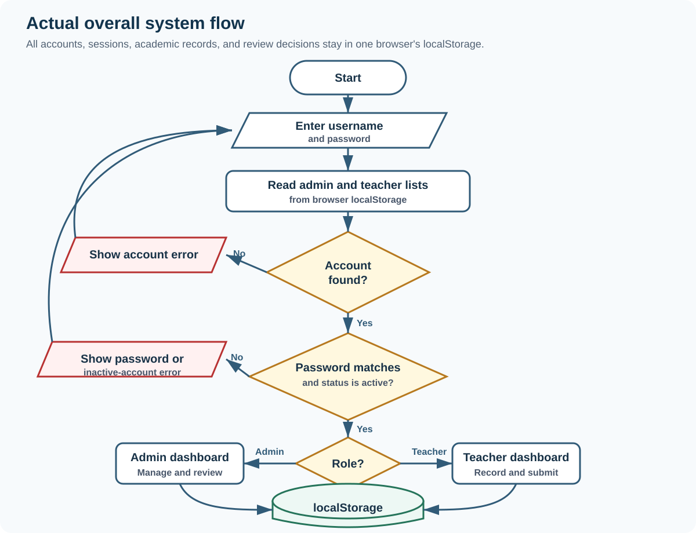
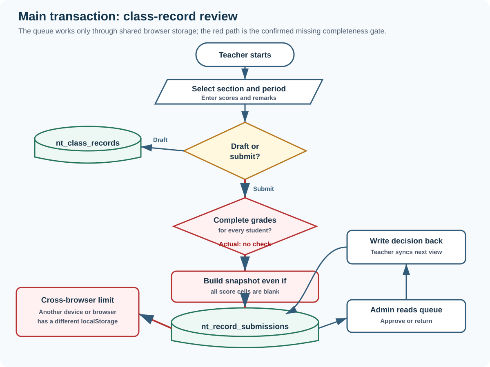
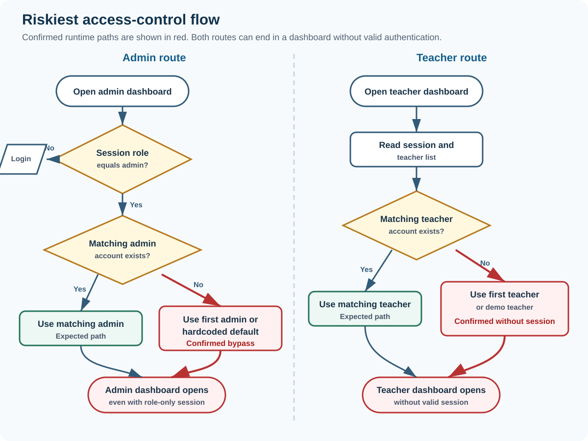

# BSIT 3-B Calleja - Neotech University SIMS

<style>
@page { margin: 10mm 10mm 12mm; }
body { font-size: 8.7pt; line-height: 1.28; }
h1 { font-size: 19pt; margin-bottom: 4mm; padding-bottom: 2mm; }
h2 { font-size: 13.5pt; margin: 5mm 0 2mm; }
h3 { font-size: 10.5pt; margin: 3mm 0 1mm; }
p { margin-bottom: 1.8mm; }
ul, ol { margin: .5mm 0 2mm 5mm; }
li { margin-bottom: .6mm; }
table { font-size: 7.3pt; margin: 2mm 0 3mm; }
th, td { padding: 1.15mm 1.4mm; }
pre { font-size: 7.2pt; padding: 2.5mm; }
img.half-diagram { max-height: 72mm; margin: 1.5mm auto 2mm; }
</style>

# One-page panel brief

**Review date:** 2026-09-28  
**Review mode:** Standard system-only mock-defense analysis  
**Submitted source:** `E:\3rdYEAR WEBSITE 100%\BSIT 3-B CALLEJA`  
**Evidence rule:** Confirmed = reproduced in a clean local browser. Code-evidenced = directly supported by source but not executed end to end. Suspected and Not testable are labeled.

## Ano ang system?

Ang Neotech University SIMS ay browser-based academic records prototype para sa dalawang active roles: **Administrator** at **Teacher**. May login, account management, sections, students, attendance, class records, grade review, reports, deletion requests, at trash/restore. Walang student login sa submitted source; ang student ay record/data subject lamang.

## Readiness verdict

**Prototype-ready for UI demonstration, not ready for real multi-user school deployment.** Maayos at malawak ang interface, maraming useful validation at workflow screens, at syntactically valid ang tatlong inline JavaScript programs. Pero ang authentication, records, approvals, at audit data ay nasa browser `localStorage` lang. Ibig sabihin, madaling baguhin sa browser, hindi shared sa ibang browser/device, at puwedeng mawala kapag na-clear ang site data.

## Strengths na puwedeng ipagtanggol

- Confirmed na nagre-redirect sa login ang admin page kapag walang session.
- Confirmed na nire-reject ang maling password at inactive account sa normal login form.
- May escaping helpers (`esc`, `escapeHTML`) sa maraming dynamic table output.
- May password length/username/email uniqueness checks para sa admin-created accounts.
- May score bounds, category weights totaling 100%, return reason, history entries, at trash/restore concepts.
- Lahat ng inline scripts passed syntax parsing: login 1/1, admin 2/2, teacher 1/1.

## Top five risks

1. **Critical - Admin takeover:** role-only value sa `localStorage` is enough para magbukas ang admin dashboard.
2. **High - Teacher access without login:** direct URL opens a demo/first-teacher dashboard kahit walang session.
3. **High - No shared authoritative data:** isolated ang records per browser context; walang real server/database sync.
4. **High - Grade integrity:** fully blank class records can be submitted as Pending Review.
5. **High - Attendance integrity:** 1 of 2 students marked can be submitted and displayed as 100% attendance.

## QA snapshot

| Result | Count | Meaning |
|---|---:|---|
| Passed | 4 | Expected control observed at runtime |
| Failed | 8 | Reproduced behavior differs from safe/required result |
| Not Run | 2 | Code reviewed, but no separate runtime case executed |
| Total | 14 | Risk-based Standard review set |

**Immediate panel focus:** Hingin ang live explanation ng auth boundary, cross-device data flow, grade completion rule, attendance completeness rule, at teacher record scoping.

# System explained simply

## Actors and permissions

| Actor | Intended actions | Actual boundary |
|---|---|---|
| Administrator | Manage academic reference data and accounts; review records; view reports; approve deletion | UI has these actions, but access is decided by editable client storage |
| Teacher | Manage own sections/students; record attendance and grades; submit to admin; view own history | Many records are filtered by teacher ID, but unassigned records leak into Class Record and direct access needs no valid session |
| Student | Represented in records only | No student account, portal, consent flow, or self-service module in submitted source |
| Browser storage | Holds accounts, sessions, records, settings, logs, and approvals | Acts like the database even though it has no server authorization, sharing, backup, or integrity controls |

## Modules and technology

- **Stack:** three standalone HTML files with embedded CSS and vanilla JavaScript; local JPG/PNG assets; no package manifest, backend, API, or database source.
- **Entry points:** `index.html`, `admin/dashboard.html`, `teacher/dashboard.html`.
- **Persistence:** browser `localStorage` keys such as `nt_admins`, `nt_teachers`, `nt_students`, `nt_sections`, `nt_attendance`, `nt_class_records`, and `nt_record_submissions`.
- **Main flow:** login reads accounts from the browser, writes a session object, redirects by role, and dashboards read/write the same browser store.

## Overall actual flow



**What this means:** Mukhang complete multi-role system sa UI, pero ang shared point ay browser storage, hindi central service. Same browser profile/tab family lang ang naturally nagkakakita ng records.

## Critical use cases

| Use case | Preconditions | Main/alternate flow | Postcondition |
|---|---|---|---|
| Login | Account exists in localStorage | Match identifier, password, active status; else show error | Session JSON stored, role dashboard opened |
| Encode grades | Teacher and section/student records available | Select period, enter scores, save draft or submit | Class record and optional review snapshot stored |
| Attendance | Teacher section/student list available | Mark status per student, draft or submit | Attendance rows and review snapshot stored |
| Admin review | Submission exists in same browser storage | Approve or return with reason | Submission status/history updated |
| Delete/restore | Record exists | Move generic record to trash; restore or purge | Record moves between local arrays |

**Paper-to-system traceability:** Not applicable. No capstone paper or formal requirements document was supplied, so intended behavior is reconstructed from UI labels, comments, and code. Any business expectation below is labeled as expected process, not a paper claim.

# Essential flowcharts

## Main transaction: class-record submission and review



**Actual behavior:** `submitSectionToAdmin()` sends every draft/returned student record to `submitClassRecordForReview()` without requiring a score, computed average, or completion percentage. The admin queue can therefore receive an empty record. Evidence: `teacher/dashboard.html:9520-9565`, `teacher/dashboard.html:8656-8715`.

## Riskiest security flow: route guards



**Actual behavior:** Admin route checks only `session.role === "admin"`, then falls back to the first/hardcoded admin. Teacher route falls back to the first teacher or demo teacher and does not redirect. Evidence: `admin/dashboard.html:1596-1626`, `teacher/dashboard.html:5279-5361`.

# Top findings

## F-01 - Role-only session opens the admin dashboard

**Severity:** Critical | **Confidence:** High | **Status:** Confirmed  
**Affected:** Administrator role, all academic records and account controls  
**Saan:** `admin/dashboard.html:1596-1626`

- **Problema:** Editable browser data ang ginagamit bilang authorization proof.
- **Paano mabubutas:** In a clean browser, set `nt_current_user` to `{ "role": "admin" }`, then open the admin URL.
- **Expected vs Actual:** Expected rejection because no authenticated admin identity exists. Actual: dashboard opens as System Administrator.
- **Effect:** Full admin UI access, including accounts, records, approvals, settings, and trash.
- **Ayusin:** Server-issued secure session, server-side role check on every protected operation, and removal of account fallbacks.
- **Verification:** A forged/missing/expired token must return 401/403 and must not expose data.
- **Panel question:** Ano ang trusted proof na authenticated admin ang user, at bakit hindi editable ng browser?

Runtime evidence: clean Edge context opened the dashboard with only a role field; screenshot `admin-forged-session.png`.

## F-02 - Teacher dashboard opens without a valid session

**Severity:** High | **Confidence:** High | **Status:** Confirmed  
**Affected:** Teacher functions and student academic data  
**Saan:** `teacher/dashboard.html:5279-5361`

- **Problema:** Kapag walang matching session, ginagamit ang first teacher o hardcoded demo teacher.
- **Paano mabubutas:** Open `/teacher/dashboard.html` directly in a clean browser.
- **Expected vs Actual:** Expected redirect to login. Actual: Juan Dela Cruz demo dashboard opens with full teacher controls.
- **Effect:** Anonymous user can enter the teacher workflow and create/edit browser-local school records.
- **Ayusin:** Require a valid server session and active teacher account before rendering or running any module.
- **Verification:** Direct URL and expired-session tests must always return to login.
- **Panel question:** Bakit may demo fallback sa production route, at paano ninyo pinipigilan ang anonymous write actions?

## F-03 - No shared authoritative persistence

**Severity:** High | **Confidence:** High | **Status:** Confirmed  
**Affected:** All users, accounts, grades, attendance, approvals, audit/history  
**Saan:** `admin/dashboard.html:1471-1508`, `teacher/dashboard.html:5258-5270`, `teacher/dashboard.html:8616-8621`

- **Problema:** Browser-local arrays ang database at ang teacher-admin connection.
- **Paano mabubutas/fail:** Create data in browser context A, then open the same site in isolated context B.
- **Expected vs Actual:** Expected both authorized users to see the same data. Actual: A had 1 student while B had 0; clearing A removed the student and only reseeded the default admin.
- **Effect:** Hindi gumagana ang real cross-device collaboration; easy data loss and inconsistent school records.
- **Ayusin:** Central transactional database/API with authenticated CRUD, constraints, backups, and migration from local prototype data.
- **Verification:** Two separate devices must see the same committed record and approval history.
- **Panel question:** Paano makikita ng admin sa ibang computer ang submission ng teacher?

## F-04 - Plaintext, default, and predictable passwords

**Severity:** High | **Confidence:** High | **Status:** Confirmed and code-evidenced  
**Affected:** Admin and teacher accounts  
**Saan:** `index.html:1854-1884`, `index.html:2084-2093`, `admin/dashboard.html:3672-3691`

- **Problema:** Default admin is `admin/admin123`; passwords are directly compared strings and stored as readable JSON. Teacher reset always becomes `neotech123`.
- **Expected vs Actual:** Expected one-time setup, hashed password verification, unique temporary secret, forced change, and no readable password. Actual: known/static secrets remain in client storage.
- **Effect:** Credential disclosure and easy account guessing/takeover.
- **Ayusin:** Server-side salted password hashing, bootstrap setup, unique expiring reset links/tokens, forced change, rate limiting, and generic login errors.
- **Verification:** No password appears in browser storage or API responses; reset tokens expire and cannot be reused.
- **Panel question:** Saan naka-hash ang password, at paano pinoprotektahan ang default/reset accounts?

## F-05 - Completely blank grades can be submitted

**Severity:** High | **Confidence:** High | **Status:** Confirmed  
**Affected:** Teacher, admin reviewer, students, grade integrity  
**Saan:** `teacher/dashboard.html:9404-9449`, `teacher/dashboard.html:9520-9565`

- **Problema:** Status lang ang basis ng eligibility; walang completeness gate for score cells or calculated average.
- **Paano mabubutas:** With two enrolled students, leave all score cells blank and click Submit to Admin.
- **Expected vs Actual:** Expected block with missing-score list. Actual: one Pending Review group was created for 2 students; both snapshots had `average: null` and empty item arrays.
- **Effect:** Admin can review/approve an academically incomplete record.
- **Ayusin:** Define completion rules per category/item/student and block submission until all required data is valid or an approved exception exists.
- **Verification:** Blank or incomplete required scores must never enter Pending Review.
- **Panel question:** Ano ang objective rule na nagsasabing complete na ang class record bago ma-submit?

## F-06 - Partial attendance can be submitted and shown as 100%

**Severity:** High | **Confidence:** High | **Status:** Confirmed  
**Affected:** Attendance records and admin review  
**Saan:** `teacher/dashboard.html:11282-11347`, `teacher/dashboard.html:11390-11404`

- **Problema:** At least one marked student lang ang requirement. Rate denominator is only existing attendance rows.
- **Paano mabubutas:** In a two-student section, mark only Student One as Present, leave Student Two blank, then submit.
- **Expected vs Actual:** Expected block or explicit Incomplete state. Actual: submission had `studentCount: 1`, UI said 1 of 2 marked, and rate displayed 100%.
- **Effect:** Misleading attendance and incomplete official records.
- **Ayusin:** Require one valid status for every active enrolled student, or document an explicit absent-by-default policy with confirmation.
- **Verification:** 1/2 marked cannot submit and cannot display 100% completion/attendance.
- **Panel question:** Ano ang denominator ng attendance rate, at paano hinahandle ang unmarked student?

## F-07 - Unassigned records are exposed in Class Record

**Severity:** High | **Confidence:** High | **Status:** Confirmed  
**Affected:** Teacher data scope and student privacy  
**Saan:** strict manager filter at `teacher/dashboard.html:6505-6516`; permissive class-record filter at `teacher/dashboard.html:8547-8567`

- **Problema:** Sections manager hides records without a teacher ID, but Class Record explicitly treats unassigned items as a match for every teacher.
- **Paano mabubutas:** Seed an unassigned section/student, sign in as another teacher, then open Class Record.
- **Expected vs Actual:** Dashboard showed 0 assigned sections, while Class Record listed the unassigned section and student `PRIVATE-1`.
- **Effect:** Cross-scope exposure and possible modification of records not assigned to the teacher.
- **Ayusin:** Deny by default; authorize every query and write by server-side teacher-section assignment.
- **Verification:** Unassigned and other-teacher data never appears in options, tables, reports, exports, or writes.
- **Panel question:** Bakit magkaiba ang scoping rule ng My Sections at Class Record?

## F-08 - Partial grade categories are renormalized

**Severity:** Medium | **Confidence:** High | **Status:** Code-evidenced  
**Affected:** Grade computation and dashboards  
**Saan:** `teacher/dashboard.html:8792-8820`

- **Problema:** Blank categories are omitted, then completed category weights are renormalized to 100%.
- **Expected vs Actual:** Expected missing requirements to remain incomplete or follow a documented grading policy. Actual: a student with only one populated category can receive a complete-looking percentage based only on that category.
- **Effect:** Inflated or misleading interim grades, especially when submission is also allowed with missing data.
- **Ayusin:** Adopt and document one policy: treat required missing work as zero, mark grade Incomplete, or allow excused items only through an auditable exception.
- **Verification:** Test all combinations of missing category/item data against the approved formula.
- **Panel question:** Bakit hindi kasama sa denominator ang category na walang encoded score?

## F-09 - Data-integrity rules are inconsistent and relationships can orphan

**Severity:** Medium | **Confidence:** High | **Status:** Code-evidenced  
**Affected:** Students, sections, courses, class records, attendance  
**Saan:** `admin/dashboard.html:1878-1915`, `admin/dashboard.html:2225-2298`, `admin/dashboard.html:2355-2396`, `teacher/dashboard.html:7015-7027`

- **Problema:** Teacher student form blocks duplicate Student IDs, but the generic admin student edit has no student uniqueness validator. Generic trash removal also removes a parent record without a referential constraint/cascade policy.
- **Effect:** Duplicate IDs can make grade/student lookups ambiguous; deleted sections/courses can leave linked student, attendance, or class-record rows inconsistent.
- **Ayusin:** Central database unique keys and foreign-key rules; explicit archive/cascade/reassignment workflow.
- **Verification:** Duplicate IDs must fail from every UI/API; deleting a referenced parent must be blocked or reconciled transactionally.
- **Panel question:** Aling layer ang final authority for uniqueness at relationships?

## F-10 - Login reveals account existence and has no throttling

**Severity:** Medium | **Confidence:** High | **Status:** Code-evidenced  
**Affected:** Login and account privacy  
**Saan:** `index.html:2072-2105`

- **Problema:** Separate messages reveal Account not found, Incorrect password, and inactive account. The handler has no attempt counter, delay, lockout, or server rate limit.
- **Effect:** Easier username/email enumeration and automated guessing.
- **Ayusin:** Generic credential error, server-side throttling/lockout, monitoring, and secure recovery.
- **Verification:** Response should not reveal whether an identifier exists; repeated attempts must be rate limited.
- **Panel question:** Paano ninyo mapipigilan ang unlimited password guessing at account enumeration?

# Recommended system improvements

| Priority | Current condition | Add or change and intended process | Benefit | Success indicator |
|---|---|---|---|---|
| Critical | Client storage decides identity and permissions | Add backend authentication, secure server session, and role/ownership checks on every read/write | Prevents forged roles and direct-route bypass | Forged, expired, missing, and wrong-role sessions always return 401/403 |
| Critical | Browser is the database | Add central transactional database/API; migrate prototype records through validated import | Shared, durable source of truth | Separate authorized devices see the same committed records |
| High | Known/plaintext passwords | Hash passwords server-side; bootstrap first admin; unique expiring resets; force first-login change | Protects credentials and account lifecycle | No password in browser/API; reset token is single-use and expires |
| High | Blank/incomplete grade submission | Add completion checklist per student/category/item before Pending Review | Protects grade integrity | Submission count is zero until all required data or approved exceptions are complete |
| High | Partial attendance can submit | Require every active student to have a status; show Completion separately from Attendance Rate | Prevents misleading totals | 1 of 2 marked shows 50% completion and submission remains blocked |
| High | Teacher filters differ by module | Centralize assignment-based authorization with deny-by-default rules | Prevents cross-scope data exposure | Same allowed section set across dashboard, records, reports, and exports |
| Medium | IDs and relationships rely on UI logic | Add unique constraints, foreign keys, archive/reassign rules, and duplicate detection | Prevents ambiguous/orphan records | Duplicate and referenced-delete test cases fail safely |
| Medium | Audit/history is editable local data | Add append-only server audit events with actor, action, before/after, timestamp, and reason | Enables accountability and investigation | Ordinary users cannot edit/delete audit events |
| Medium | Site-data clearing loses records | Add automated backup, restore drill, export policy, and retention rules | Recovery and operational continuity | Restore drill meets defined recovery time/data-loss targets |

# Validation and process correctness

| Boundary/process | Present control | Missing/incorrect control | Verdict |
|---|---|---|---|
| Client inputs | Required fields, email/number input types, password length, duplicate checks in selected forms | Client rules can be bypassed and differ by module | Partial |
| Server validation | None supplied | No API-side schema, ownership, uniqueness, transaction, or concurrency control | Incorrect for deployment |
| Database/business rules | Category total 100; score upper bound; some history/status rules | No authoritative database, foreign keys, or full completion rule | Partial prototype only |
| Authentication | Password and active-status check on normal login | Plaintext/default passwords, no secure session, route fallbacks | Incorrect |
| Authorization | Some teacher-ID filters | Client-controlled role; unassigned records visible; no operation-level server check | Incorrect |
| Grade workflow | Draft, submit, return, approve, history | Blank submission and partial-weight renormalization | Partial/incorrect |
| Attendance workflow | Per-student status and review snapshot | Partial roster accepted; misleading 100% | Incorrect |
| Admin review | Approve/return, reason required on return | Same editable browser store; no independent reviewer authority | UI-correct, trust model incorrect |
| Delete/restore | Trash and restore concepts | Generic parent deletion may orphan dependent data | Partial |
| Multi-user operation | Tabs in one browser share storage | Different browser/device does not share data | Incorrect |

# Important JavaScript functions

| Function/responsibility | Location | What it does | User-visible/system effect |
|---|---|---|---|
| `matchAccount()` and login submit handler | `index.html:2009-2163` | Finds admin/teacher by username, email, or ID; compares password/status; stores session; redirects by role | Normal login works, but all trust remains client-side |
| Admin `guard()` | `admin/dashboard.html:1596-1628` | Checks only session role, then chooses matching, first, or fallback admin | Role-only session can become admin |
| `getCurrentTeacher()` | `teacher/dashboard.html:5279-5367` | Finds current teacher, otherwise first teacher or demo object | Direct route opens teacher dashboard without login |
| `renderCrud()` and form save handler | `admin/dashboard.html:2057-2146`, `2225-2303` | Renders tables/forms and writes arrays to localStorage | Fast prototype CRUD, no authoritative validation |
| `componentAverage()` | `teacher/dashboard.html:8792-8820` | Computes weighted grade using only categories with scored items | Missing categories are ignored and remaining weights renormalized |
| `submitClassRecordForReview()` | `teacher/dashboard.html:8656-8715` | Builds/updates one review group and snapshots per student | Teacher submission appears in same browser's admin queue |
| `submitSectionToAdmin()` | `teacher/dashboard.html:9520-9566` | Submits every draft/returned record in a section | Blank records can be moved to Pending Review |
| `submitAttendanceForReview()` | `teacher/dashboard.html:11282-11347` | Saves marked students and statuses as an attendance review group | Unmarked students are omitted, not blocked |
| `approveReview()` / `returnReview()` | `admin/dashboard.html:4188-4217` | Changes submission status and appends history; return requires reason | Approval UI works in same local store |
| `moveToTrash()` | `admin/dashboard.html:2355-2403` | Removes a record from one array and saves it in trash | Recoverable deletion, but no general relationship reconciliation |

## What the JavaScript does well

- Uses shared helpers for escaping and local read/write.
- Includes status history and version metadata in review submissions.
- Requires correction reason before returning a submission.
- Rejects score values above item total or below zero at save time.
- Requires category weights to total exactly 100%.

These are useful prototype behaviors, but they need equivalent server/database enforcement before deployment.

# Vibe-coding implementation-risk indicators

These are observable implementation risks, **not proof of AI authorship**.

## V-01 - Production route contains a demo fallback

**Location:** `teacher/dashboard.html:5327-5361`  
**Responsibility:** `getCurrentTeacher()`  
**Confidence:** High

```js
if (teachers.length > 0) {
    return teachers[0];
}
return {
    id: "TCH-DEMO",
    fullName: "Juan Dela Cruz",
    teacherId: "TCH-2026-001"
};
```

**What it does:** Supplies an identity when authentication cannot resolve one.  
**Why signal:** Test/demo convenience is mixed into the protected runtime path.  
**System effect:** Anonymous direct access opens full teacher controls.

## V-02 - Missing admin identity becomes a hardcoded administrator

**Location:** `admin/dashboard.html:1610-1625`  
**Responsibility:** Admin session guard  
**Confidence:** High

```js
currentAdmin = admins.find(item =>
    item.id === session.id ||
    item.username === session.username ||
    item.email === session.email
) || admins[0] || {
    id: "ADM-DEFAULT",
    username: "admin",
    password: "admin123"
};
```

**What it does:** Replaces a missing match with another account/default.  
**Why signal:** Happy-path display fallback overrides identity verification.  
**System effect:** A role-only session becomes an administrator.

## V-03 - UI text says send to admin, code writes localStorage

**Location:** `teacher/dashboard.html:8616-8621`, `teacher/dashboard.html:8715`  
**Responsibility:** Class-record submission bridge  
**Confidence:** High

```js
/* Bridges this teacher dashboard to the Admin Dashboard's
   "nt_record_submissions" review queue, so "Submit to admin",
   "Approve", and "Return for Correction" stay in sync on both
   sides even across separate open tabs. */
localStorage.setItem(SUBMISSIONS_KEY, JSON.stringify(submissions));
```

**What it does:** Shares state across tabs in one browser origin.  
**Why signal:** UI/business wording implies a multi-user handoff, while implementation only supports local tabs.  
**System effect:** Another browser/device does not receive the submission.

## V-04 - Two modules apply opposite ownership rules

**Location:** `teacher/dashboard.html:6505-6516`, `teacher/dashboard.html:8556-8567`  
**Responsibility:** Teacher section scoping  
**Confidence:** High

```js
// Sections manager: unassigned is rejected.
return false;

// Class Record: unassigned is accepted for every teacher.
return !item?.teacherId && !item?.teacherID && !item?.teacher_id
    ? true
    : [item.teacherId, item.teacherID, item.teacher_id]
        .some(v => teacherIds.includes(String(v)));
```

**What it does:** Produces different accessible datasets for the same teacher.  
**Why signal:** Local fixes were added per module without one authorization policy.  
**System effect:** Dashboard shows 0 assigned sections while Class Record exposes an unassigned section/student.

## V-05 - Validation coverage depends on which screen edits the record

**Location:** `admin/dashboard.html:1878-1915`, `teacher/dashboard.html:7015-7027`  
**Responsibility:** Student create/edit validation  
**Confidence:** High

```js
// Teacher form checks duplicate Student ID.
const duplicate = students.some(student => {
    const existingStudentId = String(student.studentId || "").trim().toLowerCase();
    return existingStudentId === studentId.toLowerCase() && existingId !== editId;
});

// Admin student model has normalize only; no validate function.
```

**What it does:** One UI blocks duplicates while another generic edit path does not.  
**Why signal:** Business rules are duplicated/incomplete at individual screens instead of enforced centrally.  
**System effect:** Same data rule can pass or fail depending on the editor used.

# QA summary and high-value test cases

| ID | Test | Expected | Actual | Status | Severity |
|---|---|---|---|---|---|
| QA-01 | Parse every inline script | No syntax error | Login 1/1, admin 2/2, teacher 1/1 passed | Passed | High |
| QA-02 | Submit wrong admin password | Stay on login with safe rejection | Incorrect password shown; no session | Passed | Medium |
| QA-03 | Login inactive teacher | Reject and create no session | Inactive message shown; session null | Passed | High |
| QA-04 | Open admin URL without session | Redirect to login | Redirected to `index.html` | Passed | High |
| QA-05 | Forge `{role:"admin"}` only | Reject identity-less session | Admin dashboard opened | Failed | Critical |
| QA-06 | Open teacher URL without session | Redirect to login | Demo teacher dashboard opened | Failed | High |
| QA-07 | First-run credentials | Require secure setup | `admin/admin123` seeded in readable storage | Failed | High |
| QA-08 | Data in isolated browser contexts | Authorized users share one dataset | Context A had 1 student; context B had 0 | Failed | High |
| QA-09 | Clear site storage | Records recover from server/backup | Student disappeared; only default admin reseeded | Failed | High |
| QA-10 | Submit all-blank section grades | Block and list missing requirements | 2 blank student records became Pending Review | Failed | High |
| QA-11 | Submit 1 of 2 attendance rows | Block as incomplete | Submitted 1 student and displayed 100% | Failed | High |
| QA-12 | View unassigned data as teacher | Hide unless assigned | Unassigned section/student appeared in Class Record | Failed | High |
| QA-13 | Edit duplicate Student ID through admin | Reject from every path | Admin student model has no uniqueness validator | Not Run | Medium |
| QA-14 | Return review with blank reason | Require non-empty reason | Code has trim check; separate runtime case not executed | Not Run | Medium |

## Evidence-aware interpretation

- A Failed result is not theoretical: QA-05, QA-06, QA-08 to QA-12 were reproduced in clean local browser contexts.
- QA-13 and QA-14 are not called Passed because no separate runtime interaction was executed.
- No destructive, production, real-account, network, dependency-install, seed, or migration test was performed.

# Five strongest panel questions

## 1. What makes an admin session trustworthy?

**Why ask:** Runtime test showed `{role:"admin"}` alone opens the dashboard.  
**Strong answer:** Dapat sabihin na current prototype has no secure trust boundary, then propose server-issued HttpOnly secure session, expiry/rotation, and server-side RBAC per operation.  
**Follow-up:** Show the exact code that rejects a role-only forged session.  
**Red flags:** "Nakatago naman ang localStorage", "front end lang ang puwedeng gumamit", or relying on disabled buttons.

## 2. How does a teacher submission reach an admin on another computer?

**Why ask:** Current code writes `nt_record_submissions` only to localStorage.  
**Strong answer:** Admit same-browser limitation and describe authenticated API/database write, server transaction, notification/queue, reviewer query, and audit event.  
**Follow-up:** What happens if teacher and admin use different browsers at the same time?  
**Red flags:** "Automatic sync" without backend/database evidence, or confusing tabs with devices.

## 3. What exact rule makes a class record complete enough to submit?

**Why ask:** Fully blank records became Pending Review.  
**Strong answer:** Required roster, required category items, score range, missing/excused policy, completeness summary, and a server-side submission gate.  
**Follow-up:** Should a missing category be zero, Incomplete, or excluded? Who approved that policy?  
**Red flags:** "Admin will notice", visual checking only, or no documented grading rule.

## 4. Why did 1 of 2 marked students show 100% attendance?

**Why ask:** It confuses attendance rate with completion rate.  
**Strong answer:** Attendance rate denominator must be the active roster or explicitly defined eligible roster; unmarked count must remain visible and block submission.  
**Follow-up:** How are late, excused, added/dropped, and duplicate roster cases handled?  
**Red flags:** Counting only existing attendance rows or defaulting blanks silently.

## 5. How is teacher ownership enforced consistently?

**Why ask:** My Sections hid unassigned records while Class Record exposed them.  
**Strong answer:** One server-side authorization query based on teacher-section assignment, deny by default, reused for list/detail/export/write operations, with tests for unassigned and other-teacher data.  
**Follow-up:** Why does `crTeacherMatches()` return true when all teacher IDs are missing?  
**Red flags:** Per-page filters, trusting hidden UI, or allowing unassigned data to everyone.

## Limited defense-time answer guide

If five minutes lang, the honest strong position is: **This is a functional front-end prototype. The next required phase is a real backend security and persistence layer, followed by complete grade/attendance submission rules and consistent assignment-based authorization.** Do not claim production security or cross-device synchronization from this submission.

# Coverage, assumptions, limitations, and evidence

## Reviewed

- All six submitted files inventoried; all three HTML/JavaScript entry points inspected.
- Authentication/session, accounts, teacher/admin route guards, academic CRUD, section/student scoping, attendance, class records, grade calculation, review workflow, reports, trash/restore, and settings sampled by risk.
- 14 QA cases designed; 12 executed or directly reproduced through syntax/runtime checks, 2 retained as Not Run.
- Three implementation-accurate flowcharts created from source and runtime behavior.

## Confirmed runtime environment

- Local read-only HTTP serving at `127.0.0.1`.
- Clean headless Microsoft Edge browser contexts.
- No submitted file was edited; all generated artifacts are outside the app under workspace `analysis/`.

## Assumptions

- UI wording "Submit to admin" implies teacher and admin may be separate people/devices.
- Grade and attendance records are expected to be complete and authoritative before approval.
- Unassigned or another teacher's records should not be visible/editable without explicit authorization.

These assumptions should be validated against the capstone paper or school policy if later supplied.

## Not testable / not supplied

- No capstone paper, formal requirements, grading policy, data-retention policy, deployment guide, backend/API, database schema, server logs, production environment, real multi-user network, or automated test suite.
- Cross-device synchronization cannot exist in the submitted source; isolated browser-context behavior was confirmed instead.
- Accessibility, load/performance, recovery under storage quota/corruption, and full CRUD combinations were not exhaustively tested in Standard mode.
- No claim is made that vibe-coding indicators prove AI authorship.

## Compact evidence summary

| Evidence | Result | Source |
|---|---|---|
| Source inventory | 3 HTML, 3 image/settings assets; no paper/backend/manifest | Workspace file inventory |
| JavaScript syntax | 4 of 4 inline scripts passed parser | Node `vm.Script` check |
| Default login | `admin/admin123` succeeded | Clean browser runtime plus `index.html:1854-1884` |
| Admin direct no session | Correctly redirected | Clean browser runtime |
| Forged admin | Role-only session opened dashboard | Clean browser runtime plus `admin/dashboard.html:1596-1626` |
| Teacher direct no session | Demo teacher dashboard opened | Clean browser runtime plus `teacher/dashboard.html:5279-5361` |
| Blank grades | 2 empty records became Pending Review | Clean browser runtime plus `teacher/dashboard.html:9520-9565` |
| Partial attendance | 1 of 2 submitted; UI displayed 100% | Clean browser runtime plus `teacher/dashboard.html:11390-11404` |
| Ownership inconsistency | Unassigned section/student visible in Class Record | Clean browser runtime plus `teacher/dashboard.html:8547-8567` |
| Persistence isolation | Context A data absent in context B; clear removed it | Clean isolated browser contexts |

**Bottom line:** The strongest defense is to present this honestly as a broad front-end prototype, show the working UI and validation strengths, then clearly scope the missing backend, security, authoritative persistence, and completeness rules as required next work.
