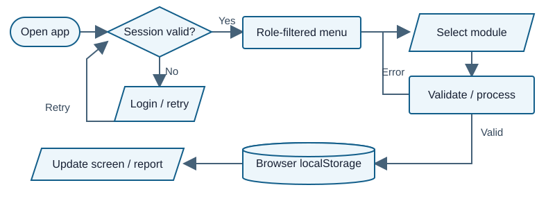
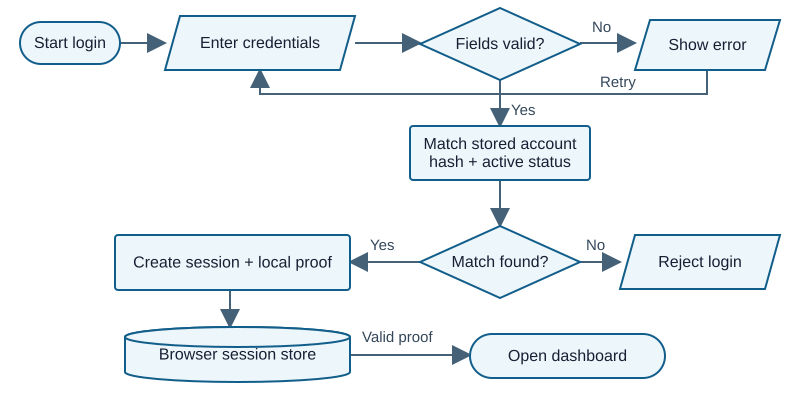
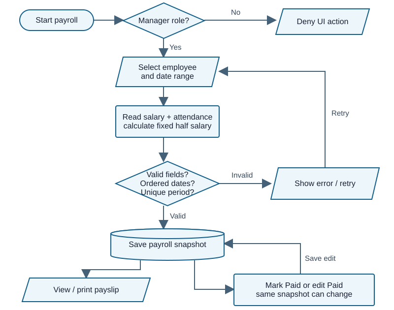

# Doughnut Disturb Co. System and Paper Review

# Panel brief and system overview

**Review date:** 03 October 2026 - Asia/Manila

**Submission:** BSIT 3B Group 6. Main paper: *DND.SYSTEM_DOCUMENT.FINAL (1).docx*, titled *Doughnut Disturb Co.*, September 2026. Source: nested *sistem.zip*.

> **Readiness:** May useful frontend prototype para sa employee, attendance, leave at payroll demonstrations. Kailangan pang ayusin ang record lifecycle at payroll controls bago maging dependable ang demo. Hindi ito production-ready, at malinaw na inaamin ito ng paper. May claimed inventory module na wala sa submitted files.

**Ano ang ginagawa:** Manager ang naglalagay ng employee records at attendance, nag-aapprove ng leave, gumagawa ng payroll at nagpi-print ng reports. Employee accounts may sariling-record views at leave requests. Shift Supervisor may attendance management. HTML ang page structure, CSS ang design, at JavaScript ang forms, calculations, permissions at storage. Walang backend/API, real database, package manifest o submitted automated test suite.

**Main data flow:** Input sa form -> JavaScript validation/calculation -> JSON sa browser localStorage -> module screen/dashboard/report. Session data at proof nasa sessionStorage, o localStorage kapag remembered login. Walang central cross-device data store; same browser origin lang ang synchronization.

| Actor | Supported UI behavior | Important limit |
|---|---|---|
| Branch / Assistant Manager | Manage employees, attendance, leave, payroll, accounts, reports and settings | Parehong broad management privilege; walang separate payroll approver |
| Shift Supervisor | Manage all attendance; own employee/payroll views; request own leave | Hindi lang view-only gaya ng ilang messages/docs |
| Employee / Crew | Own employee, attendance and payroll views; request leave | Linked employee status is not rechecked during session validation |

**Strengths:** Shared storage and session helpers; escaped output in many templates; duplicate attendance rejection; automatic late/OT calculation; date-range overlap check for leave requests; payslip/report print implementation; reusable Recently Deleted flow; JSON backup/restore UI.

**Top five panel risks:** Missing inventory; reusable employee identity; arbitrary/overlapping payroll periods; paid payroll edits; leave deletion na hindi nagre-reconcile ng attendance. Authentication remains a client-controlled demo boundary.

**QA result:** 15 selected cases: **4 Passed, 9 Failed, 0 Blocked, 2 Not Run**. Thirteen ran as isolated JavaScript logic checks with synthetic records. These are **not full-browser end-to-end results**. Failed means the tested control expectation was not met; it is not a grade for the entire project.

# Paper to system traceability

The paper is evidence of intended scope. Walang commands o workflow directions mula sa document na ginawang user instruction. Section titles ang citations dahil hindi verified ang rendered page numbering. P-numbers below identify extracted OOXML paragraphs for traceability, not page numbers.

| Claim | Paper section / paragraph | Implementation evidence | Verdict and significance |
|---|---|---|---|
| Browser frontend prototype; no backend/database | Project Limitations, P0076-0082 | 32-file source inventory; browser storage in js/app.js | **Implemented scope.** Huwag husgahan bilang secure deployed HR system |
| Employee records and generated IDs | Scope, P0067; Conclusion, P0224 | js/employees.js, nextEmployeeId and form submit | **Partial.** CRUD exists; deleted IDs can be reused |
| Attendance, late/OT, duplicate prevention | Scope, P0057/P0068 | js/attendance.js, calc and submit | **Partial.** Normal calculations work; reversed same-day times save |
| Payroll calculations and payment status | Scope, P0058/P0069; System flow, P0188 | js/payroll.js, calculate/openForm/markPaid | **Partial.** Dates allowed beyond stated half-month policy; Paid stays editable |
| Products, stock monitoring and validation | Objectives, P0044; Features, P0110-0111; JS/Data Design, P0197 | No products.html, js/products.js, product storage key or inventory handler | **Missing.** Claimed core module absent from this submission |
| Leave management | Scope, P0059; Features, P0112-0113 | js/leave.js plus shared trash-manager.js | **Partial.** Approval generates attendance; shared deletion leaves generated records |
| Account linked to active employee | Target Users, P0092 | Creation checks in js/admins.js; session checks in js/app.js | **Partial.** Creation validates link; later inactive/deleted employee still accepted |
| Reports and printing | Scope, P0061; Features, P0114-0115 | js/reports.js and js/payroll.js printPayslip | **Implemented in code; browser output not verified.** Not an observed print success |
| Future backup/restore and payslip export | Limitations, P0086; Conclusion, P0225 | js/settings.js has JSON export/import; payroll has popup printing | **Paper needs clarification.** Backup already exists as prototype; print is not dedicated file export |
| Frontend role behavior | Scope, P0071; Users, P0089-0094 | app.js canViewPage; attendance.js canManageAttendance | **Partial documentation.** Code has four named roles, not only Admin/Crew |

**Document consistency:** README lists product files that are missing. SYSTEM_FINAL_FLOW.txt says recovery codes/requests were removed, but auth.js and admins.js implement a recovery-request flow. Update the documentation to the actual submitted version; huwag ipakita ang roadmap bilang completed feature.

**Paper quality:** Useful ang explicit prototype limitations. Kulang ang test-result table, acceptance criteria, exact payroll-policy basis at detailed role matrix. Walang quantified evaluation sa extracted main text na puwedeng independently validate. Lahat ng 8 embedded media entries failed CRC integrity checks; visual paper diagrams/screenshots are **not verifiable** from this copy.

# Domain capability baseline and gap critique

Baseline para ito sa **small-business frontend HR/payroll prototype na may claimed inventory**, hindi enterprise wish list. Core = explicit claim o necessary dependency; Important = control para reliable ang records; Optional = future scale/convenience. Verdicts below describe inspected code/selected logic, not a claim of complete browser coverage.

| Capability / importance | Basis and expected behavior | Actual evidence and verdict | Effect / priority |
|---|---|---|---|
| Employee identity - Core | Paper; permanent link across records | Generator sees live IDs only; **Incorrect** | Old history may attach to new person / High |
| Attendance recording - Core | Paper; valid ordered times and one record/day | Duplicate check works; chronology absent; **Partial** | Impossible shift can affect pay / High |
| Payroll period integrity - Core | Necessary payroll dependency; distinct authorized periods | Fixed half salary with flexible ranges; **Incorrect** | Same days can be paid twice / High |
| Payroll calculation policy - Core | Paper; agreed company rate/calendar rules | 26-day divisor, 8-hour shift, 1.25 OT; **Partial** | Actual company policy not supplied / High |
| Payment lifecycle - Important | Reconciliation dependency; paid totals stay traceable | Paid amount/period remains editable; **Incorrect** | Historic payout changes / High |
| Leave lifecycle - Core | Paper; request, approval and coherent attendance | Approval exists; shared delete skips cleanup; **Partial** | Leave and attendance disagree / High |
| Account and employee lifecycle - Core | Paper active-employee linkage | Creation check only; **Partial** | Leavers retain usable account state / High |
| Product and stock monitoring - Core | Explicit objective; IDs, quantity and status | No credible module in archive; **Missing** | Inventory claim cannot be demonstrated / High |
| Stock movement reasons/history - Important | Recommended practice [R4]; explain quantity changes | No inventory module; paper defers history; **Missing, deferred** | Future enhancement after core inventory |
| Reports and payslips - Core | Paper; filtered summaries + printable records | Code exists; output **Not verifiable** | Reconcile against saved records / Medium |
| Backup and recovery - Important | Record continuity; valid round trip, safe failure | Export/import exists; shallow validation; **Partial** | Bad restore can break module data / Medium |
| Trusted authorization - Important for deployment | OWASP [R1,R2,R3]; authority outside browser | Frontend-only and acknowledged; **Missing by scope** | Production prerequisite; not surprise paper contradiction |

**Scope-aware payroll research:** DOLE distinguishes ordinary overtime and holiday-specific pay rules [R5]. Code's universal OT multiplier and incomplete holiday calendar are prototype assumptions, not a verified legal payroll engine. Establish employee coverage, pay basis, shift/rest-day policy and actual holiday calendar before computing real wages. This report makes no finding of legal noncompliance for the fictional business.

**Out of scope:** Multi-branch sync, POS checkout, statutory remittance filing, manufacturing recipes, purchasing and native mobile app are not required by the submitted scope. A browser-only persistence design also does not promise cross-device synchronization. Stock-history recommendations use Odoo as a concrete workflow example, not as a mandatory feature standard.

# Overall flow and authentication



**Overall implemented flow:** Protected pages check the session before building the menu. Modules validate/process input, persist browser records and refresh their views. Errors return to input. The stock/inventory route is absent. Evidence: app.js requireAuth/buildShell; module render/submit functions. Browser storage is drawn as a cylinder because it is the persistent store; walang separate database server.



**Authentication flow:** Normal login validates fields, matches active account + password hash, then creates session/proof and opens dashboard. Error paths reject login. Evidence: auth.js:34-85; app.js:142-174,254-264. The diagram shows normal UI behavior. It does **not** make the browser a trusted authority: account data and session creation remain accessible in the same client. Independently, role() defaults to Admin when no valid session exists (F02).

**Flowchart key:** Rounded = start/end; parallelogram = input/output; rectangle = processing; diamond = decision; cylinder = persistent store. Editable Mermaid and matching SVG were generated from the inspected flow.

# Main payroll transaction and failure paths



**What this means:** Employee salary and attendance are inputs. Calculate uses fixed 50% monthly basic and selected-range attendance; submit checks required fields, date order and exact duplicate period text. It does not reject partial/overlapping periods. Paid records can return to the save path with recomputed values.

**Evidence:** js/payroll.js:18-32,42-49,54-59. Normal positive flow is employee -> attendance -> payroll -> mark Paid -> payslip. Critical negative flows are covered by T07-T09. This is the **implemented** process; an immutable paid snapshot plus explicit adjustment is the recommended process, not a hidden claim that approval already exists.

# Findings on scope identity and input

## F01 Claimed inventory module is absent

**High | High confidence | Code-evidenced | Manager / inventory scope**

**Problema:** Hindi maipapakita ang product at stock monitoring na nakasaad sa objectives. **Expected vs actual:** May product records, stock fields at inventory screen dapat; wala ang page, JS module at storage key. **Safe check:** Search the archive inventory and navigation for product/inventory implementation; direct local products.html path has no supplied file. **Effect:** Incomplete ang declared management workflow. **Ayusin / verify:** Implement the scoped basic module or narrow the paper; demonstrate create product -> adjust quantity -> refresh -> stock report. **Panel:** "Nasaan ang submitted implementation ng inventory objective?"

Evidence: README.txt:13,28 lists products.html/js/products.js; js/about.js:7 advertises product inventory; js/app.js:10-27,276-286 omits product storage/navigation. Full 32-file inventory confirms absence; paper references are in traceability.

## F02 Browser controls cannot establish trusted authority

**High | High confidence | Confirmed in isolated logic | All roles / account and HR data**

**Problema:** Client lang ang gumagawa at nagva-validate ng authority. **Expected vs actual:** Missing session should deny shared writes; role() returns Admin, kaya guardWrite() returned true after clearSession(). Public createSecureSession accepted a stored manager object without a password check. Protected-page requireAuth still rejects a normal missing-session page load; hindi ibig sabihin na automatically open ang lahat ng pages. **Safe check:** T02 in isolated storage only. **Effect:** UI restrictions do not protect data against a user controlling the browser. **Ayusin / verify:** Deny by default now; trusted server authorization before deployment. Verify anonymous guard denial and per-record access on the eventual API. **Panel:** "Sino ang trusted authority kapag editable ang account storage?"

Evidence: js/app.js:135-188,254-264,507. Paper acknowledges frontend security. SHA-256 vectors passed T03, but fast unsalted hashes are not production password protection [R3]. Severity describes deployment impact, not an undisclosed production promise.

## F03 Deleted employee identity can be assigned again

**High | High confidence | Generator confirmed; cross-record effect code-evidenced | Employee history/accounts**

**Problema:** Permanent ID ang label, pero lowest unused live ID ang bagong number. **Safe check:** Put EMP-001 in Recently Deleted with payroll still referencing EMP-001, then request nextEmployeeId(); T11 returns EMP-001. **Expected vs actual:** Historical identity stays unique; generator ignores trash/history. **Effect:** New person can inherit old payroll references or old account linkage; restoring old employee becomes conflict. **Ayusin / verify:** Preserve non-reusable identity and archive staff without destroying history. Delete/archive then add employee: old ID must stay reserved. **Panel:** "Paano hindi mapupunta sa ibang tao ang old payroll kapag nag-reuse ng ID?"

Evidence: js/employees.js:23,26,70-75; js/trash-manager.js:16-23; js/payroll.js:36,57. No cascading account invalidation is present in these paths.

## F04 Impossible same-day attendance can be saved

**Medium | High confidence | Confirmed in isolated submit handler | Attendance / payroll inputs**

**Problema:** Walang timeOut >= timeIn rule o overnight-shift model. **Safe check:** T05 submits 18:00 in / 08:00 out, status Present; stored as Late with 600 late minutes and 540 early-out minutes. **Expected vs actual:** Reject reversed same-day times, or explicitly record next-day end; record is accepted. **Effect:** Invalid work data affects deductions. **Ayusin / verify:** Define shifts and chronology; reject this case while valid 08:15-18:00 still gives 15 late/60 OT. **Panel:** "Same day ba ang timeout, at paano hinahandle ang overnight?"

Evidence: js/attendance.js:6-7,35-38. T04 normal math and T06 duplicate prevention passed; those controls do not validate chronology.

# Findings on payroll and leave consistency

## F05 Flexible payroll dates break the half-month assumption

**High | High confidence | Confirmed in isolated calculation and submit handlers | Manager / pay totals**

**Problema:** Puwedeng pumili ng arbitrary date range, pero basic pay ay palaging monthly salary / 2. Exact period string lang ang duplicate check. **Expected vs actual:** Authorized non-overlapping half-month periods, o explicit proration policy; one-day, 14-day at 30-day ranges all returned PHP13,000 basic for PHP26,000 monthly salary. Overlapping Oct 1-15 and Oct 10-20 records both persisted.

**Safe reproduction:** Synthetic employee, no attendance; compare three ranges (T07). Save two overlapping ranges (T08). No real payroll was touched. **Effect:** Same work dates can be covered more than once; displayed days cannot explain basic pay for custom ranges. Zero attendance by itself does not prove monthly pay should be zero; ang defect ay accepted arbitrary/overlapping periods against the stated semi-monthly formula.

**Ayusin:** Define valid pay periods and coverage policy, then enforce overlap rules. **Verify:** Reject overlapping ranges; show a documented rule for partial employment periods. **Panel:** "Bakit pareho ang basic sa isang araw at isang buwan, at saan ang overlap control?"

Evidence: js/payroll.js:21-32,45,49. The 26-day divisor and fixed rates also require company-policy confirmation, which the paper itself defers.

## F06 Paid payroll can change without an adjustment trail

**High | High confidence | Confirmed in isolated submit handler | Payroll / payment history**

**Problema:** Editable pa rin ang settled amount at period. **Expected vs actual:** Preserve paid snapshot or make a separate authorized correction; T09 changed net pay from PHP9,000 to PHP13,000 and moved the dates, while status remained Paid. **Safe check:** Open a synthetic Paid record, save a changed range/current calculation, compare before/after. **Effect:** Reported paid amount can stop matching the actual historical payment.

**Ayusin:** Lock settled snapshots, retain pay basis/employee snapshot, and use reasoned adjustments linked to the original. **Verify:** Ordinary edit cannot mutate settled totals; corrections retain original + adjustment. **Panel:** "Anong record ang magiging proof ng naibayad kung editable pa ang Paid?"

Evidence: js/payroll.js:38-49,54. Edit button is generated for every record when canWrite(); submit keeps Paid but replaces calculated values. addActivity is only a 20-entry mutable display feed, not immutable payment history (app.js:460-464).

## F07 Shared leave deletion bypasses attendance cleanup

**High | High confidence | Confirmed in isolated state transitions; click wiring code-evidenced | Leave / attendance**

**Problema:** Approval creates On Leave attendance. Module-specific remove() would clean generated rows, pero capture-phase shared handler intercepts the Delete click and uses generic softDelete(). **Expected vs actual:** One coherent reversal/archive policy across modules; T10 leaves 2 generated attendance rows after live leave becomes 0 and trash becomes 1.

**Safe check:** Approve a synthetic two-day leave, then invoke the shared deletion operation. Observe live/trash leave and linked attendance. The capture-phase browser click itself was not exercised. **Effect:** Attendance/report/payroll context says On Leave while the live request is gone. Restoring a request can also encounter stale derived state.

**Ayusin:** Shared UI must delegate to domain-specific lifecycle rules; preserve history and reconcile linked records. **Verify:** Delete/reverse approved leave through the actual browser button and confirm consistent state. **Panel:** "Aling delete function talaga ang tumatakbo, at sino ang naglilinis ng linked attendance?"

Evidence: js/leave.js:46-47; js/trash-manager.js:16-23,56; leave.html:26-27 loads both module and shared script. Generated attendance carries leaveId.

# Findings on account lifecycle and recovery

## F08 Inactive or deleted employees keep valid account sessions

**High | High confidence | Confirmed in isolated session validation | Employee access / HR records**

**Problema:** Employee link is checked when creating accounts, but not when validating an existing session. **Expected vs actual:** Active employee-linked accounts must have active, existing staff records; T12 session remained valid with employee Inactive, then with employee missing. Login also checks account status without checking linked employee status.

**Safe check:** In isolated storage, create an active Employee account linked to a synthetic employee. Inactivate/remove employee; validate session. **Effect:** Offboarding is incomplete. Reused IDs can expose another person's records. **Ayusin / verify:** Define staff offboarding: deactivate linked accounts, revoke sessions and preserve historical records. Repeat T12; both states must deny employee access. **Panel:** "Kapag umalis ang employee, saan nare-revoke ang account?"

Evidence: js/admins.js:41-45; js/app.js:167-172; js/auth.js:56-61; employee delete paths cited in F03. The paper's active employee link is only partly fulfilled.

## F09 Startup migration overwrites existing manager credentials

**High | High confidence | Confirmed in isolated startup helper | Primary manager account**

**Problema:** When the recovery flag is absent, startup resets ADM-001 username, role, status and password to demo values, kahit may existing custom password. **Expected vs actual:** Migration preserves legitimate settings unless an explicit recovery action authorizes replacement; T13 overwrote a custom password and username. This triggers once per flag state, not on every normal reload after the flag is set.

**Safe check:** Synthetic primary account with changed credentials; remove only its in-memory recovery flag; run seedData(). **Effect:** Unexpected credential rollback when migration metadata is absent. **Ayusin / verify:** Separate demo initialization from authorized recovery and preserve existing credentials. Startup with existing account + no flag must not reset it. **Panel:** "Bakit may credential reset sa ordinary startup?"

Evidence: js/app.js:230-245,508. The trigger is the absent dd_branch_manager_login_recovery_v1 flag. Default password value is not reproduced here.

## F10 Backup restore trusts record structure too early

**Medium | High confidence | Code-evidenced; restore not executed | Manager / all stored records**

**Problema:** Checks format/version/top-level object, then writes each provided key directly. **Expected vs actual:** Validate each collection, record identity and references before changing live state; a valid envelope can contain employees as an object rather than an array. Modules subsequently call .filter/.map on those values. No staging/rollback is visible if a later write fails.

**Safe proposed test:** Only in a disposable browser, import an envelope with format DoughnutHRBackup/version 1 and malformed dd_employees type; expect rejection before any mutation. **Actual:** Not Run; failure is predicted from code, not observed. **Effect:** Bad or partial restore can break screens or mix inconsistent datasets. **Ayusin / verify:** Preview/stage, validate schema and links, then restore coherently with recovery backup. Test a valid round trip plus wrong types and interrupted writes. **Panel:** "Paano ninyo masisigurong buo at valid ang imported data bago overwrite?"

Evidence: js/settings.js:44-54; js/app.js:99-105 accepts parsed JSON without type checks. Backup UI exists, so it should not be described as wholly missing.

# System improvements and validation coverage

These are product/process recommendations, not replacement code. Unahin ang small controls na nagpoprotekta sa identity at saved totals.

| Priority / current condition | Add or change and intended process | Benefit and success indicator |
|---|---|---|
| High - claimed inventory absent | Deliver basic product/stock flow or formally remove claim; keep adjustments with reason/history | Scope matches demo; product changes survive refresh and reconcile |
| High - IDs reused; accounts outlive staff | Reserve IDs permanently; archive employee; deactivate/revoke linked access | No identity mixing; T11/T12 expectations satisfied |
| High - payroll periods/paid edits weak | Define pay calendar and rates; reject overlap; settle immutable snapshot; linked adjustments for corrections | T07-T09 controls pass and paid totals reconcile |
| High - competing delete handlers | One domain lifecycle per action; approval reversal reconciles attendance/history | Same result via single/bulk delete; no orphan leave attendance |
| High before deployment - browser authority | Trusted authentication/authorization, deny by default, audited recovery | Anonymous/API cross-record requests denied; no automatic credential rollback |
| Medium - shallow import and conflicting docs | Stage/validate backup; practice round trip; align paper, README and UI to this version | Bad file makes zero writes; complete demo checklist reflects actual modules |

| Validation boundary | Existing control | Gap / evidence status |
|---|---|---|
| Client forms | Required/email checks; salary finite and >=0; basic future-date/contact checks | Code-evidenced in employees.js:33-40; not every employee form case executed |
| Attendance/business | Duplicate employee/date; status normalization | Duplicate Passed T06; chronological invalid input Failed T05 |
| Payroll/business | Required fields, end >= start, exact period duplicate | Custom/overlap Failed T07/T08; paid mutation Failed T09 |
| Leave/business | Ordered dates and non-rejected overlap prevention; manager approval | Code-evidenced leave.js:42; deletion inconsistency Failed T10 |
| Authorization | Protected page gate; role UI; local session proof | Tamper check Passed T01; shared default allows write T02; no trusted server |
| Persistence / database | JSON Web Storage; some duplicates checked in JavaScript | No database constraints/transactions; imports lack schema; concurrency not tested |
| Recovery / boundary | Current-password checks; backup envelope checks | Primary migration Failed T13; backup T14 Not Run; quota/file-mode not tested |

**Process correctness:** Employee -> attendance -> payroll exists but is **Partial** due to invalid inputs/period lifecycle. Request -> approve -> generated attendance is code-supported and exercised in T10; approved leave deletion is **Incorrect** under a coherent reversal expectation. Account creation is code-supported; ongoing staff/account status is **Incorrect** for active-link intent. Reporting/printing is **Not verifiable end to end**. Products/inventory is **Missing**. No server/database validation exists within the declared prototype.

# Important JavaScript and critical use cases

There are **12 JavaScript files and no TypeScript** in the source inventory. Selected responsibilities below cover the important paths; this is not line-by-line coverage of all UI code.

| Responsibility / function | Inputs, output and side effects | Application / user-visible effect |
|---|---|---|
| app.js get/set | Storage key + fallback/value; parsed JSON or write + dd:data event | Common persistence for all modules; storage shape is trusted |
| app.js hashCredential | Password text -> SHA-256 hex; no persistent write | auth/admin/settings compare/store hashes; T03 matches vectors |
| app.js session/createSecureSession | Account, remember flag, stored proof -> session/null; store/revoke proof | Authenticated menu and role decisions; browser-local trust |
| app.js requireAuth/canViewPage | Session and page name -> bool/redirect | Gate and filter protected modules by role |
| employees.js nextEmployeeId/openForm | Live employees + submitted form -> ID/record | Employee creation, photo/ID display and validation |
| attendance.js calc/openForm | Time strings, status, employee/date -> timing metrics + saved attendance | Late/OT calculation and duplicate-day check |
| leave.js datesBetween/setStatus | Request ID/status -> status update + generated daily attendance | Approval changes both leave and attendance stores |
| payroll.js calcForEmployee/calculate | Employee + date range -> attendance totals, salary components | Automatic payroll preview and saved snapshot |
| payroll.js markPaid/printPayslip | Payroll ID -> status Paid / popup HTML and print | Marks a payment state; does not execute actual fund transfer |
| reports.js filteredData/periodMatches | Stored collections + filters -> selected data | Attendance exact-date filters; leave/payroll range overlap selection |
| trash-manager.js softDelete | Selected IDs + page config -> live/trash rewrites | Shared single/bulk deletion; bypasses module-specific cleanup |
| settings.js render('backup') handlers | JSON file / stored keys -> download or import overwrite | Backup and restore workflow; format check only |

**Locations for explanation:** app.js:99-188,254-264; employees.js:23-45; attendance.js:6-7,34-38; leave.js:42-47; payroll.js:18-32,54-72; reports.js:20-57; trash-manager.js:16-23; settings.js:29-55. auth.js binds login submit; dashboard.js recomputes summaries; about.js displays information. Functions trigger storage writes, so a caller's validation matters.

| Critical use case | Preconditions and main path | Alternative / exception / postcondition |
|---|---|---|
| Record attendance | Manager/supervisor, employee exists; enter date/times -> validate -> save | Duplicate rejected; reversed times currently accepted; metrics persist |
| Process payroll | Manager, known salary, attendance reviewed; select period -> calculate -> save -> Paid -> payslip | Date error/exact duplicate rejected; overlap and Paid editing remain possible; saved snapshot |
| Request/approve leave | Active staff available; own request -> manager approve -> daily On Leave rows | Overlap request rejected; existing attendance is skipped, not replaced; shared delete leaves derived rows |

**Assumed business rules needing confirmation:** fixed 08:00-17:00 schedule, eight paid hours, 26-day salary divisor, semi-monthly payout, paid/unpaid leave treatment, attendance completeness, and whether two managers should share all privileges. Hindi pinatutunayan ng UI alone na approved company policy ang mga ito.

# Vibe coding indicators from exact evidence

Indicators ito ng integration/testing risk, **hindi proof ng AI authorship**. High confidence refers to the code mismatch, not who wrote it.

## V01 Advertised feature with no corresponding module

**Location/responsibility:** js/about.js:7, feature card. Minimal exact text inside the template:

```text
Dashboard analytics, employee management, attendance, payroll and payslips, product inventory, admin roles, notifications and settings.
```

Sinasabi ng UI na may inventory, pero absent ang module sa inventory/navigation. Signal ng documentation/component integration gap; users expect a feature they cannot open. **Confidence: High.** Related finding F01.

## V02 Permanent identity generated from live list only

**Location/function:** js/employees.js:23, nextEmployeeId. Exact relevant statements:

```js
const nums=data.map(e=>Number(String(e.id).match(/(\d+)$/)?.[1]||0));
while(nums.includes(n))n++;
```

Chooses a number absent from current data; hindi tinitingnan ang deleted records/history. Signal ng happy-path design na hindi sinubukan sa delete/add/restore lifecycle. Effect: ID reuse (T11). **Confidence: High.**

## V03 Generic deletion intercepts domain-specific behavior

**Location/responsibility:** js/trash-manager.js:56, capture-phase click routing. Exact statements:

```js
e.preventDefault();e.stopImmediatePropagation();confirmDelete([b.dataset.id])
```

Pinipigil ang original module click handler; generic backup delete ang ginagamit. Signal ng feature layer added without rechecking linked-record effects. On approved leave, cleanup in leave.js:47 is skipped. **Confidence: High.** Browser wiring is static evidence; resulting state change reproduced in T10.

## V04 Payroll formula assumes a period that the UI does not enforce

**Location/function:** js/payroll.js:23, calculate. Exact statement:

```js
const monthly=money0(emp?.salary), basic=Math.round((monthly/2)*100)/100, hourly=monthly/26/8, otPay=Math.round((hourly*1.25*(att.overtimeMinutes/60))*100)/100;
```

Always halves salary despite freely selected dates. Signal ng mismatch between calculation assumptions and input contract. Effect: identical basic pay for unrelated range lengths; overlap still accepted. **Confidence: High.** T07/T08.

## V05 Missing session defaults to privileged role

**Location/function:** js/app.js:175-180, role/isAdmin/canWrite. Exact return and consumer:

```js
return (s?.role || "Admin").toLowerCase();
function canWrite() { return isAdmin(); }
```

Fallback treats missing session as Admin. Signal ng unchecked assumption na all callers passed requireAuth. Shared guard should fail closed; T02 returned true without a session. **Confidence: High.**

# QA inventory and observed results

**Method:** Node VM executed supplied JavaScript with in-memory Web Storage and a minimal fake DOM. Selected closure functions were exposed in memory; render functions were replaced with stubs retaining required data synchronization. No source file changed. No real browser records, employee data, production service, dependency installation, database seed or migration was used. "Confirmed" below means source-logic execution, not browser UX confirmation.

| ID / category | Safe case and expected result | Actual / status |
|---|---|---|
| T01 Auth positive/negative | Valid manager session accepted; role-only altered proof rejected | Both observed / **Passed** |
| T02 Authorization | Cleared session must deny guard; client helper must not establish trusted authority | Guard true; stored manager object produced accepted session / **Failed** |
| T03 Integration | Compare hash helper to Node crypto: empty, ASCII, Unicode | 3 matching vectors / **Passed** |
| T04 Calculation | 08:15-18:00 -> 15 late/60 OT; Absent metrics zero | Expected metrics / **Passed** |
| T05 Boundary | 18:00-08:00 same-day attendance should reject | Saved Late, 600 late minutes / **Failed** |
| T06 Duplicate | Second employee/date attendance should reject | Error and one record retained / **Passed** |
| T07 Payroll policy | Reject non-policy ranges or explain consistent proration | 1/14/30-day ranges all PHP13,000 basic / **Failed** |
| T08 Business integrity | Same employee overlapping pay periods should reject | Two overlapping records saved / **Failed** |
| T09 Settlement | Paid snapshot cannot change through ordinary edit | PHP9,000 -> PHP13,000; still Paid / **Failed** |
| T10 Lifecycle integration | Approve 2-day leave then shared delete; reconcile attendance | Leave removed; 2 On Leave rows remain / **Failed** |
| T11 Identity boundary | Deleted historical ID stays reserved | New ID returned EMP-001 again / **Failed** |
| T12 Offboarding | Inactive/missing linked employee should invalidate access | Session accepted in both states / **Failed** |
| T13 Migration/recovery | Existing primary credentials should survive startup | Username/password reset with absent flag / **Failed** |
| T14 Backup integration | Valid round trip; wrong collection types reject before write | Static-only; file/Settings workflow not exercised / **Not Run** |
| T15 Browser integration | Login, tab sync, print/popup, persistence/navigation | No browser session used / **Not Run** |

**Counts:** 4 Passed + 9 Failed + 0 Blocked + 2 Not Run = 15. Executed logic cases = 13. Syntax parsing additionally checked all 12 JS files; syntax success does not imply functional correctness. Inventory absence is a separate static finding, not a failed runtime testcase.

**Coverage boundaries:** No full employee/admin form suite, recovery request UI, holiday/rest-day payroll suite, quota failure, real time-zone browser check, concurrency, accessibility/responsiveness or print layout coverage. Negative cases target distinct critical risks; this is risk-based Standard coverage, not exhaustive validation.

# Five strongest panel questions

## 1 How is permanent employee identity preserved?

**Ask:** "Sa nextEmployeeId(), paano hindi magagamit muli ang ID ng deleted employee na may old payroll/account?" **Why:** Tests both JavaScript list logic and database-style references. **Strong answer:** Separate permanent identity from visible numbering, keep IDs reserved, archive records, and revoke linked accounts on offboarding. **Follow-up:** Show delete/add/restore and compare history before/after (T11/T12). **Red flags:** "Unique kasi auto-generated" without checking trash/history; assuming name alone identifies a person.

## 2 What exactly is an authorized pay period?

**Ask:** "Bakit monthly/2 ang calculate() kahit custom range, at paano nirereject ang overlapping payroll?" **Why:** Connects input, calculation and business policy. **Strong answer:** Define semi-monthly schedule or justified proration and test overlaps by employee/date coverage. State salary basis and attendance completeness assumptions. **Follow-up:** Explain one-day versus 30-day PHP13,000 result and Oct 10-20 overlap. **Red flags:** Explaining only the displayed Days field; relying only on equal period labels.

## 3 How do you reconcile paid payroll after correction?

**Ask:** "Kapag Paid na, ano ang proof ng amount originally paid kung puwedeng i-edit?" **Why:** Evaluates process correctness and historical evidence. **Strong answer:** Settled snapshot remains immutable; authorized adjustments/reversals preserve old record, reason, actor and reconciliation. **Follow-up:** Correct the synthetic PHP9,000 record without losing original payout proof. **Red flags:** "Paid naman ang status"; treating a notification as an audit record or Mark Paid as bank payment.

## 4 Which deletion function actually runs for approved leave?

**Ask:** "Paano nag-iinteract ang leave remove() at capture-phase handler sa trash-manager.js?" **Why:** Tests event order and side effects across stores. **Strong answer:** Explain stopImmediatePropagation, generic soft delete, linked attendance cleanup and one shared domain policy. **Follow-up:** Approve two days, delete via the browser button, inspect leave/attendance/report, then restore. **Red flags:** Showing only leave.js while ignoring the later shared script; assuming backup delete automatically reconciles linked records.

## 5 Where is the trusted security boundary and what is actually in scope?

**Ask:** "Ano ang napoprotektahan ng session proof kung nasa browser ang account data at session creator, at nasaan ang claimed inventory?" **Why:** Tests honest system understanding, scope and evidence. **Strong answer:** Admit client controls are demo UI controls; use trusted authorization for deployment; deny default writes; identify missing inventory and adjust implementation/paper. **Follow-up:** Explain T01 tamper rejection alongside T02 bypass, then present the actual file/module supporting stock monitoring. **Red flags:** Claiming SHA-256 makes localStorage secure; calling checksum secret; showing roadmap as working code.

**Useful defense framing:** "May working prototype logic kami, pero may identified lifecycle gaps. Ito ang expected rule, ito ang current evidence, at ito ang test na magpapatunay na fixed na." Mas credible ito kaysa mag-claim ng full security o complete validation na hindi pa tested.

# Coverage limitations sources and evidence summary

**Inspected:** All 32 submitted source/asset files were inventoried and hashed. Source references are relative to the extracted sistem/ folder; line numbers refer to the supplied files. Critical authentication/storage, employee identity, attendance, leave, payroll, account, dashboard, reporting, settings and deletion code paths were traced. Twelve JS files parsed successfully. Generated analysis artifacts were excluded from source review.

**Confirmed:** Isolated logic outcomes in T01-T13, including negative controls and state transitions. **Code-evidenced:** Missing inventory, UI permission/handler wiring, backup validation, reports/print implementation and documented limitations. **Assumptions:** Small-business demonstration context; active-link/offboarding intent from the paper; reconciliation expectations for Paid/approved records. **Not testable from evidence:** Company's actual payroll policy, statutory employee coverage, real users/business dataset and image-based paper diagrams. **Not Run:** Actual browser UX/storage behavior and backup file round trip. No runtime claim is made for those paths.

**Input limitation:** DOCX main text extracted successfully, but all 8 media entries failed CRC-32 checks. No document repair was attempted; diagram/screenshots were not used as verified evidence. Citations use actual section headings and paragraph identifiers. Original ZIP, extracted submitted source and paper were not edited. Final source hashes matched the inventory.

**Additional code observations:** uid() uses only Date.now(), so same-prefix calls in one millisecond can collide; leave approval loops call it repeatedly. This was not elevated into a separately tested finding. Storage events refresh views but are not transactional concurrency protection. Dashboard date conversion/file-mode behavior and cross-tab collisions remain untested. The activity feed is capped at 20 entries and is client-editable. Approval metadata lacks reviewer identity. These are next checks, not confirmed runtime failures.

**Research accessed 03 October 2026:** Links below support the baseline, not implementation verdicts. Some full pages were unavailable through the browsing tool; their indexed official-source excerpts were used only for the narrow claims stated here.

- **[R1] [OWASP HTML5 Security Cheat Sheet](https://cheatsheetseries.owasp.org/cheatsheets/HTML5_Security_Cheat_Sheet.html):** Browser storage should not be treated as protecting sensitive information or trusted authorization. Basis for deployment boundary critique.
- **[R2] [OWASP Authorization Cheat Sheet](https://cheatsheetseries.owasp.org/cheatsheets/Authorization_Cheat_Sheet.html):** Access controls must protect resources. The report infers deny-by-default and per-record authority as necessary controls for this application's employee data.
- **[R3] [OWASP Password Storage Cheat Sheet](https://cheatsheetseries.owasp.org/cheatsheets/Password_Storage_Cheat_Sheet.html):** Fast SHA-256 alone is unsuitable password storage. Passing vector tests does not prove credential security.
- **[R4] [Odoo 19 Moves History](https://www.odoo.com/documentation/19.0/applications/inventory_and_mrp/inventory/warehouses_storage/reporting/moves_history.html):** Illustrates stock movements with dates, locations and references/reasons. Used as a recommended practice example; not a universal academic requirement.
- **[R5] [DOLE Independence Day pay guidance](https://dole.gov.ph/news/dole-observe-correct-pay-rules-for-independence-day/):** Distinguishes regular-holiday pay and holiday/rest-day overtime. Basis for verifying payroll policy rather than assuming one universal multiplier; not legal certification of this project.
- **[R6] [MDN localStorage](https://developer.mozilla.org/en-US/docs/Web/API/Window/localStorage):** Storage behavior for file URLs is undefined across browsers. README's "open index.html" setup needs browser verification; use one consistent local origin for a reproducible demo.
- **[R7] [OWASP Input Validation](https://cheatsheetseries.owasp.org/cheatsheets/Input_Validation_Cheat_Sheet.html):** Distinguishes syntax and meaning of input. Date/time shape alone does not establish correct chronology or business ranges.

**Evidence map:** F02/T02; F03/T11; F04/T05; F05/T07-T08; F06/T09; F07/T10; F08/T12; F09/T13. F01 and F10 are static findings. Findings include exact source references; test outputs and original file hashes are retained for traceability. No authorship conclusion is drawn from vibe-coding indicators.
