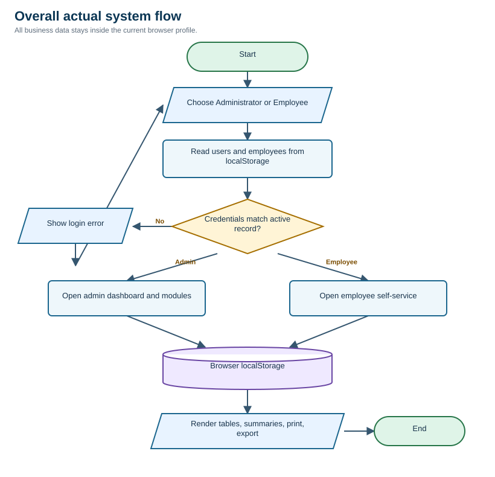
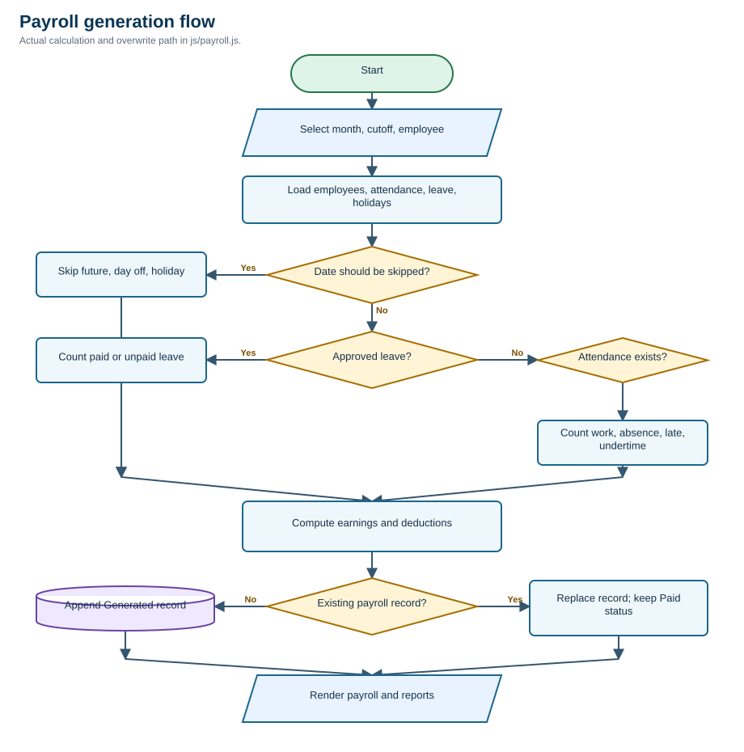
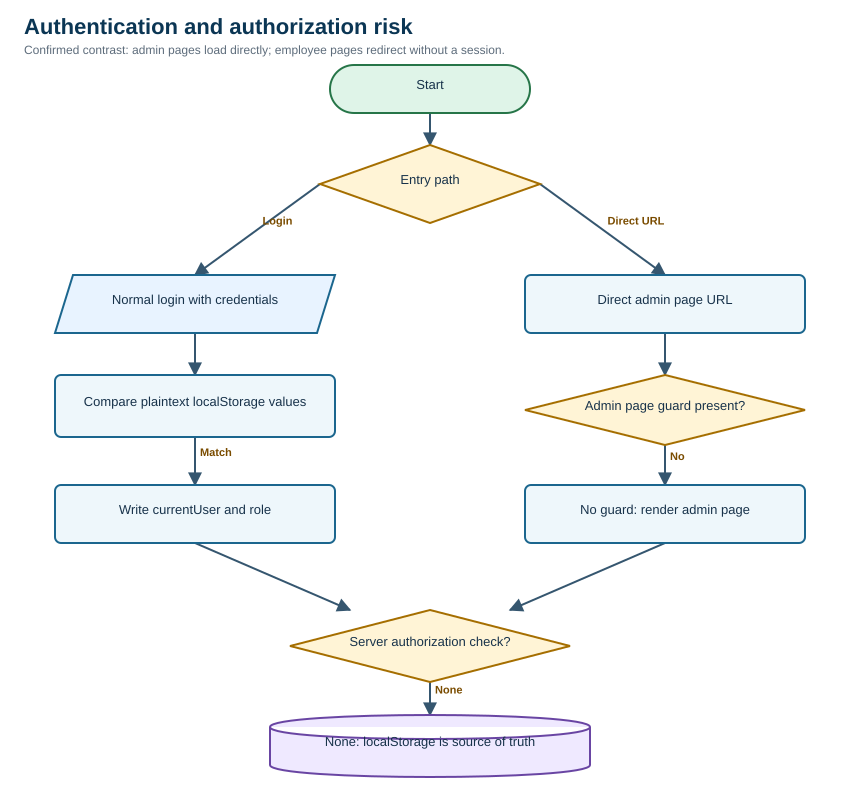

# Employee Management and Payroll System - Mock Defense Analysis

<!--
**Review date:** 29 September 2026
**Mode:** Standard review - system source only
**Submitted system:** F:/SUBTLE YUGEN/EMPLOYEE MANAGEMENT AND PAYROLL SYSTEM/
-->

<style>
table { font-size: 7.8pt; }
th, td { padding: 1.5mm 1.7mm; }
</style>

# One-page panel brief

## Ano ang system?

Ito ay browser-based Employee Management and Payroll System para sa Subtle Yugen Apparel Co. May dalawang user views: Administrator/Member at Employee. Sakop nito ang employee records, departments, attendance, leave, holidays, payroll generation, reports, user accounts, QR employee ID, print, at Excel export.

**Assumed intended process:** Administrator creates employees and accounts; employees time in/out and submit leave; Administrator approves leave and manages holidays; payroll is generated per cutoff, marked Paid, then printed/exported. Walang paper o formal requirements, kaya reconstructed assumption ito mula sa UI at code.

## Readiness verdict

**Good visual prototype, pero hindi pa production-ready payroll system.** Maayos ang UI coverage at may ilang useful validations, pero lahat ng HR, password, attendance, at payroll data ay nasa browser `localStorage`. Walang server, shared database, server-side authorization, audit trail, payroll locking, o reliable statutory configuration. Sa mock defense, dapat tawagin itong single-browser prototype, hindi centralized multi-user deployment.

| Snapshot | Result |
|---|---|
| Source inventory | 99 files: 10 HTML, 17 JavaScript, 10 CSS, assets/fonts; no backend or database project found |
| Runtime checks | 2 browser journeys: admin direct URL failed security; employee direct URL correctly redirected |
| Static check | 13 custom JavaScript files parsed by `node --check`; 0 syntax failures |
| Findings | 10 total: 5 High, 4 Medium, 1 Low |
| QA inventory | 14 cases: 2 Passed, 3 Failed, 9 Not Run, 0 Blocked |
| Paper traceability | Not applicable - no capstone paper was supplied |

## Pinakamalakas na strengths

- Organized modules and consistent interface for employees, attendance, payroll, reports, and users.
- Employee pages call a role/session guard; direct access to `employeeDashboard.html` redirected during runtime.
- Duplicate employee IDs are normalized and rejected (`js/employees.js:852-897`).
- Attendance edit checks duplicate employee/date records (`js/attendance.js:1508-1524`).
- Output paths commonly use `escapeHTML`, reducing accidental HTML injection in tables.

## Top five risks for the panel

1. Admin pages can load by direct URL without login, confirmed locally.
2. Credentials and business records are plaintext, browser-editable, and not server-verified.
3. A Paid payroll record can be recalculated and replaced while keeping its Paid label.
4. Payroll omits withholding tax and does not model overtime, holiday pay, or night differential.
5. Attendance QR and PIN both rely on the public employee ID, so identity proof is replayable.

# System explained simply

## Actors and role/permission matrix

| Actor | Intended access | Actual control found | Verdict |
|---|---|---|---|
| Administrator / Member | Manage employees, attendance, leave, holidays, payroll, reports, users | Admin UI and local functions; no consistent page guard | Partial / unsafe |
| Employee | View own profile/payroll, time in/out, submit leave | Employee pages verify `currentUser.role === Employee` and employee ID | Mostly present, still client-only |
| HR | Mentioned in attendance authorization messages | No HR role can be created; user creation forces `Member/Admin` | Inconsistent |
| Payroll approver | Review and release payroll | Only `Generated` to `Paid` confirmation; no separate approver or reversal | Missing |
| System/database | Persist and enforce rules | Browser `localStorage` only | Prototype-level |

## Actual architecture and data movement

The system is static HTML/CSS/JavaScript. Each page reads and writes JSON arrays in `localStorage`: `users`, `employees`, `attendanceRecords`, `leaveRequests`, `holidayRecords`, and `payrollRecords`. Login also writes `currentUser`, `loggedIn`, `username`, and `userRole`. There is no API call, server controller, database schema, or network identity check in the submitted source.

### Main modules

| Module | Primary files | Purpose |
|---|---|---|
| Login and recovery | `index.html`, `js/login.js` | Role selection, admin/employee login, QR password reset |
| Employee management | `pages/employees.html`, `js/employees.js` | CRUD, departments, personal and compensation fields |
| Attendance and leave | `pages/attendance.html`, `js/attendance.js` | Admin records, leave approval, holidays, QR scanning |
| Employee self-service | `js/employeeDashboard.js`, `js/employeeAttendance.js`, `js/employeePayroll.js` | Own profile, ID QR, time records, leave, payslip view |
| Payroll | `pages/payroll.html`, `js/payroll.js` | Semi-monthly calculation, contributions, status, print |
| Reports | `pages/reports.html`, `js/reports.js` | Employee, attendance, payroll tables and XLSX export |
| Users and backup | `js/users.js`, `js/backup.js` | Admin accounts and JSON backup/restore routines |

# Three essential flowcharts

## 1. Overall actual system flow



Both roles end in the same browser store. Walang separate server-side gate between user action and persisted HR/payroll data. Evidence: `js/login.js:553-598`, `js/login.js:632-719`, `js/dashboard.js:83-93`, `js/employees.js:139-156`.

## 2. Main payroll transaction



The function loops through cutoff dates, skips future/day-off/holiday dates, classifies leave and attendance, computes earnings/deductions, then appends or replaces a record. An existing Paid record keeps the Paid flag but receives newly computed amounts. Evidence: `js/payroll.js:378-433`, `js/payroll.js:435-678`.

## 3. Riskiest authorization flow



**Confirmed:** a fresh local browser opened `/pages/dashboard.html` directly and rendered the admin dashboard shell. In the same condition, `/pages/employeeDashboard.html` redirected to `/index.html`. Code matches this contrast: employee guard at `js/employeeDashboard.js:134-173`; no equivalent startup guard in `js/dashboard.js:1-121`.

# Top findings

### F-01: Admin pages have no reliable authorization gate

**Severity:** High | **Confidence:** High | **Evidence:** Confirmed runtime + code-evidenced  
**Problema:** Direct admin URL opens without login. **Saan:** Dashboard and other admin pages. **Paano mabubutas:** Open `/pages/dashboard.html` in a fresh local browser. **Effect:** HR/payroll screens are reachable without a verified session. **Ayusin:** Put authentication and authorization on a server and enforce it on every protected request/page. **Panel question:** Why is employee-page protection present but not admin-page protection?

The dashboard immediately reads username, role, employees, attendance, leave, and payroll from `localStorage` (`js/dashboard.js:71-93`). Expected: redirect or 403. Actual: admin dashboard rendered. Verification: repeat with a clean browser profile and assert redirect before any data read.

### F-02: Plaintext default credentials and weak recovery

**Severity:** High | **Confidence:** High | **Evidence:** Code-evidenced  
**Problema:** The shared administrator credential is embedded in source, employee passwords are stored as plaintext, and an absent employee password falls back to the employee ID. **Saan:** Login, users, forgot-password. **Paano mabubutas:** Anyone who can read the distributed JavaScript knows the default admin credential and can inspect stored passwords. **Effect:** Account takeover and no defensible credential custody. **Ayusin:** Server-side password hashing, forced first-login change, unique reset token, rate limiting, and session expiry.

Evidence: default `EMPSadmin/subtleyugen` at `js/login.js:60-78`; employee fallback at `js/login.js:685-699`; plaintext save at `js/login.js:495-501` and `js/users.js:388-395`. Expected: no recoverable password in browser storage.

### F-03: Paid payroll is mutable after release

**Severity:** High | **Confidence:** High | **Evidence:** Code-evidenced  
**Problema:** Regenerating the same employee/month/cutoff replaces the record. If it was Paid, only `status` and `paidAt` are preserved. **Saan:** Payroll generation. **Paano mabubutas:** Mark payroll Paid, change attendance, then Generate Payroll again for the same period. **Effect:** Paid amount can silently change while still looking finalized. **Ayusin:** Immutable payroll runs, explicit adjustment/reversal workflow, approver identity, and audit log.

Evidence: replacement at `js/payroll.js:405-423`; Paid transition at `js/payroll.js:1472-1501`. Expected: released amounts locked. Actual logic: new amount object replaces old amount object.

### F-04: Payroll computation is incomplete for statutory and premium pay

**Severity:** High | **Confidence:** High | **Evidence:** Code-evidenced + official-reference check  
**Problema:** Computation covers basic earnings, allowance, late/undertime, other deductions, SSS, PhilHealth, and Pag-IBIG only. No withholding tax, overtime, holiday pay, night differential, or employer-share ledger was found. **Saan:** `calculateEmployeePayroll`. **Effect:** Net pay and remittance/reporting can be incomplete even when the UI says payroll is generated. **Ayusin:** Formal payroll policy, effective-dated statutory tables, taxable compensation model, premium-pay rules, and accountant-approved test vectors.

Evidence: `js/payroll.js:435-678`; source-wide search found no `tax`, `withholding`, `overtime`, `holiday pay`, or `night differential` computation. BIR has a withholding table effective 2023 onward; SSS and PhilHealth publish official contribution schedules. Exact applicability must be validated by the employer/accountant.

### F-05: Leave approval and holiday management lack role enforcement

**Severity:** High | **Confidence:** High | **Evidence:** Code-evidenced, supported by confirmed direct admin access  
**Problema:** `approveLeave`, `rejectLeave`, and holiday CRUD do not call a role check or record the approver. **Saan:** Admin attendance page. **Paano mabubutas:** Reach the admin page directly and trigger a status action. **Effect:** Self-approval or unauthorized calendar changes can alter attendance and payroll. **Ayusin:** Server-enforced permission per action plus approver ID, timestamp, reason, and audit event.

Evidence: `js/attendance.js:3168-3238`, `js/attendance.js:4020-4199`. By contrast, attendance edit/delete calls `canManageAttendance` at `js/attendance.js:1287-1331`.

### F-06: Attendance identity is a replayable employee ID

**Severity:** Medium | **Confidence:** High | **Evidence:** Code-evidenced  
**Problema:** Manual PIN must equal employee ID, and the QR contains only the same employee ID. QR path bypasses PIN. **Saan:** Admin attendance and employee ID QR. **Paano mabubutas:** Type a known ID or show a copied QR. **Effect:** Buddy punching and disputed attendance. **Ayusin:** Signed short-lived QR/challenge, authenticated kiosk, device/session checks, and supervisor exception workflow.

Evidence: `js/attendance.js:621-646`, `js/attendance.js:5151-5233`, `js/employeeDashboard.js:176-196`.

### F-07: Early payroll generation produces partial-period results

**Severity:** Medium | **Confidence:** High | **Evidence:** Code-evidenced  
**Problema:** Future dates inside the selected cutoff are skipped, so running payroll before cutoff end pays only attendance up to today but labels the full period. **Saan:** Date loop and cutoff working-day denominator. **Effect:** Underpayment or repeated recalculation; combined with F-03, even Paid records can drift. **Ayusin:** Enforce cutoff close date or explicit preview versus final mode.

Evidence: future-date skip at `js/payroll.js:463-479` and `js/payroll.js:707-738`; no close-state check in `generatePayroll` at `js/payroll.js:378-433`.

### F-08: Employee deletion leaves orphaned business history

**Severity:** Medium | **Confidence:** High | **Evidence:** Code-evidenced  
**Problema:** Deletion only removes the employee array entry; attendance, leave, payroll, and linked user data are untouched. **Saan:** Employee management. **Effect:** Reports and self-service can disagree; historical records have no active master record. **Ayusin:** Prefer deactivate/archive; otherwise block deletion when dependencies exist and preserve referential history.

Evidence: `js/employees.js:1842-1881`; separate data collections are independently stored by `js/attendance.js:170-187`, `js/payroll.js:138-150`, and `js/employeeAttendance.js:49-71`.

### F-09: Leave validation permits overlap and has no balance model

**Severity:** Medium | **Confidence:** High | **Evidence:** Code-evidenced  
**Problema:** Submission checks only that end date is not earlier than start date. It does not reject overlapping requests, past/closed periods, excessive paid days, or duplicate pending requests. **Saan:** Employee and admin leave forms. **Effect:** Conflicting approved leave and incorrect payroll classification. **Ayusin:** Central leave-balance and overlap validation before submission and approval.

Evidence: employee path `js/employeeAttendance.js:1571-1676`; admin path `js/attendance.js:2741-2873`.

### F-10: Enter-key login handler calls the wrong value

**Severity:** Low | **Confidence:** High | **Evidence:** Code-evidenced  
**Problema:** Local constants named `adminLogin` and `employeeLogin` shadow the functions, then are called as functions. **Saan:** Landing-page Enter key handler. **Effect:** Pressing Enter can throw a TypeError instead of logging in; clicking the button remains the likely workaround. **Ayusin:** Rename the element variables or call the functions by distinct names; add one keyboard smoke test.

Evidence: `js/login.js:896-918`. This is a functional mismatch, not proof of AI authorship.

# Recommended system improvements

| Priority | Current condition | Add or change | Intended process and benefit | Success indicator |
|---|---|---|---|---|
| Critical | Browser decides identity and permissions | Server authentication, secure sessions, route/action authorization | Every read/write is checked against a server-side role | Direct admin URL redirects; forged browser state is rejected |
| Critical | Local plaintext HR/payroll store | Shared database with backups, access control, encryption, and retention | Authorized users see one consistent dataset | Two devices show the same approved record and audit history |
| High | Paid payroll can be replaced | Payroll run lifecycle: Draft, Reviewed, Approved, Paid, Adjusted/Reversed | Only controlled adjustments change released pay | Hash/amount of Paid run is unchanged after regeneration attempt |
| High | Incomplete statutory model | Effective-dated SSS, PhilHealth, Pag-IBIG, BIR and premium-pay rules | Rates selected by coverage date and reviewed by accountant | Golden payroll cases match approved manual computations |
| High | QR is just employee ID | Signed expiring attendance token or authenticated kiosk | Scan proves freshness and kiosk context | Replayed screenshot is rejected after expiry |
| Medium | Leave has no balances/overlap control | Entitlement, balance, overlap, approver, remarks, cancellation | Request-reserve-approve-deduct flow is traceable | Duplicate overlap is rejected; balance reconciles |
| Medium | Hard delete can orphan history | Deactivate/archive employee and dependency checks | Historical payroll remains linked and immutable | Former employee cannot log in; reports retain identity |

## Validation review and process correctness

| Boundary/process | Existing control | Missing control | Correctness verdict |
|---|---|---|---|
| Login | Exact username/password match and active status | Hashing, throttling, expiry, server session | Incorrect for deployment |
| Admin authorization | Some function-level attendance role checks | Page guards and consistent action checks | Incorrect |
| Employee authorization | Page guard and employee ID filter | Server verification; tamper resistance | Partial |
| Employee master data | Required fields, duplicate ID, 11-digit contact, non-negative salary | Email format, future birthday, realistic salary/photo bounds, server validation | Partial |
| Attendance | One record per employee/date; time order on edit | Replay-resistant identity, audit reason, shift schedules, timezone | Partial |
| Leave | Required HTML fields and date ordering | Overlap, balance, closed period, approver identity | Partial |
| Payroll | Active employees, unique period key, contribution functions | Tax, premiums, close/lock, reversal, approvals, audit | Incorrect for real payroll |
| Reports | Escaped HTML, filters, XLSX export | Server data scope, signed/final report version | Partial |
| Backup/restore | System label and confirmation | Record schema, version migration, integrity check, visible tested entry point | Partial / unverified |

**Expected overall workflow:** create employee -> authenticate -> record trusted attendance -> approve leave -> close cutoff -> calculate reviewed payroll -> approve/pay -> immutable report/audit.  
**Actual workflow:** create local record -> browser-authenticate -> browser-write attendance/leave -> generate/re-generate local payroll -> optionally mark Paid -> print/export.  
**Main mismatch:** approval, locking, auditability, and server trust are absent.

# Important JavaScript

| Function | Input and output | Side effects / call site | User-visible effect |
|---|---|---|---|
| `adminLogin` | Username/password -> matching user | Writes login flags/currentUser; button in `index.html` | Opens admin dashboard (`js/login.js:539-599`) |
| `employeeLogin` | Employee selector/password -> matching employee | Writes employee currentUser | Opens employee dashboard (`js/login.js:602-720`) |
| `saveEmployeeRecord` | Form fields -> employee object | Replaces/appends `employees` | Employee appears in tables (`js/employees.js:1086-1156`) |
| `recordTimeIn` / `recordTimeOut` | Employee/date/current time -> attendance record | Saves `attendanceRecords` | Attendance status and hours update (`js/attendance.js:662-810`) |
| `approveLeave` | Leave ID -> Approved status | Saves `leaveRequests` | Leave affects attendance/payroll (`js/attendance.js:3168-3202`) |
| `calculateEmployeePayroll` | Employee + cutoff -> payroll object | Reads attendance/leave/holiday data | Gross, deductions, net pay (`js/payroll.js:435-678`) |
| `generatePayroll` | Selected period/filter | Appends or replaces payroll record | Generates/recalculates rows (`js/payroll.js:378-433`) |
| `renderPayrollReport` | Filters + payroll records | Writes escaped table HTML | Admin payroll report (`js/reports.js:399-469`) |

## Vibe-coding evidence

These are observable implementation-risk signals only. **Hindi ito proof na AI ang author.**

### V1 - Function names shadowed by element constants

**Location/responsibility:** `js/login.js:900-910`, Enter-key login. **Confidence:** High.

```js
const adminLogin = document.getElementById("adminLogin");
const employeeLogin = document.getElementById("employeeLogin");
if (adminLogin && !adminLogin.classList.contains("hidden")) {
    adminLogin();
}
```

It finds DOM elements, then calls those elements as functions. Signal: integration was likely not exercised with keyboard input. Effect: Enter login can fail.

### V2 - HR authorization exists, but no HR account can be created

**Location/responsibility:** `js/attendance.js:236-243`, permission check; `js/users.js:339-395`, user creation. **Confidence:** High.

```js
return role === "hr" || role === "administrator" || role === "admin";
// user creation elsewhere:
const role = "Member/Admin";
```

It recognizes HR in one module while the account form hard-codes Member/Admin. Signal: role vocabulary drift. Effect: stated HR workflow cannot be configured normally.

### V3 - Benefit settings are loaded but never applied

**Location/responsibility:** `js/payroll.js:91-99` and `js/payroll.js:152-159`. **Confidence:** High.

```js
loadBenefitSettings();
function loadBenefitSettings() {
    const settings = JSON.parse(localStorage.getItem(BENEFITS_STORAGE_KEY));
    return settings || {};
}
```

The returned settings object is discarded; no writer for `payrollBenefitSettings` was found. Signal: unfinished integration. Effect: user may believe benefit settings are configurable when formulas remain hard-coded.

### V4 - Three deduction values are calculated but excluded from total deductions

**Location/responsibility:** `js/payroll.js:596-617`, payroll totals. **Confidence:** Medium.

```js
const absenceDeduction = absenceDays * dailyRate;
const halfDayDeduction = halfDayDays * dailyRate * 0.5;
const unpaidLeaveDeduction = unpaidLeaveDays * dailyRate;
const totalDeductions = lateUndertimeDeduction + otherDeductions +
    sss + philhealth + pagibig;
```

Basic earnings already count only worked/paid-leave days, so adding these again could double-deduct; however returning them as named deductions while excluding them from the total is unclear. Signal: residue from two competing calculation models. Effect: payslip explanation can confuse users even when the final net follows attendance-based earnings.

### V5 - Backup/restore code is shipped without a visible caller

**Location/responsibility:** `pages/dashboard.html:433`, `js/backup.js:1-145`. **Confidence:** Medium.

```html
<script src="../js/backup.js"></script>
```

Functions `backupAllData` and `restoreBackup` exist, but no button/event/call was found outside their definitions. Signal: incomplete UI integration. Effect: recovery capability is present in code but not demonstrably usable through the submitted interface.

# QA summary

| Status | Count | Meaning |
|---|---:|---|
| Passed | 2 | Employee direct-access redirect; all 13 custom JS files parse |
| Failed | 3 | Admin direct access, hard-coded credential design, incomplete payroll coverage |
| Not Run | 9 | Financial/destructive or setup-heavy paths kept as evidence-aware test designs |
| Blocked | 0 | No unavailable dependency blocked the selected checks |

| Test | Risk covered | Status | Essential expected result |
|---|---|---|---|
| QA-01 | Admin route authorization | Failed | Unauthenticated direct URL must redirect/deny |
| QA-02 | Employee route authorization | Passed | Unauthenticated direct URL redirects to login |
| QA-03 | JavaScript parsing | Passed | 13 custom files parse successfully |
| QA-04 | Default admin credential | Failed | No shared hard-coded credential |
| QA-05 | Browser-state forgery | Not Run | Server rejects forged role/session |
| QA-06 | Attendance replay | Not Run | Copied employee ID/QR cannot prove presence |
| QA-07 | Duplicate employee ID | Not Run | Case variants are rejected |
| QA-08 | Birthday/salary boundaries | Not Run | Future date and invalid compensation rejected |
| QA-09 | Overlapping leave | Not Run | Duplicate date range rejected |
| QA-10 | Leave approval authorization | Not Run | Employee cannot approve own leave |
| QA-11 | Paid payroll regeneration | Not Run | Paid amount remains immutable |
| QA-12 | Statutory/premium coverage | Failed | Tax and configured premium items traceable |
| QA-13 | Employee deletion integrity | Not Run | Dependent history blocked or archived |
| QA-14 | Restore schema | Not Run | Malformed backup changes zero records |

Full QA fields are retained in `supporting-evidence/qa-test-cases.csv`; this PDF contains the panel-useful summary.

# Five strongest panel questions

### Q1: Paano ninyo mapapatunayang Administrator talaga ang user kung puwedeng buksan diretso ang admin URL?

**Why ask:** Tests understanding of authentication versus authorization. **Strong answer:** Admit the current client-only limitation; propose server session, route middleware, per-action permission checks, expiry, and 401/403 behavior. **Follow-up:** Which exact admin actions need separate permission checks? **Red flag:** "Hidden naman ang menu" or "localStorage says Administrator."

### Q2: Ano ang mangyayari kapag ni-regenerate ang payroll na naka-Paid na?

**Why ask:** Targets financial integrity. **Strong answer:** Point to replacement logic, explain why Paid data must be immutable, then describe adjustment/reversal and audit trail. **Follow-up:** How would you test that the original amount never changes? **Red flag:** "Same status pa rin, so safe."

### Q3: Paano ninyo na-validate ang payroll formula laban sa SSS, PhilHealth, Pag-IBIG, BIR, overtime, holiday pay, at night differential?

**Why ask:** Separates UI completion from payroll correctness. **Strong answer:** Use official effective-dated references, accountant-approved rules, employer/employee shares, taxable compensation, and golden test cases. **Follow-up:** Show one semi-monthly manual computation and reconcile every peso. **Red flag:** "Hard-coded na ang table kaya correct."

### Q4: Bakit secure ang attendance kung Employee ID din ang PIN at laman ng QR?

**Why ask:** Tests threat modeling. **Strong answer:** It is not a secret; propose signed expiring tokens or authenticated kiosk/device workflow and replay tests. **Follow-up:** What happens if someone photographs a coworker's QR? **Red flag:** "Unique naman ang employee ID."

### Q5: Kapag dinelete ang employee, paano ninyo pinoprotektahan ang attendance, leave, payroll, at audit history?

**Why ask:** Tests referential integrity and records retention. **Strong answer:** Deactivate/archive instead of delete; preserve stable employee key; block unsafe deletion; retain immutable historical snapshot. **Follow-up:** Which reports must still show a former employee? **Red flag:** "Nasa ibang localStorage array pa naman."

## Coverage, assumptions, and limitations

- **Confirmed runtime:** local HTTP server served the unchanged source; admin dashboard direct URL loaded; employee dashboard direct URL redirected; 13 custom JavaScript files passed syntax checks.
- **Code-evidenced:** all findings except the directly observed route contrast; exact locations are cited once per item.
- **Assumptions:** reconstructed business process and role ownership because no paper, requirements, database design, or deployment guide was supplied.
- **Not tested:** camera/QR permission, data mutation journeys, paid payroll regeneration, deletion, restore, printing, XLSX content, multi-device concurrency, production security, and real employee data.
- **Excluded:** minified third-party QR/XLSX libraries, fonts, cosmetic CSS, destructive tests, dependency installation, and any changes to the submitted system.
- **Vibe-coding boundary:** indicators show integration/verification risk only and do not establish authorship.

## Compact evidence summary

| Evidence | Result |
|---|---|
| Source inventory | 99 files; static front-end; no backend/database code |
| Browser route check | Admin unguarded; employee guarded |
| Syntax check | 13/13 custom JS parsed |
| Storage/search review | Core records and credentials stored in localStorage |
| Official payroll references | SSS schedule effective Jan 2025; PhilHealth 5% total with floor/cap for 2025; BIR withholding table effective 2023 onward |

## Official references used for payroll review

- Social Security System, 2025 contribution schedule: https://www.sss.gov.ph/wp-content/uploads/2024/12/2025-SSS-Contribution-Table-rev.pdf
- PhilHealth Advisory 2025-0002: https://www.philhealth.gov.ph/advisories/2025/PA2025-0002.pdf
- BIR Revised Withholding Tax Table effective 1 January 2023 onward: https://bir-cdn.bir.gov.ph/local/pdf/Annex%20E%20RR%2011-2018.pdf
- BIR withholding-tax calculator and compensation categories: https://web-services.bir.gov.ph/tax_calculator/wt_calculator.html

**Bottom line:** The prototype demonstrates the intended screens and local business flow, but the defense should openly acknowledge that secure multi-user operation, payroll finality, statutory completeness, and auditability are the next required engineering milestones.
