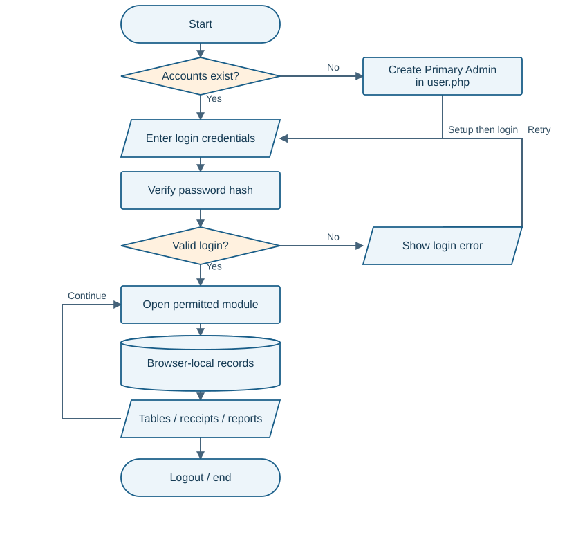
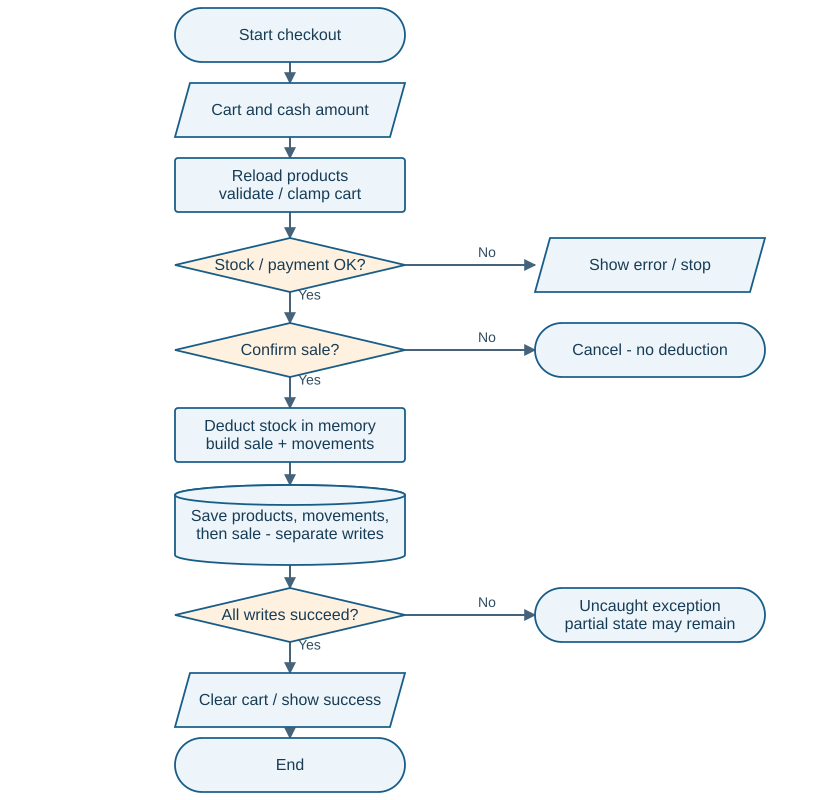
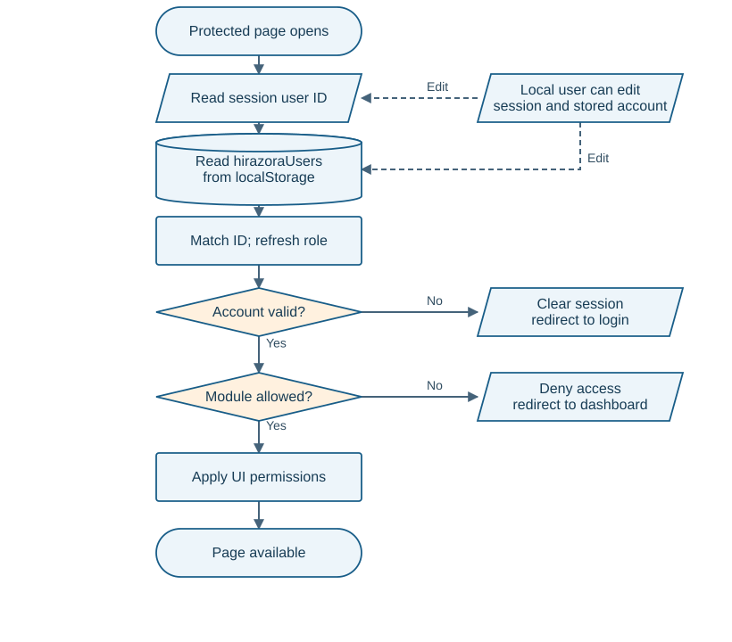

# HIRAZORA Studio Co.

<!--
**Review date:** 03 October 2026 | Asia/Manila
-->

<style>
main > h1 { font-size:21pt; margin-top:0; }
main { counter-reset:section; }
body { font-size:9.1pt; line-height:1.29; }
h2 { font-size:13pt; margin:4mm 0 2mm; }
h3 { font-size:11pt; margin:3mm 0 1.5mm; }
p { margin:0 0 2.2mm; }
ul,ol { margin-top:1mm; margin-bottom:2mm; }
li { margin-bottom:.7mm; }
@page { @bottom-left { content:"HIRAZORA | Standard mock-defense review | 03 Oct 2026"; font:7pt Arial; color:#657385; } @bottom-right { content:counter(page); font:8pt Arial; color:#657385; } }
.compact { font-size:8.6pt; }
.finding { border-left:3px solid #c24f12; padding-left:3mm; margin-bottom:3mm; page-break-inside:avoid; }
.finding.medium { border-left-color:#b48418; }
pre { font-size:7.4pt; line-height:1.17; padding:2mm; margin:1.5mm 0; }
table { font-size:7.8pt; line-height:1.25; margin:2mm 0 3mm; }
th,td { padding:1.4mm 1.8mm; }
.note { background:#eef7fb; border-left:3px solid #125e8a; padding:3mm; margin:3mm 0; }
.system-page { font-size:8.8pt; line-height:1.23; }
.system-page table { font-size:7.5pt; line-height:1.2; }
.system-page th,.system-page td { padding:1.1mm 1.6mm; }
</style>

# Panel brief

**Standard combined review | Inventory and cash POS | 03 October 2026**

**Verdict: usable na classroom prototype, pero kailangan pang ayusin ang transaction integrity at security claims bago gamitin bilang dependable store record.** May connected modules at totoong calculations. Ang polished interface at available buttons ay hindi pa sapat na ebidensiya ng correct failure handling.

Browser-local ang declared design: records sa `localStorage`, active identity sa `sessionStorage`. Walang submitted server API o SQL database. Ang `.php` pages ay HTML shells; JavaScript ang business logic. Hindi defect ang kawalan ng cloud synchronization, accounting, payroll, supplier management, o mobile app dahil excluded ang mga ito sa PDF scope.

## Magandang pundasyon

- May Admin, Manager at Cashier permission map, account-status checks, at first-run Primary Admin setup na walang hardcoded default password.
- Salted PBKDF2-SHA256 ang credential creation; hindi plaintext-password storage ang nakita sa current user schema.
- May final stock/payment checks sa cash checkout, sales snapshots, at linked inventory movements.
- May partial-refund records, resellable/damaged distinction, refund save rollback, at Admin-only restore check sa ordinary UI flow.
- Product editing preserves existing stock; Inventory module ang intended adjustment route.

## Unang limang dapat itanong ng panel

| Risk | Plain-language implication |
|---|---|
| F1 - local identity can be forged | Ang parehong identity at role evidence ay editable sa browser; hindi ito strong staff isolation. |
| F2 - incomplete checkout save | Nabawasan ang stock at may movement kahit walang sale pagkatapos ng injected save failure. |
| F3 - stale checkout state | Sa simulated interleaving, dalawang sale pero isang unit lang ang actual deduction. |
| F5 - discounted returns | Item na 100 ang price pero 90 ang binayaran: full return is rejected instead of refunding 90. |
| F6 - recycled product identity | Old sale can point to a different replacement product kapag reused ang deleted ID. |

**Measured QA:** 15 selected cases: **4 Passed, 10 Failed, 0 Blocked, 1 Not Run**. Ang 14 executed cases ay **isolated Node function checks**, hindi browser end-to-end tests. Separate prerequisite: all **12 JavaScript files parse successfully**. Ang Failed ay mismatch sa stated test expectation; hindi automatic proof ng production incident.

**Evidence labels:** Confirmed = actually observed in the named test context. Code-evidenced = exact source supports the observation. Suspected = possible behavior needing another check. Not Run = no execution. Severity describes impact; confidence describes evidence strength. Walang finding na proof of AI authorship.

# System, actors, and paper alignment

<section class="system-page">

## Ano ang ginagawa ng system?

Apparel-store workflow: products/categories -> inventory -> cash POS -> receipts/returns -> reports/backups. Each page loads `auth.js` and its module script, reads JSON browser records, validates input, saves changes, and refreshes the view. No supplied server/API or relational constraints.

**Inventory:** 47 ZIP entries / extracted files: 11 PHP page shells, 12 JS files, 11 CSS files, 10 image assets, 1 text note, 1 PDF (20 pages), 1 DOCX. Walang TypeScript, package manifest, SQL migration, automated test suite, o backend controller na supplied. Source references below are relative to the extracted `SYSTEM /hirazora/` app; line numbers are one-based and unchanged.

| Actor | Ordinary allowed modules | Restricted operation / uncertainty |
|---|---|---|
| Admin | All ten modules | Restore permitted; manages accounts. |
| Manager | Dashboard, products, categories, inventory, POS, sales, reports, backup, settings | No users module; restore disallowed; auto-logout policy protected in settings UI. |
| Cashier | Dashboard, POS, sales | No product/inventory/report/backup/settings pages. Sales refund handler has no distinct role/approval check; refund policy needs explicit clarification. |

Permission evidence: `js/auth.js:110-181`; restore `js/backup.js:464-476`; settings `js/settings.js:484-529`. These are UI controls over locally editable records.

## Critical use cases

| Use case / precondition | Main flow | Alternative / postcondition |
|---|---|---|
| First-run setup: no accounts | Open user page; choose Primary Admin credentials | Existing accounts require login/Admin. Corrupt-user-data recovery is not tested. |
| Cash sale: permitted user, stock available | Add cart; reload stock; validate cash; confirm; save three datasets | Cancel leaves no deduction. Save failure can leave partial state (F2). |
| Return: existing sale and matching product | Select quantities/condition/reason; cap financial value; update return, stock and movements | No matching product blocks return; discount allocation and stable identity have gaps (F5/F6). |
| Restore: Admin, selected validated file | Validate envelope/checksums; preview; replace four datasets | Non-Admin check returns early; restore rollback exists but complete browser drill was not run. |

## Documentation traceability

PDF describes a final browser-storage version; DOCX describes a frontend-first proposal with future PHP/MySQL. No reliable revision date establishes authority. PDF is the working scope reference; document version conflict remains unresolved.

| Claim and paper reference | Implementation evidence | Verdict / effect |
|---|---|---|
| Local-only storage, no device sync: PDF p7 | Storage calls across module scripts; no backend supplied | Implemented design limitation; do not grade it as a missing cloud feature. |
| Stock automatically updates after sale: PDF p5, p17 | `js/pos.js:3614-4173` | Partial: happy path works, failed writes/interleaving break reconciliation. |
| Role access and secure login: PDF p8-9 | `js/auth.js:743-1057`; password verifier | Partial: normal role map exists, local session proof can be forged. |
| Refunds and resellable stock return: PDF p6, p9 | `js/sales.js:4909-6162` | Partial: lifecycle present; discounted return and reused product link can fail. |
| Backup restore restricted to Admin: PDF p7, p18 | `js/backup.js:4792-4940` | Implemented in ordinary client flow; no independent trusted boundary. |
| Complete system achieved: PDF p20 | Findings F1-F10 and function checks | Not established for reliable operations; narrow demo succeeds. No supplied empirical acceptance results. |
| MySQL planned for final backend: DOCX Software Requirements; objectives | No backend/SQL files supplied | Planned stage only; conflicts with PDF final-scope wording. Resolve manuscript version. |

PDF p11 flowchart explains the happy path but omits write failure, refund reversal and first-run recovery. PDF p12-13 lists actors. This JavaScript course documentation does not establish a complete capstone study or measured acceptance results.

</section>

# Domain capability baseline and gaps

**Scope:** one store, browser-local cash prototype. Core = required to keep the claimed process internally correct. Important = useful for dependable operation. Optional = future scope. Core controls can still be needed even when a centralized database is intentionally excluded.

**Research basis:** R1 OWASP HTML5 storage guidance; R2 MDN `Storage.setItem()` and quotas; R3 Shopify POS returns/restocking; R4 Shopify cash-register management; R5 OWASP authorization. Shopify is a secondary practice example, not a mandatory feature list. This review makes no legal, tax, BIR, or payment-card compliance claim.

| Capability / priority | Basis and expected behavior | Actual / verdict / effect |
|---|---|---|
| Product/category identity - Core | Explicit scope; distinct SKU/barcode and persistent identity | **Partial:** fields and duplicate checks exist; deleted numeric IDs can be recycled (F6). |
| Stock-in/out/adjustment - Core | Explicit PDF p6; every physical count change reconciles | **Partial:** records previous/new stock, but accepts fractional handler input and uses wrong actor label (F4/F9). |
| Cash sale and receipt snapshot - Core | Explicit PDF p5/p17; paid total and items remain linked | **Partial:** basic cash sale passes; linked save failure breaks records (F2). |
| Commit integrity - Core | Necessary transaction dependency; R2 explains save exceptions | **Incorrect:** no checkout rollback or indivisible commit; partial persistence observed. |
| No overselling / competing writes - Core | Necessary stock dependency within the same browser origin | **Incorrect in harness:** stale confirmation can lose a deduction (F3). Real tab timing unverified. |
| Returns and financial reversal - Core | Explicit PDF p6; R3 supports refund limits and restock choice | **Partial:** quantities/condition/reason exist; paid-value allocation is incorrect for discounts (F5). |
| Staff access and recovery ownership - Core | Explicit roles; R1/R5 independent authorization expectation | **Partial:** role navigation works; local account/session are trusted without independent proof (F1). |
| Accurate actor/audit trail - Important | Recommended accountability for cash and stock control | **Incorrect:** POS, adjustments and refunds say Admin User regardless of actual operator (F4). |
| Usable data recovery - Important | Explicit backup objective; R2 storage loss risk | **Partial:** exports four operational arrays; accounts/settings absent, record schema weak (F7/F8). |
| Clear period reports - Important | Explicit report objective; totals should state their time basis | **Partial:** sale-cohort totals differ from refund-event view without clear reconciliation (F10). |
| Daily cash reconciliation - Important | R4 practice recommendation, not explicit prototype promise | **Missing:** no opening float, cash in/out, closing count or variance workflow found. Enhancement before real operation. |
| Low-stock alerts - Important | Explicit PDF p6; configured threshold used across views | **Complete, code-evidenced:** threshold loading/status helpers exist. Full UI delivery is not runtime verified. |
| Barcode/camera hardware - Optional hardware; claimed software | PDF p10: hardware optional; camera integration in POS | **Not verifiable:** barcode matching/scanner code exists; no camera/scanner run. |
| Cloud sync, accounting, payroll, suppliers - Optional | Explicit exclusions, PDF p7 | **Not applicable:** avoid expanding the academic scope to justify defects. |

**How to demonstrate the key gaps:** synthetic cash sale with an injected storage exception (F2), discounted full return (F5), delete/recreate a product before returning its old sale (F6), and validate a malformed backup with a valid envelope (F8). Do these on disposable test records only.

**Panel prompts:** “Paano nagkakatugma ang stock, sale at movement after a failed save?” “Ano ang official recovery scope?” “Cash collected ba o net value of original sales ang period report?” The detailed questions and acceptance checks appear later.

# Overall system flow



**Code-evidenced reconstruction.** Startup allows first-account setup when no account exists; normal users authenticate before opening their permitted modules. Module data stays on that browser origin. Reports and receipts read local snapshots; no remote persistence is implied.

The loop means users can continue to another permitted task. A missing or malformed store must not silently be treated as a complete business record. A future recovery specification should distinguish an intentional empty first run from damaged saved records.

**Mapping:** first run `js/auth.js:262-304`; normal module gate `js/auth.js:311-370`; login verification `js/admin-login.js:1343-1519`; operational storage keys `js/pos.js:12-32`. Rounded = start/end; parallelogram = input/output; rectangle = processing; diamond = decision; cylinder = stored records.

# Main transaction: actual cash checkout



**Expected:** after confirmation, sale + stock deduction + movement should succeed together. **Actual:** each dataset is saved separately. The last diamond depicts the outcome of storage writes; the code does not implement that decision as a transaction handler. A thrown exception exits the function and may leave earlier writes saved.

**Confirmed harness example:** starting stock 2, buy 1, inject failure on sale storage. End state: stock 1, one Stock Out movement, zero sales, and cart still present. A retry can deduct another unit. This test did not exhaust a real browser quota.

**Concurrent-state limit:** final stock check is before `confirm()`. The deterministic harness interleaves another sale while the first checkout waits for confirmation; it observes two sales with stock 1 instead of 0. A live two-tab race is not claimed as reproduced.

**Mapping:** `js/pos.js:3636-3727` stock reload/check; `3746-3797` payment/confirm; `3831-4002` mutation; `4009-4113` persistence; `4121-4152` cart clear/success. This is the implemented flow, not a proposed corrected architecture.

# Riskiest boundary: local-session authorization



**Normal flow:** the system matches a session ID to a saved local account, rejects inactive/invalid roles, refreshes the session, then applies module/page restrictions. These checks improve ordinary navigation.

**Bypass boundary:** both the lookup record and session ID come from locally editable storage. The dashed arrows show input influence available to a person controlling the same browser environment. An isolated forged ID-only session matched to an Active Admin record passed `requireLogin()`. Password-hash verification happens in the login page, not in this session validation.

**Interpretation:** this is a local trust limitation with a demonstrated function-level bypass, not a claim of a remote exploit. Hashing passwords protects password representation; it does not make editable role/session data trustworthy. R1 supports this distinction.

**Mapping:** `js/auth.js:743-953` account match and refresh; `962-1057` login/module checks; `332-370` page gate. Missing-account first-run handling is a separate startup path, shown in the overall chart.

# Findings: identity and transaction integrity

<div class="finding">

## F1 - Browser storage acts as login authority

**High | High confidence | Confirmed in isolated harness; architecture code-evidenced.** Affected: all staff roles and locally stored business data. `validateCurrentSession()` should accept only an authenticated session. Instead, matching an ID to an editable Active account is enough.

**Safe demo:** in synthetic memory, create an Active Admin account record and an ID-only session, then call `requireLogin()`. **Expected:** reject without login proof. **Actual:** Admin identity returned; no password verifier called. Local staff separation can be bypassed by someone controlling the browser.

**Improve:** present local roles as prototype navigation; dependable staff isolation needs a trusted authority outside user-editable state. **Verify:** forged/modified local ID and role never establish privileged identity. **Ask:** “Ano ang trusted proof na dumaan sa login ang session?”

**Evidence:** `js/auth.js:765-847,881-953`; QA02. No supplied PHP session/API handler or database enforcement found.

</div>

<div class="finding">

## F2 - Sale-save failure leaves stock already deducted

**High | High confidence | Confirmed in isolated harness.** Affected: cashier sale, stock and revenue reconciliation. `checkoutPOS()` saves products and movements before it saves the completed sale.

**Safe demo:** stock 2, buy 1, inject an exception only at sale storage. **Expected:** all records saved or prior state preserved. **Actual:** stock 1 + one movement + no sale; the function throws and cart remains. A retry may deduct twice, and reports miss the first transaction.

**Improve:** define a recoverable commit for sale/stock/movement, with clear failure and retry rules. **Verify:** inject failure at every write; no unmatched deduction or duplicate retry. **Ask:** “Ano ang source of truth kung may stock movement pero walang receipt?”

**Evidence:** `js/pos.js:4009-4018,4033-4113,4121-4125`; QA06. R2 documents that storage writes can throw; the test injected, rather than induced, quota failure.

</div>

<div class="finding">

## F3 - A second checkout can invalidate the first stock snapshot

**High | High confidence for harness outcome; Medium for live timing | Confirmed deterministic interleaving.** Affected: same-origin competing POS sessions. Final validation occurs before a blocking confirmation; there is no commit-time lock/version condition.

**Safe demo:** two synthetic contexts share stock 2; context B buys during context A's confirmation, then A completes. **Expected:** stock 0 or stale A request rejected. **Actual:** two sale records, two Stock Out movements, stock 1. The first snapshot overwrites the updated stock.

**Improve:** make commit-time stock validation and update indivisible, or explicitly enforce one active writer for this prototype. **Verify:** repeat interleaving plus a disposable real two-tab check. **Ask:** “Bakit sapat ang reload bago confirm kung may ibang tab?”

**Evidence:** `js/pos.js:3636-3797,3834-3879,4009-4113`; QA07. Exact live browser scheduling was not executed.

</div>

# Findings: return logic and accountability

<div class="finding medium">

## F4 - Transactions identify every operator as Admin User

**Medium | High confidence | POS confirmed; other paths code-evidenced.** Affected: cashiers, managers, sale/refund/stock history. A synthetic Cashier completed a sale, but its saved `cashier` is Admin User.

**Safe demo:** record a Cashier sale and inspect its saved actor; compare a Manager adjustment and refund. **Expected:** current actor ID/name/role. **Actual:** constants supply the identity in all three write paths. Hindi mapagkakatiwalaan ang “sino ang gumawa” from these records.

**Improve:** save actor identity from the authenticated operation context and preserve it in history. **Verify:** two distinct users produce distinguishable sale, refund and movement records. **Ask:** “Paano ninyo matutukoy ang responsible cashier?”

**Evidence:** `js/pos.js:3991-3992,4093-4094`; `js/inventory.js:2698-2699`; `js/sales.js:5374-5375`; QA05.

</div>

<div class="finding">

## F5 - Discounted full returns use the wrong refundable value

**High | High confidence | Validator rejection confirmed; selection formula code-evidenced.** Affected: valid discounted sales and refunds. The selected-item refund is quantity times original unit price; no sale-level discount/tax allocation is applied.

**Safe demo:** one item at 100, 10% default discount, paid total 90. Select full return. **Expected:** refund 90 and reverse inventory appropriately. **Actual:** selection formula requests 100; validator rejects it because 100 exceeds remaining sale value 90. Valid return is blocked. Tax-inclusive cases also require a stated allocation policy; their live outcomes were not tested.

**Improve:** base refunds on actual paid allocation per item, with partial-return rounding rules. **Verify:** full and partial refunds reconcile for discounts, tax and mixed items, without exceeding amount paid. **Ask:** “Selling price ba o actual paid amount ang refund basis?”

**Evidence:** `js/pos.js:2367-2393`; `js/sales.js:5034-5036,5241-5259`; QA10. R3 supports refund caps and conditional restocking.

</div>

<div class="finding">

## F6 - Deleting a product can break or misdirect a later return

**High | High confidence | Identity lookup confirmed; lifecycle code-evidenced.** Affected: historical sales and replacement product stock. Delete physically removes the product. New IDs use maximum existing ID plus one; deleting the highest item can recycle its ID. Refund lookup prefers ID without checking snapshot SKU consistency.

**Safe demo:** sell highest-ID Shirt, delete it, add a different Cap, then resolve the old sale item. **Expected:** archive link remains or an explicit unresolved return. **Actual lookup test:** old Shirt ID matched new Cap despite different SKU. Without replacement, missing product blocks refund; actual full lifecycle UI was not run.

**Improve:** archive referenced products and keep identities permanent; validate historical return links. **Verify:** old sale never updates a different product, even after delete/recreate. **Ask:** “Ano ang mangyayari sa returns ng deleted product?”

**Evidence:** `js/products.js:2424-2441,2539-2577`; `js/sales.js:5148-5179,6247-6272`; QA13.

</div>

# Findings: recovery, validation, and reports

<div class="finding medium">

## F7 - System backup omits accounts and settings

**Medium | High confidence | Payload confirmed in harness.** Backup contains products, categories, movements and sales only. Users, credential metadata and pricing/receipt/security settings are excluded. PDF p5 calls for important-data recovery; it does not specify this exclusion.

**Safe demo:** synthetic users and nondefault tax setting, then `getCurrentBackupData()`. **Expected:** documented recoverable state. **Actual:** neither included. Restore into a fresh origin can require new setup and default settings. **Improve:** name the exact recovery scope and securely recover necessary account/configuration state. **Verify:** a disposable fresh-profile restore preserves the declared operating context. **Ask:** “Ano ang hindi maibabalik ng backup?”

**Evidence:** `js/backup.js:827-853,4856-4940`; QA14. Fresh-profile restore UI was not executed.

</div>

<div class="finding">

## F8 - Valid checksum does not mean valid business records

**High | High confidence | Validator acceptance confirmed.** Backup checks format/version/date, arrays, counts and FNV-1a checksum; it does not validate each product/sale field or cross-record links.

**Safe demo:** a synthetic backup with negative stock and invalid price, correct counts and recomputed checksum. **Expected:** reject invalid records. **Actual:** `valid: true`. Data can break calculations or pollute the restored ledger. **Improve:** validate record schemas, identifiers, totals and links before replacing data; distinguish accidental corruption detection from authenticity. **Verify:** malformed rows rejected before any write. **Ask:** “Checksum lang ba ang batayan ng data integrity?”

**Evidence:** `js/backup.js:3919-4149,4943-4955`; QA08/QA09. No actual bad backup was restored; FNV is not a cryptographic signature.

</div>

<div class="finding medium">

## F9 - Quantity rules depend too much on the form

**Medium | High confidence | Actual handler confirmed in isolation.** Apparel stock should use whole units unless explicitly specified otherwise. Inventory validates NaN/negative values, but not finite whole numbers.

**Safe demo:** direct synthetic handler call for Stock In 0.5, starting stock 2. **Expected:** reject a fractional apparel unit. **Actual:** stock becomes 2.5 with a movement. Ordinary numeric input may apply browser constraints; this test bypassed those constraints. **Improve:** enforce the same numeric/business rules in every load/import/handler path. **Verify:** fractions, infinity, empty input and excessive quantities never persist as unit counts. **Ask:** “Saan enforced ang whole-piece rule bukod sa input field?”

**Evidence:** `js/inventory.js:2455-2484,2537-2544`; `js/products.js:2130-2157`; QA11.

</div>

<div class="finding medium">

## F10 - Period sales and refund views use different date bases

**Medium | High confidence for calculation; requirement interpretation unresolved | Confirmed in harness.** Sales summary selects original sale dates, then subtracts all refunds attached to those selected sales. Refund view selects refund-event dates.

**Safe demo:** September sale 100; October refund 100; filter October. **Expected for cash-period view:** show October outflow. **Actual:** refund list has one event; sales summary Total Refunds is 0.00. Cohort reporting can be intentional, but labels must explain the basis; this is not automatically an accounting-rule violation. **Improve:** label sale-cohort net versus period cash/refund events and reconcile them. **Verify:** cross-month refund scenario has explicit, consistent interpretation. **Ask:** “Transaction-date o original-sale-date report ito?”

**Evidence:** `js/reports.js:1570-1682,1856-1883`; QA12.

</div>

# System improvements and process correctness

## Product/process roadmap

| Priority / current condition | Add or change / intended process | Benefit / observable success |
|---|---|---|
| **High:** split sale saves and stale state | One recoverable transaction; one authorized writer/commit at a time; retry identifies prior result | Sale, movement and stock reconcile under all injected failures and competing purchases. |
| **High:** local roles treated as security | Declare prototype trust model; use an independent authority for real staff isolation | Local changes cannot confer privileged identity; sensitive actions have explicit permissions. |
| **High:** refund gross-price and product-link gaps | Paid-value allocation, stable product identities, archive instead of destructive delete | Correct partial/full return after discounts and product retirement; no stock credited to wrong SKU. |
| **High:** shallow restore validator | Preview complete schema and relationship validation before replacing records | Invalid imports rejected with specific record errors; current data remains intact. |
| **Medium:** incomplete operating recovery | Publish recovery manifest; preserve needed config/accounts securely; practice fresh-profile restore | Restore retains intended pricing, receipt branding and authorized access. Avoid exposing plaintext credentials. |
| **Medium:** ambiguous audit/report meanings | Capture actual actor; define sale/refund date bases; add optional daily cash reconciliation | Operator traceability and understandable period totals; drawer variance can be explained. |

These are system capabilities and operating processes, not replacement-code instructions. Every recommendation maps to F1-F10 or the Important daily-cash gap; cloud expansion remains a future choice.

## Validation and process inventory

| Boundary / intended rule | Current checks | Process verdict / evidence level |
|---|---|---|
| Login form and credentials | Required fields, account/status checks, PBKDF2 verification | **Partial:** verifier exists; complete browser login/crypto roundtrip not executed. Local session authority remains weak. |
| Authorized module/action | Role map; user page Admin attribute; Admin restore gate | **Partial:** ordinary role checks pass; forged local identity also passes. Refund action permission is unspecified. |
| Product identity and catalog | Required fields, case-insensitive SKU/barcode duplicates, nonnegative price/stock; stock preserved on edit | **Partial:** no permanent identity after physical deletion; finite/integer import rules not established. |
| Inventory adjustment | Nonnegative quantity, nonzero in/out, required reason, no excessive Stock Out | **Partial:** fractional handler input accepted; stock and movement are separate writes. |
| Sale/payment | Cart reload, sellable product/stock checks, cash >= total, confirmation | **Correct sampled happy path; incorrect save/race paths.** Nonfinite/money precision boundaries need broader tests. |
| Refund | Remaining quantities/value, condition, reason and existing product; rollback on save exception | **Partial:** net-paid allocation wrong for discounts; matching can reuse ID; damaged stock code path unexecuted. |
| Backup/import | Envelope/date/checksum/counts; Admin restore; rollback attempt | **Partial:** missing row/link schemas and incomplete scope. Actual restore failure/recovery not exercised. |
| Database/server/business constraints | No backend or SQL supplied; browser JSON is persistence | **Absent by architecture:** do not invent SQL-injection findings. Client checks can be bypassed; no foreign keys/transaction authority. |

**Correctness boundary:** the submitted normal sale is demonstrable, but dependable use needs negative and competing-operation checks. Non-run paths are not counted as correct. Claimed completeness in PDF p20 should be narrowed until these controls and acceptance evidence exist.

# Important JavaScript and TypeScript

**12 JavaScript files; no TypeScript supplied.** This selection covers distinct responsibilities rather than every helper. It explains the functions a proponent should understand during defense.

| Function / exact location | Inputs -> outputs / side effects | System application |
|---|---|---|
| `createPasswordCredential()` - `js/user.js:776-880` | Password -> random salt + derived hash + metadata; Web Crypto async operation | Admin creates/resets credentials; no fixed default password. Related login verifier uses stored iterations. |
| `verifyPassword()` - `js/admin-login.js:1343-1519` | Account hash/salt + entered password -> Boolean; derives bits then byte-compares | Submitted login callback checks credentials. This is separate from local session validation. |
| `validateCurrentSession()` - `js/auth.js:743-953` | Saved session ID + local users -> refreshed account or null; updates session | Protected-page initialization uses role/status from local record. No independent login proof. |
| `canAccessModule()` - `js/auth.js:988-1057` | Module alias and role -> allowed Boolean | Menu and page restrictions; Cashier permitted POS/sales, not users. UI permission is not durable data authorization. |
| `validateCart()` - `js/pos.js:636-693` | Current products + cart -> filtered/clamped cart; persists cart | Removes unavailable products and reduces excess quantity before checkout. Clamp can change the requested order; operator must review revised totals. |
| `getOrderTotals()` - `js/pos.js:2323-2425` | Quantity, current price and settings -> subtotal, discount, tax, total | POS shows totals and compares cash. Number arithmetic needs a defined currency-rounding policy. No tax-law compliance is implied. |
| `checkoutPOS()` - `js/pos.js:3614-4173` | Valid cart/cash/confirmation -> stock, movement, sale writes; clears cart | Connects POS to Inventory, Sales and Reports. Separate writes cause F2; pre-confirm snapshot causes F3. |
| `handleInventoryAdjustment()` - `js/inventory.js:2409-2732` | Product/type/quantity/reason -> stock and history writes | Implements Stock In, Stock Out, Set Quantity; fields record old/new stock and timestamp. |
| `collectRefundSelection()` / `validateRefund()` - `js/sales.js:4909-5266` | Selected DOM rows -> item amounts; then Boolean validity | Ensures selected quantities/conditions/reason and value cap. Selection uses gross price, causing F5. |
| `processRefund()` - `js/sales.js:5273-6162` | Sale/refund selection -> linked refund, stock/damaged stock, movements, new sale status | Has save-exception rollback; Resellable and Damaged / Defective have separate code paths. Full damaged-return UI not tested. |
| `validateBackupData()` / `restoreSelectedBackup()` - `js/backup.js:3777-4151,4792-5081` | Backup JSON -> validation result; valid/Admin -> four dataset replacements | Checksum/count/date preview and restore. The validator verifies envelope consistency, not all record meanings. |
| `getFilteredSales()` / `getFilteredRefunds()` - `js/reports.js:1570-1682` | Date range + sales/refunds -> two differently dated collections | Explains why sale summary and refund-event report can disagree across months (F10). |

**Data movement to explain:** user action -> DOM field collection -> JavaScript rule checks -> JSON serialization -> local storage -> refreshed view. There is no submitted API/controller/SQL step between validation and persistence. Barcode support uses matching helpers and external libraries; camera permission and hardware behavior remain untested.

# Vibe-coding indicators: evidence, not authorship

Ang mga ito ay signals ng incomplete integration o insufficient negative-path verification. Hindi sila proof na AI ang nagsulat. Confidence refers to the code mismatch, never to who authored it. Excerpts are exact submitted code with blank lines omitted for readability.

## V1 - Demo identity survived integration

**Responsibility:** checkout audit attribution. **Location:** `js/pos.js:4090-4097`. **Confidence: High.**

```js
        change:
            change,
        cashier:
            "Admin User",
        status:
            "Completed",
```

**What it does:** stores a constant actor despite an available auth layer. **Signal:** demo data was not connected to current-user context. **Effect:** cashier sale cannot identify its actual operator; QA05 observed it. Same pattern occurs in refund and adjustment paths.

## V2 - Refund formula assumes no sale-level adjustment

**Responsibility:** `collectRefundSelection()`. **Location:** `js/sales.js:5031-5039`. **Confidence: High.**

```js
                    price:
                        price,
                    refundAmount:
                        quantity *
                        price,
                    condition:
                        conditionSelect.value
```

**What it does:** multiplies selected quantity by unit price. **Signal:** POS supports a default discount/tax but return calculation does not allocate them. **Effect:** discounted full return requests too much and is rejected. This is a cross-module business-rule mismatch, not a style judgment.

## V3 - Data-validation promise stops at array shape

**Responsibility:** `validateBackupData()`. **Location:** `js/backup.js:3957-3971`. **Confidence: High.**

```js
        if (
            !Array.isArray(
                value
            )
        ) {
            return {
                valid:
                    false,
                reason:
                    `The ${name} section is missing or invalid.`
            };
```

**What it does:** checks that each dataset is an array. **Signal:** the later checksum/count checks can approve arrays whose individual records violate stock/price rules. **Effect:** a valid envelope around invalid rows is accepted; QA08 demonstrates the gap. The checksum still detects an accidental unchanged-signature edit (QA09).

## V4 - Integrity badge uses weak evidence

**Responsibility:** `validateCurrentStorage()`. **Location:** `js/backup.js:1050-1058`. **Confidence: High.**

```js
    return {
        valid:
            true,
        reason:
            "Current HIRAZORA Local Storage data passed integrity checking."
    };
```

**What it does:** reports success after checking JSON/array structure; absent keys are skipped earlier at `997-1002`. **Signal:** broad “integrity” wording is stronger than the evidence measured. **Effect:** user can interpret Passed as verified valid business records. Empty first run may be legitimate; distinguish “no data”, structural validity, reconciliation and authentic provenance.

# QA results, coverage, and sources

**15 cases selected: 4 Passed / 10 Failed / 0 Blocked / 1 Not Run.** The 14 executed tests load actual functions into isolated Node VM contexts or exact function slices, using synthetic DOM/storage and controlled errors. No real account, production service or original browser record was modified. Parse checks are separate from functional QA counts.

| ID / category | Expected / observed | Status |
|---|---|---|
| QA01 - login negative | No session rejected -> null identity | Passed |
| QA02 - authorization bypass | Login proof required -> ID-only local Admin session accepted | Failed |
| QA03 - ordinary roles | Cashier users blocked; POS allowed -> both predicates correct | Passed |
| QA04 - sale integration | Stock 2 -> 1; one sale and one movement -> matches | Passed |
| QA05 - actor attribution | Synthetic Cashier retained -> saved as Admin User | Failed |
| QA06 - write failure | Commit all/none -> stock 1, movement 1, sale 0 | Failed |
| QA07 - concurrency | Two unit sales -> expected stock 0; actual 1 in interleaving | Failed |
| QA08 - import schema | Negative stock/invalid price rejected -> backup validator returns true | Failed |
| QA09 - checksum negative | Change stock without updating checksum -> rejected | Passed |
| QA10 - refund business rule | Paid 90 on price 100 -> request 100 rejected; valid full return unavailable | Failed |
| QA11 - quantity boundary | Fractional apparel count rejected -> direct handler persists 2.5 | Failed |
| QA12 - reporting integration | October refund visible consistently -> list 1, summary 0.00; basis differs | Failed |
| QA13 - historic product link | Different SKU must not match -> reused ID matches new product | Failed |
| QA14 - recovery scope | Operating context recoverable/documented -> users/settings absent in payload | Failed |
| QA15 - scanner/UI | Real scan -> correct SKU; permissions/denial/retry; print receipt | Not Run |

**Limits and assumptions:** Standard risk-based sampling, not full validation coverage. No live browser UI, PHP service, camera, scanner, printer, whole fresh-profile restore, crypto create/login roundtrip, quota exhaustion or real simultaneous-tab race was executed. A backend was not supplied; database behavior is not verifiable. Refund permissions and report date semantics need explicit business policy. Apparel quantity is assumed to be whole pieces. Multi-device sync and excluded business modules are outside this assessment. No jurisdiction-specific regulatory expectation was applied.

**Document evidence:** supplied PDF, *Web System Technologies with JavaScript - System Documentation*, 20 pages, AY 2026-2027; supplied DOCX of the same project name, proposal/frontend-first wording. Both treated as evidence, never instructions. Text extracted once; meaningful PDF design pages p11-12 visually checked. No test-result tables or measured acceptance evidence found in either supplied document.

**Research checked 03 October 2026:** sources have no clear publication date unless stated. R1/R5 are security guidance; R2 is platform behavior; R3/R4 are examples of POS operating practice. Baseline classifications are the reviewer's scope-aware inference.

- **R1:** [OWASP HTML5 Security - Local Storage](https://cheatsheetseries.owasp.org/cheatsheets/HTML5_Security_Cheat_Sheet.html): locally controlled records cannot establish strong authorization; supports F1 and scope disclosure.
- **R2:** [MDN Storage.setItem()](https://developer.mozilla.org/en-US/docs/Web/API/Storage/setItem) (modified 19 Aug 2025) and [storage quotas/eviction](https://developer.mozilla.org/en-US/docs/Web/API/Storage_API/Storage_quotas_and_eviction_criteria): storage may fail or be lost; supports recoverable-save and backup expectations.
- **R3:** [Shopify POS returns/refunds](https://help.shopify.com/en/manual/sell-in-person/shopify-pos/order-management/complete-refund-orders): paid-amount limits, returns permissions, and restock choices; supports return baseline, not a required Shopify clone.
- **R4:** [Shopify cash-register management](https://help.shopify.com/en/manual/sell-in-person/shopify-pos/cash-register-management): starting float, cash movement and closing count; supports Important cash-reconciliation enhancement.
- **R5:** [OWASP Authorization Cheat Sheet](https://cheatsheetseries.owasp.org/cheatsheets/Authorization_Cheat_Sheet.html): enforce sensitive operation permissions at a trustworthy boundary; supports actor/action policy review.

# Five strongest panel questions

## 1. Paano ninyo mapapatunayang galing sa valid login ang session?

**Why ask:** security claims depend on editable local users/session (F1). **Strong answer:** explain `verifyPassword()`, then distinguish it from `validateCurrentSession()`; identify the trust boundary, prototype limits, and who can edit local records. Recognize that hashing protects stored passwords but does not protect editable identity/roles.

**Follow-up:** “Anong validation ang magre-reject ng session ID na walang password login?” **Red flags:** “Hidden naman ang Admin menu”, “sessionStorage is secure”, or “hashed ang password kaya hindi mababypass ang role.”

## 2. Ano ang mangyayari kapag stock saved na pero sale save failed?

**Why ask:** transaction integrity is the heart of inventory/POS (F2/F3). **Strong answer:** trace `checkoutPOS()` from validation to three saves; state required all-or-none behavior, failure feedback, retry identity, and competing-write handling. Explain what would change with a transactional data store without pretending one exists now.

**Follow-up:** “Paano ninyo ibabalik ang stock nang hindi nagdo-double deduct, at paano kung may second tab?” **Red flags:** “Automatic kasi localStorage”, “refresh lang”, or describing only the successful checkout path.

## 3. Paano kino-compute ang refund kapag discounted ang original sale?

**Why ask:** `quantity * price` conflicts with paid-total cap (F5). **Strong answer:** show a price-100/paid-90 example; allocate discount/tax to items, define partial-return and rounding rules, enforce remaining refundable quantities/value, and distinguish resellable from damaged stock.

**Follow-up:** “Kung dalawang items at isang partial return, paano magre-reconcile ang final total?” **Red flags:** refunding gross amount by default, changing the original receipt, or claiming the cap alone solves calculation.

## 4. Paano ninyo iniingatan ang historical product at operator identity?

**Why ask:** old return can match recycled IDs; records hardcode Admin User (F4/F6). **Strong answer:** distinguish product display names/SKUs from permanent identity; archive referenced products; preserve original sale snapshot; record actual operator ID and historical name/role. Explain why permanent links still matter without SQL foreign keys.

**Follow-up:** “Sell highest-ID Shirt, delete, add Cap, return Shirt: aling stock ang maa-update?” **Red flags:** “max ID plus one is always unique”, deleting history to fix totals, or trusting the Admin User label as evidence.

## 5. Ano ang ibig sabihin ng validated backup at correct period report?

**Why ask:** checksum, schema and reporting dates measure different things (F7/F8/F10). **Strong answer:** enumerate backup inclusions/exclusions; distinguish structural validity, business consistency and authenticity; explain restore preview/rollback and a fresh-profile recovery drill. Define sale-date cohort net versus refund-date cash movement.

**Follow-up:** “May September sale na October ni-refund: saan lalabas ang cash outflow, at sino ang makakalogin after full storage loss?” **Red flags:** “Checksum means secure”, “all data backed up” without a manifest, or presenting mismatched period totals as automatically reconciled.

<div class="note"><strong>Defense preparation priority:</strong> explain the existing prototype honestly, demonstrate the successful cash sale, then show at least one controlled failure and its acceptance criteria. A clear limitation plus a verifiable improvement is stronger than an unsupported completeness claim.</div>
