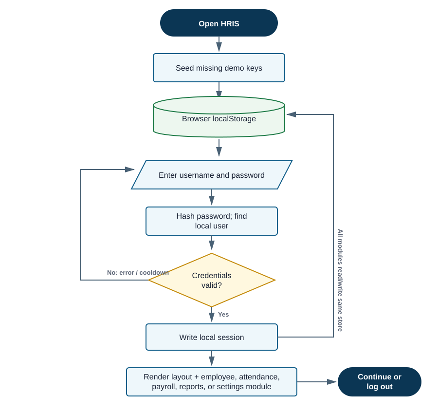
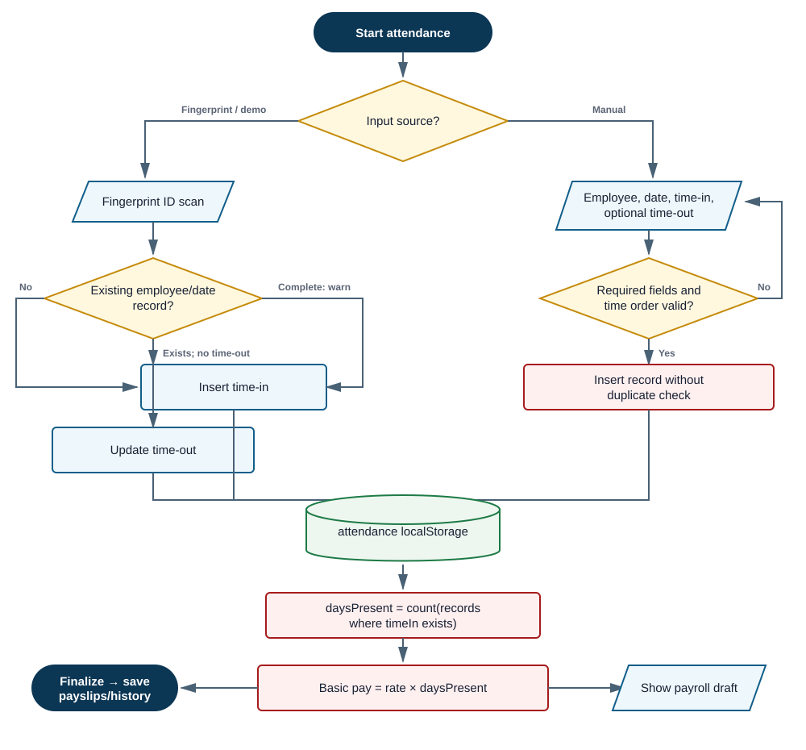
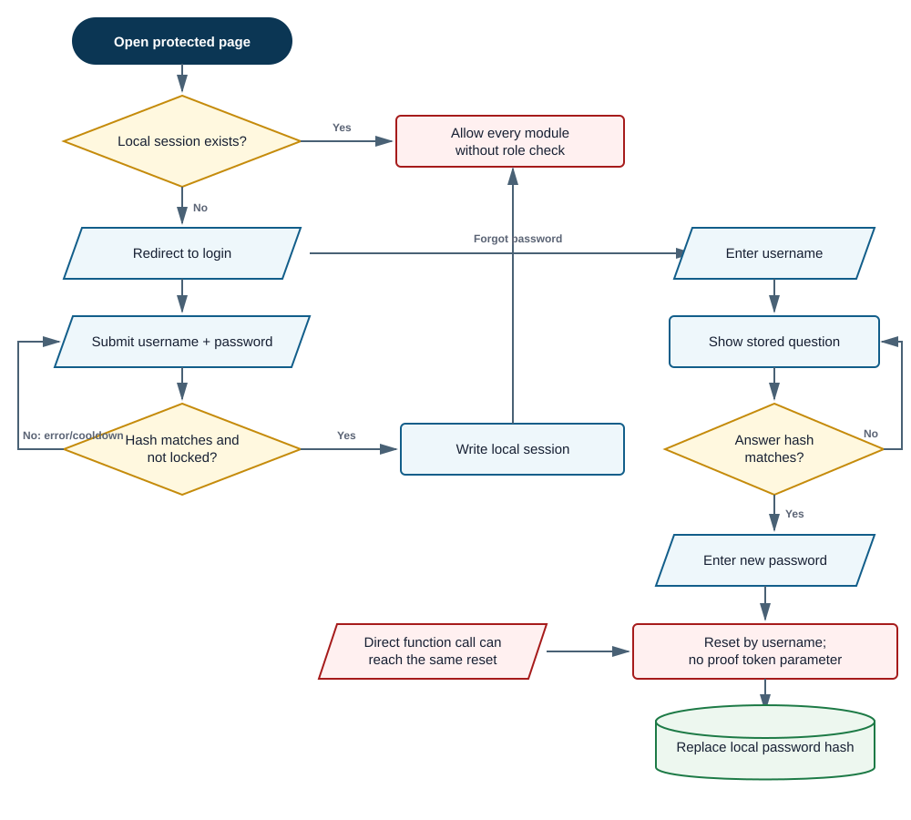

# CHROMORA CO. HRIS - Mock Defense Analysis

<style>
@page { margin: 10mm 10mm 12mm; }
body { font-size: 8.8pt; line-height: 1.31; }
p { margin-bottom: 2mm; }
ul, ol { margin-bottom: 2.2mm; }
li { margin-bottom: .8mm; }
h2 { font-size: 14.2pt; margin: 5.5mm 0 2mm; }
h3 { font-size: 11pt; margin: 3.3mm 0 1.3mm; }
h3 + p { page-break-after: avoid; }
h3 + p + p { page-break-before: avoid; }
h4 { margin: 3mm 0 1mm; }
table { font-size: 7.2pt; margin: 2mm 0 3.2mm; }
th, td { padding: 1.35mm 1.5mm; }
pre { font-size: 7.7pt; padding: 3mm; }
img { max-height: 145mm; margin: 2.5mm auto 3.5mm; }
</style>

**Review date:** September 30, 2026  
**Review mode:** Standard, system-only  
**Submitted source:** `F:\New folder\hris - Copy\hris`  
**Evidence labels:** Confirmed = reproduced in an isolated browser; Code-evidenced = directly supported by source; Not testable = unavailable hardware/environment; Assumption = reconstructed intent because no paper was supplied.

## 1. One-page panel brief

### Ano ang system?

Ang submission ay isang browser-only Human Resource Information System (HRIS) prototype para sa employee master data, departments, positions, fingerprint-style attendance, semi-monthly payroll, reports, account settings, at activity log. Static HTML/CSS/JavaScript lang ito; lahat ng records, users, password hashes, sessions, at payroll data ay naka-save sa browser `localStorage`. Walang backend server o database.

### Readiness verdict

**Good classroom/demo prototype; hindi pa production-ready for real employee and payroll data.** Malinaw ang navigation, reusable ang shared utilities, at gumagana ang basic employee-attendance-payroll journey. Pero ang payroll integrity, authorization, recovery flow, duplicate prevention, legal-rate computation, durable storage, at auditability ay kulang para sa tunay na HR/payroll use.

### Strengths

- Consistent modular structure: `storage`, `auth-guard`, `salary`, `attendance`, `payroll`, at page modules.
- User-facing escaping is commonly applied before dynamic HTML, reducing accidental HTML injection in many screens.
- May archive/restore flow for employees at may delete protection for departments and positions that are still assigned.
- Payroll records snapshot the rate and computed values when finalized, so old finalized payslips do not automatically change when a rate is edited.
- JavaScript syntax check passed for all 17 `.js` files.

### Top five risks

1. **High - Duplicate/incomplete attendance becomes full paid days.** Confirmed: two incomplete records for Carlo on one date became `2d` and ₱2,400 basic pay.
2. **High - Payroll deductions are flat percentages/amounts.** They do not implement BIR withholding tables or current SSS/PhilHealth/Pag-IBIG bases, floors, ceilings, and employee shares.
3. **High - Browser-only security.** A locally editable session object protects every page; there is one role and no server-side authorization.
4. **High - Recovery reset has no verified reset token.** `resetPasswordViaSecurity(username, newPassword)` trusts that another function was called earlier.
5. **High - Data loss can be reported as success.** Failed `localStorage` writes return `false`, but CRUD callers ignore it and still show success.

### QA snapshot

| Result | Count |
|---|---:|
| Passed | 4 |
| Failed | 3 |
| Blocked | 2 |
| Not Run | 6 |
| **Total designed** | **15** |

> **Bottom line:** Maganda itong proof of concept for UI and basic flow. Ang defense should honestly frame it as a local prototype and explain a clear migration path to a server-backed, role-based, auditable HR/payroll system.

<div class="page-break"></div>

## 2. System explained simply

### Reconstructed scope and actors

No capstone paper or requirements document was supplied. The following is an **assumption based on UI labels and code**.

| Actor | What the implementation allows | Evidence |
|---|---|---|
| Administrator | Full access to employee, department, position, attendance, payroll, reports, and settings | One seeded `Administrator`; all pages share the same `requireAuth()` check |
| Employee | No direct account or self-service portal; represented only as HR/payroll data | Employee records have no login link |
| Fingerprint/Arduino device | Sends a fingerprint ID line over Web Serial; app converts it to time-in/time-out | `attendance.js:105-150,165-201` |
| Panel/operator | Can export CSV and print reports/payslips through the browser | `reports.js:260-299`; `payroll.js:366-410` |

### Modules and data movement

| Module | Main responsibility | Persistence |
|---|---|---|
| Login/account | Login, lockout, password change, security-question recovery | `users`, `hris_session` |
| Employees | Add/edit/archive/restore/delete employee; salary assignment | `employees` |
| Departments/positions | Maintain organizational labels and live daily-rate components | `departments`, `positions` |
| Attendance | Demo scan, Web Serial scan, manual records, derived late/OT values | `attendance` |
| Payroll | Semi-monthly draft, basic/OT pay, deductions, finalize, payslip | `payrollRecords`, `payrollSettings` |
| Reports/dashboard | Reads current stored data for KPIs, tables, CSV, print | No independent store |
| Activity log | Prepends up to 200 user/action entries | `activityLogs` |

**Technology:** nine HTML pages, 17 JavaScript files, CSS, browser Web Crypto, Web Serial, and `localStorage`. There is no package manifest, automated test suite, API, database schema, or deployment configuration.

## 3. Domain capability baseline and gap critique

The fair baseline is a **single-company, single-admin academic HR/payroll prototype**, not an enterprise HR suite. Core expectations are employee records, unique attendance, correct pay basis, controlled payroll finalization, reliable deductions, access control, history, and recoverability. Leave management, recruitment, and multi-branch features are enhancements unless claimed.

Official anchors used: DOLE identifies holiday, premium/rest-day, overtime, night differential, and related statutory benefits as core labor-standard topics; BIR calculates withholding by payroll period and taxable/non-taxable categories rather than one flat rate; SSS uses a compensation schedule effective January 2025; PhilHealth publishes an income floor/ceiling and shared premium; the National Privacy Commission requires reasonable organizational, physical, and technical safeguards for personal data.

| Capability | Importance and basis | Expected behavior | Actual evidence | Verdict | Effect / priority |
|---|---|---|---|---|---|
| Employee master data | Core - necessary process | Valid, unique employee identity with safe lifecycle | CRUD, archive, filters exist; no unique email/fingerprint check | **Partial** | Duplicate identity or biometric mapping; High |
| Attendance uniqueness | Core - data integrity | At most one valid work record per employee/date, or explicit split-shift model | Manual insert has no duplicate check; duplicate reproduced | **Incorrect** | Inflated presence and payroll; High |
| Complete attendance | Core - payroll dependency | Incomplete time-out is excluded/flagged before pay | Any record with `timeIn` increments `daysPresent` | **Incorrect** | Full pay without completed hours; High |
| Overtime/holiday/rest/night pay | Core where payroll claims these settings; DOLE basis | Classify day/time and apply approved premiums | OT is based only on time-out; holiday/rest/night settings are saved but unused | **Partial** | Under/overpayment; High |
| Withholding tax | Core for claimed payroll; BIR basis | Payroll-period tax table and taxable-income rules | Flat `grossSalary * taxRate` | **Incorrect** | Wrong withholding; High |
| SSS/PhilHealth/Pag-IBIG | Core for claimed deductions; agency schedules | Correct bases, brackets/floors/ceilings, employee share | Flat percentage/flat amount | **Incorrect** | Wrong employee deductions; High |
| Payroll review/finalization | Core - authorization/integrity | Maker-checker review, validation, lock/reversal trail | Same administrator calculates, edits, replaces, and finalizes | **Partial** | No independent approval; High |
| Payslip/history | Core | Snapshot final values and retain history | Final records include rate and computed values; printable payslip | **Complete** for prototype | Useful strength |
| Roles and permissions | Core for real HR data; NPC safeguard basis | Least-privilege roles and server authorization | One seeded admin; `role` is stored but never enforced | **Missing** | Anyone with a forged local session gets all modules; High |
| Audit trail | Important | Durable actor, before/after, reason, immutable event | 200 mutable local entries; delete log lacks subject details | **Partial** | Weak accountability; Medium |
| Backup/recovery | Important | Export/restore and failure notice | No backup/import; corrupt reads silently fall back; writes may fail silently | **Missing** | Browser reset/quota can lose records; High |
| Privacy/security controls | Core for real personal/biometric/payroll data; NPC basis | Controlled access, secure storage, retention, incident measures | Plain browser storage; no encryption-at-rest, retention, or server controls | **Incorrect** for real use | Confidentiality risk; High |
| Leave/absence workflow | Optional unless claimed | Requests, approvals, balance and payroll linkage | Only an `On Leave` status; no workflow | **Out of current scope / enhancement** | Do not grade as a defect without a paper claim |

<div class="page-break"></div>

## 4. Essential flowcharts

### 4.1 Actual overall system flow



The browser loads demo data only when a storage key is absent, authenticates against a local user list, then every module reads and writes the same local store. The diagram is the **actual implemented flow**, not a proposed architecture. Evidence: `storage.js:9-19,21-42,129-194`; `main.js:8-30`.

### 4.2 Actual attendance-to-payroll flow and failure path



Critical issue: manual attendance is inserted without checking employee/date uniqueness; payroll counts every record with any `timeIn` as a full present day. A missing `timeOut`, zero hours, late minutes, and undertime do not reduce basic pay. Evidence: `attendance.js:344-364`; `payroll.js:68-94`.

### 4.3 Actual login/recovery/authorization flow



Normal login has password hashing and a five-attempt cooldown. However, every protected page trusts the existence of a locally editable session object, and the password-reset function has no one-time proof/token connecting answer verification to reset. Evidence: `auth-guard.js:15-43,53-69,90-120`; `storage.js:114-121`.

<div class="page-break"></div>

## 5. Top findings

### F-01 - Duplicate and incomplete attendance produces full basic pay

**Severity:** High | **Confidence:** High | **Evidence:** Confirmed + code-evidenced  
**Affected:** Administrator; attendance, dashboard, payroll; `attendance.js:344-364`, `dashboard.js:18-22`, `payroll.js:68-94`

**Problema:** Walang duplicate check sa manual attendance. Kahit walang time-out, basta may `timeIn`, counted na as one paid day.  
**Saan:** Manual attendance → dashboard KPI → payroll draft.  
**Paano mabubutas:** Sa isolated browser, nag-add ng dalawang Carlo Dizon records sa 2026-09-30, parehong 09:00 at walang time-out. Parehong tinanggap.  
**Expected vs Actual:** Expected one employee/day or explicit split shift and incomplete records blocked from payroll. Actual: dashboard `Present today` became 5 for four unique attendees; payroll showed Carlo `2d`, ₱2,400 basic pay.  
**Effect:** Inflated headcount and direct payroll overpayment.  
**Ayusin:** Enforce a unique employee/date rule (or modeled shifts), require a completed/approved attendance state, and compute payable units from approved hours/rules.  
**Verification:** Re-run the duplicate case; second insert must be rejected or merged, and incomplete attendance must not increase payable days.  
**Panel question:** “Bakit `timeIn` lang ang basis ng paid day, at paano ninyo pinipigilan ang duplicate attendance?”

### F-02 - Payroll uses flat deductions instead of official rules

**Severity:** High | **Confidence:** High | **Evidence:** Code-evidenced  
**Affected:** Payroll correctness; `storage.js:88-102`; `payroll.js:98-108`

**Problema:** One percentage or flat amount ang tax, SSS, PhilHealth, at Pag-IBIG for every employee.  
**Expected vs Actual:** BIR withholding is payroll-period/table based; SSS and health/housing contributions use defined bases, schedules, floors/ceilings, and shares. Actual formulas are `gross * rate`, `basic * rate`, and one flat ₱100.  
**Effect:** A payslip can look mathematically consistent but still be materially wrong.  
**Ayusin:** Version official deduction tables/configuration by effective date; separate employee and employer shares; compute taxable compensation before tax.  
**Verification:** Golden-test several salaries at bracket boundaries against official agency examples.  
**Panel question:** “Anong official table at effective date ang pinagbabasehan ng bawat deduction?”

### F-03 - Holiday, rest-day, and night differential settings are dead controls

**Severity:** High | **Confidence:** High | **Evidence:** Code-evidenced  
**Affected:** Settings and payroll; `settings.html:55-65`; `settings.js:24-33,49-62`; `payroll.js:68-108`

**Problema:** Editable at saved ang three premium settings, pero walang payroll branch na gumagamit sa kanila.  
**Effect:** UI promises a capability that the calculation does not deliver; users may trust wrong totals.  
**Ayusin:** Either remove the controls from the declared scope or add day classification, approved premium hours, and formula application with evidence.  
**Verification:** Same hours on ordinary day, rest day, holiday, and night window must produce the expected distinct amounts.  
**Panel question:** “Ipakita sa code kung saan ginagamit ang holiday, rest-day, at night-differential values.”

### F-04 - Authentication and authorization are only local browser state

**Severity:** High | **Confidence:** High | **Evidence:** Code-evidenced  
**Affected:** All HR, payroll, and biometric-linked data; `storage.js:114-121,129-145`; `auth-guard.js:53-69`; `main.js:8-13`

**Problema:** `requireAuth()` checks only whether `hris_session` exists. There is no server validation, session expiry, per-action authorization, or enforced role matrix.  
**Effect:** This is acceptable only as a local demo deterrent. It cannot protect real employee records because browser storage is under the local user's control.  
**Ayusin:** Server-side identity/session, short expiry, role checks on every API action, and least-privilege roles (HR, attendance encoder, payroll maker/approver, viewer).  
**Verification:** A forged/expired session must fail server-side; an attendance encoder must not change payroll settings.  
**Panel question:** “Ano ang security boundary ng system kung editable ng user ang `localStorage`?”

### F-05 - Password recovery reset is not bound to a verified challenge

**Severity:** High | **Confidence:** High | **Evidence:** Code-evidenced  
**Affected:** Administrator account takeover; `auth-guard.js:90-120`; `index.html:122-157`

**Problema:** The UI calls verify then reset, but `resetPasswordViaSecurity()` independently accepts only username and new password. Walang short-lived reset token, attempt limit, or server-held proof.  
**Effect:** Client code can invoke reset without demonstrating the answer; the recovery question also reveals whether a username exists.  
**Ayusin:** Issue a one-time, expiring server-side reset token only after a rate-limited challenge; use generic lookup messages.  
**Verification:** Direct reset without a valid token must fail; repeated answers must throttle/lock safely.  
**Panel question:** “Saan naka-store ang proof na tama ang security answer bago tanggapin ang password reset?”

### F-06 - Failed writes can still show success

**Severity:** High | **Confidence:** High | **Evidence:** Code-evidenced  
**Affected:** Every CRUD flow and photo upload; `storage.js:33-42,60-82`; `employees.js:298-313,353-367`

**Problema:** `writeKey()` returns `false` on quota/serialization errors, but `insert`, `update`, and `replaceAll` ignore it and return success-like values.  
**Effect:** Large photos or full/corrupt storage can cause silent data loss while the UI says “Employee added” or “Payroll generated.”  
**Ayusin:** Propagate write failure, cap/compress or avoid storing photos as data URLs, and show a blocking error with recovery guidance.  
**Verification:** Simulate `QuotaExceededError`; no success toast and no false in-memory confirmation should appear.  
**Panel question:** “Paano malalaman ng user na hindi talaga na-save ang record?”

### F-07 - Employee deletion leaves orphan HR/payroll records

**Severity:** Medium | **Confidence:** High | **Evidence:** Code-evidenced  
**Affected:** Employee history, attendance, payroll, reports; `employees.js:394-406`; `reports.js:152-160,176-185`

**Problema:** Permanent delete removes only the employee row. Attendance and payslips remain with an ID fallback and lose name/department context.  
**Effect:** History becomes harder to audit and reconcile; privacy retention is uncontrolled.  
**Ayusin:** Prefer deactivation/retention; if deletion is required, define cascade/anonymize rules and preserve a stable payroll identity snapshot.  
**Verification:** Delete an employee with history; reports must remain interpretable under the documented retention policy.  
**Panel question:** “Ano ang mangyayari sa lumang payslip at attendance kapag dinelete ang employee?”

### F-08 - Mutable, capped activity log is not an audit trail

**Severity:** Medium | **Confidence:** High | **Evidence:** Code-evidenced  
**Affected:** Accountability; `activity-log.js:6-22`; `attendance.js:370-381`

**Problema:** Logs are locally editable, capped at 200, have no before/after values, and a deletion log says only “Deleted an attendance record.”  
**Effect:** A reviewer cannot prove who changed which record or reconstruct a payroll correction.  
**Ayusin:** Append-only server audit events with actor, entity, old/new values, reason, timestamp, and retention.  
**Verification:** Edit/delete a record and reconstruct the exact change from a read-only log.  
**Panel question:** “Paano ninyo mapapatunayang hindi binago o binura ang audit history?”

### F-09 - Duplicate employee identity fields are allowed

**Severity:** Medium | **Confidence:** High | **Evidence:** Code-evidenced  
**Affected:** Employee/attendance identity; `employees.js:315-364`; `attendance.js:165-177`

**Problema:** Required fields are checked, but not uniqueness of email or `fingerprintId`. Scan matching uses the first fingerprint match.  
**Effect:** A scan may be credited to the wrong employee; duplicate emails weaken record identity.  
**Ayusin:** Case-normalized unique constraints for identifiers, plus clear conflict errors.  
**Verification:** Try to create a second employee with an existing fingerprint ID; save must fail.  
**Panel question:** “Kung pareho ang fingerprint ID ng dalawang employee, sino ang tatamaan ng attendance?”

### F-10 - KPI “Present today” counts records, not people

**Severity:** Medium | **Confidence:** High | **Evidence:** Confirmed + code-evidenced  
**Affected:** Dashboard decision support; `dashboard.js:18-22`

**Problema:** `presentToday = todaysAttendance.length`; duplicate rows inflate the metric.  
**Confirmed result:** Five attendance rows displayed as five present even though only four unique employees appeared.  
**Ayusin:** Count unique eligible `employeeId` values after validating the attendance state.  
**Verification:** Duplicates must not increase the KPI.  
**Panel question:** “Ano ang definition ng ‘present’: attendance row ba o unique employee?”

<div class="page-break"></div>

## 6. Recommended system improvements

| Priority | Current condition | Add/change and intended process | Benefit | Success indicator |
|---|---|---|---|---|
| Critical path | Browser storage is the database/security boundary | Move records and authentication to a server database/API; UI becomes a client only | Durable data, enforceable authorization | Direct local edits cannot change server truth |
| High | Any time-in row becomes a paid day | Attendance states: incomplete, submitted, corrected, approved, rejected; one employee/date/shift rule | Prevents inflated payroll | Payroll accepts only approved records |
| High | One admin performs everything | Separate HR, attendance encoder, payroll maker, payroll approver, read-only auditor | Segregation of duties | Permission matrix tests pass |
| High | Flat deduction rates | Effective-dated BIR/SSS/PhilHealth/Pag-IBIG computation tables and employee/employer shares | Legally aligned, explainable payslips | Boundary examples match official calculators/tables |
| High | Premium settings are disconnected | Calendar/day classification, approved OT, rest-day/holiday/night windows; remove unused controls until ready | Avoids false capability claims | Each premium has traceable input and computed line |
| High | Writes can fail silently | Transaction/error propagation, photo limits/object storage, backup/export/restore | Prevents invisible data loss | Forced storage failure blocks success and guides recovery |
| Medium | Logs are mutable and vague | Append-only audit event with subject, before/after, reason, actor, timestamp | Defensible accountability | Every payroll-affecting change is reconstructable |
| Medium | Delete breaks history | Deactivate by default; documented retention/anonymization; snapshot identity in final payroll | Preserves history and privacy intent | Old reports remain readable after lifecycle changes |

## 7. Validation and process correctness

| Boundary/process | Existing control | Gap | Verdict |
|---|---|---|---|
| Login client | Required username/password, SHA-256 comparison, five-attempt cooldown | Local-only hashes/session; no expiry; username-specific recovery responses | Partial |
| Page authorization | Redirect when no session | Existence check only; role not enforced | Incorrect for real data |
| Employee form | Required name/email/department/position; email format; positive custom rate | No unique email/fingerprint; weak phone/date/business validation; photo size absent | Partial |
| Department/position | Non-negative amounts; prevents delete while assigned | Duplicate names allowed; changes affect future payroll without approval/effective date | Partial |
| Attendance manual | Required employee/date/time-in; time-out after time-in | Duplicate employee/date, future date, incomplete paid day, no correction reason/approval | Incorrect |
| Attendance device | Matches active fingerprint ID, toggles in/out | Duplicate fingerprint ambiguity; no device identity/trust; hardware not tested | Partial / blocked |
| Derived time | Late/undertime/OT from schedule | No breaks, shift/overnight handling, approved OT, holiday/rest/night classification | Partial |
| Payroll draft | Semi-monthly period, manual non-negative HTML inputs, confirmation modal | No server validation, no attendance approval, no maker-checker, negative values possible if DOM is bypassed | Incorrect |
| Payroll finalization | Replaces period records and snapshots values | Regeneration deletes/replaces period as one local write; no reversal/lock/version | Partial |
| Reports | Filters, CSV, print, payslip | Depends on possibly duplicated/orphaned local data | Partial |
| Storage | JSON try/catch | Corrupt reads become empty; failed writes ignored; no backup | Incorrect for durable records |

### Process verdict

- **Employee setup:** Mostly correct for demo CRUD, but identity uniqueness and privacy controls are incomplete.
- **Attendance:** Partial. Happy path works; integrity fails for duplicates, incomplete records, and unapproved overtime.
- **Payroll:** Demonstrates a calculation pipeline but is materially incorrect as a Philippine payroll engine.
- **Reporting:** Functionally present, but outputs inherit upstream data defects.
- **Security/account recovery:** Demo-grade only; not a trustworthy boundary for real HR data.

## 8. Important JavaScript functions

| Function | Input → output / side effect | How the system uses it | User-visible effect |
|---|---|---|---|
| `seedIfEmpty()` (`storage.js:129-194`) | Missing keys → seeded arrays/settings | Runs on login and protected pages | Demo account and sample HR data appear on first use |
| `Store.insert/update/remove/replaceAll` (`storage.js:53-83`) | Entity/key → rewrites JSON array | Shared persistence layer | All CRUD screens appear to save locally |
| `AuthGuard.login()` (`auth-guard.js:15-43`) | Username/password → result/session | Login page | Correct demo credentials open dashboard; failures increment cooldown counter |
| `AuthGuard.requireAuth()` (`auth-guard.js:53-60`) | Session existence → redirect/allow | Every protected page | No local session redirects to login |
| `handleScan()` (`attendance.js:165-201`) | Fingerprint ID → time-in/out record | Demo button and Web Serial reader | First scan times in; second scan times out |
| `computeDerived()` (`attendance.js:225-244`) | Time-in/out + settings → late/total/under/OT | Scan and manual form | Attendance table shows derived minutes/hours |
| `handleManualSave()` (`attendance.js:344-368`) | Form fields → insert/update | Add/edit attendance modal | Saves records, but does not enforce uniqueness |
| `Salary.dailyRate()` (`salary.js:10-20`) | Employee assignment → daily rate | Employee preview and payroll | Department rate + position add-on or custom override |
| `buildDraft()` (`payroll.js:68-96`) | Active employees + period attendance → draft lines | Generate/regenerate payroll | Turns every time-in record into a paid day |
| `computeLine()` (`payroll.js:98-109`) | Earnings + settings → gross/deductions/net | Draft rows and finalized payslip | Shows gross/net and four deductions |
| `finalizePayroll()` (`payroll.js:237-277`) | Draft → replace period records | Finalize confirmation | Saves one payslip per active employee |
| `employeeReport()/attendanceReport()/payrollReport()` (`reports.js:114-188`) | Stored records + filters → flat rows | Report tabs/CSV/print | Exports exactly what is in local storage |

<div class="page-break"></div>

## 9. Vibe-coding implementation-risk indicators

These are **observable risk indicators, not proof of AI authorship**.

### V-01 - UI settings with no downstream implementation

**Location/responsibility:** `storage.js:88-97`, payroll settings; `payroll.js:98-108`, pay computation  
**Evidence code:**

```js
nightDifferentialRate: 0.1,
holidayRateMultiplier: 2.0,
restDayRateMultiplier: 1.3,
```

```js
const grossSalary = line.basicPay + line.overtimePay + Number(line.bonuses) + Number(line.allowances);
const tax = grossSalary * (settings.taxRate || 0);
```

**What it does / signal:** The settings exist and are editable, but the pay function never reads them. This is incomplete integration between UI/config and business logic.  
**System effect:** Users may assume premiums are included when they are not.  
**Confidence:** High.

### V-02 - Security sequence enforced only by a comment/UI order

**Location/responsibility:** `auth-guard.js:111-119`, recovery reset  
**Evidence code:**

```js
/** Step 3 ... only call this after verifySecurityAnswer() ... */
async resetPasswordViaSecurity(username, newPassword) {
  const user = Store.getAll(STORAGE_KEYS.USERS).find((u) => u.username === username);
  const newHash = await hashText(newPassword);
  Store.update(STORAGE_KEYS.USERS, user.id, { passwordHash: newHash });
}
```

**Signal/effect:** A security precondition is documentary, not technically enforced. Direct invocation can skip verification.  
**Confidence:** High.

### V-03 - Success path ignores persistence failure

**Location/responsibility:** `storage.js:34-42,60-64`; generic persistence  
**Evidence code:**

```js
function writeKey(key, value) {
  try { localStorage.setItem(key, JSON.stringify(value)); return true; }
  catch (err) { console.error(...); return false; }
}
// ...
writeKey(key, items);
return item;
```

**Signal/effect:** Error handling exists at one layer but is disconnected from callers and success toasts, a common happy-path-only integration residue.  
**Confidence:** High.

### V-04 - “Present” metric uses the easiest count, not the business definition

**Location/responsibility:** `dashboard.js:18-22`, KPI  
**Evidence code:**

```js
const todaysAttendance = Store.getAll(STORAGE_KEYS.ATTENDANCE)
  .filter((a) => a.date === today);
const presentToday = todaysAttendance.length;
```

**Signal/effect:** It counts rows without deduplication or validity state. The runtime test inflated present employees.  
**Confidence:** High.

### V-05 - Visible global controls have no behavior

**Location/responsibility:** `layout.js:71-81,103-125`, shared top bar/actions  
**Evidence code:**

```js
<input type="search" id="global-search" placeholder="Search employees" />
<button id="notifications-btn" aria-label="Notifications">...</button>
```

`bindGlobalActions()` binds theme, sidebar, and logout only; it never binds global search or notifications.  
**Signal/effect:** UI affordances appear finished but do nothing, suggesting incomplete feature integration.  
**Confidence:** High.

## 10. QA summary and high-value test cases

| ID | Test | Expected | Actual/status | Evidence |
|---|---|---|---|---|
| QA-01 | Clean seeded login (`admin/admin123`) | Dashboard opens | **Passed** | Confirmed in isolated origin |
| QA-02 | All `.js` files via `node --check` | No syntax errors | **Passed** | 17 files passed |
| QA-03 | Add one manual incomplete attendance | Visible as incomplete | **Passed** | Carlo 09:00, no time-out saved |
| QA-04 | Add duplicate same employee/date/time | Reject/merge | **Failed** | Second Carlo row saved |
| QA-05 | Dashboard after duplicate | Count unique valid attendees | **Failed** | Showed 5, only 4 unique employees |
| QA-06 | Generate payroll after duplicate incomplete rows | Exclude/flag incomplete duplicate | **Failed** | Carlo `2d`, ₱2,400 basic pay |
| QA-07 | Correct seeded login flow before mutation | Activity records actor/time | **Passed** | Login event shown |
| QA-08 | Real Web Serial fingerprint device | Match, disconnect, error recovery | **Blocked** | Device/hardware not supplied |
| QA-09 | Print dialog/paper formatting | Readable payslip/report | **Blocked** | Native print destination not exercised |
| QA-10 | Duplicate fingerprint ID | Save rejected | **Not Run** | Code shows no uniqueness check |
| QA-11 | Direct recovery reset without proof token | Reset rejected | **Not Run** | Unsafe to alter account; function has no token parameter |
| QA-12 | Storage quota failure with large photo | Save fails visibly | **Not Run** | Write return ignored; no file-size cap |
| QA-13 | Official deduction boundary cases | Match agency tables | **Not Run** | No table implementation exists |
| QA-14 | Holiday/rest/night scenario | Premium applied | **Not Run** | Settings unused in payroll code |
| QA-15 | Delete employee with payroll history | History remains interpretable | **Not Run** | Delete removes only employee master |

## 11. Five strongest panel questions

### Q1. “Paano ninyo pinapatunayang isang valid paid day lang ang bawat employee kada date?”

**Why ask:** Directly tests the confirmed overpayment path.  
**Strong answer:** A unique employee/date/shift constraint, explicit attendance state, completed/approved hours, and a payroll query that accepts only approved rows.  
**Follow-up:** “I-demo ang second duplicate save at incomplete time-out.”  
**Red flags:** “Hindi naman gagawin ng admin,” or relying only on disabled UI controls.

### Q2. “Saan galing ang formulas at effective dates ng tax, SSS, PhilHealth, at Pag-IBIG?”

**Why ask:** Payroll correctness depends on official, time-varying rules.  
**Strong answer:** Names the specific agency table/circular, shows floors/ceilings/brackets and employee/employer shares, and has boundary tests.  
**Follow-up:** “I-compare ang isang semi-monthly case sa official calculator/table.”  
**Red flags:** “Default lang po na 10%, 4.5%, 2%, at ₱100.”

### Q3. “Ipakita kung saan ginagamit ang holiday, rest-day, at night-differential settings.”

**Why ask:** Detects advertised-but-unimplemented features.  
**Strong answer:** Either demonstrates the complete classification/computation path or honestly removes/labels them as future scope.  
**Follow-up:** “Anong input ang nagsasabi na holiday o rest day ang date?”  
**Red flags:** Points only to settings storage, not computation.

### Q4. “Ano ang security boundary kung ang users, session, at payroll ay nasa `localStorage`?”

**Why ask:** Tests whether the team understands prototype versus production security.  
**Strong answer:** Admits local-only limits and proposes server authentication, authorization, expiry, secure database, and role checks.  
**Follow-up:** “Ano ang mangyayari kung gumawa ako ng sarili kong `hris_session`?”  
**Red flags:** Claims SHA-256 makes the whole app secure.

### Q5. “Paano ninyo malalaman at mare-recover kapag hindi na-save o na-corrupt ang browser storage?”

**Why ask:** Tests resilience and truthful success reporting.  
**Strong answer:** Propagated storage errors, atomic server transactions, backups, restore tests, and visible operator alerts.  
**Follow-up:** “Ano ang return value ng `writeKey`, at sino ang nagche-check nito?”  
**Red flags:** “May try/catch naman,” without showing caller handling or recovery.

<div class="page-break"></div>

## 12. Coverage, assumptions, limitations, and evidence summary

### Confirmed runtime results

- Clean-origin seeded login opened the dashboard.
- JavaScript syntax passed `node --check` for all 17 source files.
- Manual attendance accepted two rows for the same employee/date/time.
- Dashboard counted five attendance rows as five present despite four unique attendees.
- Payroll draft converted two incomplete rows into two paid days and ₱2,400 basic pay for Carlo.

### Code-evidenced but not runtime-tested

- Flat deductions, unused premium settings, local-session authorization, reset function without token, ignored write failure, orphan history, duplicate fingerprint risk, and mutable audit log.

### Not testable / blocked

- Real Arduino/fingerprint device and Web Serial behavior: no hardware supplied.
- Native printer output: no printer/paper target was supplied.
- Production concurrency, multi-device synchronization, network security, and database recovery: no backend exists.
- Legal compliance as a final conclusion: organization type, employee categories, region, collective agreements, and complete requirements were not supplied. The report identifies mismatches with official guidance, not legal advice.

### Assumptions

- Intended setting is a Philippine private-company academic prototype because the UI uses ₱, SSS, PhilHealth, Pag-IBIG, and BIR-style withholding labels.
- A single administrator is the only implemented user; missing employee self-service, leave, recruitment, and multi-branch modules are not treated as defects unless claimed elsewhere.
- Seeded personal data appears demonstrative, but the same design would be unsafe for real personal/biometric/payroll records.

### Research sources

1. Department of Labor and Employment, [2023 Handbook on Workers' Statutory Monetary Benefits listing](https://dole.gov.ph/dole-top-requested-information/) and Bureau of Working Conditions, [2024 General Labor Standards webinar summary](https://bwc.dole.gov.ph/bwc-hosts-informative-webinar-wednesdays-on-general-labor-standards/).
2. Bureau of Internal Revenue, [Withholding Tax Calculator for compensation income](https://web-services.bir.gov.ph/tax_calculator/wt_calculator.html) and [Withholding Tax information](https://www.bir.gov.ph/WithHoldingTax?q=RDO).
3. Social Security System, [2025 contribution schedule (Circular 2024-006)](https://www.sss.gov.ph/wp-content/uploads/2024/12/2025-SSS-Contribution-Table-rev.pdf) and [pay-contribution guidance](https://www.sss.gov.ph/pay-contribution/).
4. PhilHealth, [employer premium and remittance resources](https://www.philhealth.gov.ph/partners/employers/) and [premium contribution schedule explainer](https://www.philhealth.gov.ph/circulars/2020/TS_circ2020-0005.pdf).
5. Pag-IBIG Fund, [revised membership contribution guidelines](https://www.pagibigfund.gov.ph/document/pdf/circulars/provident/HDMF%20Circular%20No.%20274%20-%20Revised%20Guidelines%20on%20Pag-IBIG%20Fund%20Membership.pdf).
6. National Privacy Commission, [Data Privacy Act implementing rules](https://privacy.gov.ph/implementing-rules-regulations-data-privacy-act-2012/) and [data security guidance](https://privacy.gov.ph/data-security/).

### Compact evidence map

| Evidence type | Source |
|---|---|
| Source inventory | 38 files: 9 HTML, 17 JS, 12 CSS; no package/test/backend files |
| Syntax check | `node --check` over all JS files |
| Runtime | Local read-only HTTP serving of submitted files; clean browser origin on port 8766; isolated `localStorage` mutations only |
| Primary code | `storage.js`, `auth-guard.js`, `attendance.js`, `payroll.js`, `employees.js`, `settings.js`, `reports.js`, `dashboard.js`, `salary.js` |
| External baseline | Official DOLE, BIR, SSS, PhilHealth, Pag-IBIG, and NPC sources above |

**Final assessment:** The team can defend the architecture as a deliberately local demonstration, but should not claim production security, complete statutory payroll correctness, or reliable employee-record protection. The strongest improvement sequence is: attendance integrity → official payroll rules → server-backed authorization/storage → approval/audit/recovery.
