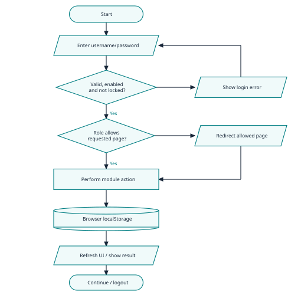
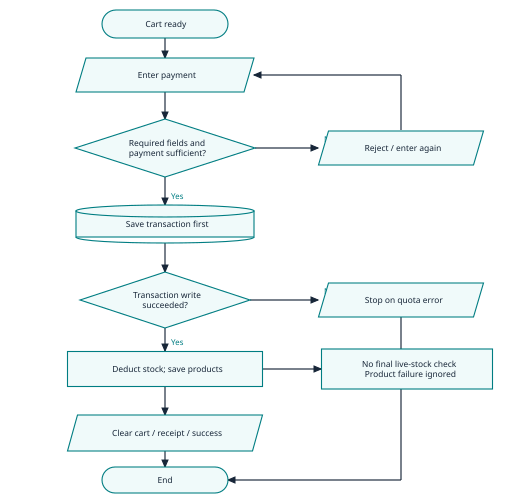
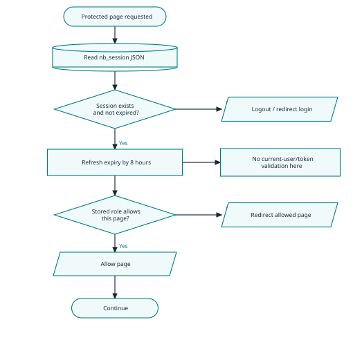

# NIGHTBABY
## Mock Defense Report | POS + Inventory Management
Standard combined review - source code + 40-page system documentation
Prepared 01 October 2026 | Taglish panel reviewer

### Panel brief
**Verdict: Usable academic prototype, pero may major transaction-integrity at security gaps bago gamitin sa actual retail operations.** May malinaw na modules at working core computations. Hindi sapat ang UI route guards para patunayan ang secure authorization, at hindi pa consistent ang sale, refund, stock, at backup lifecycle.

**Ano ang ginagawa:** Local desktop retail app para sa clothing at perfumes. Cashier ang nag-ca-cart, nagre-record ng Cash/GCash payment, gumagawa ng receipt, refund, at cash remittance. Admin ang nagma-manage ng stock, discounts, staff, at reports. Super Admin ang may account/system management. Customer screen ang nagpapakita ng current order at promotional content.

### Strengths na may evidence
- Connected ang POS, inventory, transaction history, dashboard, at customer display sa shared browser data.
- May insufficient-payment check, basic form validations, duplicate-username check, at refund status/history fields.
- Local ang Chart.js, jsPDF, at JsBarcode vendor files; walang kailangang bagong app dependency para sa review.
- Na-confirm sa isolated runtime ang ordinary cash sale at short-payment rejection.

### Unahin sa defense
1. **Sale at stock:** Walang final live-stock check o atomic commit; puwedeng hindi magtugma ang records.
2. **Refund money:** P100 list price ang nare-refund kahit P80 lang ang paid amount pagkatapos ng discount.
3. **Refund stock:** Automatic POS restock + pending Inventory stock-in = posibleng doble ang stock.
4. **Authorization:** Editable browser session ang authority; backend authorization claim ay hindi supported.
5. **Backup:** Hindi kasama ang remittances at refund-processing markers sa export key list.

**QA inventory:** 15 risk-based cases: 2 Passed, 11 Failed, 1 Not Run, 1 Blocked. Sa 13 executed checks, 12 ay isolated function/cross-module runtime at 1 ay source/config check. Kasama sa failures ang recommended-policy cases; hindi ito overall system score. Lahat ng 11 authored JS files ay pumasa sa syntax check.

**Evidence legend:** Confirmed = observed sa synthetic in-memory execution; Code-evidenced = exact source, walang browser reproduction; Assumption = reviewer reconstruction/policy; Not testable = kulang ang environment o hardware. Walang submitted source o business data na binago.
<!-- PAGE -->
## 1. System explained simply
**Data flow:** HTML controls -> JavaScript handlers -> browser localStorage -> updated UI/report. Walang backend API, database schema, o server authorization implementation sa supplied folder. Browser profile/origin ang practical data boundary; hindi ito shared online system sa magkakaibang computer. [R1]

### Actors at actual permissions
| Actor | Intended responsibility | Observed implementation / limit |
| Super Admin | Accounts, maintenance, backup/restore | access_control.js allows management pages and POS; pos.js has a conflicting raw-role check. |
| Admin | Dashboard, history, inventory, discounts, staff | Listed in page allowlist; may protections against assigning Super Admin. UI protections remain client-side. |
| Cashier | Sale, receipt, refund, remittance | POS page only; refund does not require separate manager approval. |
| Customer | Review current order | Public customer.html reads same-origin order snapshot; ads are fixed promotional slides. |

### Modules and stores
| Module | Responsibility | Persistent store |
| Products / Inventory | Add/edit/delete, stock, expiry, labels | nb_products; nb_refund_stock_done |
| POS / Transactions | Cart, tender, receipt, refunds | nb_transactions; nb_customer_display |
| Discounts / Dashboard | Date-based promotions; totals, alerts, PDF | nb_discounts; derived transaction/product data |
| Accounts / System | Users, preferences, maintenance, export/import | nb_users; nb_session; nb_settings; nb_login_attempts |
| Remittance | Cash turnover and differences | nb_remittances |

### Three critical use cases
**Sale - Cashier:** Preconditions: local session and available product. Main flow: select product, cart, compute discount/tax, enter payment, save sale, deduct stock, show receipt. Alternative: short payment is rejected. Exception: product write failure does not undo saved sale. Required postcondition: one sale corresponds to exactly one valid stock deduction.

**Refund - Cashier:** Preconditions: receipt exists and selected line is not marked refunded. Main flow: choose line/quantity/reason, split partial line or mark full line, restore stock, lower transaction total, save. Alternative: already-refunded line is rejected. Exception: discount/tax allocation and return disposition are incomplete. Required postcondition: cash reversal matches amount paid; sellable stock returns once.

**Backup/restore - Super Admin:** Export serializes selected browser keys to NBData; import decodes and writes entries after confirmation. Required postcondition: operational records reconcile after restoration. Current exception: incomplete key list and swallowed per-key errors can leave mixed data.

**Exact source locator convention:** File references below are relative to E:/DEFENSE nightbaby/1. pos_ims/ISO_nightbaby_pos_ims/. Line numbers refer to the supplied files reviewed on 01 October 2026. Document citations use physical PDF page numbers; printed page numbers are PDF page minus 2 after the front matter.
<!-- PAGE -->
## 2. Paper-to-system traceability
Paper: **NIGHTBABY POINT-OF-SALE AND INVENTORY MANAGEMENT SYSTEM**, Web System Technologies with JavaScript, AY 2026-2027. This is system documentation; no separate empirical evaluation or capstone research manuscript was supplied.

| Claim / PDF page | Actual evidence | Verdict and defense significance |
| Automate subtotal, total, change; pp. 6-7, 10 | pos.js:317-366, 442-537; T01-T02 | Implemented for basic cash path. Does not establish full financial correctness. |
| Centralized inventory; pp. 7-9 | global.js:61-68, 134-155; paper p.19 explicitly says no DB | Implemented within one browser origin/profile. Multi-device access is out of scope. |
| Backend authorization; p.8 | access_control.js:113-160; global.js:681-694 | Contradicted by browser-only authority. Paper pp.19,38 already acknowledge no server. |
| Salted and hashed passwords; p.8 | global.js:530-562; account_management.js:295-316 | Partial: SHA-256 path exists; reversible fallback and weak staff-password path weaken claim. |
| Low-stock / perfume-expiry alerts; pp.6-7,10,26 | dashboard.js:25-30, 149-210; inventory.js:35-59 | Code-evidenced implementation. Alert is different from preventing expired sales. |
| Discounts with duration/coverage; p.10 | discount.js:29-33, 82-113; pos.js:333-359 | Partial: promotion rules work in logic; per-product discount field is ignored by POS. |
| Backup and restore protect data; pp.8,10 | global.js:431; system_management.js:29-77 | Partial: export/import exists; operational keys omitted; restore correctness unverified. |
| Customer records and product browsing; pp.5,8-9 | customer.js:26-67, 104-155; no customer CRUD store found | Missing persistent customer-record module; browsing claim is broader than fixed ads/order display. |
| Refund and stock adjustment; pp.28,36 | pos.js:672-736; inventory.js:906-920,1088-1134 | Contradicted in end-to-end integrity: over-refund and duplicate-restock paths observed. |
| Admin backup access; p.18 vs p.9 | access_control.js:14-20; system_management.html:91-93 | Paper inconsistent: role description assigns backup to Super Admin; p.18 also assigns it to Admin. Actual Admin allowlist excludes system management. |
| Test required functions / all objectives achieved; pp.7,38 | Paper presents UI screenshots but no test-case results/acceptance dataset | Not verifiable as an acceptance claim; reviewer checks are separate evidence. |

### Diagram and paper consistency
Visually inspected design pages 12-18. They show login, role navigation, inventory, discounts, staff, POS, and export/import. Useful ang separation of actors, pero cashier flow omits refund/remittance and storage-failure recovery. Login diagram also does not show the five-attempt threshold before lockout. Extend diagrams to match actual exceptions rather than treating the drawn happy path as proof of correctness.

**Fair reading:** LocalStorage and desktop-only restrictions are explicit limitations, hindi automatic defects. Ang concern ay stronger security/completeness claims at operations na dapat consistent kahit local lang.
<!-- PAGE -->
## 3. Domain capability baseline and gap critique
Scope: single-location, browser-local clothing/perfume POS with cash and manually recorded e-wallet payments. Core = dependency of main sale flow or explicit requirement. Important = dependable operation practice. Optional = outside the stated prototype. Research [R1-R5] is a comparison aid, hindi legal certification.

| Capability / importance | Expected vs actual | Verdict / priority |
| Product catalog - Core, paper p.8 | CRUD/search/image/labels present. No durable stock-movement ledger. | Partial / Medium |
| Valid completed sale - Core, process dependency [R3] | Consistent receipt and product quantities. Two separate writes; no rollback. | Incorrect / High |
| Final stock availability - Core, integrity dependency | Recheck live stock at commit. Cart caches quantity; helper clamps shortages. | Incorrect / High |
| Returns/refunds - Core, claimed p.36; practice [R4] | Paid amount reversal plus chosen return disposition. Uses list price and automatic restock. | Incorrect / High |
| Inventory adjustments - Core, claimed p.10; [R5] | Reasoned receiving/count/loss movements. Adjust button depends on pending refunds; direct edit changes stock. | Partial / Medium |
| Roles and account revocation - Core, paper p.8; [R2] | Authority outside user-controlled data; disabled users lose access. Mutable session accepted. | Incorrect / High |
| Password protection - Core, paper p.8; [R6] | One-way password hashing and uniform creation rules. SHA-256, FAKE fallback, staff exception. | Incorrect / High |
| Discounts and consistent settings - Core, paper p.10 | Agreed pricing rule. Promotion store used; product discount and per-product threshold disconnected. | Partial / Medium |
| History/reports - Core, paper pp.7-8 | Filter/export and reconcile net sales. Functions exist; refund mutates original total and cannot reconcile discount/tax cleanly. | Partial / High |
| Expiry/low stock - Core for alerts, paper p.7 | Alerts visible. Expired products still eligible for sale; blocking policy not explicitly required. | Partial / Medium |
| Recovery / remittance - Important, explicit backup claim | Complete record export and verified restore; cash ledger preserved. Omitted remittance/processed-return keys. | Partial / High |
| Customer records - Core if p.8 retained | Persistent customer record lifecycle. No customer CRUD implementation located. | Missing / Medium |
| Online payments / multi-device / delivery - Optional | Paper explicitly excludes or defers these capabilities. Manual reference entry is not payment verification. | Out of scope |

**Research use:** [R1] supports browser storage boundaries. [R2,R6] support security controls. [R3] supplies the all-or-nothing transaction principle; PostgreSQL installation is not a requirement. [R4,R5] illustrate common return, restock, and adjustment workflows; enterprise features are not imported wholesale.

**Safe gap demonstration:** Use disposable synthetic data: stock 1, stale cart qty 5; P100 item sold at 20% discount; one refunded unit then Inventory stock-in; export key inspection. Panel focus: "Paano ninyo mapapatunayang pareho ang receipt, stock, refund amount, at recovery state pagkatapos ng bawat exception?"
<!-- PAGE -->
## 4. Overall system flow


**Actual flow, simplified from source.** Login validates local user credentials and enabled flag. Successful login writes a browser session, then role-based navigation selects the page. Product, sales, discount, account, and remittance handlers read/write localStorage; pages recalculate views from those records.

**Important boundary:** Route guards organize screens. They do not turn localStorage into a trusted authorization service. Customer display receives order snapshots through the same browser origin; it does not provide remote online stock synchronization.

**Decision/error paths:** Invalid/locked login stays at login. Disallowed page redirects. Allowed module action can still fail while writing. This last branch is inconsistent across helpers, so "success" on screen is not enough evidence that all data persisted.

**Mapping:** login.js:142-231; global.js:666-725; access_control.js:113-160; global.js:134-155,353-369. These charts are reconstructed from code, not copied from the paper. A cylinder means browser persistence, not a SQL database.
<!-- PAGE -->
## 5. Main transaction flow: sale and stock


**What works:** Payment below total is rejected before saving the transaction. Transaction-write quota errors return early. Ordinary cash checkout saves one sale and deducts one stock quantity in T01.

**Where it breaks:** confirmSale() does not recheck live stock before persistence. addToCart() validates against the product snapshot, so another tab or stock edit can make the cart stale. deductProductStock() clamps negative results to zero rather than rejecting insufficient stock.

**Storage failure:** Sale is saved first, products second. saveProducts() can return false and later retry image compression, but deductProductStock() ignores that result and returns true. T04 injected a product-only quota error: the sale remained saved, stock remained unchanged, and checkout emitted success. This confirms a function-level failure path, not an actual measured browser quota threshold.

**Desired postcondition:** Sale quantity must equal deducted quantity, and both persist together. If either operation fails, reject or recover consistently before displaying a completed receipt. Atomic means "all steps succeed together, or none become final." [R3]

**Mapping:** pos.js:257-285,442-537; global.js:134-155,270-285,353-369. No final stock validation or rollback node is shown because neither exists in this path.
<!-- PAGE -->
## 6. Riskiest security flow: browser session authority


**Actual security decision:** The app reads a JSON session from localStorage, checks expiresAt, refreshes it by eight hours, then trusts the stored role to decide page access. Token is generated/stored at login, but isSessionValid() does not validate token membership, current user existence, enabled status, or current stored role.

**Confirmed synthetic checks:** T07 used an unissued session with no token and no user record; system_management.html access passed. T08 used a disabled account with an unexpired session; the session still passed. These are local trust-boundary demonstrations, not remote network attacks.

**Business effect:** Someone controlling the browser's stored data can appear privileged, change local records, or preserve a disabled session. Browser-only authentication should be presented as a local prototype limitation. For stronger operational authorization, privileged decisions and persistent records need a trusted service or equivalent protected local authority. [R2]

**Additional route inconsistency:** ROLE_PERMISSIONS includes POS for super_admin, but pos.js calls loginRequired(['cashier','it']). requireAuth compares raw role values, and the POS caller ignores the returned boolean. Standardize role labels and stop handler initialization after failed access checks.

**Mapping:** global.js:657-694; access_control.js:4-27,113-202; pos.js:1-3. The threat model assumes local browser/storage access; no production access was attempted.
<!-- PAGE -->
## 7. Prioritized findings: security and checkout
### F01 | Browser session can claim privileged authority
**High | High confidence | Confirmed isolated runtime.** Problema: local role/expiry ang trusted identity, walang current-user or token verification. Saan: accounts/page guard. Safe reproduction: synthetic unissued session -> session validator -> system-management guard (T07); disabled session still accepted (T08). Expected: deny invalid/revoked identities. Actual: allowed. Effect: local privilege bypass and stale access. Ayusin: protect authority outside editable storage, revalidate current account, and honor guard return values. Verify: both cases denied. Panel: "Saan talaga ine-enforce ang permission?" Evidence: global.js:681-694; access_control.js:113-160; pos.js:2.

### F02 | Password protection has unsafe fallback and uneven rules
**High | High confidence | Confirmed fallback/staff runtime; other details code-evidenced.** Problema: crypto failure returns Base64-based FAKE value; Staff Management skips password strength validation. Safe test: disable crypto in isolated context (T09), create synthetic staff with one-character password (T12). Effect: recoverable fallback passwords and weaker staff accounts. Default setup only shows a reminder, not a required change. Ayusin: fail closed, use password-specific hashing, enforce same policy on every creation/reset path, mandatory default-password replacement. Verify: crypto failure/weak password rejected. Panel: "Ano ang behavior kapag unavailable ang crypto?" Evidence: global.js:458-472,530-562; account_management.js:295-316; login.js:187-197. [R6]

### F03 | Stale cart can sell more than current stock
**High | High confidence | Confirmed isolated runtime.** Problema: add-to-cart checks cached stock; final checkout does not validate current inventory. T03: qty 5 with live stock 1 -> five-unit sale, stock 0. Expected: reject shortage; actual: sale proceeds and shortage is hidden by clamping. Effect: receipts overstate fulfilled stock, inventory inaccurate. Ayusin: live quantity/product validation at commit, reject shortage, prevent concurrent lost updates. Verify: stale cart rejected without write. Panel: "Saan ang last stock check?" Evidence: pos.js:257-285,442-526; global.js:270-285.

### F04 | Sale and stock persistence can disagree
**High | High confidence | Confirmed injected failure.** Problema: independent writes plus ignored product-save result. T04: fail only nb_products write; sale stays saved, stock unchanged, success shown. Refund also restores before saving transaction; that failure path is code-evidenced only. Effect: unreliable sales/stock reconciliation. Ayusin: one coherent commit/recovery process and visible failure status; success only after durable completion. Verify: failure of either write leaves consistent pre-operation state. Panel: "Paano ninyo nire-recover ang half-saved transaction?" Evidence: pos.js:518-537,728-736; global.js:134-155,270-285. [R3]

### F05 | Refund uses list price, not the paid line value
**High | High confidence | Confirmed isolated runtime.** T05: P100 item with P20 discount, paid P80 -> refund P100, remaining total clamped to zero. Expected: reverse paid amount with correct discount/tax allocation. Actual: price x quantity, without allocation. Effect: over-refund and inconsistent revenue/tax totals. Ayusin: preserve original paid line amounts and link immutable refund entries. Verify: full and partial discounted/taxed returns reconcile to payment. Panel: "Paano kinukuha ang refundable amount?" Evidence: pos.js:682-685,730-736; sale fields:496-516.
<!-- PAGE -->
## 8. Prioritized findings: returns, recovery, product controls
### F06 | Refund and Inventory can restock the same unit twice
**High | High confidence | Confirmed cross-module runtime.** Problema: POS immediately restores stock, Inventory still labels refund as pending. T06: stock 0 -> refund restores 1 -> Inventory '+' adjustment -> stock 2. Expected: one inventory movement per return. Actual: two. Defective Item also restocks automatically; this may make damaged stock sellable. Ayusin: single owner for return disposition, sellable/quarantine distinction, duplicate protection. Verify: refund+adjust ends at stock 1 once. Panel: "Aling module ang final owner ng restock?" Evidence: pos.js:728; inventory.js:906-920,1088-1134.

### F07 | Backup omits operational state; import can partially apply
**High | High confidence | Key omission confirmed; restore path code-evidenced.** NB_DATA_KEYS lacks nb_remittances and nb_refund_stock_done. New-profile restore loses these; same-profile import may leave stale values. Import accepts arbitrary data keys and swallows write errors, yet reports imported. Safe reproduction: inspect key list (T10), then plan a synthetic fresh-profile roundtrip; no actual restore performed. Ayusin: complete allowlisted schema, validate all entries first, stage/rollback, exclude sessions, reconcile after restore. Verify: remittance totals and processed returns preserved; malformed/failed import changes nothing. Panel: "Paano pinapatunayang complete ang restored data?" Evidence: global.js:431; system_management.js:29-77.

### F08 | Product text is inserted into POS HTML without escaping
**High | High confidence in sink | Code-evidenced; browser exploit not run.** Problema: product name/category/subcategory and image are concatenated into innerHTML. Inventory and customer pages escape text in representative renderers, POS does not. Safe test: harmless product name '<b>DEMO</b>' in disposable profile; expect literal text, check whether markup appears (T14 Not Run). Effect: stored markup injection, potentially script-capable HTML accessing same-origin records. Ayusin: render text as text, validate image URLs, consistently escape attribute contexts. Verify: markup displays literally. Panel: "Bakit magkaiba ang rendering protection?" Evidence: pos.js:207-225; inventory.js:113-117; customer.js:39-42.

### F09 | Expiry alert does not prevent expired perfume sale
**Medium | High confidence | Confirmed checkout acceptance; policy assumed.** T13: expiration 2000-01-01 still accepts sale. Dashboard alert exists, but POS sellability checks stock only. Paper promises alerts, not an explicit sale prohibition; this is a recommended operational control, not a proven scope violation. Effect: cashier can miss expired stock. Ayusin: agree policy, quarantine expired stock or require documented override; make checkout enforce it. Verify: blocked/approved-override path works. Panel: "Alert lang ba o sales rule ang expiry?" Evidence: pos.js:195-205,257-285,442-526; dashboard.js:149-210.

### F10 | Product pricing/alert fields do not match consumers
**Medium | High confidence | Discount confirmed; threshold code-evidenced.** Inventory saves product.discount and lowStockAlert, but POS promotions read nb_discounts and POS badge uses fixed 10; Inventory status uses global threshold. T11: product discount 20% yields zero discount without promotion record. Effect: expected price/low-stock behavior may differ by screen. Ayusin: choose one documented pricing and threshold policy, connect consumers or remove misleading fields. Verify: same product price/stock status across pages. Panel: "Aling stored field ang source of truth?" Evidence: inventory.js:663-672,35-59; pos.js:197,333-359.
<!-- PAGE -->
## 9. Improvements, validation and process correctness
### Product/process roadmap
| Priority / current condition | Change and intended process | Benefit / observable success |
| High: uncertain sale persistence | Final availability check, one durable sale-stock commit, explicit recovery state | Failed write produces no completed receipt and no half-saved movement. |
| High: refund lifecycle overlaps | Return record linked to original sale; allocate paid price/tax; choose sellable or quarantine once | Refund never exceeds paid amount; stock changes once; original sale stays auditable. |
| High: editable identity | Protected account authority; revoke disabled sessions; consistent role matrix and password policy | Invalid/disabled identity denied; all role paths agree. |
| High: incomplete backup | Validated full business snapshot; preview/stage restore; preserve reconciliation state | Fresh-profile roundtrip matches stock, net sales, remittances and return markers. |
| Medium: weak stock movement history | Receiving, count correction, damage/loss with reason, actor, timestamp | Physical count differences trace to approved movements. |
| Medium: paper/UI scope mismatch | Clarify customer module, customer display, expiry policy and pricing rules | Requirement ledger matches implemented controls; no unsupported claims. |

### Validation coverage inventory
| Trust boundary | Existing control / missing control | Process verdict |
| Client inputs | Required name/category, nonnegative price/stock; username pattern, duplicates; payment sufficiency | Partial: no finite/integer stock checks; strength skipped on staff path. |
| Login/session | Enabled check at login, 5 failed attempts / 15-minute lockout, session expiry | Incorrect authority: editable storage, no active-account revocation. |
| Server/API | No server/API present; guards run in client | Not applicable to architecture; backend-authorization claim incorrect. |
| Database/persistence | JSON localStorage; helper exception handling | No DB constraints; sale/refund writes not atomic; bad JSON often becomes empty lists. |
| Business rules | Cart quantity check, promotion dates, refunded flag | Incorrect/partial: stale stock, paid-value refund, duplicate disposition. |
| Imports/HTML | NBData decoding/confirmation; some renderers escape | Partial: missing typed schema/allowlist/rollback; unescaped POS sink. |
| Reports/remittance | Summaries, exports, cash variance, transaction-ID lists | Partial: historical total mutation; name-based cash filtering; no receiving-admin approval record found. |

**Correct:** Basic cash checkout math and short-payment rejection in isolated tests. **Partial:** product lifecycle, promotion rules, reports, alerts, backup and remittance. **Incorrect:** security authority, stale-stock checkout, failure recovery, discounted refunds, double restock. **Blocked:** physical scanner/print/display acceptance. No complete-validation claim is made.

**Other boundary cases to verify:** fractional quantity, blank numeric values converting to zero, duplicate payment reference, refund after remittance, concurrent tabs, and malformed import. These are not recorded as executed tests.
<!-- PAGE -->
## 10. Important JavaScript and how the app uses it
No authored TypeScript was found. These are representative functions selected by business responsibility, not a line-by-line inventory.

| Function / location | Input -> output; side effect | User-visible purpose / call site |
| getProducts(), saveProducts(); global.js:61-68,134-155 | JSON arrays <-> nb_products; image compression retry on quota | Shared product persistence used by CRUD, sale deduction and restoration. |
| addToCart(); pos.js:257-290 | Product -> cart quantity update; caches name/price/stock | Product-card or scanner action updates cart UI; checks snapshot availability. |
| getCartDiscount(), getFinalTotal(); pos.js:333-366 | Cart + active promotion store -> discount/net+tax | Checkout totals use highest matching promotion; UTC date decides activity. |
| confirmSale(); pos.js:442-544 | Cart + tender -> transaction/receipt; saves then deducts | Confirm button completes sale, clears cart, refreshes views. |
| confirmRefund(); pos.js:672-742 | Receipt line, quantity, reason -> refund flags/split/total | Refund button restores stock, changes original transaction, shows status. |
| getPendingRefundedItems(); inventory.js:906-915 | Refunded lines - done markers -> pending list | Adjust Stock button and selectable return items; separate from automatic POS restock. |
| hashPassword(), verifyPassword(); global.js:538-562 | Password/salt -> SHA-256 or fallback; compares stored value | Login and account/reset flows; fallback is a material security weakness. |
| setSession(), isSessionValid(); global.js:666-694 | User -> local session; expiry refreshed | Login/navigation uses role and expiry from browser data. |
| enforceAccessControl(), requireAuth(); access_control.js:113-202 | Page/session/allowed roles -> boolean or redirect | Page guard and module checks; raw role comparison differs from normalization. |
| saveUser(); account_management.js:243-330 | Form -> account entry; writes nb_users | Shared account/staff form; policy changes with isStaffManagement. |
| renderDashboard(); dashboard.js:17-210 | Product/transaction arrays -> counts, alerts, top products | Admin sees stock/expiry alerts and net totals; changes are derived from mutable local records. |
| readSnapshot(); customer.js:26-37 | nb_customer_display -> normalized order object | Public display polls/listens for same-origin updates; scanner relay uses BroadcastChannel. |
| Backup/import handlers; system_management.js:29-77 | Keys -> encoded file; file -> browser entries | System buttons export/import NBData, not encrypted storage. |

**Panel explanation:** DOM events trigger these functions. JSON serialization turns arrays/objects into strings for localStorage; parsing restores objects. A successful handler must validate input, enforce role/business rules, persist consistently, and only then notify the user.
<!-- PAGE -->
## 11. Vibe-coding indicators: exact integration-risk evidence
These are implementation-risk signals only. **Hindi ito proof na AI ang author.** Confidence rates the visible inconsistency, not authorship. The excerpts are exact, short, and selected for impact.

### V01 - Security fallback silently changes the guarantee
Location: global.js:553-556 | Responsibility: hashPassword() | High confidence
```javascript
    } catch (cryptoErr) {
    }
    var fake = 'FAKE__' + salt + '__' + btoa(pw);
    return fake;
```
Ginagawang encoded value ang password kapag unavailable/failed ang crypto. Signal: happy-path compatibility fallback replaces a security requirement. Effect: reversible credentials in that environment; T09 confirms this branch.

### V02 - Shared form skips password validation for staff
Location: account_management.js:295-300 | Responsibility: saveUser() | High confidence
```javascript
        if (password && !isStaffManagement) {
            var passwordValidation = validatePasswordStrength(password);
            if (!passwordValidation.valid) {
                formError.textContent = passwordValidation.message;
                return;
            }
```
Same account data, different policy by page. Signal: reuse integrated with a silent validation exception. Effect: one-character staff password accepted in T12, although Account Management checks strength.

### V03 - Stock helper reports success regardless of persistence
Location: global.js:280-285 | Responsibility: deductProductStock() | High confidence
```javascript
                break;
            }
        }
    }
    saveProducts(products);
    return true;
```
Helper attempts product save but ignores returned failure. Signal: optimistic success result disconnected from persistence. Effect: checkout can announce completion while stock is unchanged (T04).

### V04 - Two modules own the same restock step
Locations: pos.js:728 and inventory.js:910-913 | Responsibilities: confirmRefund(), getPendingRefundedItems() | High confidence
```javascript
        restoreProductStock([{ id: liveItem.id, quantity: qtyToRefund }]);
```
```javascript
        for (var i = 0; i < all.length; i++) {
            var r = all[i];
            if (!done[refundItemKey(r)]) pending.push(r);
        }
```
POS restores immediately; Inventory only checks its separate done markers. Signal: independently built modules lack one lifecycle contract. Effect: the refunded item remains pending and can be restocked twice (T06).

### V05 - Saved product fields have disconnected consumers
Locations: inventory.js:668,671 and pos.js:197,336 | Responsibilities: product form, badge/pricing | High confidence
```javascript
                discount: discount,
```
```javascript
                lowStockAlert: alertEl ? Number(alertEl.value) || 10 : 10,
```
```javascript
            var lowStock = (!outOfStock && currentStock <= 10);
```
```javascript
            savedDiscounts = JSON.parse(localStorage.getItem('nb_discounts') || '[]');
```
Signal: form fields exist but downstream logic follows another rule/store. Effect: misleading discounts/alerts; T11 confirms the pricing disconnect. Map the fields to an agreed source of truth.
<!-- PAGE -->
## 12. QA summary and safe reproduction inventory
**15 selected cases | 2 Passed | 11 Failed | 1 Not Run | 1 Blocked.** Failed = expected control was not met, including two recommended product/policy expectations. Counts describe selected risks, not all functions or an ISO quality score.

Checks load the original global.js into Node VM with in-memory storage. Selected original POS/Inventory/account functions are executed with stubbed DOM/UI side effects. No submitted user data, backup, real browser profile, or production endpoint was changed. T10 inspects configuration; it is not a backup roundtrip test.

| ID / category | Synthetic steps and expected result | Actual / status |
| T01 Positive checkout | Stock 5, buy 1 @ P100, pay P100; sale 1, stock 4 | Sale 1 / stock 4 - Passed |
| T02 Negative payment | Same item, pay P99; no sale or deduction | Sale 0 / stock 5 - Passed |
| T03 Stale-stock boundary | Cart qty 5, live stock 1; reject before save | Sale qty 5 accepted, stock 0 - Failed |
| T04 Persistence failure | Inject quota failure for products only; keep sale/stock consistent | Sale saved, stock 5, success shown - Failed |
| T05 Financial refund | Paid P80 for P100 discounted item; refund P80 | Refunded P100 - Failed |
| T06 Integration return | Refund one unit, then Inventory '+1'; only one return | Stock 0 -> 1 -> 2 - Failed |
| T07 Authorization | Unissued session, no token/user; deny privileged page | Guard accepted - Failed |
| T08 Revocation | Disabled stored account, unexpired session; deny | Session accepted - Failed |
| T09 Crypto boundary | Crypto unavailable; stop credential operation | Reversible FAKE value - Failed |
| T10 Recovery config | Inspect export keys for business state | Two operational keys omitted - Failed |
| T11 Pricing integration | Product discount 20%, no promotion; honor/remove field | POS discount 0 - Failed |
| T12 Input security | Staff password 'a'; reject weak password | Account saved - Failed |
| T13 Sellability policy | Perfume expired in 2000; recommended block | Checkout accepted - Failed |
| T14 Rendering security | Harmless '<b>DEMO</b>' product name; literal display | Sink found; browser test Not Run |
| T15 Hardware acceptance | Scanner + physical print + second screen | Peripherals unavailable - Blocked |

**Runnable evidence:** checks.cjs is a diagnostic harness: assertions verify the observed behavior, including known failures. Exit zero means observations matched, not that the application passed every business rule. All 11 authored JavaScript syntax checks passed separately.

**Next verification after remediation:** rerun these controls, add actual fresh-profile backup roundtrip and two-tab concurrent checkout, then run cashier/admin acceptance with barcode scanner and receipt printer. Do not use customer/business records for destructive demonstrations.
<!-- PAGE -->
## 13. Five strongest panel questions
### 1. Sale atomicity and stock integrity
**Ask:** "Kapag nabawasan na ang live stock sa ibang tab, o pumalya ang stock save, paano ninyo maiiwasan ang completed receipt na mali ang quantity?"
**Why:** T03-T04 show independent failure paths. **Strong answer:** Explain cached vs live stock, final validation, one commit/recovery boundary, and verify both records together. **Follow-up:** Trace confirmSale -> addTransaction -> deductProductStock and explain the false save result. **Red flag:** "Hindi naman mangyayari" or UI refresh as the only remedy.

### 2. Refund financial logic
**Ask:** "P100 ang price pero P80 ang binayaran after discount. Magkano dapat ang refund, at paano kung partial o may tax?"
**Why:** T05 observed P100 refund. **Strong answer:** Use original paid line allocations, reversible discount/tax, remaining refundable balance and linked return record; distinguish refund from gross list price. **Follow-up:** Which fields preserve original totals after liveTx.total changes? **Red flag:** Clamping total to zero described as financial correction.

### 3. Ownership of return stock
**Ask:** "Bakit nire-restock na sa POS pero pending pa rin sa Inventory? Ano ang gagawin sa defective item?"
**Why:** T06 demonstrates duplication. **Strong answer:** One restock owner, return disposition, quarantine/sellable choice, duplicate-safe reference to original return. **Follow-up:** Show stock 0 -> 1 and why Inventory cannot make it 2. **Red flag:** Always adding stock regardless of reason, or expecting staff to remember the workaround.

### 4. Actual authorization and JavaScript security
**Ask:** "Kung browser data lang ang role/token, ano ang tunay na security boundary at paano mare-revoke ang disabled account?"
**Why:** Backend claim conflicts with architecture; T07-T09 expose authority and fallback weaknesses. **Strong answer:** Acknowledge prototype boundary, explain trusted authorization, current-account checks, fail-closed password handling and uniform staff policy. **Follow-up:** Why is token stored but not checked in isSessionValid? **Red flag:** Hashing, hidden navigation, or redirect treated as sufficient authorization.

### 5. Evidence that backup/restore is complete
**Ask:** "Paano ninyo mapapatunayan na complete ang NBData backup sa bagong profile, kasama ang cash remittances at processed returns?"
**Why:** T10 key omission; import errors swallowed. **Strong answer:** Inventory of business keys, schema/version validation, staged restore, no active-session import, and reconciliation of totals/markers. **Follow-up:** What if one setItem fails halfway? **Red flag:** Download success, Base64 encoding, or a reload cited as proof of complete recovery.

**Answer guidance is a reviewer aid, hindi script para itago ang gaps.** Mas credible ang pag-acknowledge ng observed issue, clear proposed process, at demonstrable corrected test result kaysa broad claim na "secure" o "fully tested."
<!-- PAGE -->
## 14. Coverage, assumptions, limitations and sources
### What was inspected
108 submitted files inventoried and fingerprinted; risk-focused reading of all 11 authored JS files by function, related HTML role/forms/script entry points, and relevant paper sections. Vendor libraries, images, fonts, JSON fixtures and existing NBData were inventoried; vendor internals and backup credential contents were not audited/copied. No tests/build scripts or backend implementation found in supplied source inventory.

The 40-page paper was extracted once. Scope/objectives/roles/process/security/backup claims and relevant UI descriptions were compared with code; design diagrams on physical PDF pages 12-18 were visually reviewed. Screenshots in the paper are historical documentation, not current runtime results.

### Limits that affect conclusions
- **Confirmed runtime is limited:** original functions executed in synthetic VM, UI methods stubbed. No full browser login/navigation, DOM script execution, report export, browser-quota capacity, or native hardware acceptance run.
- **Untested:** real fresh-profile import/export, multi-tab simultaneous writes, refund after cash turnover, invalid-file rollback, print layout, physical scanner, monitor focus and delivery behavior. These remain code-evidenced risks or verification proposals.
- **Assumptions:** Single local desktop/branch based on paper p.9. Expired-product blocking is recommended policy, not a promised rule. Customer-record requirement may be outdated wording; clarify rather than silently invent a CRM module.
- **Security threat model:** user/browser storage access or malicious same-origin content. No remote production compromise was attempted or claimed.
- **No legal/ISO certification:** Filipino setting is documented, but this report makes no tax-invoice, privacy-law, or regulatory-compliance verdict. "ISO" in folder name does not establish certified quality. Hardware sizing in the paper was not benchmarked.
- **AI authorship:** cannot be inferred from these patterns. Vibe indicators measure integration risk only.

### Research sources (accessed 01 October 2026)
**R1 - MDN, Web Storage API.** Origin-based browser storage and behavior. https://developer.mozilla.org/en-US/docs/Web/API/Web_Storage_API

**R2 - OWASP, Authorization Cheat Sheet.** Permission validation at trusted boundaries. https://cheatsheetseries.owasp.org/cheatsheets/Authorization_Cheat_Sheet.html

**R3 - PostgreSQL 18 tutorial, Transactions.** Atomic all-or-nothing principle; used as a design concept, not a prescribed stack. https://www.postgresql.org/docs/18/tutorial-transactions.html

**R4 - Shopify Help, Creating returns and exchanges.** Return lifecycle and restocking/refund choices as common operational practice. https://help.shopify.com/en/manual/fulfillment/managing-orders/returns/creating-returns

**R5 - Shopify Help, Managing inventory.** Tracking stock and adjustment history. https://help.shopify.com/en/manual/products/inventory

**R6 - OWASP, Password Storage Cheat Sheet.** Adaptive password hashing; fast SHA-256 is not suitable password storage by itself. https://cheatsheetseries.owasp.org/cheatsheets/Password_Storage_Cheat_Sheet.html

**Evidence retention:** Canonical report source, editable/rendered charts, synthetic results, syntax checks and source fingerprints are saved under workspace analysis. Source is read-only; none of the proposed fixes were applied.
