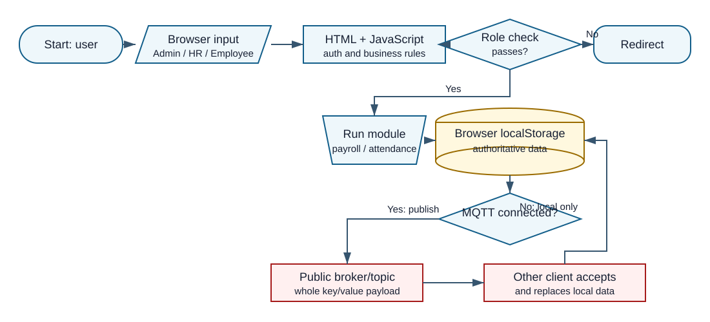
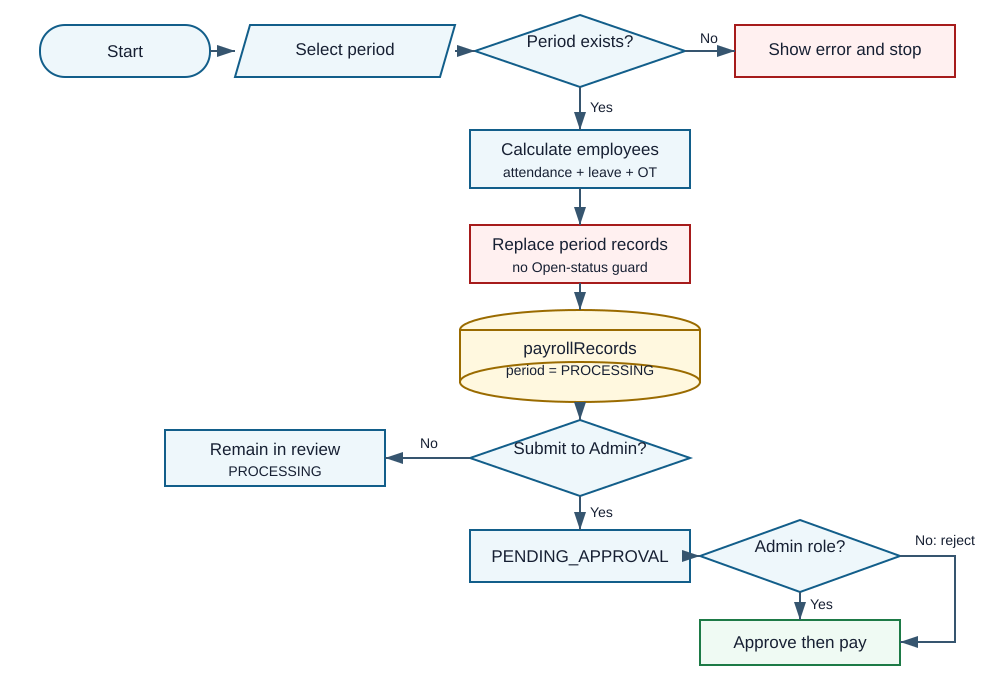
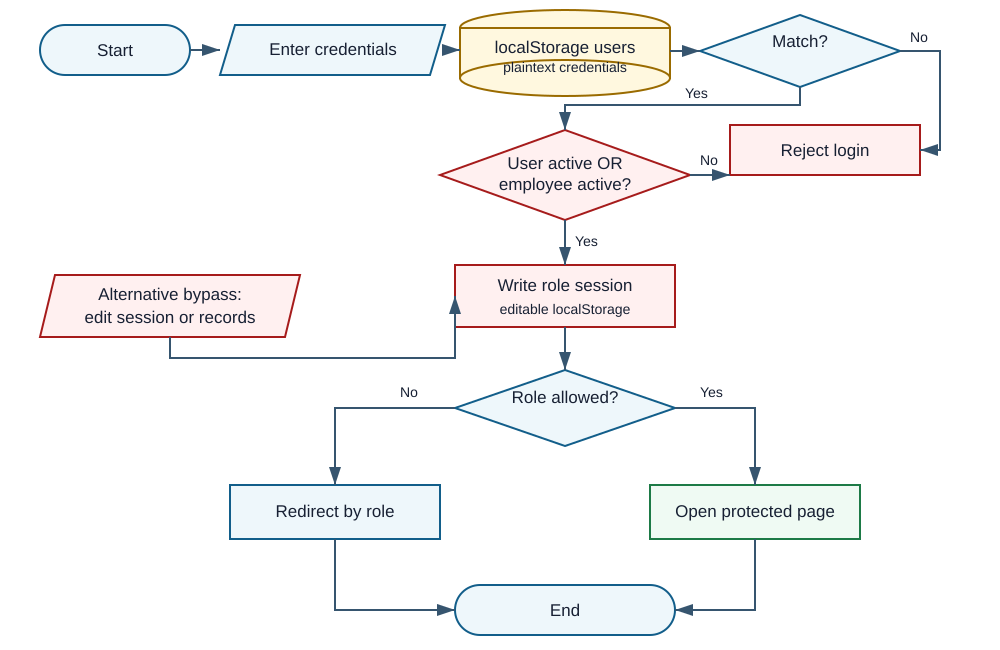

# Likha Apparel Payroll and GPS Attendance System

# One-Page Panel Brief

**Review date:** September 29, 2026  
**Mode/source:** Standard, system-only | `F:\MOCK\payroll new`

## Ano ang system?

Isang browser-based prototype para sa Admin, HR, at Employee. Sakop nito ang employee records, GPS attendance, leave, overtime, payroll computation, approval, payslips, payments, reports, notifications, at activity logs. Walang backend server o database sa submission; ang browser `localStorage` ang pangunahing data store at client-side JavaScript ang gumagawa ng authentication at business rules.

## Readiness verdict

> **Hindi production-ready.** Gumagana ang maraming UI flow at pasado sa syntax check ang lahat ng 23 JavaScript files, pero ang security at payroll integrity ay nakaasa lamang sa browser. May confirmed defects sa disabled-account login, undertime/absence deductions, at attendance-leave overlap.

## Strengths

- Malinaw ang role-oriented pages at may kumpletong prototype journey mula attendance hanggang payslip.
- May reusable `Storage`, `Auth`, `Utils`, at `PayrollCalculator` modules.
- May escaping helper at ginagamit ito sa ilang high-risk UI outputs.
- May payroll approval state, duplicate-payment check, leave/overtime approval, at audit-style activity records.

## Top five risks

| Priority | Risk | Bakit mahalaga |
|---|---|---|
| 1 | Public MQTT topic can receive and broadcast storage updates | Payroll, users, at attendance can be exposed or replaced by another connected client. |
| 2 | Browser storage is the authority | A user can edit role, salary, attendance, approval, or payment data through browser tools. |
| 3 | Inactive account can still log in | Confirmed when the linked employee remains Active. |
| 4 | Enabled absence/undertime deductions are not applied | Confirmed zero deductions even with missing days and 60-minute undertime. |
| 5 | Attendance plus approved leave double-counts one day | Confirmed 12 paid days in an 11-working-day period. |

## QA snapshot

**12 tests:** 1 Passed, 4 Failed, 2 Blocked, 5 Not Run. Detailed evidence appears in the QA section.

**Decision for defense:** Ipresent bilang functional prototype, hindi secured production payroll system.

# System Explained Simply

## Actors and modules

| Actor | Implemented access | Main activities |
|---|---|---|
| Admin | `/admin/` pages | Full employee, payroll, payment, user, settings, report, and log functions |
| HR | `/hr/` pages | Employees, attendance, leave, overtime, payroll preparation/review, payslips, reports |
| Employee | `/employee/` pages | GPS attendance, leave request, overtime request, payslip, profile |

## Technology and data movement

- **UI:** 35 static HTML files and 9 CSS files.
- **Logic:** 23 plain JavaScript files; no framework or build step was supplied.
- **Persistence:** `localStorage` through `js/storage.js`.
- **Authentication:** plaintext user lookup and session objects in `localStorage` through `js/auth.js`.
- **Realtime sync:** Paho MQTT over `broker.emqx.io`, topic `likha_apparel/thesis/storage_sync`.
- **External UI libraries:** CDN-hosted Font Awesome, Leaflet, jQuery, Moment, date-range picker, and Flatpickr depending on page.
- **Server/database:** none supplied and therefore not verifiable.

## Reconstructed intended process

1. Admin or HR creates employees and accounts; employees record GPS attendance and requests.
2. Admin or HR approves leave/overtime; HR prepares and submits payroll.
3. Admin approves and pays; employee views the approved payslip.

This process is inferred from UI labels and code because no capstone paper or requirements document was supplied.

## Role and permission matrix

| Capability | Admin | HR | Employee | Evidence |
|---|---:|---:|---:|---|
| Manage users/settings/payments | Yes | No | No | Explicit `Auth.protectRoute(['admin'])` on Admin pages |
| Manage employees/attendance/leave/overtime | Yes | Yes | Self-service only | Admin/HR pages plus employee-specific filtering |
| Prepare payroll | Yes | Yes | No | HR payroll pages allow `['hr','admin']` |
| Final payroll approval | Yes | No | No | `payroll.js:466-493` checks role `admin` |
| View own approved payslip | N/A | N/A | Yes | `employee-payslip.js:3-12` filters employee and approved/paid period |

# Essential Flowcharts

## 1. Actual overall architecture



Ang browser ang parehong UI, application server, at database. Every `Storage.setData` can also publish the whole value to a shared MQTT topic. Walang server-side authorization or authoritative validation layer sa submission. Evidence: `storage.js:14-19,74-91`; `sync.js:1-12,21-28,57-75`.

## 2. Payroll transaction



May sensible HR-to-Admin approval concept, pero client-side only ang state transitions. `executeRunPayroll` also accepts a supplied period ID without verifying that the period is still Open, so a direct call can recompute and replace an approved period. Evidence: `payroll.js:48-103,449-497`.

## 3. Authentication and authorization risk



The intended path checks credentials and role, but the actual trust boundary is editable `localStorage`. The active-state test also uses OR, so an inactive user linked to an active employee was accepted in the local runtime check. Evidence: `auth.js:38-74,95-118`.

# Top Findings

## F-01 - Public sync plus browser-authoritative data breaks the trust boundary

**Severity:** Critical | **Confidence:** High | **Evidence:** Code-evidenced  
**Problema/Saan:** Roles, sessions, salary, payroll, attendance, and logs live in editable `localStorage`; every write may also go to one hard-coded public MQTT topic, and incoming key/value messages are trusted.  
**Paano mabubutas:** Edit browser storage or publish a shaped `STORAGE_UPDATE`. The external publish was intentionally not tested.  
**Expected vs Actual:** Authenticated server/database vs editable client state plus `broker.emqx.io`.  
**Effect:** Full confidentiality, integrity, approval, and audit bypass.  
**Ayusin/verify:** Authenticated backend, server authorization, database constraints, append-only audit, private broker ACLs. Browser edits and unauthorized broker clients must have zero authority.  
**Evidence:** `auth.js:16-21,60-72,95-118`; `storage.js:4-68,74-91`; `sync.js:1-12,21-28,45-75`.

## F-02 - Disabled account remains usable when employee is Active

**Severity:** High | **Confidence:** High | **Evidence:** Confirmed local runtime  
**Problema/repro:** `userIsActive || employeeIsActive` accepted an Inactive user linked to an Active employee in an isolated runtime test.  
**Expected vs Actual:** Both eligible vs either eligible. **Effect:** suspension does not revoke access.  
**Ayusin/verify:** Require both checks and revalidate sessions; the same negative test must reject. **Evidence:** `auth.js:42-53`.

## F-03 - Enabled undertime and absence deductions are silently ignored

**Severity:** High | **Confidence:** High | **Evidence:** Confirmed local runtime  
**Problema/repro:** With all flags enabled, one present day, 60-minute undertime, and ten absences produced undertime `0` and absence `0`.  
**Effect:** Net pay is overstated. **Ayusin/verify:** Implement approved formulas and rerun the golden case.  
**Evidence:** `seed.js:23-32`; `payroll-calculator.js:201-225`.

## F-04 - Attendance and approved leave can double-count one workday

**Severity:** High | **Confidence:** High | **Evidence:** Confirmed local runtime  
**Problema/repro:** One attendance day plus overlapping approved leave produced 12 paid days in an 11-workday period and PHP 12,000 at PHP 1,000/day.  
**Effect:** Inflated gross pay. **Ayusin/verify:** Use one mutually exclusive state per employee-day; overlap must count once or become an exception.  
**Evidence:** `payroll-calculator.js:143-179,181-187`.

## F-05 - Payroll can be recomputed after approval and existing records are replaced

**Severity:** High | **Confidence:** High | **Evidence:** Code-evidenced  
**Problema/bypass:** `executeRunPayroll(targetPid)` never requires Open status; it replaces records and resets the period to PROCESSING.  
**Effect:** Approved values can be invalidated. **Ayusin/verify:** Server state machine, idempotency, explicit void/reopen; APPROVED/PAID rerun must fail and log.  
**Evidence:** `payroll.js:48-103`.

## F-06 - Leave approval can go negative or deduct repeatedly

**Severity:** High | **Confidence:** High | **Evidence:** Code-evidenced  
**Problema:** A confirm dialog permits insufficient balance, and no status guard prevents repeated approval. Payroll treats all approved leave as paid.  
**Effect:** Negative/repeated balance deductions and wrong pay. **Ayusin/verify:** Paid/unpaid policy plus idempotent approval; repeat must not change balance.  
**Evidence:** `leave.js:115-161`; `payroll-calculator.js:121-124,164-176`.

## F-07 - Employee schema drifts between seeded and newly created records

**Severity:** Medium | **Confidence:** High | **Evidence:** Code-evidenced  
**Problema:** Seed uses `departmentId`/`positionId`; add/edit stores `department`/`position`; payroll reads only IDs.  
**Effect:** New employees show `N/A` or miss filters. **Ayusin/verify:** One schema plus migration; new records must resolve across every page.  
**Evidence:** `seed.js:64-89`; `employees.js:531-545`; `payroll.js:280-287`.

## F-08 - GPS auto-timeout fires when the user leaves the geofence

**Severity:** Medium | **Confidence:** High | **Evidence:** Code-evidenced  
**Problema:** Any exit after time-in triggers time-out; client coordinates are trusted. **Effect:** Premature checkout, wrong undertime, spoofing risk.  
**Ayusin/verify:** Explicit or sustained-exit checkout, accuracy and server checks; brief drift must not end a shift.  
**Evidence:** `gps-attendance.js:78-103,122-171,225-269`.

## F-09 - Report tables render stored data without escaping

**Severity:** Medium | **Confidence:** High | **Evidence:** Code-evidenced  
**Problema:** Stored employee/leave values go directly to report `innerHTML` although an escape helper exists.  
**Effect:** Crafted data can execute markup/script. **Ayusin/verify:** `textContent` or consistent escaping; payload must render literally.  
**Evidence:** `reports.js:441-443,489-493,543-546`; `utils.js:82-93`.

**Lower-priority confirmed UI issue:** HR dashboard links to missing `hr/activity-logs.html`, and "Forgot password?" points to `#` (`hr/dashboard.html:87,312`; `login.html:53`).

# Recommended System Improvements

| Priority | Current condition | Add or change | Intended process | Benefit | Success indicator |
|---|---|---|---|---|---|
| Critical | Browser is database and authority | Authenticated backend API plus relational database | Client requests; server authorizes, validates, commits | Confidentiality and integrity | Browser edits cannot alter records or roles |
| Critical | Public shared MQTT topic | Remove it or use private tenant topics with broker ACLs | Server publishes approved events only | Prevents disclosure/tampering | Unauthorized subscribe/publish is denied |
| High | Weak account lifecycle | Hashed passwords, lockout/rate limit, secure reset, session expiry, revoke on disable | All access rechecks account status | Reliable access revocation | Disabled user is rejected immediately |
| High | Payroll rules are incomplete | Versioned payroll policy with date-effective rates and reviewed formulas | Calculator selects policy by pay period | Auditable correct payroll | Golden test cases match approved manual computation |
| High | Days can overlap | Daily attendance/leave reconciliation and exception queue | One payable state per employee-day | Stops double counting | No period has duplicate payable day |
| High | Mutable workflow | State machine with submit, approve, pay, void, reopen controls | Every transition has actor, timestamp, reason | Protects approvals | Illegal transitions fail and are logged |
| Medium | Logs are editable local data | Append-only audit log and backup/recovery | Every sensitive mutation creates immutable evidence | Accountability and recovery | Admin cannot edit past audit events |
| Medium | Field names drift | Canonical schema and data migration | All modules read/write same keys | Fewer N/A and filter errors | Cross-module contract tests pass |

# Validation and Process Correctness

## Trust-boundary matrix

| Boundary | Present control | Missing or weak control | Verdict |
|---|---|---|---|
| Login UI | Required fields, generic failure message | Plaintext passwords, no throttling, flawed active check | Incorrect for real use |
| Authorization | Page-level role checks | Client-side only; editable session | Prototype-only |
| Employee input | Some required fields, duplicate username/ID checks | No server validation, weak password policy, schema drift | Partial |
| Attendance | Geofence distance and duplicate current-day lookup | GPS spoof resistance, accuracy threshold, sustained exit, server timestamp | Partial |
| Leave | Start not after end | Overlap, balance enforcement, duplicate approval, paid/unpaid rule | Partial |
| Overtime | Required fields and positive same-day duration | Maximum hours, overlap, attendance reconciliation, overnight shift | Partial |
| Payroll period | Required dates | Start/end order, overlap, pay-date rule, immutable approval | Incorrect |
| Payroll math | Rounding and itemized outputs | Missing deductions, overlap reconciliation, date-effective statutory rules | Incorrect |
| Payment | Exact amount and duplicate payment check | Server transaction, reversal, reference requirement | Partial |
| Database | None supplied | Constraints, transactions, backups, concurrency | Not testable / absent |

## Critical use cases

| Use case | Preconditions | Main flow | Exception/postcondition | Correctness |
|---|---|---|---|---|
| Employee login | User and employee records exist | Match username/ID and password; save session | Reject inactive account | **Incorrect:** OR active check |
| GPS attendance | Employee session and permission | Track GPS; time-in inside; time-out outside | Show GPS error | **Partial:** automatic exit is risky |
| Leave approval | Pending request | Review balance; approve; deduct | Reject or insufficient balance | **Incorrect:** negative/repeat allowed |
| Payroll run | Open period and clean daily ledger | Calculate each active employee; save Pending records | Prevent rerun of approved/paid | **Incorrect:** no state guard |
| Payroll approval/payment | HR submits; Admin approves | Approved records become payable; mark paid | Prevent duplicate; controlled reversal | **Partial:** duplicate check exists, reversal absent |

# Important JavaScript Functions

| Function | Inputs / outputs | Side effects | User-visible effect |
|---|---|---|---|
| `Auth.login` (`auth.js:38-75`) | Username, password, portal; result object | Writes a session to localStorage | Logs user in or returns error |
| `Auth.requireAuth` (`auth.js:95-121`) | Allowed roles; Boolean | Redirects on missing/wrong role | Protects page navigation, client-side only |
| `Storage.setData` (`storage.js:14-24`) | Key and value; Boolean | Writes localStorage and may broadcast | Persists nearly all system actions |
| `Sync.handleStorageUpdate` (`sync.js:70-168`) | Remote key/value | Replaces localStorage and rerenders modules | Other browsers change in realtime |
| `GPSAttendance.evaluateAutoAttendance` (`gps-attendance.js:106-175`) | Coordinates | May create or close attendance | Automatic time-in/out |
| `EmployeeLeave.submitRequest` (`employee-leave.js:60-88`) | Form fields | Inserts Pending leave | Employee sees request in history |
| `LeaveModule.updateStatus` (`leave.js:115-170`) | Request ID/status | Updates balance, request, log | HR/Admin approves or rejects leave |
| `PayrollCalculator.calculateEmployeePayroll` (`payroll-calculator.js:110-255`) | Employee and period | Reads attendance/leave/overtime/settings | Produces earnings, deductions, net pay |
| `PayrollModule.executeRunPayroll` (`payroll.js:48-104`) | Period ID | Replaces period records and changes state | Generates payroll review list |
| `PayrollModule.approvePayroll` (`payroll.js:466-498`) | Selected period | Marks period/records approved | Releases payslips/payment stage |
| `PaymentModule.processPayment` (`payments.js:83-155`) | Payroll ID, amount, method | Inserts payment, marks paid, notifies | Records payment with duplicate check |

# Vibe-Coding Risk Indicators

These are observable implementation-risk signals, not proof that AI authored the system.

## V-01 - Demo-wide public sync with no trust boundary

**Location:** `sync.js:1-12,21-28` | **Responsibility:** realtime storage sync | **Confidence:** High

```js
topic: 'likha_apparel/thesis/storage_sync',
Sync.client = new Paho.MQTT.Client('broker.emqx.io', 8084, '/mqtt', Sync.clientId);
```

**What/signal/effect:** Generic public topic drives storage sync - demo convenience mixed with sensitive data, creating cross-client disclosure/tampering risk.

## V-02 - Inconsistent eligibility expression

**Location:** `auth.js:47-53` | **Responsibility:** `Auth.login` | **Confidence:** High

```js
return (matchesUsername || matchesEmployeeId) &&
    u.password === password.trim() && (userIsActive || employeeIsActive);
```

**What/signal/effect:** OR defeats suspension - happy-path logic without offboarding coverage; inactive-user login was confirmed.

## V-03 - Configured deductions overwritten by placeholders

**Location:** `payroll-calculator.js:201-225` | **Responsibility:** payroll deductions | **Confidence:** High

```js
let undertimeDeduction = 0;
let absenceDeduction = 0;
absenceDeduction = 0;
```

**What/signal/effect:** Two advertised settings never affect output - partially wired feature; net pay overstatement was confirmed.

## V-04 - Password change writes data that authentication never reads

**Location:** `employee-profile.js:63-79` | **Responsibility:** employee password change | **Confidence:** High

```js
if (employee.password !== currPass) return;
window.Storage.setData('employees', allEmployees);
window.Storage.setData('activeUser', activeUser);
```

**What/signal/effect:** Auth reads `users` and named sessions, not these targets - incomplete integration; employee password change is disconnected from login.

# QA Summary

| ID | Module | Category | Test | Expected | Actual / status |
|---|---|---|---|---|---|
| QA-01 | All JS | Static | Run `node --check` on 23 files | No syntax errors | **Passed:** all 23 passed |
| QA-02 | Navigation | Integration | Resolve all local HTML `src`/`href` targets | Zero missing | **Failed:** `hr/activity-logs.html` missing |
| QA-03 | Auth | Negative | Inactive user + active employee + valid password | Reject | **Failed:** login succeeded |
| QA-04 | Payroll | Business rule | 60-minute undertime and 10 absences with deductions enabled | Nonzero policy deductions | **Failed:** both zero |
| QA-05 | Payroll | Integration | Attendance day overlaps approved leave | Count day once | **Failed:** 12 paid days vs 11 workdays |
| QA-06 | Auth | Security | Modify session role in browser storage | No privilege change | **Not Run:** architecture shows no server guard |
| QA-07 | Sync | Security | Unauthorized MQTT subscribe/publish | Denied | **Blocked:** no destructive third-party test authorized |
| QA-08 | Payroll | State | Recompute APPROVED period | Reject and audit | **Not Run:** direct code path has no status guard |
| QA-09 | Leave | Boundary | Approve same request twice | Idempotent, one deduction | **Not Run:** no guard found |
| QA-10 | Employee profile | Functional | Change password then relogin | New password works, old fails | **Not Run:** data path mismatch found |
| QA-11 | GPS | Boundary | Brief GPS drift outside radius | No time-out | **Blocked:** hardware/location simulation not performed |
| QA-12 | Reports | Security | Render stored HTML payload as employee name | Display text only | **Not Run:** unescaped `innerHTML` sink found |

Priority regression pack after remediation: QA-03, QA-04, QA-05, QA-06, QA-07, QA-08, QA-09, QA-10, QA-11, and QA-12.

# Five Strongest Panel Questions

## 1. Ano ang tunay na security boundary kung editable ang localStorage?

**Why ask:** Core architecture issue.  
**Strong answer:** Prototype-only ang local storage; explain backend API, database, server session, and endpoint authorization.  
**Follow-up:** Paano pipigilan ang user na gawing Admin ang sariling session?  
**Red flag:** "Hidden naman sa UI" or "Hindi alam ng user ang developer tools."

## 2. Paano ninyo pinatunayan na tama ang payroll formula sa overlap ng attendance, leave, at overtime?

**Why ask:** Confirmed double counting and missing deductions.  
**Strong answer:** One employee-day ledger, precedence rules, approved policy, golden cases, and reconciliation.  
**Follow-up:** Bakit naging 12 paid days ang 11-workday test period?  
**Red flag:** Pure demo only, no manual expected result or test data.

## 3. Bakit nakaka-login ang inactive user kapag active pa ang linked employee?

**Why ask:** Directly tests understanding of Boolean logic and offboarding.  
**Strong answer:** Identify the OR bug, require both active checks, and revalidate sessions.  
**Follow-up:** Ano ang mangyayari sa already logged-in session after disabling the account?  
**Red flag:** Password change lang ang proposed fix.

## 4. Sino ang puwedeng mag-publish sa MQTT topic at anong keys ang puwedeng palitan?

**Why ask:** Largest confidentiality and integrity exposure.  
**Strong answer:** No demonstrated ACL/allowlist; remove client data sync or secure broker/server events.  
**Follow-up:** Kasama ba ang `users`, passwords, at payroll records sa `Storage.setData` broadcast?  
**Red flag:** "Random ang client ID" as proof of authorization.

## 5. Paano ninyo poprotektahan ang approved payroll laban sa recompute, edit, at reversal?

**Why ask:** Payroll approval must be durable.  
**Strong answer:** Server state machine, immutable snapshot, idempotency, maker-checker, controlled void/reopen, audit.  
**Follow-up:** Anong guard sa approved period? **Red flag:** Confirmation dialog lang.

# Coverage, Assumptions, Limitations, and Evidence

## Confirmed runtime/static results

- All 23 JavaScript files passed `node --check`.
- Local link scan found one missing target: `F:\MOCK\payroll new\hr\activity-logs.html`.
- Isolated Auth test confirmed login success for an Inactive user linked to an Active employee.
- Isolated PayrollCalculator test confirmed zero undertime/absence deductions despite enabled flags.
- Isolated PayrollCalculator test confirmed attendance plus overlapping approved leave produced 12 paid days in an 11-workday period.

## Code-evidenced observations

- Public MQTT configuration and unauthenticated broad storage replacement.
- Client-side-only sessions, authorization, data, approvals, and logs.
- Payroll rerun state bypass, repeated/negative leave approval, schema drift, password-flow mismatch, GPS exit behavior, and unescaped report sinks.

## Assumptions

- The intended HR-to-Admin flow is inferred from pages and state labels.
- All approved leave is treated as paid because the calculator adds all approved leave to paid days; no policy document was supplied.
- This is assessed as a prototype, not as a deployed production installation.

## Not testable or intentionally not tested

- No capstone paper, database schema, backend API, deployment configuration, or automated test suite was supplied.
- No live public MQTT subscribe/publish test was performed because that would target a third-party service and could affect other clients.
- No production accounts, real employee data, hardware GPS, concurrency load, backup restore, or legal payroll certification was tested.
- Statutory deduction constants were reviewed as hard-coded and unversioned; their legal correctness for a specific pay date was not asserted.

## Evidence inventory

Source inventory: 69 files total - 35 HTML, 23 JavaScript, 9 CSS, 2 images. Analysis artifacts were created outside the submitted app and were excluded from review. The submission remained read-only.

**Bottom line:** Malawak ang prototype coverage and presentable ang interface flow, pero kailangan muna ng secure backend, authoritative database, corrected payroll calendar logic, and regression tests before any real payroll or employee data can be trusted.
