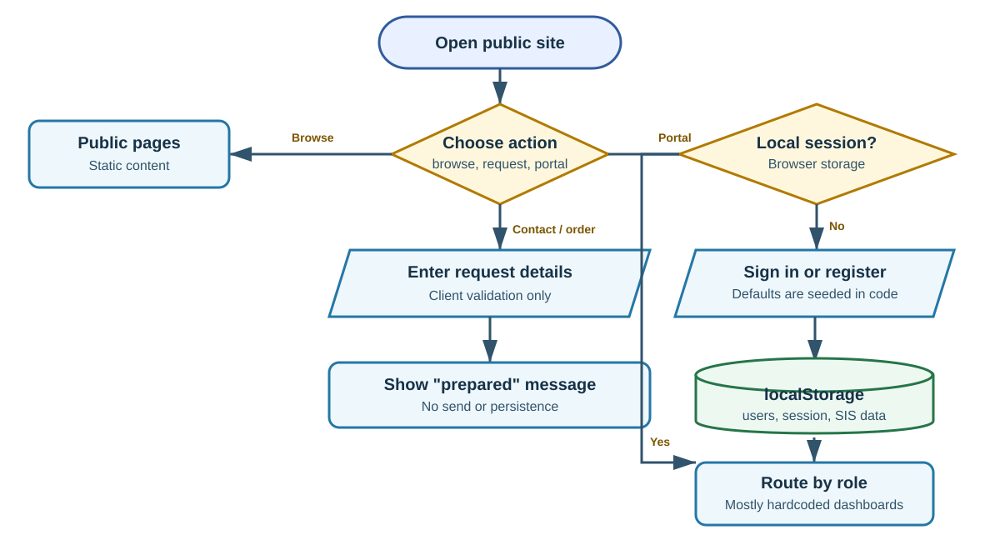
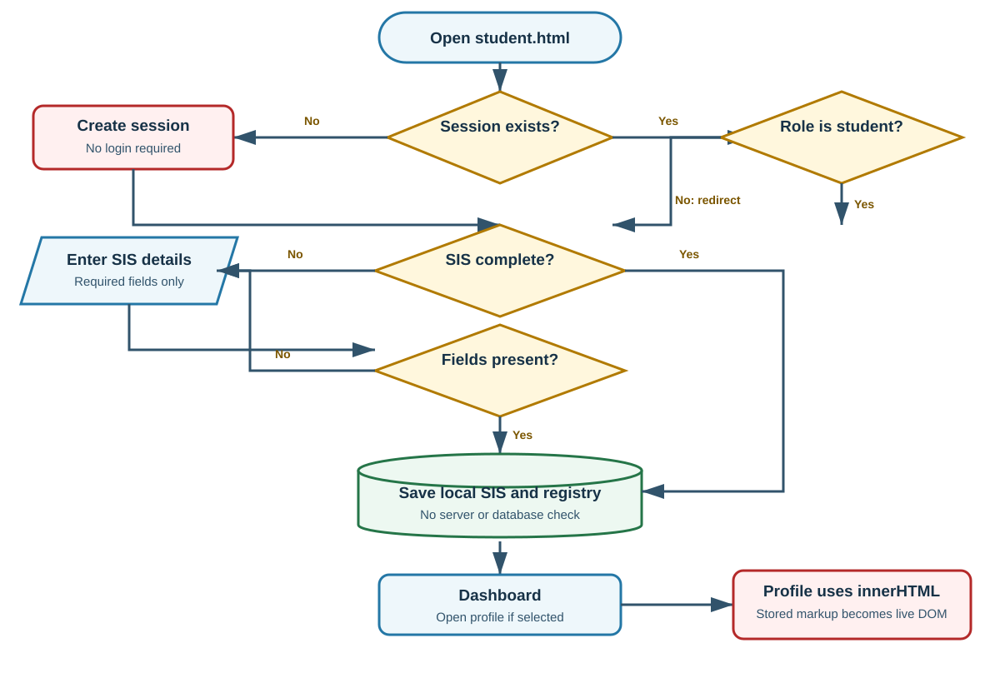
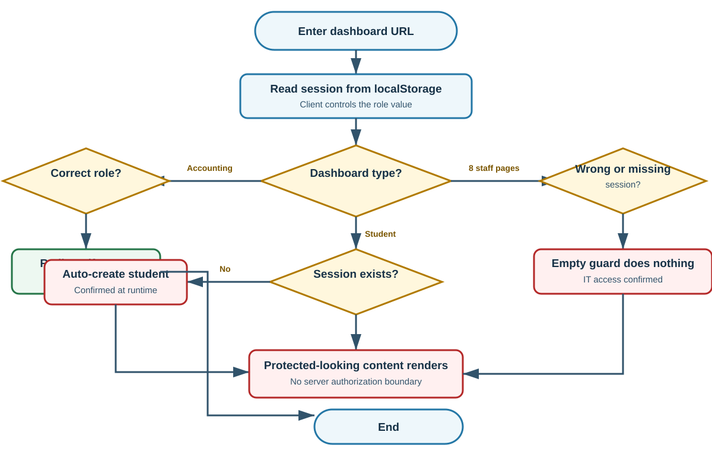

# RISE College School Student Information System - Mock Defense Analysis

<!-- **Review date:** 29 September 2026
-->

<div class="page-break"></div>

## One-page panel brief

### Ano ang system?

Ang submission ay isang static school website plus role-based portal prototype. May public homepage, program and product pages, contact page, login and registration, student SIS onboarding, at dashboards for President, Principal, Vice President, Academic Head, IT Administrator, Accounting, Guidance, Administrative Staff, Faculty, at Student.

Ang runtime ay HTML, CSS, at vanilla JavaScript lamang. Walang submitted server application, API, database schema, migration, o backend authentication service. Users, passwords, session, student profile, at student registry ay nasa browser `localStorage`. Karamihan ng staff metrics ay fixed values sa JavaScript.

### Readiness verdict

> **Prototype only.** Maganda itong UI demonstration at navigation concept, pero hindi pa ito ligtas o tama para sa tunay na student and staff records. Ang pinakamalaking gap ay walang trusted server boundary: ang browser mismo ang nagdedesisyon kung sino ang user, ano ang role niya, at ano ang data.

### Pinakamalakas na bahagi

- Malinaw at consistent ang visual hierarchy, navigation, role labels, at responsive layout.
- May distinct dashboards at modules para sa maraming school roles.
- Gumagana ang public homepage, local assets, basic login flow, student onboarding, theme controls, search, at profile display sa local browser.
- May ilang basic validation: required fields, email input types, at accounting direct-access redirect.
- Ang IT account table ay nag-e-escape ng displayed account values bago ilagay sa HTML (`it-admin.html:4338-4345`).

### Top five risks na dapat itanong agad

| Priority | Risk | Practical meaning |
|---|---|---|
| 1 | Eight staff dashboard guards have empty bodies | Kahit walang login, direktang nabubuksan ang IT, President, Principal, VP, Academic, Guidance, Administrative Staff, at Faculty pages. |
| 2 | Hardcoded default staff credentials and plaintext browser storage | Nasa source mismo ang passwords at readable sila sa browser storage. |
| 3 | Client-controlled role and session | Puwedeng baguhin ang role sa `localStorage`; walang server na magva-validate ng identity or permission. |
| 4 | Student data is rendered through `innerHTML` | Harmless markup became a live DOM element in testing; executable markup is therefore plausible. |
| 5 | No real database or integrations | Staff metrics, audit, backups, grades, attendance, contact, and orders are mostly display-only or local-device data. |

### Review numbers

**10 findings:** 6 High, 4 Medium. **13 QA cases:** 3 Passed, 10 Failed. **7 runtime-confirmed checks, 3 essential flowcharts, and 5 tailored panel questions.**

## Evidence legend

- **Confirmed:** Na-observe sa local runtime.
- **Code-evidenced:** Diretsong suportado ng exact source code, pero hindi inulit sa browser.
- **Suspected:** Plausible risk na kailangan pa ng focused test.
- **Not testable:** Walang kailangan na access, dependency, data, o environment.

Walang capstone paper na nakita sa submission, kaya ang intended process ay reconstructed mula sa UI labels, code, at visible workflows. Ang `_build/` folder at `guidance.backup.html` ay tinuring na construction or backup artifacts at hindi primary live pages.

## System explained simply

### Actual architecture

| Layer | Actual implementation | Panel meaning |
|---|---|---|
| Public website | Static HTML, inline CSS/JS, local images | Gumagana bilang brochure-style site. |
| Authentication | JavaScript compares entered password with browser-stored plaintext records | Demo login only; no secure identity service. |
| Session | JSON object under `student-portal-session` in `localStorage` | User controls the session and role. |
| Authorization | Page-level JavaScript role checks | Most checks are empty; even the working one is client-side only. |
| Student SIS | Per-account localStorage record plus a shared local registry | Data stays on one browser/device and is not authoritative school data. |
| Staff dashboards | JavaScript objects with fixed labels, counts, percentages, cards, and activity text | Most indicators are mock data, not computed records. |
| IT account view | Reads `student-portal-users` from localStorage and escapes displayed values | Shows accounts created or seeded in the same browser only. |
| Database/API | None supplied or called by current live pages | No central persistence, consistency, audit, or recovery. |
| Contact and order | Client validation then status message | No delivery, ticket, order, or acknowledgment record. |

### Actors and practical access

| Actor | Intended use | Actual implementation status |
|---|---|---|
| Public visitor | Browse school, programs, products, contact | Mostly functional static pages. |
| Student | Register, complete SIS, view academic portal | Local-only prototype; direct page access creates a session. |
| President, Principal, VP | View institution-level indicators | UI works, but guard is empty and data is fixed. |
| Academic Head | View academic programs, faculty, grades, reports | UI works, but guard is empty and data is fixed. |
| IT Administrator | View users, permissions, database, backups, security | Direct access works without login; most metrics are fixed. |
| Accounting Staff | View billing and payment indicators | Redirects unauthenticated users, but relies only on client role. |
| Guidance, Administrative Staff, Faculty | View role-specific modules | UI works, but guards are empty and data is fixed. |

### Critical use cases

| Use case | Preconditions | Main flow | Alternate or exception | Postcondition |
|---|---|---|---|---|
| Student registration | Open login page | Enter email/password -> save local user -> create local session -> student page | Duplicate email rejected in same browser | Browser has local account and session. |
| Staff login | Login page has seeded defaults | Enter hardcoded credentials -> compare plaintext -> set local session -> role page | Wrong password shows message | Browser has staff role session. |
| Student SIS onboarding | Student session | Enter required details -> save local record/registry -> show dashboard | Missing required field blocks submit | Student record exists only in that browser. |
| Staff dashboard access | Intended: authenticated staff | Read session -> validate role -> show role modules | In eight pages, wrong/missing role does nothing | Protected-looking content renders. |
| Contact/order request | Public page | Enter form values -> JavaScript validates -> show notice | Missing fields show error | Nothing is sent or persisted. |

### Process correctness summary

- **Correct for a prototype:** public navigation, role-specific UI concept, local login demonstration, required-field onboarding, theme/search/profile interactions.
- **Partial:** registration, SIS, accounts, reports, contact, and orders. May visible flow, pero walang central or operational completion.
- **Incorrect for a real SIS:** authentication, authorization, password handling, audit, database-backed records, uniqueness rules, server validation, backups, and reliable institutional metrics.
- **Blocked from verification:** real deployment topology, database design, real API behavior, test coverage, backup restore, institutional rules, and paper-to-system conformance because those artifacts were not supplied.

<div class="page-break"></div>

## Essential flowcharts

### 1. Overall actual system flow



**What this means:** Public pages are static. Portal login, registration, role routing, and records all converge on browser storage. Contact and order paths stop at a client message. This diagram shows actual behavior, not an intended future backend.

### 2. Student SIS transaction



**What this means:** `student.html` can create its own student session, validates presence of a few fields, then writes to local storage. The profile view later inserts stored values through `innerHTML`, which created a live `<b>` node during the safe runtime check.

<div class="page-break"></div>

### 3. Authentication and authorization risk flow



**What this means:** Accounting has a visible redirect, while eight other staff pages contain an empty denial branch. All checks still depend on editable browser data, so even the accounting behavior is not equivalent to server authorization.

## Prioritized findings

### F-01 - Staff dashboards open without authentication

**Severity:** High | **Confidence:** High | **Status:** Confirmed for IT; code-evidenced for seven sibling pages

**Problema:** Walong staff dashboards detect a wrong or missing role but execute an empty block. The protected-looking page continues to render.

**Saan:** `it-admin.html:3846-3850`; `academic-head.html:3928-3932`; `administrative-staff.html:3832-3836`; `faculty.html:3832-3836`; `guidance.html:3832-3836`; `president.html:3882-3886`; `principal.html:3832-3836`; `vice-president.html:3832-3836`.

**Paano mabubutas:** Sa isolated local browser with no session, opening `it-admin.html` directly showed the complete IT dashboard, user-account screen, system metrics, database, backups, security, and audit modules.

**Expected vs actual:** Expected redirect or access denied. Actual full page rendered. Accounting is an inconsistent exception and redirected at `accounting.html:2720-2725`.

**Effect:** Any user who knows the URL can see privileged-looking modules. If real records are later connected without fixing the boundary, this becomes a direct data exposure path.

**Ayusin:** Enforce authentication and permission on a trusted server before returning protected data or pages. Client redirects should be only UI convenience.

**Verification:** Request each staff route with no session, student session, and wrong staff role; every request must return a server-side denial without protected content.

**Panel question:** Bakit empty ang unauthorized `if` blocks, at saan talaga ine-enforce ng server ang RBAC?

### F-02 - Default staff passwords are hardcoded and stored in plaintext

**Severity:** High | **Confidence:** High | **Status:** Confirmed login plus code evidence

**Problema:** Ten default staff accounts and passwords are visible in the login page source, then copied to `localStorage` without hashing.

**Saan:** `login.html:307-330`, especially passwords at `login.html:312-321`; login comparison at `login.html:401-413`.

**Safe reproduction:** `president@rise.edu` with `president123` successfully opened `president.html` in the local test.

**Expected vs actual:** A production account should be provisioned server-side, stored with a password hash, and require reset. Actual credentials are shipped to every browser.

**Effect:** Anyone with the source or browser developer tools knows the staff credentials. Any script running on the same origin can read the stored passwords.

**Ayusin:** Remove seeded production-like accounts. Use server-side account provisioning, strong password hashing, first-login reset, lockout/rate limiting, and optional MFA for privileged roles.

**Verification:** No password appears in shipped source or browser storage; default login fails; password reset and lockout events are auditable.

### F-03 - Session identity and role are controlled entirely by the browser

**Severity:** High | **Confidence:** High | **Status:** Code-evidenced

**Problema:** `setSession()` writes editable JSON with `email`, `role`, `accountId`, `username`, and `name` to `localStorage`. Every role page trusts that value.

**Saan:** `login.html:331-340`; role routing at `login.html:341-365` and `login.html:412-413`; accounting check at `accounting.html:2700-2725`.

**Paano mabubutas:** A user can change the local JSON role to a privileged role and refresh. No signed token, server session, or backend permission check exists in the submitted system.

**Effect:** Role checks are cosmetic. Records and permissions cannot be trusted even where the page redirects correctly.

**Ayusin:** Use a server-managed session or short-lived signed token, validate it on every protected request, and derive permissions from a server-side account record.

**Verification:** Editing browser storage never grants new data or actions; server logs show denied requests for forged roles.

### F-04 - Student portal creates a session without login and stores PII locally

**Severity:** High | **Confidence:** High | **Status:** Confirmed

**Problema:** If no session exists, `student.html` creates a student identity automatically and opens SIS onboarding.

**Saan:** `student.html:1705-1711`; onboarding form at `student.html:1700`; save logic at `student.html:1726`.

**Runtime result:** Direct navigation to `student.html` with no session created a local student session and displayed the complete SIS form.

**Effect:** Login is bypassed. Full name, email, phone, address, birthdate, guardian details, and notes are stored on the device without a privacy, retention, sharing, or logout cleanup policy.

**Ayusin:** Require authenticated enrollment-linked accounts. Store authoritative data server-side with access control, consent, minimization, retention, and device-cache rules.

**Verification:** Direct student URL redirects to login; logging in from another device retrieves the same authorized record; logout and account closure follow documented retention rules.

### F-05 - Stored student values become live HTML in the profile view

**Severity:** High | **Confidence:** High | **Status:** Confirmed with harmless markup

**Problema:** `renderModule('profile')` places student-controlled fields inside an HTML template, then assigns it to `innerHTML` without escaping.

**Saan:** `student.html:1728`.

**Safe reproduction:** The local test saved `<b id="marker">Panel Test</b>` as Full Name. The dashboard initially showed it as text, but My Profile created a real `B` element with id `marker`.

**Expected vs actual:** Expected literal text. Actual browser interpreted the stored value as markup.

**Effect:** A crafted record can change the page and may execute browser script. On this origin, that script could read local users, plaintext passwords, sessions, and student records.

**Ayusin:** Render data with `textContent` or a proven contextual encoder. Add server validation and a restrictive Content Security Policy as defense in depth.

**Verification:** HTML and event-handler strings appear only as text; automated tests cover every field rendered into dynamic HTML.

### F-06 - The system has no authoritative backend or database

**Severity:** High | **Confidence:** High | **Status:** Code-evidenced

**Problema:** Current live pages contain no `fetch`, XHR, server form action, database driver, or API client for core SIS work. Users and records are local; staff KPIs are JavaScript constants.

**Saan:** local persistence at `login.html:307-308`, `student.html:1705-1718`, and `it-admin.html:4328-4334`; fixed IT module numbers at `it-admin.html:3851-4173`.

**Effect:** Different devices have different users and student records. There is no central truth, concurrency control, audit trail, backup, recovery, cross-role workflow, or real reporting.

**Ayusin:** Define the smallest real backend around identity, student records, enrollment, grades, attendance, announcements, and audit events. Make dashboards derive only from approved records.

**Verification:** Two devices see consistent authorized data; writes survive browser reset; concurrent edits are controlled; metrics reconcile to source records.

### F-07 - Dashboard metrics are hardcoded and semantically inconsistent

**Severity:** Medium | **Confidence:** High | **Status:** Code-evidenced

**Problema:** Staff pages show precise counts and percentages that are not calculated. The IT Database card contains academic achievement and grade readiness; Backups contains attendance; Security contains guidance cases.

**Saan:** `it-admin.html:3974-4089`; other fixed module values begin at `president.html:3887`, `principal.html:3837`, `faculty.html:3837`, and similar role pages.

**Effect:** A panelist or operator may believe that 99.9% availability, seven backups, zero critical alerts, or 1,240 students are measured facts. They are display values.

**Ayusin:** Label demo data clearly until integration exists. In a real system, define metric source, formula, refresh time, owner, and drill-down records.

**Verification:** Every displayed KPI can be recomputed from authoritative data and includes an accurate last-updated timestamp.

### F-08 - Contact and order flows do not complete their business process

**Severity:** Medium | **Confidence:** High | **Status:** Code-evidenced

**Problema:** The contact form and product order button only display messages saying the request was prepared. They do not send, save, queue, or create a reference number.

**Saan:** contact handler at `contact.html:2243-2286`; order handler at `products.html:4722-4766`.

**Effect:** Users may think a school request exists when no staff can receive or track it. Follow-up, duplicate detection, status, cancellation, and SLA are impossible.

**Ayusin:** Either rename the action as a draft helper, or implement a trackable request workflow with receipt, owner, status, notifications, and audit trail.

**Verification:** A submitted request appears in an authorized staff queue and the user receives a reference number and status.

### F-09 - Validation stops at field presence and browser controls

**Severity:** Medium | **Confidence:** High | **Status:** Mixed: one required-field check confirmed; broader gaps code-evidenced

**Problema:** Registration accepts a four-character password and stores it as entered. Student SIS checks only seven non-empty fields. Phone, Student ID, Course, and Academic Year are free-form; no duplicate Student ID rule exists.

**Saan:** registration UI `login.html:270-281`; registration handler `login.html:416-435`; SIS fields `student.html:1700`; local registry matching `student.html:1713-1714`; save validation `student.html:1726`.

**Effect:** Weak accounts, malformed records, duplicate official IDs, and inconsistent academic values can enter the local registry. There is no server revalidation.

**Ayusin:** Write a validation contract per field and business rule, enforce it server-side, and return field-specific errors. Make official identifiers unique in the data store.

**Verification:** Negative and boundary tests cover length, format, allowed values, duplicates, authorization, and cross-record consistency.

### F-10 - Login routes reference four missing pages

**Severity:** Medium | **Confidence:** High | **Status:** Code-evidenced

**Problema:** The route map includes `admin.html`, `registrar.html`, `dean.html`, and `finance.html`, but those files are absent from the submitted root.

**Saan:** `login.html:346-360` and `login.html:412`; source inventory of the root folder.

**Effect:** Any matching role record reaches a 404 or missing file. This also shows the route list and delivered modules are not reconciled.

**Ayusin:** Remove unsupported roles from authentication and requirements, or deliver the pages and include them in automated route checks.

**Verification:** Every declared role maps to exactly one existing route, and every protected route maps back to a declared role and permission set.

<div class="page-break"></div>

## Recommended system improvements

These are product and operational improvements, not replacement code.

| Priority | Current condition | Add or change | Intended process and benefit | Success indicator |
|---|---|---|---|---|
| Critical | Browser decides identity and role | Central authentication and server-side RBAC | Users sign in to a trusted service; each request is authorized against assigned roles | Direct URL and forged local role always receive denial. |
| Critical | Passwords are shipped and stored in plaintext | Secure account lifecycle | Admin provisions staff; users reset temporary passwords; passwords are hashed; failures are rate-limited | No password in source/storage; reset, lockout, and recovery tests pass. |
| High | Student PII exists only on one device | Authoritative student-record service | Student submits a validated record; authorized staff review/update; changes are auditable | Same authorized record is consistent across devices and roles. |
| High | SIS fields lack institutional rules | Data governance and validation contract | Define formats, required evidence, uniqueness, ownership, correction, and retention | Duplicate IDs and malformed records are rejected with clear reasons. |
| High | Dashboards display fixed numbers | Traceable reporting pipeline | KPIs derive from approved source records with formula, timestamp, and drill-down | Every KPI reconciles to underlying records. |
| High | Contact/order buttons create no work item | Request and order lifecycle | Submit -> receipt -> staff queue -> status -> resolution/cancellation | User gets a reference and staff sees the same request. |
| High | Backup/audit are screen labels | Operational audit and recovery | Immutable events, scheduled backups, restore drills, and access reviews | Restore drill succeeds and sensitive actions are traceable. |
| Medium | Large duplicated inline role pages drift independently | Shared maintained UI and route inventory | Reuse the existing role dashboard runtime/config approach or another single maintained pattern | One role fix applies consistently; route and permission tests cover all roles. |

## Validation and process correctness

| Boundary or rule | Client control | Server / database control | Verdict |
|---|---|---|---|
| Login email/password present | Yes | None | Partial demo only. |
| Email format | Browser `type=email` | None | Partial; bypassable outside normal UI. |
| Password strength | `minlength=4` on registration | None; plaintext storage | Incorrect. |
| Session validity | JSON parse only | None | Incorrect. |
| Role authorization | Page JavaScript | None | Incorrect; eight empty guards. |
| Student required fields | Browser `required` plus JS presence check | None | Partial. |
| Student ID uniqueness | None | None | Missing. |
| Phone and Academic Year format | None | None | Missing. |
| Output encoding | Mixed: IT escapes account text | Student profile does not escape | Inconsistent and unsafe. |
| Contact/order delivery | Presence checks only | None | Incomplete workflow. |
| Audit, backup, recovery | Display labels and fixed cards | None | Not implemented. |

### Authorization matrix

| Resource | Student | Staff role owner | Other staff | No session | Actual enforcement |
|---|---|---|---|---|---|
| Student SIS/profile | Intended own record | Intended authorized support only | Intended denied | Intended denied | Local session and per-browser data; no backend. |
| Accounting dashboard | Denied | Accounting allowed | Denied | Redirect | Client-only role check. |
| IT, President, Principal, VP, Academic, Guidance, Admin Staff, Faculty | Denied | Intended owner allowed | Denied | Denied | Empty denial blocks; pages render. |
| Public contact/order | Allowed | Allowed | Allowed | Allowed | No actual delivery or record. |

## Important JavaScript and how the system applies it

| Function or responsibility | Inputs and output | Side effects / call site | User-visible effect |
|---|---|---|---|
| `loadUsers()` / `saveUsers()` - `login.html:307-308` | JSON under `student-portal-users` | Reads/writes localStorage | Accounts exist only on this browser. |
| `seedAdmin()` - `login.html:309-330` | Hardcoded default array | Adds ten staff accounts and plaintext passwords | Default staff logins work immediately. |
| `setSession()` - `login.html:331-340` | Email, role, local user object | Writes `student-portal-session` | Browser becomes the identity authority. |
| `redirectIfLoggedIn()` - `login.html:341-365` | Parsed local session role | Navigates to role page or student fallback | Stale roles can hit missing pages or student fallback. |
| Login submit handler - `login.html:401-414` | Entered email/password | Plaintext lookup and session write | Correct seeded password opens staff dashboard. |
| Registration handler - `login.html:416-435` | Email/password | Creates local student account and session | User immediately enters student portal. |
| `saveSIS()` - `student.html:1726` | Form field values | Writes per-account record, shared registry, and session | Student completes onboarding locally. |
| `renderModule()` - `student.html:1728` | Selected student module plus stored data | Replaces `moduleView.innerHTML` | Student pages render; profile data may become live markup. |
| `loadModule()` - `it-admin.html:4224-4325` | Module key | Replaces module text/cards; calls account renderer | Switches IT dashboard panels. |
| `loadRegisteredAccounts()` - `it-admin.html:4328-4334` | Local users JSON | Reads current browser accounts only | IT sees seeded/created local accounts, not a central registry. |
| `escapeAccountText()` - `it-admin.html:4338-4345` | Any account display value | Encodes HTML metacharacters | Good local defense in the IT account table. |
| `renderAccountOverview()` - `it-admin.html:4349-4393` | Browser account list | Builds staff/student tables | Counts and identities shown to IT. |
| Contact submit handler - `contact.html:2243-2286` | Name, email, message | Updates status text only | User sees a prepared-message notice. |
| Order click handler - `products.html:4722-4766` | Name, email, quantity | Updates notice text only | User is told to contact school to finalize. |

### Important JavaScript assessment

The JavaScript is understandable and often uses direct DOM APIs, which is appropriate for a small prototype. The main problem is not lack of frameworks. It is that security and institutional data rules are implemented in the same untrusted browser layer as the UI. The smallest correct architecture change is to move identity, authorization, records, and business validation to a server; a new front-end framework alone would not fix the system.

## Vibe-coding evidence

These are implementation-risk indicators only. They are not proof of AI authorship.

### V-01 - Empty security branches

**Location:** `it-admin.html:3846-3850` (same pattern in seven role pages)  
**Responsibility:** Page authorization guard

```js
if(
  !session ||
  session.role !== "it-system-admin"
){
}
```

**What it does:** It calculates an unauthorized condition but performs no denial action.  
**Why it is a signal:** The code looks like a completed guard at a glance, but the essential behavior is missing.  
**System effect:** Direct unauthenticated access succeeds.  
**Confidence:** High.

### V-02 - Student page reuses a Principal theme key

**Location:** `student.html:1705`  
**Responsibility:** Student theme persistence

```js
THEME_KEY='rise-principal-theme'
```

**What it does:** Student theme changes share the key named for the Principal.  
**Why it is a signal:** Concrete copy/paste residue from another role page.  
**System effect:** Student and Principal appearance settings can collide on the same origin.  
**Confidence:** High.

### V-03 - IT modules contain unrelated copied metrics

**Location:** `it-admin.html:3974-4089`  
**Responsibility:** Database, backup, and security dashboard cards

```js
database:{ cards:[["Achievement","88%"], ["Grade readiness","92%"]] },
backups:{ cards:[["Daily attendance","96.4%"]] },
security:{ cards:[["Active cases","24"], ["Interventions","24"]] }
```

**What it does:** Labels IT modules but displays academic, attendance, and guidance values.  
**Why it is a signal:** Repeated template data was renamed at the module level without end-to-end semantic verification.  
**System effect:** IT indicators are misleading and cannot support decisions.  
**Confidence:** High.

### V-04 - Declared role routes are not delivered

**Location:** `login.html:346-360` and `login.html:412`  
**Responsibility:** Role-to-page routing

```js
admin: 'admin.html',
registrar: 'registrar.html',
dean: 'dean.html',
finance: 'finance.html'
```

**What it does:** Sends four roles to files that are absent.  
**Why it is a signal:** Route configuration and release contents were not reconciled.  
**System effect:** Matching users reach missing pages.  
**Confidence:** High.

### V-05 - Demo identity is mixed into the live login path

**Location:** `login.html:309-330`; demo notice at `login.html:281`  
**Responsibility:** Authentication setup

```js
{ email: 'president@rise.edu', password: 'president123', role: 'president' }
...
saveUsers(list);
```

**What it does:** Every browser receives production-looking role accounts and passwords.  
**Why it is a signal:** Demo convenience is embedded in the normal authentication path rather than isolated as test data.  
**System effect:** The prototype is easy to demonstrate but unsafe to publish as an operational system.  
**Confidence:** High.

## QA summary

**13 selected cases:** 3 Passed, 10 Failed. Seven checks were executed locally; six additional outcomes are directly code-evidenced. No result below implies full coverage.

| ID | Test | Evidence | Expected | Actual | Status |
|---|---|---|---|---|---|
| QA-01 | Open public homepage | Confirmed | Load with assets | Loaded | Passed |
| QA-02 | Open IT admin with no session | Confirmed | Denied | Full dashboard rendered | Failed |
| QA-03 | Open Accounting with no session | Confirmed | Denied | Redirected to home | Passed |
| QA-04 | Open Student with no session | Confirmed | Require login | Auto-created session | Failed |
| QA-05 | Use seeded President credential | Confirmed | Reject/reset default | Login succeeded | Failed |
| QA-06 | Submit SIS without Academic Year | Confirmed | Block with clear error | Browser blocked field | Passed |
| QA-07 | Save harmless HTML in Full Name | Confirmed | Render literal text | Live `B` DOM node created | Failed |
| QA-08 | Forge Accounting role locally | Code-evidenced | Server denial | No server; local role trusted | Failed |
| QA-09 | Register with four-character password | Code-evidenced | Strong policy and hash | Allowed by design; plaintext save | Failed |
| QA-10 | Duplicate Student ID across accounts | Code-evidenced | Reject duplicate | No uniqueness check | Failed |
| QA-11 | Submit contact message | Code-evidenced | Send or persist | Status text only | Failed |
| QA-12 | Submit product order | Code-evidenced | Trackable request | Status text only | Failed |
| QA-13 | Resolve all role routes | Code-evidenced | All routes exist | Four files missing | Failed |

### Next QA tranche after a backend exists

- Authorization matrix tests for every role, route, record owner, and action.
- Duplicate and concurrent student-record creation.
- Password reset, lockout, session expiry, logout invalidation, and MFA for privileged roles.
- Stored/reflected output encoding across every profile, search, report, and export surface.
- Contact/order delivery retry, idempotency, status, and staff acknowledgment.
- Backup restore, audit integrity, and dashboard reconciliation to source records.

## Five strongest panel questions

### 1. Where is authentication and authorization truly enforced?

**Why ask:** The submission has empty role guards and client-controlled sessions.  
**Strong answer should cover:** Acknowledge that current code is a front-end prototype; explain the planned server session, protected endpoints, RBAC matrix, and denial tests.  
**Follow-up:** If I edit `student-portal-session` and change the role, what server response prevents access?  
**Red flags:** "Hidden ang URL," "may if statement naman," or reliance only on `localStorage` and redirects.

### 2. How will student records remain correct across devices and users?

**Why ask:** Current data is device-local and Student ID uniqueness is not enforced.  
**Strong answer should cover:** Authoritative database, unique constraints, record ownership, validation, concurrency control, audit history, and correction workflow.  
**Follow-up:** What happens when two accounts submit the same Student ID at the same time?  
**Red flags:** "The browser will prevent it" or no database/business-rule answer.

### 3. Explain the `renderModule()` security issue in `student.html:1728`.

**Why ask:** Harmless stored markup became live HTML at runtime.  
**Strong answer should cover:** Trust boundary, `innerHTML`, contextual output encoding, use of `textContent`, server validation, and regression tests.  
**Follow-up:** Which other dynamic HTML assignments receive user-controlled values?  
**Red flags:** "Required fields make it safe" or sanitizing only on the client.

### 4. Which dashboard numbers are real, and how are they computed?

**Why ask:** Precise staff KPIs are hardcoded and some are copied into unrelated IT modules.  
**Strong answer should cover:** Clearly call them demo data; define future sources, formulas, update schedule, reconciliation, and drill-down evidence.  
**Follow-up:** Show how the displayed 99.9% database availability is derived from records or telemetry.  
**Red flags:** Presenting constants as measured institutional results.

### 5. What is the complete lifecycle of a contact message or product order?

**Why ask:** Current handlers stop at a prepared-message notice.  
**Strong answer should cover:** Submission, validation, persistence, reference number, staff queue, ownership, status, notification, retry, cancellation, and audit.  
**Follow-up:** Where can staff see the request that the user just submitted?  
**Red flags:** "Success message means it was sent" or no receiving system.

## Coverage, assumptions, and limitations

### Source inventory

- Primary live root: 15 HTML pages, 2 root JavaScript files, 1 root CSS file, images, and `.vscode/launch.json`.
- Additional `_build/` content: original pages, fragments, CSS, and a check script. These were treated as build/history artifacts because current root pages do not load them as the primary runtime.
- `guidance.backup.html` was treated as a backup, not the active guidance page.
- No package manifest, server source, API project, database schema, SQL, migrations, automated test suite, PDF paper, DOCX paper, or requirements document was supplied.

### Runtime checks actually performed

- Served the untouched submission locally from `127.0.0.1:8765`.
- Loaded public homepage.
- Opened IT admin directly with no session.
- Opened Accounting directly with no session.
- Opened Student directly with no session.
- Logged in using the seeded President account.
- Triggered the required Academic Year browser validation.
- Saved harmless bold markup as a local test name and confirmed that My Profile created a live `B` element.

### Assumptions

- "SIS" and the role dashboards imply future handling of real school records, even though the current code calls itself a demo in one notice.
- The root HTML pages are the intended deliverable; `_build/` is not deployed.
- Institutional counts and percentages were treated as demo indicators because no source records or calculations were found.

### What was not tested

- No destructive payload, credential attack, broad fuzzing, production target, real account/data, or third-party service was used. The submitted source was not edited and no dependency was installed into it.
- Test browser storage was local. Accessibility and responsive behavior were not fully audited; server, database, restore, API, and deployment behavior were not testable because those components were absent.
