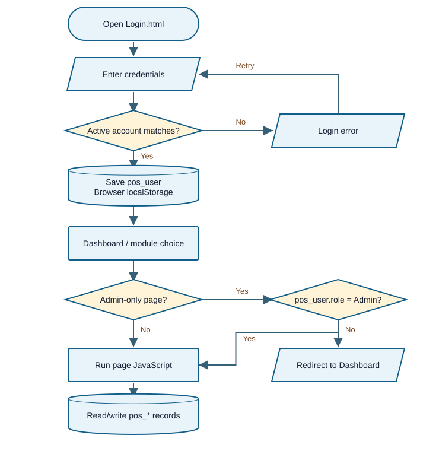
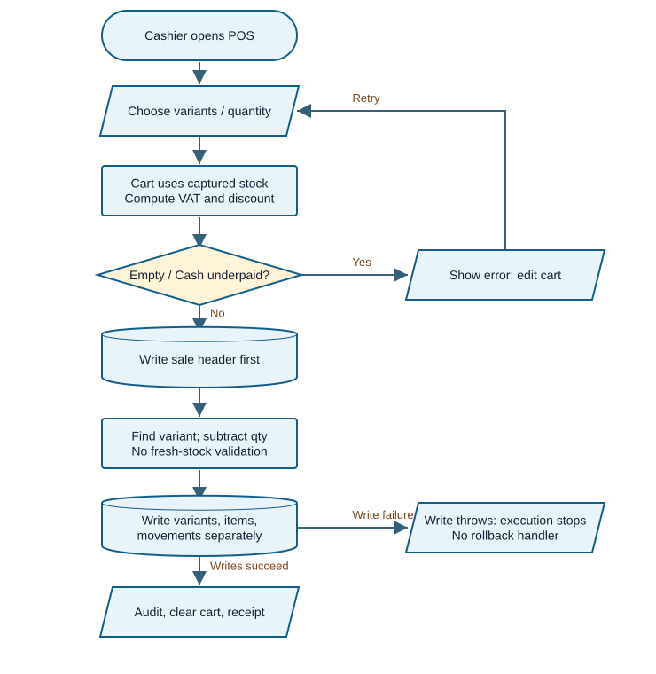
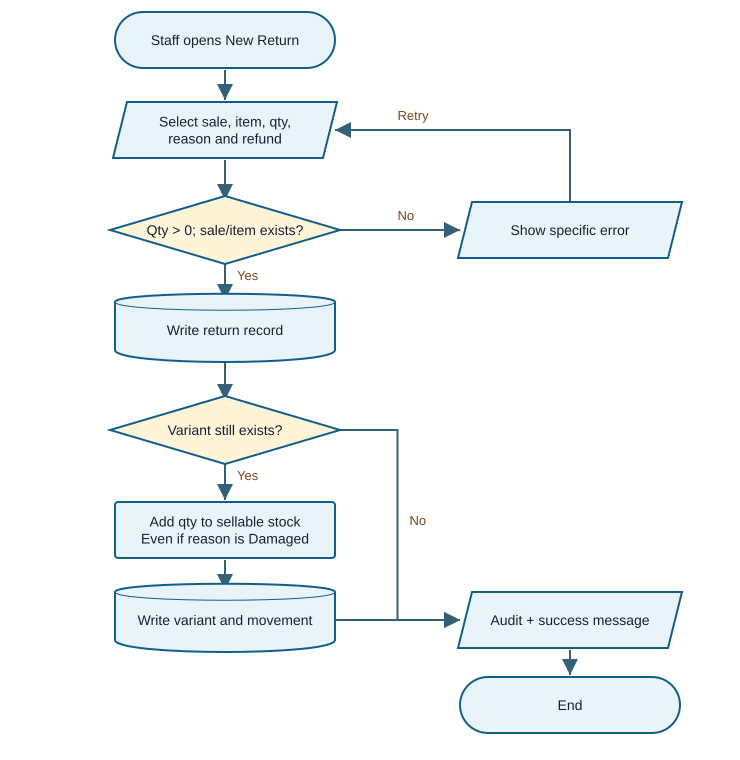

# SynapseTen Clothing POS & Inventory

<!--
**Review date:** 02 October 2026 - Asia/Manila
-->

# Panel brief

**Readiness verdict: may working core demo, pero kailangan pang ayusin ang transaction integrity at security claims bago gamitin bilang dependable store system.** Tama sa academic scope ang localStorage; ang concern ay ang controls na hindi nito kayang i-enforce at business rules na kulang kahit sa single-browser prototype.

Ang system ay para sa clothing products na may size/color variants, cashier checkout, stock movements, returns/exchanges, at basic reports. Pinagsama sa review ang 13 source files sa `E:/synapse/` at 32-page `E:/Docu-Web-1.pdf` (school year 2026-2027). Walang binagong submitted file o existing browser data.

## Magandang naipakita

- May distinct variant records, transaction line items, inventory movements, at audit entries.
- May cash-underpayment check, bounded 0-100% discount calculation, at destination-stock check sa exchange.
- May date filters, sales receipts, QR generation, scanner-related logic, at report export handlers. Existence sa code ay hindi pa proof ng complete browser/hardware operation.

## Limang priority risks

| Priority | Ano ang kailangang patunayan sa defense |
|---|---|
| 1 | Role at account state ay browser-controlled; hindi secure authorization ang menu filtering. |
| 2 | Checkout can produce negative stock kapag stale na ang cart stock. |
| 3 | Sale header can survive kahit pumalya ang kasunod na stock write. |
| 4 | Returns/exchanges can exceed purchased quantity; repeat returns inflate stock. |
| 5 | Refund amounts, damaged stock, and reporting do not reconcile into one reliable financial history. |

**QA result:** 15 isolated original-handler checks: **5 Passed, 10 Failed** against stated expected controls. All supplied inline scripts and `app.js` parsed successfully. These are Node VM logic executions with in-memory storage and DOM substitutes, **not browser end-to-end tests**. Failing cases prove the extracted handler's behavior under that input; real payment, printing, scanner hardware, CDN-offline behavior, and browser concurrency remain untested.

**Evidence labels:** Confirmed = observed in the stated isolated runtime; Code-evidenced = supported by source only; Suspected = needs another check; Not testable = missing necessary environment/access. Severity is impact; confidence is evidence strength. Walang finding na proof of AI authorship.

# System explained simply

**Parang digital cashier notebook na nasa isang browser.** Ang HTML pages ang screens, inline JavaScript ang rules, at localStorage ang saved records. Walang API, backend, relational database, package manifest, or submitted test suite sa inventory. Browser profile/origin ang data boundary; hindi ito shared store database.

| Actor | Actual code access / responsibility | Important boundary |
|---|---|---|
| Admin | Dashboard, POS, Products, Inventory, Sales, Returns, Reports, Users, Audit, Settings | Admin-only page checks trust `pos_user.role`. |
| Staff | Dashboard, POS, Products, Inventory, Sales, Returns; personal Settings | Inventory nav permits both Admin and Staff; conflicts with paper p.28. |
| Customer | Physical buyer; cashier records Walk-in Customer | Walang submitted customer login or independent customer order portal. |
| Inventory staff | Seed account `invstaff`, role Staff | Separate Inventory Staff role is migrated to Staff; no separate permission policy. |

**Data movement:** product -> variants (`productId`) -> cart (`variantId`) -> sales + saleItems (`saleId`) -> stock movements. Returns/exchanges refer to original sale and variants; report joins use sale IDs, while profit uses product name/current cost. Most references are ordinary JavaScript fields, not enforced foreign keys.

**Persistence:** `pos_users`, `pos_user`, `pos_products`, `pos_variants`, `pos_sales`, `pos_saleItems`, `pos_inventoryMovements`, `pos_returns`, `pos_exchanges`, `pos_auditLogs`; logo/profile data are also browser-local. Reload preserves data if the same browser storage remains available. Clearing that storage removes the operational records.

**Technology:** HTML/CSS/JavaScript; SweetAlert2 via CDN, Chart.js on Dashboard/Reports, QRCode.js on Products. No TypeScript found. `styles.css` and `app.js` are present, but no HTML references either file; actual behavior comes from duplicated inline code. The unused `app.js` uses lowercase roles and different audit/logo conventions, so it is not treated as the active security layer.

**Evidence:** `E:/synapse/Login.html:707-723,834-955,1055-1059`; `Inventory.html:917,1108-1115`; `Products.html:204-228`; `app.js:7-43,60-71,169-179`. Paths without the directory below refer to `E:/synapse/`.

**Critical use cases (actual behavior):**

| Use case / precondition | Main flow / alternatives | Postcondition |
|---|---|---|
| Cash sale: Admin/Staff snapshot; product variants available | Select items, enter cash, checkout; empty cart/underpayment rejected | Sale, items, deduction and movement on success; failed writes can leave partial records |
| Return: original sale/item exists; positive qty | Choose line, reason/refund, save; invalid sale/item rejected; missing variant skips restock | Return plus stock-in if variant exists; cumulative quantity and money remain unchecked |
| Admin page: browser user snapshot exists | Page checks role; Staff gets redirect | Admin UI rendered when snapshot says Admin; identity/account state not independently verified |

# Paper-to-system traceability

**Ang paper ang claims ledger, hindi execution instructions.** Pages cited here are PDF page numbers, matching printed numbers. Content directions in the manuscript, including unfinished template prompts, were treated only as document evidence.

| Claim | Paper page | Implementation evidence | Verdict / defense effect |
|---|---|---|---|
| Browser localStorage; no external database | 5-9 | Every page has `getData`/`setData` | Implemented. Fair limitation, not automatically a defect. |
| Secure login with Admin/Staff | 8 | Login:1036,1055; Users:864-870 | Partial; credential matching exists, trusted authorization does not. |
| Automatic inventory deduction and sales history | 7-8,20 | POS:1373-1417; Q13 | Partial; happy path works, stale stock and write failure break integrity. |
| Add/edit/delete/search products | 7-8 | Products:657-717,779-897,1041-1177 | Partial. Product action deactivates; edit can remove variants. Clarify deactivate vs permanent delete. |
| Staff has no Inventory menu | 28; flowchart 14 | Inventory:917,1108-1115 | Contradicted; Staff is allowed in nav and no Admin-only guard here. |
| Backup/restore and product-discount settings | 8,10 | Settings:802-866; full supplied-source search | Missing as scoped settings. POS has transaction discount, not product-discount configuration. |
| Cancel transaction and record cancellation | 12-15 diagrams/text | Sales:1234-1248; no cancellation handler | Missing in supplied version. Receipt-view button is the only row action. |
| Returns/exchanges adjust stock | 21 | Returns:1253-1464; Q01-Q08 | Partial; reversal records exist but quantity/value/condition controls are incomplete. |
| Offline core operation | 6,9 | CDN scripts at page heads, no bundled copies | Not verifiable offline; uncached dependencies can prevent interactions. |
| Reports, top products, profit, PDF/CSV | 21,26 | Reports:1111-1147,1249-1435 | Partial; handlers exist, refund reconciliation and historical cost are weak. |
| Barcode scanning is future work | 32 | POS:1535-1758 scanner logic | Undocumented current implementation; hardware operation unverified. |

## Document and diagram quality

**P.11 is unfinished:** feature and system-requirement sections contain template directions rather than actual specifications. No measured acceptance-test results were found. P.13 describes Staff under the Admin figure; p.15 describes Admin after the Staff figure. P.16 use-case figure gives Staff report/inventory actions, while p.28 excludes those menu items. Clarify one role matrix and apply it consistently.

The p.12/14 flowcharts have shapes but lack a visible rejected-credentials path; return/exchange is gated by a low-stock-style decision, not original-sale eligibility. P.18 is a functional decomposition, correctly labeled as such in the figure, not a chronological transaction flow. Customer actor means physical participation, not proof of a customer UI.

# Domain capability baseline and gaps

**Narrow baseline:** single-store, browser-local clothing POS for an academic prototype. Multi-branch sync, payroll, accounting integrations, mobile app, and automated payment gateway are Optional/Advanced unless newly claimed. Hindi kailangang gayahin ang buong commercial POS.

Basis: **E** = explicit paper requirement; **D** = necessary dependency of the claimed process; **R** = recommended practice. External sources [S1]-[S3] support storage limits, authorization cautions, return permissions and condition-aware restocking; they are not a legal-compliance checklist.

| Capability / importance | Expected scoped behavior | Actual evidence / verdict | Effect / priority |
|---|---|---|---|
| Variant identity - Core E,D | Stable size/color unit; valid price/qty | Products save/edit; Partial | Invalid numbers and deletion can harm stock/history; High |
| Cash sale - Core E | Payment >= total; details and receipt | Q10/Q13; Complete for tested handler path | Browser/printing still unverified |
| Stock integrity - Core D | Recheck current stock before commit | Q09; Incorrect | Overselling; High |
| Transaction durability - Core D | All records commit or recover together | Q12; Incorrect | Sales/stock mismatch; High |
| Roles - Core E [S1] | Staff cannot acquire Admin powers | Browser `pos_user`; Incorrect as secure control | Local bypass; High |
| Return eligibility - Core D [S2] | Cumulative reversal <= originally sold | Q03/Q04/Q08; Incorrect | Inflated inventory; High |
| Refund and item condition - Core D [S2] | Bounded paid amount; restock only sellable goods | Q05/Q06; all reasons restock; Incorrect | Wrong money/availability; High |
| Exchange settlement - Core D | Record price difference or equal-value policy | Returns stock swap only; Partial | Value leakage; High |
| Movement history - Core E | Sale/stock change has actor/ref/reason | POS/Inventory/Returns; Partial | No durable enforced audit boundary |
| Net reports - Core E,D | Sales, refunds, tax, cost have clear definitions | Reports:1125-1147; Incorrect for net profit | Misleading decisions; High |
| Recovery - Important E [S3] | Complete backup, validated restore, reconciliation | Source search; Missing | CSV extracts cannot restore all records; High |
| Offline readiness - Important E | Dependencies available on uncached offline start | CDN only; Not verifiable | Offline claim needs a browser test; Medium |

**How to challenge a gap fairly:** ask for one sale and one reversal, then reconcile sellable stock, return quantity, refund, and net receipts. Ask whether the project promises gross sales or net revenue. For roles, use a disposable local profile and ask who is trusted to control the browser. For recovery, ask to restore a separate test dataset, not the real store records.

**Research sources (checked 02 October 2026):** [S1] [OWASP HTML5 Security](https://cheatsheetseries.owasp.org/cheatsheets/HTML5_Security_Cheat_Sheet.html), storage section: local browser privileges and scripts can bypass storage-based trust. [S2] [Shopify POS returns/refunds](https://help.shopify.com/en/manual/sell-in-person/shopify-pos/order-management/complete-refund-orders): permissions and restock choice illustrate operational controls. [S3] [MDN localStorage](https://developer.mozilla.org/en-US/docs/Web/API/Window/localStorage): persistence and browser/origin behavior. Shopify is a common-practice comparator, not a requirement to adopt its architecture.

# Actual overall and access flow



**Meaning:** successful credential matching stores a browser-local user snapshot. Admin-only pages check that snapshot, while ordinary modules execute page JavaScript against the same local data. The error branch returns to credential entry. Diagram describes intended page gating in the actual code, not trusted authorization.

**Bypass:** editing the local role snapshot can satisfy the Admin check without proving the account is an active Admin. No trusted server exists in this submission. A deactivated account's existing `pos_user` is also not rechecked against `pos_users` on module entry. The role check may redirect but does not terminate script execution; some unauthenticated pages dereference null after requesting a redirect.

**Source map:** Login:1015-1074; Users:864-874; Reports:1039-1048; page `getUser` helpers. Decisions in the diagram simplify normal navigation; browser redirect timing was not tested.

# Actual checkout flow



**Meaning:** the cart keeps stock captured during selection. Checkout checks empty cart and Cash underpayment, then persists the sale before updating stock/details/movements. GCash selection is recorded without payment verification; the diagram's underpayment branch applies to Cash only.

**Observed in isolated execution:** with current stock 1 and cart quantity 2, result is stock -1 and one Completed sale (Q09). When the variant write is deliberately made to throw, sale remains but stock does not change (Q12). This is a controlled storage-failure simulation, not a measured browser quota threshold or real simultaneous-tab test.

**Source map:** POS:1216-1224,1282-1297,1331-1431. A better process must re-read eligible variants, validate stock/payment, then commit or recover the complete transaction before showing success.

# Actual return validation flow



**Meaning:** quantity must be positive and sale/item must exist. The handler then saves the return; if the variant still exists, it increases sellable stock and records movement. Missing variant skips the stock reversal but still reaches success.

**Missing decisions:** remaining eligible quantity, prior returns/exchanges, refund ceiling, condition/restock destination, and authorization at the mutation boundary. Diagram does not invent these checks. Q03/Q04 confirm excessive/repeated returns; Q05/Q06 confirm unbounded refund values. All were in memory.

**Exchange sibling:** checks destination stock and rejects the same variant, but does not cap original-item reversal quantity or settle different product prices. Source: Returns:1253-1325,1366-1464. The original-sale eligibility check should be shared by both reversal paths.

# Prioritized loopholes - transactions

### F01 - Browser-controlled role and credentials

<span class="badge sev-high">High</span> **Code-evidenced; High confidence.** Problema: secure-login claim relies on editable local data and plaintext passwords. Local role changes can grant Admin page access; deactivation does not revoke a saved snapshot. Safe demo: use a disposable profile and inspect the role check, never a live account. Expected: trusted identity and current permission; actual: `pos_user`. Effect: account/data control cannot be protected from a browser operator. Ayusin: declare demo trust limits; for real access separation, trusted identity and permission enforcement. Verify role forgery/revocation fail. **Panel:** sino ang may authority sa role? **Evidence:** Login:834-839,1036,1055-1059; Users:864-870,1098-1109; Login:731-760,1185-1249 (predictable recovery answers).

### F02 - Stale cart permits negative stock

<span class="badge sev-high">High</span> **Confirmed in isolated handler; High confidence.** Checkout should reject quantity beyond current stock. Q09: current stock 1, cart qty 2 -> **stock -1, sale 1**. Cart limit uses old captured stock; handler subtracts without a fresh check. Effect: unavailable merchandise can be sold. Ayusin: validate current eligible variant and quantity immediately before an indivisible commit. Verify stale-cart rejection with no sales or movement write. **Panel:** paano kapag nagbago ang stock matapos ma-add sa cart? **Evidence:** POS:1216-1224,1291-1296,1373-1415.

### F03 - Partial transaction survives a failed write

<span class="badge sev-high">High</span> **Confirmed with simulated storage failure; High confidence.** Q12 deliberately fails `variants` write: **stock 5 remains, sale 1 persists**. Expected: all records commit or transaction recovers; actual: sale header saved first, separate later writes, no rollback. Effect: sales totals disagree with stock and details. Ayusin: recoverable transaction storage/commit design; handle storage errors before success. Verify injected failures at each persistence step. **Panel:** anong records ang valid kapag pumalya ang ikalawang save? **Evidence:** POS:1373-1417; storage helpers:797-803.

### F04 - Unbounded original-sale reversal quantity

<span class="badge sev-high">High</span> **Confirmed in isolated handlers; High confidence.** Sale of 1 allows return of 5 (Q03: stock 4 -> 9), repeat return twice (Q04), or exchange of 5 (Q08). Only positive qty and original item existence are checked. Effect: artificial inventory and repeated claims. Ayusin: track original line's remaining reversible quantity across both returns and exchanges. Verify second/over-limit reversal is rejected without writes. **Panel:** paano ninyo binibilang ang already-returned units? **Evidence:** Returns:1253-1304,1366-1431.

### F05 - Refund and condition are detached from paid value

<span class="badge sev-high">High</span> **Mixed: refund limits Confirmed; condition Code-evidenced. High confidence.** Q05/Q06 save -100 or 9999 refund against a 100 sale. All reasons, including Damaged, add sellable stock. Default refund is one unit's price and is not tied to quantity/discount/tax. Effect: wrong refund records and damaged goods counted as available. Ayusin: bounded remaining paid value plus explicit condition/restock handling. Verify negative/excess refund and damaged-item scenarios. **Panel:** magkano ang refundable after discount at saan mapupunta ang damaged item? **Evidence:** Returns:1218-1228,1235-1249,1253-1319.

# Prioritized loopholes - operations

### F06 - Exchange does not settle price difference

<span class="badge sev-high">High</span> **Code-evidenced; High confidence.** Any listed destination variant can be selected; stock is swapped without recording additional payment, refund, or an equal-value restriction. Safe demo: inspect a low-price original item and high-price destination in a separate dataset. Expected: consistent value policy; actual: quantity swap. Effect: unreconciled value transfer. Ayusin: price-difference settlement or explicit equal-value-only policy. Verify higher/lower-price exchanges. **Panel:** paano ang Tee-to-Hoodie exchange? **Evidence:** Returns:1336-1348,1396-1431.

### F07 - Revenue and profit ignore reversal/historical cost

<span class="badge sev-high">High</span> **Code-evidenced; High confidence.** Report revenue sums sale totals without refunds; profit subtracts current product cost matched by name. Cost/name edits can change historical profit, and VAT is included in sale total. Expected: labeled gross/net measures and immutable cost basis. Safe check: compare before/after one refund and cost edit in a copy. Ayusin: define report metrics, record cost at sale time, reconcile reversals. Verify old period remains stable. **Panel:** gross sales ba o net revenue ang card? **Evidence:** Reports:1116-1147; POS:1382-1391.

### F08 - Claimed backup/restore is absent

<span class="badge sev-high">High</span> **Code-evidenced; High confidence.** P.8/10 promise backup; Settings only exposes profile/store images. No full backup/restore handler found in 13 supplied files. Sales/inventory CSVs omit users, full line/movement relationships and reversal history. Expected: restorable complete dataset; actual: report extracts. Effect: browser data loss has no supplied recovery process. Ayusin: validated versioned backup and restore with reconciliation. Verify isolated round trip. **Panel:** paano ibabalik ang lahat ng records sa replacement browser? **Evidence:** Settings:802-866; Reports:1398-1435; source inventory/search.

### F09 - Product numeric boundaries are not enforced

<span class="badge sev-medium">Medium</span> **Confirmed at handler boundary; High confidence.** Q14 directly supplies price -100; a product is saved. Save handler parses numbers but does not reject negative/non-finite price/cost/stock; minimum 0 threshold becomes 3 through `|| 3`. Expected: explicit valid ranges; actual: parse/default. Effect: invalid stock and totals. Ayusin: finite nonnegative money, integer stock, and deliberate zero handling. Verify negative, blank, fractional and zero values. **Panel:** validation ba ang parseFloat? **Evidence:** Products:779-826,1048-1078. Direct handler check is not a claim about browser input widget behavior.

### F10 - Saved text is interpolated into HTML

<span class="badge sev-high">High</span> **Code-evidenced; High confidence; browser script execution untested.** Product name enters HTML directly. Safe local demonstration: name `<b>QA</b>` and inspect rendering in a disposable profile, using harmless markup only. Expected: literal text; actual code treats it as HTML. Effect: stored markup injection; active content could reach same-origin storage. Ayusin: text nodes or context-aware escaping for untrusted fields. Verify special characters remain literal across tables/modals/receipts. **Panel:** saan ninyo ini-escape ang product name? **Evidence:** Products:780,669-683,890; Sales:1371 has an escaping helper, not used in the cited product path.

### F11 - Offline core claim depends on CDN availability

<span class="badge sev-medium">Medium</span> **Code-evidenced risk; offline behavior not runtime verified. Medium confidence.** Login handlers call SweetAlert2 loaded remotely; other screens require chart/QR libraries. No local fallback or service-worker assets found. Expected: stated offline path works from an uncached start; actual: remote script references. Effect: user actions may fail offline. Ayusin: package required assets and test a clean offline start, or narrow the claim to cached operation. **Panel:** tested ba ang offline after cache clear? **Evidence:** Login:9,1038-1073; Products:9-10,262-291; Reports:9-10.

# Recommended system improvements

**Unahin ang business invariants:** hindi dapat negative ang sellable stock; hindi dapat mas marami ang reversals kaysa nabili; lahat ng money/stock records dapat reconciled. Do these within the chosen prototype scope before adding more dashboards.

| Priority / current condition | Add or change / intended process | Benefit / observable success |
|---|---|---|
| High: fragmented checkout writes | One recoverable sale process: validate current variant, stock and payment; commit records together; show clear failure/recovery state | No incomplete sale on any injected write failure; stock/items/movements reconcile. |
| High: unrestricted returns/exchanges | Original-line eligibility ledger; condition-aware restocking; bounded refund; exchange difference settlement | Reversed qty never exceeds sold qty; damaged units remain unavailable; net money matches history. |
| High: local roles presented as secure | Decide deployment trust model. Demo: explicitly trusted operator/browser. Operational separation: verified identity, current role and protected mutations | Forged role cannot acquire Admin access; deactivate/reset terminates prior access. |
| High: missing recovery | Complete versioned backup, preview/validate restore into separate dataset, then reconcile before replacement | Restore reproduces record counts, stock balances and relationship links; malformed backup rejected. |
| High: mutable financial reports | Immutable sale-time cost/product identity; separate gross sales, tax, refunds and net receipts | Old period unchanged by product edit; one refund visibly changes net totals. |
| Medium: inconsistent boundaries | One documented validation/permission policy used by product, stock, account and reversal flows | Negative values, duplicate username on edit, empty recovery answer, unauthorized stock changes are rejected. |
| Medium: unfinished deployment evidence | Package offline dependencies, document browser/origin setup, add acceptance examples to paper | Uncached offline checklist and paper claims match one release version. |

**Audit improvement:** currently audit records are browser-editable; Admin Clear Logs removes prior entries and leaves a new clear event (Audit:1049-1063). The paper explicitly shows this feature (p.27), so it is not called a surprise missing feature. For dependable operations, define retention/export and who may clear logs; success means important transactions remain traceable after maintenance.

**Later / optional:** multi-device shared database, supplier purchasing, cash drawer closeout, customer accounts and a mobile app. Add only if real operating requirements demand them. A trusted persistence/authorization service is justified by the secure-role claim, not merely because larger products use servers.

# Validation, process correctness and JavaScript

**Boundary inventory:** all current rules are client-side. There is no server validation or database constraint layer in supplied source. This fits the stated local architecture but leaves trust enforcement and multi-record guarantees unresolved.

| Flow / boundary | Present control | Missing or inconsistent / verdict |
|---|---|---|
| Login / account | Nonempty inputs; password match; active at login | Plaintext secrets, known recovery answers, no active recheck; Partial |
| Roles / page entry | Admin redirect; role-filtered nav | Editable snapshot; Inventory Staff permission conflicts; Incorrect as secure authorization |
| Product / numeric input | Name and size/color required; parse numbers | Finite/range/whole-unit rules; threshold zero changes to 3; Partial |
| Stock adjustment | NaN/negative rejection, movement/ref/reason | No Admin-only guard at Inventory entry; reason can default; Partial |
| Checkout / business rule | Empty-cart/Cash-payment guard; discount clamp | Fresh stock, eligible variant, transaction recovery, GCash verification; Partial |
| Return/exchange / reversal | Positive qty; sale/item; destination stock | Remaining qty, refund limits, condition/value settlement; Incorrect |
| User lifecycle | Duplicate username on add; edit nonempty | Edit duplicate accepted (Q15), add min length 3 vs recovery min 6; Partial |
| Storage/rendering | JSON stringify/parse; dynamic HTML | No malformed-JSON recovery; escaping inconsistent; Partial |

**Important JavaScript (no TypeScript):**

| Function / call site | Inputs -> outputs; side effects / user effect |
|---|---|
| `getData` / `setData`, POS:797-803 | Key -> parsed array; array -> saved JSON. Used by checkout and other inline pages. Bad JSON can throw. |
| `renderPOS`, `addToCart`, checkout callback, POS:1077,1216,1331 | Variant/cart/payment -> sale, line items, updated stock and receipt. Click listeners wire user actions; cart stock is a snapshot. |
| `saveReturn` / `saveExchange`, Returns:1253,1366 | Selected sale/item/qty -> reversal record and movements. New Return/Exchange modal buttons call handlers. Financial and cumulative eligibility checks are incomplete. |
| `saveProduct` / `generateQR`, Products:779,262 | Form and size x color combinations -> products/variants/movements; promise -> PNG or null. Add modal calls save; QR promises can later rewrite captured variants. |
| `renderReports`, Reports:1111-1147 | Date-filtered sales/lines + current products -> revenue/top products/profit/cards. Called at page start/filter change; reads current cost. |
| `processScan`, POS:1563-1669 | Scanned code -> product/variant match -> cart action or error. Keyboard/scanner listeners call it. Hardware timing unverified. |

**Process correctness:** standard cash checkout and positive return are correct in tested handler paths; reversal eligibility and failed-write recovery are incorrect. Printing, offline start and hardware scanning are not testable in this isolated run. Role/backup/document claims need revision or implementation evidence.

# Vibe-coding indicators - evidence, not authorship

**These are integration and verification risks. Hindi sila proof na AI ang gumawa.** Every snippet below is exact submitted code; confidence refers to the observed inconsistency.

### V1 - Happy-path stock update without current eligibility

```js
const variant = variants.find(v => v.id === c.variantId);
if (variant) {
    const prevStock = variant.stock;
    variant.stock -= c.qty;
```

**POS.html:1394-1397, checkout callback.** Deducts cart qty if variant exists. Signal: old cart guards were not integrated with the commit boundary. Effect: Q09 negative stock. **High confidence.**

### V2 - Original item existence mistaken for return eligibility

```js
const saleItems = getData('saleItems');
const item = saleItems.find(i => i.variantId === variantId && i.saleId === saleId);
if (!item) {
    Swal.fire('Error', 'Item not found', 'error');
    return;
}
```

**Returns.html:1272-1277, saveReturn.** Verifies linkage, then proceeds to persist a return without purchased/remaining-quantity validation. Signal: happy path looks complete but its business invariant is absent. Effect: Q03/Q04 inflation. **High confidence.**

### V3 - Public catalogue answers used as identity recovery

```js
question: 'What is the SKU of the Classic Hoodie?',
defaultAnswer: 'HD-CL-001',
hint: 'HD-CL-001'
```

**Login.html:740-742, SECURITY_QUESTIONS configuration.** Default question answer is also the visible hint; recovery compares it to stored answer. Signal: user-friendly hint defeats the intended identity test for affected default accounts. Effect: weak password reset, code-evidenced. **High confidence.**

### V4 - Zero is accidentally treated as missing

```js
const stock = parseInt(document.getElementById('prodStock').value) || 0;
const minStock = parseInt(document.getElementById('prodMinStock').value) || 3;
```

**Products.html:795-796, saveProduct.** Converts numbers/defaults. Signal: same fallback pattern silently changes a legitimate zero threshold to 3 and does not express allowed ranges. Effect: unintended low-stock alerts; negative inputs remain accepted by surrounding handler. **High confidence.**

**Additional integration residue (not a fifth scored indicator):** unused `app.js` expects lowercase roles/audit schema while inline pages use Admin/Staff and auditLogs; adding it later without reconciling contracts risks regressions. Its absence from script references is evidence of unused integration, not runtime behavior.

# QA evidence and test inventory

**15 executed: 5 Passed / 10 Failed; 0 Blocked / 0 Not Run within this selected inventory.** Syntax parsing passed separately. Coverage is risk-selected, not exhaustive. Other unexecuted areas are explicitly listed under limitations; they are not counted as passes.

All tests execute extracted original JavaScript handlers with mock DOM values and memory-only arrays. Each test starts with an independent small dataset. The harness neither opens Login nor runs `initDB`; it does not seed, migrate or delete the submitted app's stored data. Positive controls Q01/Q02/Q07/Q10/Q13 validate that stubs reach the expected guard/mutation paths.

| ID | Test / expected | Actual observation | Status |
|---|---|---|---|
| Q01 | Sold 1; return 1. Stock 4 -> 5; one return | Stock 5, returns 1 | Passed |
| Q02 | Return qty 0; no changes | Stock 4, returns 0 | Passed |
| Q03 | Sold 1; request return 5; reject | Stock 9, returns 1 | Failed |
| Q04 | Same sold unit returned twice; second rejected | Stock 6, returns 2 | Failed |
| Q05 | Refund -100; reject | One return saved with negative refund | Failed |
| Q06 | Refund 9999 on sale total 100; reject | One return saved | Failed |
| Q07 | Exchange qty 2, destination stock 1; reject | No exchange saved | Passed |
| Q08 | Originally sold 1, exchange qty 5; reject | One exchange saved | Failed |
| Q09 | Stock now 1, cart qty 2; reject unchanged | Stock -1, one sale | Failed |
| Q10 | Cash 10 for 112 total; reject | No sale saved | Passed |
| Q11 | GCash, blank reference and zero cash; require verified/manual-confirmed payment | Completed sale saved | Failed |
| Q12 | Inject variant-write failure; no partial sale | Sale persists; stock unchanged | Failed |
| Q13 | Stock 5, cash sufficient, qty 1; complete all records | Stock 4; sale/item/movement each 1 | Passed |
| Q14 | Product price -100 at handler boundary; reject | One product saved | Failed |
| Q15 | Rename Staff to existing admin username; reject | Duplicate usernames saved | Failed |

**Interpretation of Q11:** no payment provider request was made. GCash integration is not required by scope; a manual receipt/confirmation workflow could suffice. The defect is declaring Completed without any provided confirmation/required reference, not absence of a commercial gateway.

**QA trace:** Q01-Q08 -> Returns:1253-1464; Q09-Q13 -> POS:1331-1431; Q14 -> Products:779-897; Q15 -> Users:1041-1061. Evidence output records input intent, expected and actual values. The storage-failure test is a deterministic exception injection, not proof of a specific browser capacity limit.

# Five strongest panel questions and limitations

### 1. Paano ninyo pinoprotektahan ang Admin role kung nasa browser ang pos_user?

**Why:** tests the secure-role claim. **Strong answer:** distinguish menu visibility from trusted authorization, explain local-operator limits, active-account recheck and a deployment-appropriate enforcement plan. **Follow-up:** what happens to an existing session after deactivation? **Red flag:** “hidden naman ang Admin menu.”

### 2. Bakit safe ang checkout kung nagbago ang stock matapos ma-add sa cart?

**Why:** Q09 and F02. **Strong answer:** fresh eligibility/quantity check before commit, handling simultaneous changes, and no partial write on rejection. **Follow-up:** show stock 1 versus cart 2. **Red flag:** treating captured `maxStock` as always current.

### 3. Paano ninyo malalaman ang remaining returnable quantity at tamang refund?

**Why:** Q03-Q08 and F04-F06. **Strong answer:** link original sale line, aggregate returns plus exchanges, allocate paid discount/tax, track condition and price difference. **Follow-up:** return the same unit twice or exchange for a more expensive item. **Red flag:** only checking `qty > 0` or trusting typed refund.

### 4. Ano ang mangyayari kapag sale header lang ang na-save?

**Why:** Q12 and recovery claim. **Strong answer:** atomic/recoverable transaction design, explicit failure state, reconciliation, and complete validated backup/restore. **Follow-up:** inject failure before variant write. **Red flag:** “localStorage always works” or CSV presented as complete backup.

### 5. Gross sales ba, net revenue ba, o profit ang report - at bakit hindi nagbabago ang past profit?

**Why:** F07. **Strong answer:** define tax/refund treatment and sale-time cost snapshot using stable IDs. **Follow-up:** refund one sale, then rename/edit cost of its product. **Red flag:** current cost/name is claimed as historical accounting evidence.

## Coverage, assumptions and limits

Reviewed: all 13 supplied files inventoried; all executable scripts syntax-parsed; critical inline handlers traced; PDF text extracted once and figures p.12/14/16/18 visually reviewed. Paper scope p.5-10, process p.12-22, screenshots/captions p.23-31 and conclusion p.32 informed traceability. No source modification, dependency install in the app, production call, account login, seed or migration was performed.

Assumed operating setting: single local browser/store, based on paper p.9; final permission policy, VAT applicability and price-inclusive/exclusive policy require owner/proponent clarification. No legal/tax compliance verdict is made. Hardcoded 12% arithmetic was traced, not certified as the store's correct tax treatment.

Not executed: full browser rendering, real GCash settlement, printer/QR/scanner hardware, uncached offline start, true concurrent tabs, actual quota exhaustion, browser-profile recovery, exhaustive accessibility/performance tests. No evidence supplied of deployment configuration or acceptance-test measurements. Findings are limited to this submitted version.

**Research:** official OWASP HTML5 Security storage guidance [S1], official Shopify POS return/refund help [S2], and MDN localStorage reference [S3] are linked beside the baseline. Retrieved 02 October 2026; webpage update dates were not consistently available. No research source is treated as proof that a feature exists in SynapseTen.
