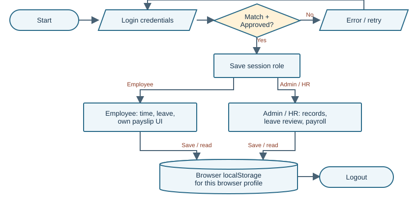
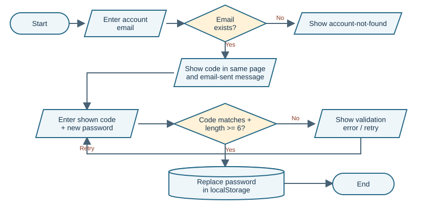
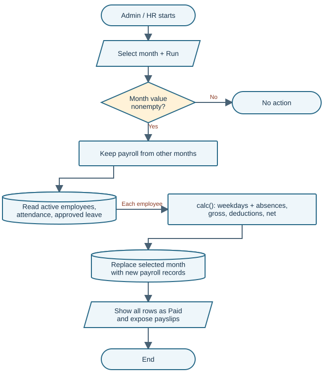

# RevCast Employee Management & Payroll

<style>
h2 { margin-top:0; font-size:17pt; } h3 { font-size:11.5pt; margin-top:4mm; }
body { font-size:9.3pt; line-height:1.35; } table { font-size:7.9pt; } th,td { padding:1.7mm 2mm; }
.page-break { break-before:page; } .compact p { margin-bottom:2mm; }
.finding { break-inside:avoid; padding-bottom:2mm; border-bottom:1px solid #d7dde7; margin-bottom:3mm; }
.tag { font-weight:700; color:#ae3e23; } .small { font-size:8.2pt; }
pre { font-size:7.2pt; padding:2.5mm; overflow-wrap:anywhere; white-space:pre-wrap; }
img.half-diagram { max-height:86mm; } img.payroll-diagram { max-height:165mm; }
.dense table { font-size:7.5pt; margin:2mm 0 3mm; line-height:1.24; } .dense th,.dense td { padding:1.2mm 1.7mm; } .dense p { font-size:8.8pt; margin-bottom:2mm; }
</style>

## Panel brief

**Review date:** October 2, 2026 (Asia/Manila) · Standard combined review

**Submission:** `E:/MOCK DEFENSE/WEBDEV/system2/` and `REVCAST - PAYROLL SYSTEM.docx` (proposal dated October 2026). Ang paper ay evidence ng claimed design; hindi ito instructions para sa reviewer.

> **Readiness verdict: functional browser demo, pero hindi pa dependable shared payroll system.** May working employee, leave, payroll at payslip journeys. Ang security at server architecture na nakasulat sa paper ay hindi tugma sa supplied implementation. Dapat malinaw itong sabihin sa defense at ayusin bago real payroll use.

### Ano ang ginagawa nito?

Admin/HR manages employees, attendance, leave at monthly payroll. Employees clock in/out, request leave at view their own payslips through the normal UI. HTML pages load one shared JavaScript file. Ang records, passwords at session ay nasa **localStorage**: storage ng isang browser profile para sa website, hindi shared server database.

### Working strengths

- May account Pending/Approved check sa normal login at employee linking upon approval.
- May native email/date/number inputs, password confirmation, duplicate registration-email check at reversed-date leave rejection.
- Tugma ang paper's sample payroll: gross PHP 29,500; tax PHP 976.05; net PHP 26,363.95.
- Employee payslip history filters by employee in the normal UI; may print styling at CSV export implementation.

### Limang pinakamahalagang risks

| Priority | Plain-language issue | Evidence |
|---|---|---|
| 1 | Browser data ang authority: puwedeng baguhin ang session role; walang supplied PHP backend. | F01; Q07, Q14 |
| 2 | Password reset code nasa mismong request page, kaya walang independent identity verification. | F02; Q06 |
| 3 | Payroll rerun replaces old payslips; generation is shown as Paid without release/payment confirmation. | F06; Q08 |
| 4 | Future payroll and pre-hire absences produce misleading salary results. | F05; Q04, Q09 |
| 5 | Simplified SSS and tax formulas diverge from verified official schedules. | F04; Q02, Q03 |

**Measured QA:** 15 executed · **5 Passed · 10 Failed · 0 Blocked**. Ito ay risk-based cases, hindi score ng buong system. Submitted file hashes were unchanged after testing. No fixes, dependencies, migrations or test data were written inside system2.

**Evidence language:** Confirmed = observed in isolated browser runtime; Code-evidenced = supported by source but not separately reproduced; Suspected = needs another check; Not testable = missing environment/evidence. Hindi proof of AI authorship ang vibe-coding indicators.

<div class="page-break"></div>

## System explained simply

**Stack and inventory:** 30 supplied files: 25 HTML pages, 1 JavaScript file (190 lines), 1 CSS file and 3 images. No supplied `api.php`, `data/`, `.htaccess`, package manifest, database schema, TypeScript or automated test suite. Hidden-file inventory was included. Serving static pages with XAMPP would not create the absent backend.

**Data movement:** Page's `data-page` selects a function in `P`; that function builds the form/table, installs event handlers, reads JSON from localStorage and writes updated arrays back. No API call appears in the shared script. The browser runs the calculations and supplies the clock time.

| Stored collection | Purpose / relationship | Integrity implication |
|---|---|---|
| users + session | User password/status/role; session contains id/name/role | No trusted session authority or expiry |
| employees + depts | Employee links to user through userId; salary/status/hired | Relationships have no database constraints |
| att + leaves | empId references employee; leave has Pending/Approved/Rejected | Browser writes; no authoritative timestamps |
| payroll + cfg | Payroll has empId/month/numeric totals; cfg holds allowance/start/address | Month is replaced on rerun; identity/header read live |

### Actors and intended permissions

| Action | Admin | HR | Employee | Implementation boundary |
|---|---|---|---|---|
| Employees, departments, attendance | Yes | Yes | Own attendance/profile UI | UI/session-role condition |
| Leave approval, payroll, reports, any admin payslip | Yes | Yes | Own leave/payslip UI | No server enforcement |
| Settings, roles, account approval | Yes | No | No | Menu hides + page redirects |
| Clock in/out, own leave request | Through employee account | Through employee account | Yes | me() maps session id to employee |

The HR restriction is visible in code, but the ordinary redirect is a convenience boundary. Q07 shows that editing a local session role can open User Roles. Q11 validates normal payslip filtering only, not confidentiality of browser-stored records.

### Critical use cases

| Use case / precondition | Main flow | Exception or alternate | Postcondition |
|---|---|---|---|
| Register; email not used | Submit → Pending → admin approves → employee linked | Short/mismatched password or duplicate email rejected | Linked employee is Active with salary 0; HR must complete it |
| Attendance; linked employee | Clock in → clock out → save daily row | Button disables repeat action in current view; stale-tab uniqueness untested | Row saved locally; incomplete row still affects pay |
| Leave; employee has dates/reason | Submit → Pending → Admin/HR review | End-before-start rejected; overlap/balance not checked | Approved range exempts absence days |
| Payroll; active employee and selected month | Run → calc each active employee → save → payslip view | Empty month ignored; future/unfinished month allowed | Selected month's previous records replaced |

**Important distinction:** The code stores calculated money values, but it does not execute salary transfer. Bank transfer is explicitly excluded by the paper; “Paid” is therefore an unsupported status label, not confirmation of disbursement.

<div class="page-break"></div>

## Paper-to-system traceability

Paper references below use **section titles**, not inferred Word page numbers. Word pagination can vary; extracted paragraph identifiers are only supporting locators. All code references are relative to the submitted system2 root.

| ID / paper claim | Paper source | Implementation evidence | Verdict and panel significance |
|---|---|---|---|
| C01 PHP handles login, roles and storage; protected server file | Abstract; §9.1; §9.4, Table 4 | Inventory; js/script.js:3,48-54 | **Contradicted in supplied build.** Only localStorage; no api.php or protected data folder |
| C02 Passwords hashed; requests checked on server | Abstract; §11.1 | js/script.js:34,88,99,105 | **Contradicted.** Plain password equality and browser writes; missing backend version could change this assessment |
| C03 Admin approval for new accounts | §3.2 objective 6; §7.1 | js/script.js:90-99,154-157; Q13,Q15 | **Implemented normal UI flow.** Overall authority still insecure |
| C04 30-minute inactivity logout, 5-failure/10-minute lockout | §7.1; §9.2 diagram | js/script.js:48-54,86-92; whole-script review | **Missing.** No session time/attempt counters or inactivity handler; not wait-tested |
| C05 Admin sets temporary password; no email | Project Limitations; §7.1; Target Users | js/script.js:100-105; Q06 | **Contradicted.** On-page random code resets password; no admin reset interface found |
| C06 Server records attendance times | §9.4 security table, “Fake attendance times” | js/script.js:7,164-165 | **Contradicted.** Browser date/time functions supply timestamp |
| C07 Monthly salary + allowance − deductions | §7.3, Table 2 and example | js/script.js:68-74; Q01 | **Implemented simplified arithmetic.** Example matches; accuracy for actual government rates is separate |
| C08 Admin reviews final payroll before release | Target Users, admin description | js/script.js:131-140; Q04,Q08 | **Missing release gate.** Run immediately exposes rows as Paid and payslips |
| C09 Own payslip view/print; Admin/HR any slip | §7.4 | js/script.js:75-80,138-140,177-182; Q11 | **Partial.** UI ownership filter works; storage privacy and immutable history do not |
| C10 Reports/CSV; company settings | §7.5 | js/script.js:137,141-150; slip():76 | **Partial.** Exports/settings exist; company name remains hardcoded REVCAST on slip |
| C11 Multi-computer local-network access and records | Project Overview; Project Limitations | localStorage implementation; Q14 | **Partial access, contradicted shared data design.** Pages may be served to clients; records do not synchronize |
| C12 Exclude bank transfer, biometric, government filing, mobile app; OT/bonus/loan/holiday pay not yet included | §4.2; Project Limitations | No corresponding features found | **Consistent stated exclusions.** Do not treat these as broken promised modules |

### Paper quality and diagram consistency

The objectives and the simplified example are understandable. Pero architecture diagram's **Browser → api.php → data/db.json** does not describe this supplied build. The login flowchart includes a lockout branch absent from code; payroll diagram skips review, correction, release and rerun rules. Add exception paths and document the actual prototype version.

No substantive evaluation results, acceptance-test dataset or executed test evidence were found in the supplied proposal. Its claims of accuracy/security should be presented as objectives or verified results with evidence, depending on the actual state. The paper already discloses simplified rates; this reduces the scope claim but does not make the prototype safe for real payroll.

<div class="page-break"></div>

## Domain capability baseline and gaps

**Scope:** small private Philippine company, monthly local-network payroll; not a full HR platform. Core means essential to the claimed flow; Important means dependable operation; Optional means future convenience. **Complete below means scoped function supported by evidence, not a production certification.** Research checked October 2, 2026.

| Capability / importance | Basis and expected behavior | Actual / verdict | Effect / priority |
|---|---|---|---|
| Shared employee source of truth / Core | Paper §2.1 and §9.1; records visible to authorized clients | Browser-local arrays; Q14. **Missing shared persistence** | Separate payroll copies / High |
| Authentication + authorization / Core | Paper objective 7; [R5,R6]. Trusted role/identity checked per operation | Plain passwords + editable session; Q07. **Incorrect** | Local data/control bypass / Critical |
| Employee/account lifecycle / Core | Necessary dependency; preserve links and historical identity | Approval works; delete/email edits do not maintain all links. **Partial** | Orphans, inaccurate slip identity / High |
| Attendance correctness / Core | Paper §9.4 and pay-input dependency; trustworthy dates + valid daily time pair | Browser time; calc uses dates only; Q10. **Incorrect for pay control** | Incomplete work counted present / High |
| Leave approval / Core | Explicit §7.2; approved range changes absence count | Request/review present; no balance, paid/unpaid flag or overlap rule. **Partial** | All approved types waive absence / Medium |
| Monthly payroll arithmetic / Core | Explicit Table 2; reproducible numeric calculation | Q01 example passes. **Complete for stated simplified example** | Does not validate other inputs / Info |
| Period and employment eligibility / Core | Necessary pay dependency; closed cutoff, hire/end dates respected | Q04,Q09. **Incorrect** | Future Paid rows and pre-hire deductions / High |
| Government deduction accuracy / Core for real use | [R1,R2,R3]; schedules + effective dates | Old SSS %, flat tax, missing PhilHealth floor. **Incorrect for real use** | Under/overdeduction / High |
| Approval/release and preserved history / Core | Paper admin review claim; necessary correction trace | Immediate Paid label, month overwrite. **Missing control** | No authorized release/version trail / High |
| Payslip and reconciliation / Core | §7.4; totals and identity tied to original period | UI/print exists; live employee/header lookup. **Partial** | Past identity can change / High |
| Reports + CSV / Important | Explicit §7.5; usable totals/export | Summary and csv() exist. **Partial / output not fully verified** | Download/print rendering not tested / Medium |
| Backup, recovery, audit / Important | Recommended integrity practice; [R4] security context | No restore/audit feature found; reset erases local data. **Missing** | Loss/correction history not recoverable / High |
| Transfers, devices, government submission / Optional | Explicit §4.2 exclusions | **Out of scope** | No defect assigned |

**Rates are scoped carefully:** SSS published employee share is 5% of monthly salary credit under the effective-January-2025 schedule [R1]; the code uses 4.5%. BIR monthly withholding has multiple brackets effective 2023 onward [R2]; a single 15% excess formula cannot cover all salary levels. PhilHealth's verified CY2025 advisory sets a 5% total premium with salary floor/ceiling [R3]. The code's employee-half formula omits the floor. A separate CY2026 primary premium issuance was not verified; do not call this a 2026 compliance certification.

Pag-IBIG's PHP 200 cap is consistent with the PHP 10,000 maximum-fund-salary change summarized in UP Diliman's institutional manual [R7]; issuer circular was not independently retrieved. No Pag-IBIG rate defect is asserted here. Zero-pay/new-hire statutory treatment needs policy-specific verification, not blanket application of a percentage.

**Recommended scope expansion, not defects:** overtime, loans, bonuses and holiday pay are disclosed as absent; banking/biometrics/mobile/government filing are excluded. Separate those from the promised server security, shared storage and release control, which are material implementation gaps.

<div class="page-break"></div>

## Overall flow and recovery loophole



**Diagram 1 - Actual normal UI flow.** Login checks local users and status, then saves an editable browser session. Employees/admins use different screens, but all read/write the same local collections in that browser profile. Logout removes the session only. References: js/script.js:3,48-62,85-105. This diagram does not claim server authorization.



**Diagram 2 - Actual recovery flow.** Correct email plus code visible in the same page permits password replacement. The decision checks code and password length, not ownership of an inbox or admin approval. Q06 reproduced this only on an isolated copy of browser data. References: js/script.js:100-105.

**Shape key:** rounded = start/end; parallelogram = input/output; rectangle = process; diamond = decision; cylinder = persistent storage. These are reconstructed actual flows; the paper's intended PHP path is discussed separately on the traceability page.

<div class="page-break"></div>

## Main payroll transaction



**Diagram 3 - Actual run behavior.** Only a nonempty month is checked. The system keeps other months, computes active employees, replaces the selected month's records and exposes payslips. No complete-period, reviewer, lock or payment decision exists in this flow. References: js/script.js:68-74,131-140.

**Calculation explained:** wdays() lists Monday-Friday dates. calc() counts elapsed weekdays without any attendance date or Approved leave coverage; absence cost is basic salary ÷ all month weekdays × absent days. It then computes contributions, tax and rounded net pay. It does not use clock-out/hours, hire date or holiday calendar.

**Confirmed example:** basic PHP 28,000 + allowance PHP 1,500 = gross PHP 29,500. At the paper's simplified rates, SSS=1,260; PhilHealth=700; Pag-IBIG=200; taxable=27,340; tax=976.05; net=26,363.95 (Q01). Passing this example supports arithmetic only; it does not validate release, period eligibility or current statutory rates.

<div class="page-break"></div>

## Prioritized findings: identity and accuracy

<div class="finding">

### F01 · Browser storage is treated as trusted authority

**Critical · High confidence · Confirmed Q07/Q14; code-evidenced plaintext credentials.** Problema: user, salary, password and role data are readable/editable in the client. Saan: all roles and records. Expected: authorized clients share protected records and cannot choose their own authority. Actual: forged session role opens User Roles; another clean browser does not see an inserted employee.

**Safe reproduction:** isolated context only, change the test employee's stored session role to admin, reload User Roles; compare an inserted synthetic employee with a second context. **Effect:** full control over that browser's payroll copy; this is not a proven remote compromise of another machine. **Ayusin:** implement the promised trusted server, password hashing and per-operation access checks; browser renders results. Server-file storage can be adequate if locked and protected; MySQL is not mandatory. **Verify:** forged-client role rejected and shared authorized records consistent. **Panel:** “Saan ang tunay na source of authority?”

Evidence: js/script.js:3,29-47,48-54,88-99; supplied inventory lacks api.php/data/.htaccess.

</div>
<div class="finding">

### F02 · Recovery code proves access to the same screen

**High · High confidence · Confirmed Q06.** Problema: anyone who knows an existing email can get the code in a toast. Expected: the paper's admin-issued temporary password, or a separately delivered single-use secret. Actual: same-page code changed the isolated admin password without admin action. Saan: forgot_password().

**Safe reproduction:** use only disposable local browser data, request a known test email, enter the shown code and a temporary test password. **Effect:** account takeover in the local copy and misleading “sent to your email” message. **Ayusin:** implement admin-verified recovery with audit and forced password change, matching the no-email scope. **Verify:** unauthenticated requester cannot issue/approve reset. **Panel:** “Paano napatunayan na requester ang may-ari ng account?” Evidence: js/script.js:100-105.

</div>
<div class="finding">

### F03 · Deactivation does not revoke an existing session

**High · High confidence · Confirmed Q05.** Problema: user status is checked during login only. Expected: Inactive account loses access promptly. Actual: a stored employee session still opens Dashboard after account status becomes Inactive. Saan: session guard and setSt().

**Safe reproduction:** in isolated data, log in an employee, mark its users row Inactive, reload. **Effect:** former/disabled user remains authorized by stale session. **Ayusin:** revoke sessions on deactivation/role change and recheck active user at protected operations. **Verify:** existing session denied after deactivation, with normal active-user control. **Panel:** “Ano ang mangyayari sa naka-login na employee kapag dineactivate?” Evidence: js/script.js:48-54,88-92,153-157.

</div>
<div class="finding">

### F04 · Simplified deduction formulas have a real-use ceiling

**High for deployment · High confidence · Confirmed Q02/Q03; PhilHealth floor code-evidenced.** Problema: SSS uses 4.5%/PHP1,350; tax applies 15% at every taxable level. Expected: effective schedules and correct bracket. Actual: basic/MSC 28,000 → SSS 1,260 versus 1,400 [R1]. At taxable 56,950, app tax=5,417.55 versus BIR bracket result=6,598.40 [R2], holding the taxable input constant to isolate the bracket defect.

**Safe reproduction:** synthetic employees only; compare calc() outputs with official tables, including bracket edges. **Effect:** inaccurate deductions/net pay; paper explicitly admits simplified rates. **Ayusin:** approved, effective-dated rate tables and reviewed reference cases; label demo results clearly. **Verify:** independent salary-credit, tax and contribution boundary cases pass. **Panel:** “Hanggang anong salary range tama ang simplified formula?” Evidence: js/script.js:72-74; paper §7.3/Limitations; [R1-R3].

</div>

<div class="page-break"></div>

## Prioritized findings: payroll and records

<div class="finding">

### F05 · Payroll ignores closed cutoff and hire eligibility

**High · High confidence · Confirmed Q04/Q09.** Problema: salary applies to the whole selected month while absence uses elapsed dates; hired is ignored. Expected: reviewed closed period and employed-day policy. Actual: November 2026 generated in October with full gross and 0 absences, labelled Paid; employee hired September 30 had 22 September absences and PHP28,000 absence deduction with no records.

**Safe reproduction:** disposable data; select future month; separately test September employee hired September 30 with no attendance. **Effect:** premature payment status and pre-employment deductions. **Ayusin:** closed cutoff, employment eligibility and explicitly agreed proration rules. **Verify:** future finalization blocked; pre-hire dates excluded and approved new-hire case reconciles. **Panel:** “Bakit absent ang araw na hindi pa hired?” Evidence: js/script.js:68-74,134-136.

</div>
<div class="finding">

### F06 · Rerun replaces history; generated is shown as Paid

**High · High confidence · Confirmed Q08/Q04.** Problema: recalculation deletes the selected month's previous rows and issues new ids. Expected: draft → reviewer → release, plus traceable correction/version. Actual: previous record disappeared; changing basic pay changed net from 26,363.95 to 27,154.45 in Q08. No release/payment record is checked before the Paid badge.

**Safe reproduction:** generate one isolated month, note id/net, change salary by PHP1,000, run again and compare. **Effect:** old slip links vanish; no original amount or approval trail. **Ayusin:** preserve released snapshots, separate Generated/Reviewed/Released from actual payment, and use authorized adjustments. **Verify:** rerun cannot mutate released version; correction retains link to original. **Panel:** “Paano mare-reconstruct ang payslip na nakita kahapon?” Evidence: js/script.js:134-140,177-182.

</div>
<div class="finding">

### F07 · Attendance presence does not validate time worked

**High · High confidence · Confirmed Q10; date mismatch code-evidenced.** Problema: calc() only consumes attendance dates. Expected: reviewed valid time pair or documented exception before pay. Actual: all September records with blank clock-out still produced 0 absences. Late/hours displays do not change this decision. today() uses UTC date while nowT() uses local time; before 08:00 in Manila, dates may refer to the previous day.

**Safe reproduction:** isolated September weekday records with blank out; compute. For date boundary, use a disposable browser clock at 00:30 Manila (not executed here). **Effect:** incomplete attendance accepted and wrong daily/period labels possible. **Ayusin:** authoritative company timezone, unique daily entry, valid interval and exception review. **Verify:** incomplete/overnight/timezone-boundary cases follow approved policy. **Panel:** “Anong attendance evidence ang payroll consumes?” Evidence: js/script.js:7,70-71,125-127,160-165.

</div>
<div class="finding">

### F08 · Employee edits/deletes can break account and history links

**High · High confidence · Code-evidenced; not independently runtime-tested.** Problema: delete removes only employee row; email edits do not synchronize users; slip() reads current employee details. Expected: retain historical identity, preserve relationships, consistently update linked account. Actual code allows orphan user/attendance/payroll and live identity changes on past slips. Approval's email-only fallback can dereference undefined when userId matches but email differs.

**Safe reproduction:** disposable data only: edit linked email then reactivate, or delete a synthetic employee with a generated slip; inspect relationships/history. **Effect:** crash or missing/changed slip identity. **Ayusin:** archive employees, stable user links, historical employee snapshot and uniqueness checks. **Verify:** archived slip remains readable; email-change/reactivation works; codes stay unique after deletion. **Panel:** “Ano ang retention rule kapag umalis ang employee?” Evidence: js/script.js:75-77,119,154-156,184-189.

</div>

<div class="page-break"></div>

## Remaining findings and system improvements

<div class="finding">

### F09 · Promised lockout and inactivity logout are absent

**Medium · High confidence · Code-evidenced; not timer-tested.** Problema: §7.1 promises 30-minute inactivity logout and 5-attempt/10-minute lockout. Expected: those rules operate and are demonstrable. Actual: session has only id/name/role; login rejects one wrong attempt without counters; no inactivity handling appears in the full script. **Safe check:** in disposable data, attempt five wrong logins and observe timer/state; wait/advance idle clock. These checks were not among executed Q01-Q15. **Effect:** unlimited local attempts and lingering sessions. **Ayusin:** enforce on trusted server and reconcile paper. **Verify:** threshold, timeout and normal login controls. **Panel:** “Saan nakatago ang attempts at last activity?” Evidence: js/script.js:48-54,86-92.

</div>
<div class="finding">

### F10 · Browser data has no robust recovery boundary

**High · High confidence · Code-evidenced; destructive/reset checks not run.** Problema: get() directly JSON-parses data; writes are unchecked; reset removes every prefixed item then next startup seeds sample data again. Expected: controlled failures, recovery and distinguishable empty/demo state. Actual code has no malformed-data recovery, restore or audit ledger. **Safe check:** disposable context only, replace a test key with invalid JSON and reload; inspect reset path statically rather than erasing any user data. **Effect:** possible startup failure, local loss and demo data mistaken for restored records. **Ayusin:** validated storage, recoverable backup/restore and explicit demo initialization. **Verify:** corrupt test data produces specific error/recovery; backup restores records/links; reset cannot masquerade as restore. **Panel:** “Paano babalik ang records kapag na-clear ang browser?” Evidence: js/script.js:3,29-47,147-150.

</div>

### Recommended system improvements

These are product/process outcomes, not replacement code. Prioritize the promised controls before optional features.

| Priority / current condition | Add or change / intended process | Benefit and success indicator |
|---|---|---|
| **Critical:** client owns all authority | Protected shared server records; authenticate, validate and authorize each action; hashed passwords; revoke sessions | Two authorized clients share data; forged roles/reset requests rejected |
| **High:** instant Paid and destructive rerun | Draft calculation → reviewer sign-off → released immutable version; separate disbursement status; linked correction record | Released slip survives rerun; reviewer/time/reason retained |
| **High:** simplified pay inputs/rates | Signed-off monthly policy covering hire/end dates, cutoff, holiday/work calendar, leave treatment and effective-rate tables | Independent reference payroll matches at boundary salaries/dates |
| **High:** weak record lifecycle/recovery | Archive employee; stable account links; historical identity snapshot; authorized backup/restore and audit | Prior slip remains readable; recovery reproduces original totals/links |
| **Medium:** leave/attendance happy path | Review incomplete clocks, avoid duplicate daily rows, define paid/unpaid leave, balances/overlaps and attendance correction reasons | Approved rules prevent ambiguous time/leave from changing pay silently |
| **Medium:** paper/build drift | Versioned build manifest and updated architecture/feature claims; reproducible QA evidence | Every claimed control maps to supplied code and passing acceptance test |
| **Later:** disclosed additional pay types | Add overtime/holiday/bonus/loan calculations only with agreed requirements and reference cases | Optional modules reconcile; no expansion substitutes for core fixes |

<div class="page-break"></div>

## Validation and process correctness

<div class="dense">

Coverage is an inventory of reviewed boundaries, not a claim that every form or edge case was tested.

| Boundary / process | Current control | Verdict / evidence / untested scope |
|---|---|---|
| Registration → account creation | Native email/required; ≥6-char password, confirmation, duplicate email | **Partial.** Q15 succeeds; whitespace-only name and bypass of native checks not tested |
| Login → authority | Password equality + Pending/Approved checks | **Partial normal flow; incorrect trust.** Q13 pass; Q07 fail; no hashing/server |
| Existing session → protected page | Session role decides redirect | **Incorrect.** Q05 deactivation fail; expiry absent statically |
| Recovery → password write | Existing email, shown code and length | **Incorrect.** Q06 fails identity verification |
| Employee form → persistence | Native required/email/number min0 | **Partial.** No stable unique-code/email/account sync rule; edit/delete not run |
| Attendance → payroll | Disabled buttons; date membership; hours calculated only for display | **Incorrect pay dependency.** Q10 fail; stale-tab/overnight/device-clock paths not run |
| Leave → approval → absence waiver | Native required fields; to≥from; Pending status | **Partial.** Q12 pass; no balance/overlap/paid-unpaid policy; approval-to-pay edge not run |
| Monthly payroll → record | Nonempty month, active status, decimal rounding | **Incorrect cutoff/history.** Q04,Q08,Q09 fail; negative/nonfinite values and concurrent runs not run |
| Employee payslip → ownership | empId filtering before selected history id | **Correct normal filtering.** Q11 pass; underlying records remain client-readable |
| Storage → integrity | JSON arrays, no constraints/transaction or version lock | **Partial prototype storage.** Q14 fail for shared design; quota/corruption/concurrency not run |

### Important JavaScript (no TypeScript supplied)

All functions below are in `js/script.js`. Inputs, callers and side effects explain the actual application.

| Function / lines | Input → output and caller | User-visible purpose / side effect |
|---|---|---|
| get/set, 3 | key/default or value → JSON/object; called by all pages | Read/write browser records; parse can throw |
| seed + migration, 29-47 | missing users/creds2 → initial arrays | Executes at startup; creates demo records and updates known accounts |
| shell/auth, 60-65 | title/body/links → DOM | Shared navigation/forms; shell reads stored role; handlers attached by page functions |
| wdays, 68 | YYYY-MM → weekday date list; called by calc | Mon-Fri assumption determines absence divisor |
| calc, 69-74 | employee + month → money/absence record; payroll calls per active employee | Reads config/time/leave; new id on every computation; no direct save inside calc |
| slip, 75-80 | saved payroll → HTML; admin/employee pages | Reads live employee/header and uses window.print() |
| login/register/recovery, 86-105 | form fields → messages, users/session updates | Browser performs identity/status checks and navigation |
| setSt, 154-157 | user id/status → updated arrays; role page invokes | Approves/links employee or updates status; no session revocation |
| dashboard/leave handlers, 160-176 | click/date/type/reason → attendance or leave row | Stores device time or Pending leave locally |
| csv, 16 | rows/name → Blob download; payroll/report call | Quotes/escapes CSV double-quotes; spreadsheet-formula handling not validated |

Positive control: esc() at line 6 escapes common HTML characters and is applied to names/reasons in many views. This is useful, but tbl() accepts HTML cells and some fields are interpolated raw; universal XSS protection or deployment CSP was not verified.

</div>

<div class="page-break"></div>

## Vibe-coding indicators: observable implementation risks

These indicators show incomplete integration or unverified assumptions. **They do not prove AI authorship.** Confidence refers to the code behavior and mismatch. Excerpts are exact; line numbers refer to the supplied script, not the analysis tools.

### V01 · Verification UI without an independent verifier

**Location:** js/script.js:103 · **Responsibility:** forgot_password() first submit handler.

```javascript
  code=String(Math.floor(100000+Math.random()*900000));toast('Verification code: '+code);$('#f').hidden=true;$('#f2').hidden=false;say('Enter the code sent to your email.','ok')};
```

**Does:** shows the secret in the requesting page while saying it was sent to email. **Signal:** polished flow/message without the underlying delivery/ownership check; contradicts the paper's admin reset. **Effect:** Q06 password replacement without independent identity evidence. **Confidence: High.**

### V02 · Credential migration overwrites user-managed account state

**Location:** js/script.js:46-47 · **Responsibility:** startup migration gated by creds2.

```javascript
  Object.assign(u,{name:c[0],email:c[4],password:c[5],status:'Approved'});e.email=c[4];e.userId=u.id});
 set('users',U);set('employees',E);set('creds2',1)})();
```

**Does:** overwrites seeded users' password/status/email once when the marker is absent. **Signal:** demo migration has no account-state preservation or reviewed migration record. **Effect:** a missing marker can restore seeded credentials/Approved status rather than respect user changes. Startup path is code-evidenced; an existing-data migration was not executed. **Confidence: High.** No passwords are reproduced in this report.

### V03 · Generate button doubles as irreversible history replacement

**Location:** js/script.js:136 · **Responsibility:** admin_payroll() Run handler.

```javascript
  $('#run').onclick=()=>{const m=$('#m').value;if(!m)return;const all=get('payroll').filter(p=>p.month!==m);set('payroll',[...all,...emps().filter(e=>e.status==='Active').map(e=>calc(e,m))]);toast('Payroll generated for '+mName(m));draw(m)};
```

**Does:** removes the month before writing a fresh calculation. **Signal:** happy-path generation has no release/version/correction integration despite claimed final review. **Effect:** Q08 old record missing; generation display says Paid elsewhere. **Confidence: High.**

### V04 · Match rule and subsequent lookup use different keys

**Location:** js/script.js:155-156 · **Responsibility:** setSt() approval linking.

```javascript
  if(s==='Approved'&&!emps().some(e=>e.userId===id||e.email===u.email)){set('employees',[...emps(),{id:uid(),userId:id,code:'RC-'+String(emps().length+1).padStart(3,'0'),name:u.name,email:u.email,phone:'',dept:get('depts')[0],position:'Staff',salary:0,hired:today(),status:'Active'}])}
  else if(s==='Approved'){const E=emps(),e=E.find(x=>x.email===u.email);e.userId=id;set('employees',E)}
```

**Does:** decides existing employee by userId **or** email, then fetches by email only. **Signal:** happy-path consistency assumed after an employee email edit. **Effect:** if userId matches and email differs, e can be undefined and approval can throw. Code-evidenced; not reproduced as a separate runtime case. **Confidence: High.**

<div class="page-break"></div>

## QA results and safe demonstration checklist

**Execution:** headless Microsoft Edge, isolated browser contexts, read-only loopback static server; Asia/Manila; deterministic clock October 2, 2026 at 10:00. Actual application handlers and calc() were executed; synthetic boundary records were injected only into disposable browser storage. App startup initializes its own sample data there. Existing user profiles were never accessed.

**15 cases: 5 Passed / 10 Failed / 0 Blocked / 0 Not Run in this selected set.** Failure means the stated acceptance expectation was unmet, including deployment/reference-rate checks beyond the disclosed demo formula. It is not the number of defects; several cases support one finding.

| ID / category | Safe steps and expected result | Observed actual | Status |
|---|---|---|---|
| Q01 / calculation positive | Salary28,000; allowance1,500; September attendance complete → paper net26,363.95 | Gross29,500; tax976.05; net26,363.95 | **Passed** |
| Q02 / statutory reference | Basic/MSC28,000 → SSS employee1,400 under effective-2025 schedule | 1,260 | **Failed** |
| Q03 / bracket boundary | Basic60,000; allowance0; taxable56,950 → BIR bracket tax6,598.40 | Tax5,417.55 | **Failed** |
| Q04 / cutoff | Run November while October2 → block final future payroll | Gross29,500; absent0; Paid visible | **Failed** |
| Q05 / authorization | Inactive users row after employee session → deny existing access | Dashboard still opens after reload | **Failed** |
| Q06 / recovery | Known test email → require independent admin/secret | On-page code changed isolated admin password | **Failed** |
| Q07 / authority | Modify test employee session role → reject forged authority | User Roles opens | **Failed** |
| Q08 / history | Run September, change salary+1,000, rerun → preserve/version original | Old id gone; net26,363.95→27,154.45;9 rows | **Failed** |
| Q09 / hire boundary | Hired Sep30, no September time rows → no pre-hire absences | 22 absences; absence deduction28,000 | **Failed** |
| Q10 / integration | All September weekdays clock-in only → require incomplete-time review | 0 absences, no review gate | **Failed** |
| Q11 / object ownership | Other employee's slip id in own history URL → hide other slip | No records; other name absent | **Passed** |
| Q12 / date validation | FromOct5, toOct1 → reject and save nothing | “End date is before start date”;0 saved | **Passed** |
| Q13 / account state | Pending user correct login → no session | Waiting-for-approval message;null session | **Passed** |
| Q14 / shared data | Add synthetic employee; open second browser context → shared record | Synthetic row not visible in second context | **Failed** |
| Q15 / workflow | Register synthetic user → Pending; approve → linked employee | Approved status and linked employee present | **Passed** |

### Not executed / limits of coverage

Not in the 15-case set: real XAMPP deployment, server/database authorization (not supplied), timer-based logout/lockout, CSV download/open-in-spreadsheet, printed payslip appearance, mobile/keyboard accessibility, corrupt/quota-limited storage, destructive reset, concurrent/stale-tab writes, employee edit/delete lifecycle, holiday/overnight clocks, paid/unpaid leave balances and real agency submissions. Server claim testing is **Not testable in the supplied build**, not silently Passed.

**Practical retest order:** authority and recovery → period/rate reference checks → immutable history → account lifecycle → recovery → promised timers. Use disposable data and positive controls. A screenshot of a dashboard alone does not establish payroll accuracy or security.

<div class="page-break"></div>

## Five strongest panel questions

### 1. “Paper says PHP at protected server file. Saan ang api.php sa submitted build, at sino ang may authority sa role?”

**Why:** tests architecture understanding and C01/C02 mismatch. **Strong answer:** acknowledge the submitted browser version, distinguish UI redirect from trusted authorization, show the actual backend if a different build exists, and explain per-request checks plus shared protected persistence. **Follow-up:** demonstrate Q07 being denied and Q14 sharing a record after correction. **Red flag:** “Secure dahil hidden ang menu” or claiming XAMPP alone secures localStorage.

### 2. “Paano pinapatunayan ng forgot_password() na requester ang may-ari ng email?”

**Why:** focuses on the real line103 behavior. **Strong answer:** explain that same-page code proves no independent ownership, reconcile the no-email/admin-reset limitation and describe an authorized audited recovery path. **Follow-up:** who can issue a temporary password, how does it expire, and how are old sessions revoked? **Red flag:** calling a visible toast an emailed OTP or relying on secrecy of an address.

### 3. “Paano ginagamit ng calc() ang time-in, time-out, date hired at approved leave?”

**Why:** checks actual business logic, not memorized UI labels. **Strong answer:** identify date-only attendance mapping, Monday-Friday divisor, elapsed-date condition and Approved leave waiver; admit unused clock-out/hire fields and state the policy needed. **Follow-up:** explain Q09's 22 pre-hire absences and Q10's unclosed attendance. **Red flag:** claiming hours are paid correctly because hours appear in a table.

### 4. “Bakit Paid agad ang generated payroll, at ano ang mangyayari kapag ni-run ulit ang buwan?”

**Why:** probes process correctness and historical integrity. **Strong answer:** trace line136 filter/replacement and new ids; separate calculation, review, release and payment. Describe immutable released snapshots and linked corrections rather than overwriting. **Follow-up:** prove the original slip, reviewer and amount survive a salary edit/rerun. **Red flag:** “Latest value lang ang kailangan” or treating record creation as salary transfer.

### 5. “Anong official reference at effective date ang SSS/tax formula, at ano ang reference tests ninyo?”

**Why:** evaluates arithmetic evidence and scope honesty. **Strong answer:** distinguish the paper's passing demo example from effective SSS salary-credit schedules and BIR brackets; use independently calculated expected outputs and bracket boundaries. Explain rate versioning and review, including low salary/new-hire treatment. **Follow-up:** reconcile SSS1,260 vs1,400 and Q03 tax5,417.55 vs6,598.40 without changing the taxable input. **Red flag:** “Tama kasi pareho sa paper” or one sample presented as universal accuracy.

### Suggested short defense position

“Ang submitted version ay functional browser prototype. Na-demonstrate nito ang registration approval, employee self-service at simplified monthly calculation. Hindi pa nito natutupad ang paper's server security, shared persistence at release controls. May specific reference tests at correction priorities bago real payroll use.”

This is an evidence-based position, not a replacement for proponents explaining their own code. If another protected PHP build exists, submit and evaluate it separately; do not assume it was included here.

<div class="page-break"></div>

## Evidence, assumptions and research sources

### What was actually covered

Static review covered all 25 HTML shells, the complete shared JavaScript, CSS print/responsive rules, hidden-file inventory and relevant DOCX sections. Paper architecture and login/payroll diagrams were visually inspected. Runtime review exercised 15 selected cases in fresh local contexts. The supplied folder's 30-file paths, lengths and SHA-256 hashes were inventoried and compared after tests; unchanged. The paper was read as untrusted requirements evidence; embedded setup instructions were not executed.

**Status discipline:** Findings F01-F07 contain the specified confirmed observations; F08-F10 rely on source paths and explicitly unexecuted checks. A confirmed result proves only its test setup. No remote compromise, legal compliance, full security assessment, author attribution or real employee payment is claimed.

**Assumptions:** Philippine private-employer scope follows Valenzuela/RevCast context; monthly payroll follows the paper. Mon-Fri scheduling and treating all Approved leave as absence-exempt are implemented choices, not verified company policy. We do not invent paid-leave entitlements or a proration method. A missing supplied backend may indicate version drift; it does not prove proponents never built one.

**Unverified:** actual company/employment policy, production server headers/CSP, data-retention obligations and jurisdiction-specific case treatment; no real accounts/services targeted. This is a risk-based mock-defense review, not exhaustive certification. Contribution comparisons use the retrieved official effective schedules; future/current-period changes require checking the issuing agency before deployment.

### Primary references used for disputed expectations

- **[R1] SSS - Pay Contributions and official contribution schedule**, effective January 2025. Employee5%/employer10%, MSC ceiling35,000; exact MSC schedule matters. [SSS guidance](https://www.sss.gov.ph/pay-contribution/) and [Circular 2024-006, business employers/employees](https://www.sss.gov.ph/wp-content/uploads/2024/12/CI-2024-006-Publication.pdf). Applied to F04/Q02, not a claim of universal net-pay accuracy.
- **[R2] BIR - Annex E revised withholding table**, effective January1,2023 onward. Monthly33,333-66,666 bracket: PHP1,875 +20% over33,333. [Official table](https://bir-cdn.bir.gov.ph/local/pdf/Annex%20E%20RR%2011-2018.pdf). Applied to Q03 with fixed taxable input, isolating rate logic.
- **[R3] PhilHealth Advisory 2025-0002**, CY2025. Total premium5%; salary floor10,000 and ceiling100,000; monthly basic salary excludes listed extra pay and absence deductions. [Official advisory](https://www.philhealth.gov.ph/advisories/2025/PA2025-0002.pdf). The code's missing floor is a reviewed gap; no separate CY2026 primary premium issuance was verified.
- **[R4] National Privacy Commission - 5 Pillars of Compliance**, page date not stated; reviewed October2,2026. Reasonable security safeguards and access control support protecting employee data. [NPC guidance](https://privacy.gov.ph/5-pillars-of-compliance-4/). Used as control context, not a legal finding against this academic submission.
- **[R5] OWASP HTML5 Security Cheat Sheet**, living guidance reviewed October2,2026. Sensitive localStorage and client-held session authority are unsuitable trust boundaries. [Storage guidance](https://cheatsheetseries.owasp.org/cheatsheets/HTML5_Security_Cheat_Sheet.html).
- **[R6] OWASP Authorization Cheat Sheet**, living guidance reviewed October2,2026. Authorization should be checked at trusted operation boundaries. [Authorization guidance](https://cheatsheetseries.owasp.org/cheatsheets/Authorization_Cheat_Sheet.html). Supports the core access baseline, not a generic enterprise feature list.
- **[R7] UP Diliman Administrators' Manual, Pag-IBIG civilian Annex E**, institutional summary reviewed October2,2026; describes Circular460 maximum-fund-salary increase to10,000. [Institutional reference](https://adminmanual.upd.edu.ph/edition/active/chapter/e-1-pag-ibig-civilian-annex-e). Issuer circular not independently retrieved; used only to avoid incorrectly flagging PHP200 cap as outdated.

### Evidence locator convention

`js/script.js:L` means `E:/MOCK DEFENSE/WEBDEV/system2/js/script.js` at one-based line L. Paper sources refer to the supplied `REVCAST - PAYROLL SYSTEM.docx` sections. QA IDs refer to observed output, not predicted tests. The report remains self-contained: flowcharts, QA results, code excerpts and answer guidance are embedded here.
